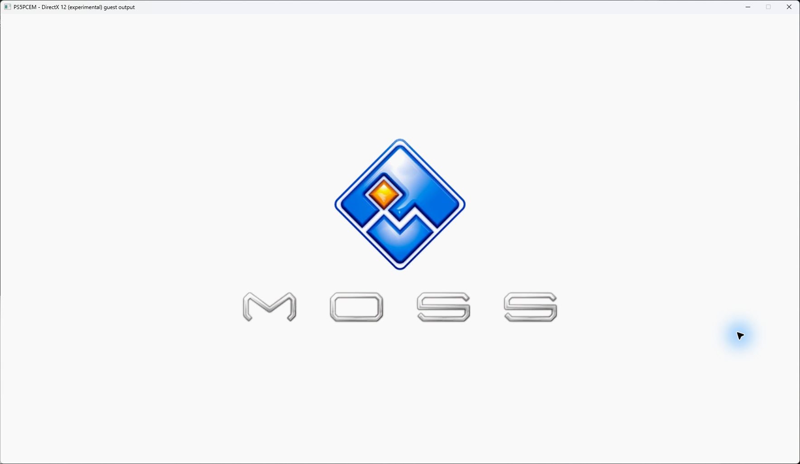
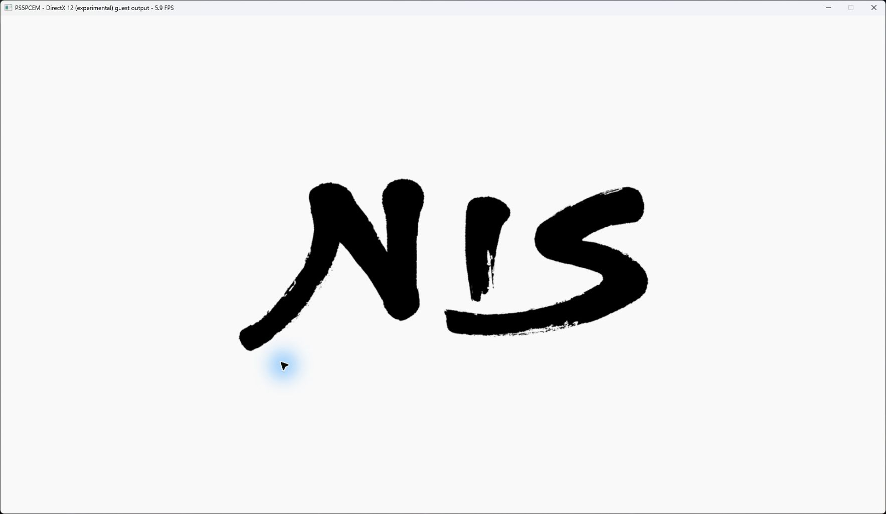
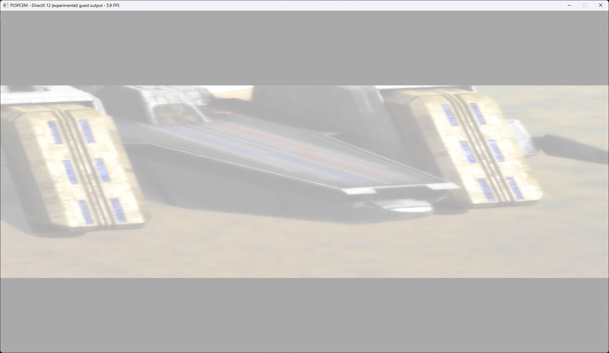
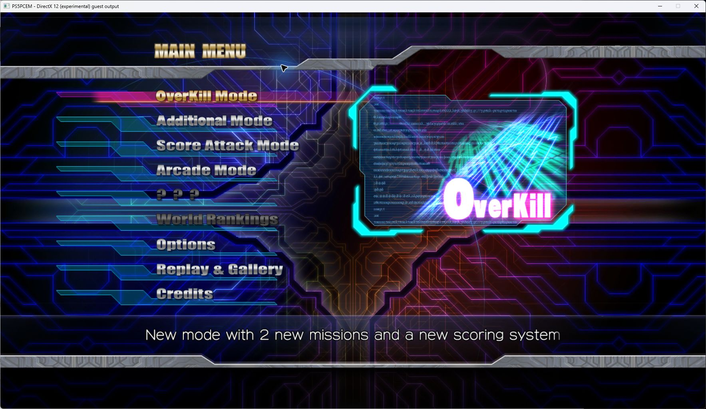
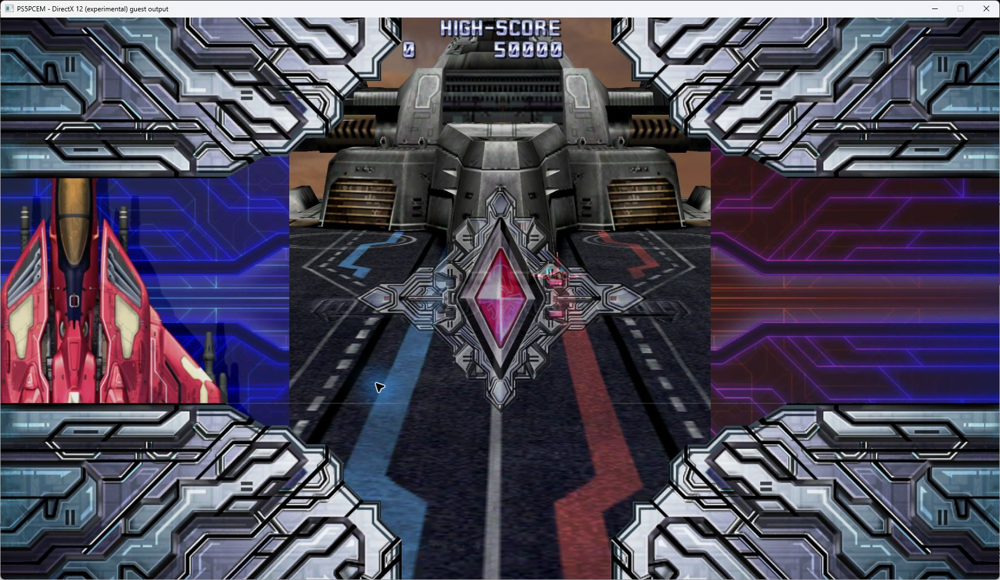
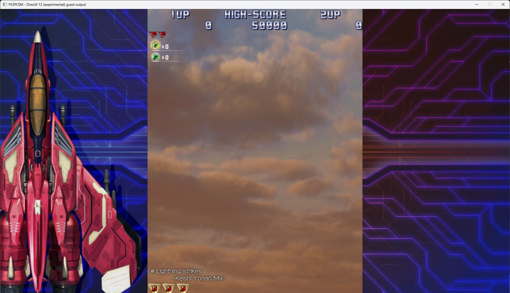
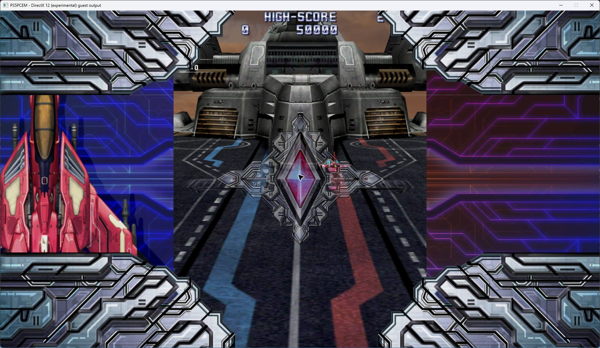

# Native Direct3D 12 backend

[Documentation index](../README.md) · [Vulkan backend](vulkan.md)

This is an **experimental development implementation**, added after v0.3.5.
It provides a native Windows D3D12 device, shader execution and presentation,
plus a deliberately limited PM4 backend. It does not yet run normal games
through their full graphics workload. No D3D12 gameplay or performance
compatibility is claimed by the Vulkan screenshots in this repository.

## Selection

The Windows library and Settings share a selector that saves `graphics_api=vulkan` or
`graphics_api=d3d12` in the portable INI and passes `PS5_GRAPHICS_API` to
`game-run`. Vulkan is the default; the setting applies on the next launch.
The launcher labels D3D12 experimental in all supported languages. The Linux
library shows Vulkan selected and DirectX 12 disabled with a Windows label;
the Linux runner rejects D3D12 explicitly.

```powershell
$env:PS5_GRAPHICS_API = 'd3d12'
.\zig-out\bin\game-run.exe 'D:\Game\eboot.bin'

# Restore normal gameplay rendering.
$env:PS5_GRAPHICS_API = 'vulkan'
```

The runner does not silently substitute Vulkan if D3D12 initialization or
execution fails. Unsupported GPU work prints its reason and terminates the
experimental run instead of publishing successful completion labels for it.
Headless game execution is not available in this backend.

## Implemented path

- Hardware adapter selection, device, direct queue, command allocator/list,
  barriers, fences and resource lifetime management behind a small C COM ABI.
- Upload/default/readback buffers, raw UAV descriptor arrays and GPU copies.
- Shared RDNA2 decoder/IR/SPIR-V generation and SPIRV-Cross HLSL generation.
  Ordinary shaders use Windows D3DCompiler Shader Model 5.1; shaders declaring
  subgroup capabilities use DXC Shader Model 6.0 and validated DXIL after
  checking device Shader Model/WaveOps support. SPIR-V is an intermediate
  representation here; execution and presentation use D3D12 and DXGI directly.
  DXC is loaded lazily from the executable directory with its matching validator,
  never from the working directory or a locally installed Vulkan SDK. Both DLLs
  and their upstream notices are included by the Windows build and packaging
  scripts. Missing runtime files fail explicitly at the first SM6 shader;
  validation is never disabled. The shader/PSO caches also retain DXIL results.
  D3D12 requests an exact integer lowering of `BallotFindLSB`: scan all four
  32-bit ballot words and select the lowest nonzero word/bit. The real subgroup
  ballot and EXEC predicate remain intact; empty masks retain the caller's
  guarded zero/election behavior. Vulkan keeps its native ballot instruction.
- PM4 `DISPATCH_DIRECT` with bounded, statically resolved MUBUF/MTBUF storage
  descriptors, USER_DATA specialization and exact guest-memory writeback.
- Graphics USER_DATA and the merged ES wave seed use a per-draw read-only
  scalar buffer (SPIR-V binding 10, native `t0, space1`). VS and PS have
  independent value ranges. The shared translator emits runtime loads so
  changing values do not create shader/PSO variants; descriptor shapes still
  participate in translation. A native root SRV avoids consuming a slot in
  the guest buffer/texture tables. Its upload follows the existing fence-based
  lifetime rules. Compute specialization is unchanged.
- Restricted `DRAW_INDEX_AUTO`, `DRAW_INDEX_2` and `DRAW_INDEX_OFFSET_2` paths:
  VS/PS execution, triangle lists, strips or
  expanded fans, one RGBA8 UNORM target, viewport, scissor, culling, channel
  masks, instancing and preservation of existing target bytes.
  Guest primitive enums are translated explicitly: triangle list `4` maps to
  D3D list `4`, and triangle strip `6` maps to D3D strip `5`. Guest fan `5`
  expands into a bounded 32-bit triangle-list index buffer. Auto-index and
  indexed fans preserve vertex IDs, base/first vertex, winding and instance
  counts. Fixed or custom restart markers split independent fans before
  base-vertex arithmetic; incomplete segments produce no triangles. Cyclic
  index rotation puts the selected FIRST/LAST provoking vertex first in the
  native triangle. Flat/custom interpolation remains separately unsupported.
  The ordering follows the [fan primitive definition](https://docs.vulkan.org/spec/latest/chapters/drawing.html#drawing-triangle-fans)
  and the native [leading-vertex convention](https://learn.microsoft.com/en-us/windows/win32/direct3d11/d3d10-graphics-programming-guide-primitive-topologies#winding-direction-and-leading-vertex-positions).
- Native output-merger blending for the supported RGBA8 target: source and
  destination color/alpha factors, saturated source alpha, constant factors,
  ADD/SUBTRACT/REVERSE_SUBTRACT/MIN/MAX and independent alpha equations.
  `CB_BLEND_RED/GREEN/BLUE/ALPHA` supply the dynamic constants. Alpha-only
  constants are replicated into RGB on older runtimes; simultaneous RGB and
  alpha constants require `OPTIONS13.AlphaBlendFactorSupported` and fail
  explicitly when unavailable. Disabled blending and MIN/MAX ignore dormant
  factors; dual-source factors remain unsupported.
- Guest D16 UNORM and D32 float depth attachments alongside one RGBA8 target:
  all eight comparisons, depth write masks and guest read-only views. Native
  DSVs use the matching format, comparison and write mode in the PSO cache key.
  Linear and depth-64 KiB layouts use shared guest address equations. Complete
  native uploads/readbacks use aligned row footprints; writes preserve guest
  row/tile padding, and the next draw reads the committed depth values. A
  read-only draw leaves the guest depth allocation unchanged. This initial path
  requires matching color/depth extents, a single mip/layer/sample, no HTILE,
  and identical depth read/write addresses when writes are enabled.
- Unrestricted viewport Z scale/offset with an **explicit guest 0..1 pixel
  depth clamp**: apply the transform in the VS, export the original GL/DX
  near/far planes as ClipDistance, disable native Z clipping, and use a unit
  D3D12 viewport for post-interpolation clamping. This preserves small positive
  D32 values without rebasing through 0.5. Native W/XY clipping stays enabled;
  the PSO key includes native Z clipping. Other clamp intervals, position-Z
  input, programmable/disabled near/far planes, user planes and nonstandard
  viewport transform modes remain explicit failures in this path.
- Native 16/32-bit index buffers, 8-bit widening, signed base vertex, index-base
  offsets and fixed primitive-restart markers. SPIRV-Cross auxiliary constants
  preserve nonzero first/base vertex semantics in the shared shader translation.
  Guest index reads are bounded; invalid counts/addresses and unsupported draw
  modes fail before submission or render-target writes.
- NGG passthrough vertex routing from `VGT_SHADER_STAGES_EN`: ES program,
  GS USER_DATA at s8, merged wave information at s3, and vertex/pixel wave-size
  flags. Inactive program banks can retain addresses without blocking a draw
  or overriding the active program. The native input assembler handles the
  passthrough primitive assembly; the guest vertex arithmetic still executes.
- Linear and tiled color staging through the shared GFX10 surface equations:
  256 B, 4 KiB, 64 KiB, partially resident and RB+ render-target swizzles.
  The bounded read/modify/write path preserves row and tile padding and
  derives allocation pitch when the guest color pitch register is absent.
- Smooth VS PARAM to PS ATTR interpolation with `SPI_PS_INPUT_CNTL` remapping.
  Multiple ATTRs can consume the same PARAM at distinct host locations.
  Missing exports fail explicitly rather than synthesizing screen-space UVs.
- Read-only graphics buffers: per-instruction descriptor resolution for
  MUBUF/MTBUF loads, scalar buffer loads and direct SMEM pointer loads. VS/PS
  share a bounded snapshot table exposed as native raw SRVs; compute keeps its
  writable UAV path. Unresolved addresses and unsupported writes reject the draw
  before modifying the target instead of using missing-resource fallback values.
  Packed vertex descriptors also recover BFE32/BFE64, OR, shifted-add and
  conditional selection through a proven comparison in the same basic block.
- Single-mip 2D R8/RG8/RGBA8 and BC1/BC2/BC3 sampled images, shared guest surface detiling, component
  mapping, optional sRGB decoding, point/linear filtering and repeat, mirrored
  repeat, clamp and fixed border modes. SRV and sampler arrays use explicit
  nonoverlapping register ranges shared by both graphics stages.
  BC blocks remain compressed through upload and are decoded by the GPU;
  native copy footprints account for block rows and aligned upload pitches.
  BC base dimensions must be multiples of four; nonstandard BC component
  swizzles are rejected explicitly.
  A 2D sampling instruction can also bind the sole layer of a 2D-array
  descriptor with base layer zero. Other array views remain unsupported.
  R8/RG8 preserve native one/two-byte rows and component mapping; forced sRGB
  is rejected because these DXGI formats have no sRGB variant.
- Packed guest `4_4_4_4_UNORM` textures (unified format 136) retain their
  16-bit pixels through detiling and native `B4G4R4A4_UNORM` upload. SRV
  component mapping accounts for the guest's low-to-high XYZW order versus
  DXGI's BGRA fields, including arbitrary selectors and constant zero/one.
  Point/linear filtering and alpha are native GPU operations. Odd row widths
  use the native copy footprint; forced sRGB remains rejected because this
  packed DXGI format has no sRGB variant.
- Pixel-coordinate sampling for ordinary fragment `IMAGE_SAMPLE` on a
  single-level 2D view. Shared shader translation divides each coordinate by
  that view's extent and samples explicit LOD zero. Point/linear filtering,
  unnormalized edge modes 0/2 and border mode 6 are preserved. This path requires
  equal min/mag filters, no mip filtering, zero minimum LOD/bias, and no
  derivative/offset/comparison flags; other combinations still fail explicitly.
  Vulkan's existing native unnormalized samplers do not use this specialization.
- Out-of-range viewport depth is normalized only for color-only draws with
  depth/stencil disabled and no allocated/enabled pixel position-Z input.
  Clip-space conversion and clipping remain intact. Observed depth uses the
  explicit unit-clamp path above or is rejected; it is never normalized away.
- Three-buffer DXGI flip swapchain, resize, linear/tiled RGBA8/BGRA8 scanout upload
  and a renderer-specific window title/FPS display.
  VideoOut RGBA8 (`0x8000000022000000`) preserves channel order; BGRA8
  (`0x8000000000000000`) swaps red/blue. Packed HDR formats remain rejected.

GPU work currently completes synchronously before guest-memory effects become
visible. Parallel AGC execution is disabled for this backend. Native shader
bytecode and graphics/compute PSOs are now cached between calls; guest shader
analysis/SPIR-V generation and resource staging still run for each call.

The per-device LRU caches retain up to 256 compiled shaders (32 MiB of SPIR-V
keys and bytecode) and 512 PSO/root-signature pairs. Shader lookup checks the
complete SPIR-V contents, stage and buffer/image binding counts, including a
byte comparison after the hash match. Reusing a guest address cannot hide a
shader change. Failed translations and invalid layouts are not cached.
PSO keys include both shader identities, binding layout, culling, front face,
write mask, blend equations/factors, index restart format, depth format,
comparison/write mode and native Z clipping. Viewport, scissor,
draw bases, blend constants and resource contents are rebound on every call.
Shader identities are never recycled when entries are evicted; native objects
keep separate caller/cache references and follow the existing fence retirement.

`[d3d12 cache]` reports cumulative hits/misses, occupancy, evictions and native
compilation/PSO creation time (coarse milliseconds) every five seconds of presentation. Set
`PS5_D3D12_CACHE=0` before starting the runner to compare the uncached path.
This is an in-memory cache; it does not create another disk cache.

Graphics draws also reuse native resource storage in a separate per-device
pool of up to 256 objects / 256 MiB, charged by the driver's allocation size.
It covers color/depth attachments, sampled images, raw buffers and their
upload/readback storage, including indices and dynamic scalars. Texture keys
include the complete resource description and heap/state contract; buffers
use power-of-two capacities while views and copies retain their logical size.
Each live draw leases distinct objects, even for equal-size resources. Only
idle entries can be evicted. Oversized requests or pressure from active leases
use temporary uncached allocations; the pool budget is not a total VRAM cap.

Attachments are read from fresh guest snapshots and read back before completion;
the optional completed-readback path below can omit an unchanged upload.
Textures return to COPY_DEST in the command list;
default buffers use documented COMMON promotion/decay, while upload/readback
heaps retain their fixed states. A successful completed draw returns storage
to the pool. Failure, uncertain state or incomplete GPU work discards or
retires it under the existing fence rules instead of permitting early reuse.
`[d3d12 resources]` reports cumulative reuse, allocation misses, eviction,
uncached bypasses, occupancy and creation time. `PS5_D3D12_RESOURCE_POOL=0`
disables this pool independently of the shader/PSO cache. Descriptor heaps,
guest staging/detiling, per-draw uploads/readbacks and synchronous waits remain.

Read-only graphics buffers and sampled textures can retain their uploaded GPU
contents within that same resource pool. This is **disabled by default**:
the first live comparison did not establish a frame-time gain. Set
`PS5_D3D12_UPLOAD_CACHE=1` before launching to test it. Up to **128 MiB of separate CPU
snapshots** prove those contents: the native resource description, logical byte
count and every freshly supplied byte must match before an upload is omitted.
The caller's pointer or guest address alone is never used as a validity token.
SRVs and samplers are rebuilt from current view state, so component mapping,
filtering and address-mode changes remain effective on a content hit.
When spare capacity permits, different sampled-image contents with the same
shape occupy separate resources. Admission does not evict other GPU storage
solely to keep an additional content version. Raw buffers keep ordinary storage
reuse so changing small uniforms do not accumulate extra native objects.

Only completed, idle resources qualify. Simultaneously bound slots keep
distinct leases. Acquiring storage through the generic path invalidates its
content proof, and a failed draw discards the tentative proof along with its
resource. Snapshot capacity is reused; idle snapshots are evicted under memory
pressure, while oversized inputs or allocation failure take the full-upload
path. Pool eviction also releases the associated snapshot. CPU snapshot bytes
are bounded separately from GPU allocation bytes, and disabling the GPU pool
also prevents upload reuse.

On a buffer hit, the barrier starts from COMMON rather than COPY_DEST because
no copy was issued; textures retain their explicit COPY_DEST-to-shader-read
transition. Attachment uploads/readbacks, per-draw waits and guest writeback
are unchanged. `[d3d12 uploads]` reports buffer/image hits, misses, avoided
logical upload bytes, snapshot evictions/bypasses and CPU occupancy.
`PS5_D3D12_UPLOAD_CACHE=0` explicitly disables it. The disabled path allocates
no CPU proofs and goes directly to ordinary resource acquisition without
scanning for content matches or snapshot ownership.

Color/depth attachment uploads have a separate exact proof path, off by default
and selected with `PS5_D3D12_ATTACHMENT_CACHE=1`. A completed texture and its
latest readback buffer form a symmetric pair inside the existing bounded native pool. Before reuse,
the renderer maps that readback only after GPU completion and compares every
logical pixel byte against fresh input, accounting for native row pitch.
Equality uses Zig's vector/word comparison; tightly packed footprints use one
comparison while padded rows exclude the native padding bytes.
Neither guest addresses nor caller pointers prove validity. A hit leases both
objects together and skips the upload allocation, CPU copy and GPU copy.
It adds no CPU shadow allocation and no additional GPU resource budget.

Generic reuse or eviction of either pair member clears both links. A failed
draw evicts its leases; an incomplete submission never becomes reusable.
Only a successfully completed draw records a new texture/readback association.
D16 and D32 results follow the same rules as RGBA8. A read-only depth hit keeps
its completed proof without writing depth or adding a new depth readback.
Changing bytes, formats or dimensions forces the ordinary upload path.
Per-draw fences, fresh guest reads, color/writable-depth readbacks and guest
writeback remain active. This is upload elimination, not asynchronous rendering
or deferred guest-memory publication. `[d3d12 attachments]` reports color/depth
hits, misses, avoided logical upload bytes and live pairs. Setting
`PS5_D3D12_ATTACHMENT_CACHE=0` disables reuse; the runtime toggle also clears
pair links without deleting pooled storage.

CPU graphics staging has a separate renderer-owned pool of up to 128 buffers /
256 MiB, with power-of-two capacities and distinct leases for concurrent
snapshots. It covers raw/pointer buffers, texture backing and pixels,
color/depth backing and pixels, and scanout. Idle storage is reused without
allocator poisoning or whole-buffer zeroing; all logical guest bytes are still
read afresh. Pointer headers are rewritten and only alignment tails
and empty-buffer defaults are zeroed. Surface writeback re-reads padding before
tiling, preserving guest changes outside the logical view.

Only idle CPU storage can be evicted. Oversized requests, a full lease table or
active-memory pressure use temporary allocations released at scope exit. The
retained-memory limit is not a cap on all active staging memory. Errors release
leases through the same ownership path as successful draws. `[d3d12 staging]`
reports cumulative hits, misses, evictions, bypasses and retained bytes. This
pool does not cache guest contents or change GPU synchronization.

A separate conversion cache retains up to 64 pairs / 256 MiB of tiled backing
and linear pixels. Keys include the guest address and every layout field;
reuse additionally requires an exact comparison against the fresh backing
snapshot. A hit copies retained pixels into independently owned working memory.
Changed bytes, overlapping guest writes or another layout at the same address
cannot reuse stale pixels. Retiling can be omitted only when both the current
pixels and freshly read backing match the retained pair. Guest writeback still
runs, including error handling, even when the conversion is redundant.

Successful conversions update their retained pair. LRU eviction bounds memory;
oversized views and cache-allocation failures use the ordinary conversion path.
No cache entry lends mutable bytes to a draw. `[d3d12 conversions]` reports
detile/tile hits and misses, eviction, bypasses and retained bytes. Set
`PS5_D3D12_SURFACE_CACHE=0` before launching the runner to disable this cache
independently of CPU scratch storage and native GPU resource/shader caches.
This layout cache does not itself omit guest reads, uploads, readbacks or
synchronization; native read-only upload reuse is described separately above.

## Explicit limitations and next work

Additional image formats, mip chains, multi-layer image arrays, comparison/anisotropic
sampling, graphics storage writes and dynamic resource descriptors,
indirect/multi-draw commands, NGG culling/LDS continuations, geometry amplification,
tessellation, flat/custom/per-vertex interpolation and default PARAM constants,
depth clears, HTILE, stencil and dual-source blending,
multiple targets, MSAA, metadata operations, advanced viewport state and
video-decoder presentation remain unimplemented. Depth bounds, unequal writable
depth read/write addresses, color/depth aliasing and out-of-range observed
viewport depth without the supported explicit unit clamp are rejected before attachment writes. This is limited
guest depth support, not full depth/stencil compatibility.
Indexed draws currently require the ordinary DMA initiator, and auto-index
draws require the ordinary auto-index initiator. Custom strip restart values,
opaque/streamout count modes and reserved index formats are rejected.
The graphics root signature reserves b0 for SPIRV-Cross draw bases, raw buffer
SRVs at t0, texture SRVs after the buffer range and samplers at s0. Snapshots are
limited to 64 buffers, 32 images and 256 MiB per draw. Graphics SMEM snapshots
cannot cross a 4 GiB address boundary. Texture metadata, LDS and FLAT operations
are rejected explicitly.

Compute rejects MIMG, FLAT, scalar-memory and LDS operations, dynamic buffer
descriptors, overlapping buffer views and unbounded dispatcher control flow.
SM6 wave operations use the host's native subgroup width. This does **not**
implement arbitrary guest wave64 execution on a wave32 device, nor enable the
shared compute workgroup emulation automatically. Wider-wave semantics and
unsupported stage/resource features still need separate implementation and
validation; successful DXIL compilation is not a claim of full RDNA2 support.

Writable attachment residency, guest translation caching, asynchronous completion and broader
shader/state coverage are required before representative game FPS can be
measured. Native probes are not a substitute for that work.

## Verification

Attachment probes compare 48 successive complete color/depth results with
retention disabled, enabled and under a 256 KiB pool budget. They include
changed pixels, padded and contiguous native rows, D16/D32, changing color
masks/scissors, writable-to-read-only depth transitions, another draw borrowing
the same readback capacity class, and pool clearing. CPU depth bytes remain
unchanged on read-only draws. Both color and depth hits must occur in the normal
budget run, and no pair may survive pool eviction.

Upload-cache validation compares complete resource-probe images against an
uncached reference, repeats identical inputs with fresh attachments, and
changes buffer bytes, image contents, formats and views. The same probes run
with caching disabled, a normal 128 MiB budget and a 32-byte pressure budget.
The enabled path must record both buffer and image hits; pressure must exercise
eviction and full-upload bypass. Clearing the cache must release all CPU
snapshots. Existing packed/compressed/narrow-texture, sampler, failed-read and
native resource-pool tests also run through these paths. A separate probe
alternates three contents at the same pointer and image shape, requiring three
cold uploads followed by three hits. Different shapes exercise snapshot LRU
eviction and complete cleanup when the GPU pool is cleared.

Conversion-cache tests cover exact changed-byte detection, independent working
copies, equal-size different layouts, address reuse/overlaps, changed padding,
rejected source/destination ranges, LRU limits, disabled caching and allocation
failure. Cached surface writes still invoke guest writeback and propagate read
and write failures. The native GPU suite runs the 960 depth cases both with
conversion caching disabled and enabled, comparing complete color/depth and
padding results. The enabled run records 1,275 detile and 674 tile hits.
Resource-sampling probes also run both ways, including changed guest data and
177 sampled/attachment detile hits in the enabled run.

CPU staging checks cover simultaneous leases, unchanged bytes on reacquisition,
LRU pressure, slot exhaustion, disabled retention, allocation failure, changed
guest buffer contents, pointer headers, alignment tails and failed reads.
Linear/tiled 16/32-bit surfaces verify fresh reads and preservation of padding
changed after the initial snapshot. The native resource-sampling suite runs
with CPU retention disabled and with the normal budget, checking RGBA8,
BC1/2/3, packed and narrow formats, filtering, coordinates and rejected reads.
The pooled path records 936 reuse hits / 22 misses in that probe; both paths
leave no outstanding leases after the rejected draw.

Resource-pool verification compares complete color/depth images for 24 cases
with pooling disabled, a normal budget and a 256 KiB budget. Changed extents,
D16/D32 and read-only/write depth modes, source bytes, indices and masks match;
source arrays remain unchanged. The small budget exercises LRU eviction and
uncached overflow while other leases remain live. The existing GPU suite
also checks actual guest buffer/image reads and changing scalar values under
reuse. A warmed 32-draw probe records 96 resource hits with zero new native
allocations. On this machine it took 2,553 us versus 27,056 us without pooling;
this is a host microbenchmark, not a game FPS result. All 17 portable tests
pass. The optional `--debug` probe cannot initialize the unavailable D3D12 debug
layer (`0x887a002d`); no validation-layer success is claimed.

Graphics scalar-buffer verification compares eight changing VS/PS USER_DATA
sets against complete images produced by independent literal shaders. Both
coverage and color change; untouched pitch bytes also match. After the first
draw, each new value set produces two shader-cache hits and one PSO hit without
new compilation. The full GPU suite additionally exercises the new path with
merged ES wave seeds, guest buffers, pointer headers, sampled textures, depth
and blending. All 17 portable boundary tests pass.

- Guest depth: 960 full-image checks across D16/D32, linear/depth-64 KiB
  layouts, all comparisons, incoming values 0/0.25/0.5/0.75/1, stored endpoints
  and write/read-only modes. Verify color visibility and depth/padding bytes.
  Written D16 samples allow 0.6 units of quantization error (interpolated 0.5
  can round to either adjacent integer); D32 and untouched bytes are exact.
  Additional consecutive draws prove that a depth write affects the next comparison and that disabling
  depth restores ordinary color rendering. Separate addresses, aliasing,
  clears, stencil, bounds and HTILE reject without guest writes or successful
  release labels. All 14 portable tests and the native GPU suite pass.
- RGBA4444: 32 complete GPU-image comparisons against independently expanded
  RGBA8, covering linear/4 KiB tiled 13x9 and 256x128 images, four component
  mappings including constants and alpha, point/linear filtering and unchanged
  guest source bytes. The 256x128 case includes Raiden's `{6,5,4,7}` selectors.
  Unsupported packed sRGB sampling rejects before altering the render target.
- DXC/SM6: a dynamically loaded guest `V_READFIRSTLANE_B32` broadcasts the first
  enabled value across a partial compute wave, with exact GPU readback. Five
  cases cover untouched, full, first-enabled-lane-5, lane-15-only and empty EXEC.
  A second dispatch changes all source values and reuses the DXIL/PSO cache
  without stale data.
  The RTX 3070 Ti reports SM6 support, WaveOps and native lane range 32..32.
  The complete existing native probe suite and all 12 portable boundary tests
  passed; the portable suite also passed after Linux cross-compilation in WSL.
  A separate executable directory without DXC DLLs produces the expected
  missing-validator error rather than accepting or skipping the shader.

```powershell
zig build test-d3d12 test-launcher
zig build d3d12-smoke
zig build d3d12-window-smoke
# Optional, requires the Windows Graphics Tools debug layer:
zig build d3d12-smoke -- --debug
```

Hardware probes passed on NVIDIA GeForce RTX 3070 Ti (17 October 2026):

- Upload/device/readback at six buffer sizes, including unaligned lengths.
- Native compute arithmetic at six dispatch sizes with exact output checks.
- RDNA2 compute translation with two descriptors and exact buffer copying.
- Native raster/depth/scissor checks at three nonuniform target extents.
- RDNA2 vertex/pixel translation, triangle rasterization and channel-mask
  preservation of the existing target, including nonzero first vertex and
  positive indexed base vertex.
- PM4 compute/draw through `DcbExecutor` into D3D12 and guest-memory writeback,
  including padded target rows and the guest shader write mask.
- Exact image comparisons for 8/16/32-bit indices in both direct and offset
  packets, negative base vertices (including 32-bit indices above 65535),
  fixed strip restart in all three formats, untouched source indices and
  zero-count draws. Out-of-bounds count rejection prevents subsequent label writes.
- NGG passthrough image comparisons with a deliberately invalid stale VS bank,
  conflicting ES/GS user data, wave32/wave64 s3 values, primitive export and
  EXEC-mask prologue, followed by a return to legacy VS while ES remains bound.
  Four portable boundary/routing tests passed on Windows; the two routing
  tests were also compiled for Linux and passed in WSL.
- Six surface layouts compared against the same GPU-rendered 259x145 image,
  crossing macro-block boundaries. Checks cover exact visible bytes, unchanged
  padding and bytes beyond the allocation, and matching linear/tiled scanout.
- Native smooth interpolation of a synthetic RDNA2 gradient, checking five
  interior pixels and two distinct ATTR inputs mapped to PARAM3.
  Six boundary/routing/surface/interface tests passed on Windows and, after
  cross-compilation, in Linux/WSL. These portable tests do not execute D3D12
  on Linux.
- Guest vertex fetch through a pointer-loaded descriptor, pixel constants from
  SMEM, two sampled-image descriptors and actual texture pixels. Pixel comparisons
  cover changed constants between draws, point/linear sampling, sRGB decoding and
  component swizzles. Input geometry remains unchanged; a failed guest-memory
  read leaves the output attachment untouched.
- A color-only draw with a guest -1..1 viewport depth range produces the same
  complete image as the native-range baseline. Enabling pixel position-Z rejects
  that normalization. All seven portable D3D12 boundary tests passed on Windows
  and Linux/WSL after this addition.
- The explicit unit-clamp path passes 1,280 native GPU configurations: GL/DX
  clip conventions, positive/reversed/offset Z transforms, both sides of the
  clip planes, tiny positive D32 values, all eight comparisons and both write
  masks. Complete color/depth bytes and row padding are checked. A triangle
  crossing both planes matches native clip coverage and an analytic depth
  gradient after pixel clamping. Identical SPIR-V with native clipping off/on/off
  verifies PSO cache separation; an unsupported clamp preserves guest memory.
  All 15 portable D3D12 tests, two targeted shared-IR tests and the full native
  probe suite pass on Windows. Existing 960 D16/D32 configurations still pass.
- All 19 scalar-resource test cases passed on Windows and Linux/WSL, including packed vertex-format
  reconstruction and rejection of unknown/clobbered SCC or a comparison across
  a basic-block boundary. These tests also cover wide bit fields and the
  zero-extension of 32-bit literals used by wide scalar operations.
- Scalar descriptor recovery preserves a proven SCC comparison across decoded
  vector ALU instructions in the same basic block. Scalar flag writers,
  unknown operations and cross-block comparisons still stop recovery. All 19
  scalar-resource tests pass, including scheduled vector MOV/SUB cases. The
  native graphics-resource probe executes true and false CSELECTs around vector
  operations and verifies unchanged textured output from the recovered buffer.
- 63 guest PM4 blending cases checked against CPU reference equations using
  actual D3D12 readback pixels: all 15 supported factors on either side, the
  25 RGB/alpha operation combinations, separate alpha, changed constants,
  channel masks and disabled blending. Both mixed RGB/alpha constant cases
  passed on the RTX 3070 Ti. A rejected dual-source draw preserves guest target
  bytes and blocks subsequent release labels. Eleven portable D3D12 boundary
  tests passed on Windows and Linux/WSL, including the new blend validation.
- 12 guest BC1/BC2/BC3 sampling cases with exact reference colors (one-byte
  UNORM rounding tolerance): linear 20x12 textures with padded native upload
  rows and 128x128 GFX10 4 KiB tiles, each in UNORM and sRGB. Checks cover
  color/alpha decoding and unchanged compressed source bytes. Portable size
  tests reject unknown formats, oversized images and unsupported BC extents.
  VideoOut byte-order tests distinguish the explicit RGBA8/BGRA8 enums from
  unsupported packed HDR formats.
- Window presentation across three swapchain extents and all three backbuffers;
  the diagnostic green/red output was also visually inspected.

Additional cache probes passed on the same RTX 3070 Ti on 18 October 2026
with a ReleaseSafe build:

- Exact GPU-image agreement with caching disabled, normal cache limits, and
  forced eviction at two shaders/one PSO, across 24 variants. Variants change
  dynamic viewport/scissor/blend constants, immutable raster/blend/write state,
  and SPIR-V constant bytes in place.
- Repeated compute uses fresh input bytes and produces exact readback after
  shader/PSO hits. The same bytecode with an invalid descriptor count is still
  rejected without changing the source buffer.
- A warmed 32-draw native microbenchmark took 124,124 us without
  the cache and 26,825 us with it (about 4.6x faster); repeated runs
  ranged from about 2.3x to 6.4x with varying background load. The cached sequence had 64 shader
  hits and 32 PSO hits with zero new compilations/PSOs. This small 65x37 probe
  measures host draw overhead, not game FPS or full-frame resource costs.
- Existing surface, index/restart, texture, interpolation and 63 blend-equation
  checks continue to pass with caching enabled.
- 252 native fan cases compare the complete output with independent triangle
  lists: auto-index, 8/16/32-bit indices, nonzero first vertex, positive/negative
  base vertex, index-buffer offsets, custom/fixed restart, both provoking
  orders, front/back culling, smooth varyings and unchanged pitch padding.
  Empty/incomplete fans and rejected base vertices leave the target unchanged.
  The 17 portable boundary tests also cover output budgets, overflow, truncated
  input and exact provoking-index order. Flat interpolation remains rejected;
  these GPU cases do not claim support for flat or explicit per-vertex inputs.
- A four-vertex guest strip is compared against an explicitly expanded
  triangle list using complete readback images. The 8/16/32-bit restart
  probes now use the actual guest strip enum `6`, correcting the old probe's
  accidental use of D3D's enum value in guest state.
- Eight R8/RG8 sampling cases verify exact channel values (one-byte UNORM
  rounding tolerance), linear/4 KiB tiled surfaces, 13x9 uploads with padded
  native row pitches, ordinary/one-layer array views and unchanged source
  bytes. Multi-layer views and forced sRGB reject without changing the target.
- Pixel-coordinate sampling matches complete normalized-coordinate readbacks
  with both point and linear filtering. Separate known-texel and out-of-range
  checks cover edge clamp (modes 0/2), explicit border (mode 6), constant channel
  mapping and rejection of unsupported mip filtering without target changes.
- All 12 portable boundary tests passed on Windows and in Linux/WSL. The
  Windows runner was rebuilt and signed with the existing project certificate
  and a timestamp; the self-signed certificate's root remains untrusted locally.

The broader `test-rdna2` suite reports 285 passed, 10 failed and one leaking
test. An isolated baseline using `79381af`'s shader translator reproduces all
ten failure names and the leak; this change does not make that suite green.

These hardware runs used the normal driver. The Windows D3D12 debug layer was
not installed (`D3D12GetDebugInterface`: `0x887a002d`), so they do not establish
debug-layer validation cleanliness.

The Windows launcher was visually checked in English and Russian; the library
selector was checked in Russian and English, synchronized with Settings in both
directions, and the saved D3D12 selection survived closing and reopening it. The
English library screenshot was refreshed with the selector visible. Windows and Linux launcher
and runner builds were checked, including explicit rejection of D3D12 on Linux
and rejection of an invalid graphics API before loading a title.
The signed Windows runner and launcher were installed in `zig-out/bin`; a
launch from that launcher using the default Vulkan setting reached Raiden IV's
rendered title screen. This was a startup check, not a gameplay FPS measurement.

A Windows Raiden IV startup with `PS5_GRAPHICS_API=d3d12` selected the RTX
3070 Ti and entered guest execution. The first draw uses NGG passthrough
(`VGT_SHADER_STAGES_EN=0x02002000`, geometry disabled), not an amplifying
geometry shader. The repeated startup now passes the previous stage-routing
and `UnsupportedRenderTargetLayout` checks, including its 1920x1080 tiled
RGBA8 target with absent pitch, and links its VS/PS attributes. Graphics resource
capture now resolves ten buffers and a 1920x1080 RGBA8 texture for the initial
VS `0x41d800` / PS `0x41d600` pair. Packed vertex-format recovery also clears
the `buffer_load_format_xyz` descriptor at VS PC `0xf0`. The color-only
viewport uses -1..1 depth; its unobserved depth mapping is normalized as above.
The next draw, VS `0x41ec00` / PS `0x41ea00`, uses alpha blending and a
128x128 BC3 texture in GFX10 4 KiB tiles. Both now execute natively. Raiden
registers VideoOut RGBA8 (`0x8000000022000000`), which is now recognized
without swapping channels. The repeated startup presents 1920x1080 frames
through DXGI and visibly renders the NIS and MOSS logos with fade transitions.
The approximately four-minute bounded run was closed at the MOSS splash;
no menu, gameplay or D3D12 FPS result was established in that run. Native
shader/PSO caching was subsequently added; resident resources and guest
translation reuse are the next throughput work, alongside the remaining
guest graphics features listed above.
Closing this test window removed the window but left the guest process active;
the bounded run was then stopped by PID. Window-close shutdown still needs
integration with the guest execution loop.
This establishes startup graphics, not gameplay or full game compatibility;
use Vulkan for normal play. The synthetic NGG probes validate passthrough
routing and ABI, not arbitrary NGG/geometry programs.



The 18 October 2026 cache comparison used the same ReleaseSafe runner and
1920x1080 native D3D12 output on the RTX 3070 Ti. On the first NIS splash,
the uncached run showed approximately 1.7–1.9 FPS; the cached run showed
approximately 5.9–6.3 FPS. Once warm, the cached run stayed at 48 compiled
shaders and 46 PSOs (1,362 KiB of shader cache), with no further native
compilation during the repeated splash draws. The uncached run accumulated
1,784 shader compilations and 1,256 PSO creations by presentation 104; native
shader compilation alone accounted for about 38.2 seconds. These are startup
measurements, not gameplay FPS. The MOSS splash also rendered correctly.

Subsequent startup checks exposed guest strip topology `6`, single-layer array
views of R8/RG8 video planes, and a pixel-coordinate linear sampler at PS
`0x41fd00`, PC `0xd0`. These paths are now implemented and covered by hardware
probes. The next live run reached the first video draw but exposed two shader
compiler blockers: SM5.1 cannot compile wave operations, and SPIRV-Cross cannot
directly lower `BallotFindLSB`. DXC/SM6 and the guarded ballot scan now pass that
draw. A signed ReleaseSafe runner rendered the introductory video with both
NV12 planes and the guest conversion shader; the captured window reports
5.9 FPS, and presentations 772, 802 and 832 continued without another shader or
PSO compilation (73 shaders, 70 PSOs, about 2.1 MiB of cached shader data).

The run then stopped explicitly at a **different** indexed blended draw:
PS `0x41ea00`, `IMAGE_SAMPLE` PC `0x20`, a 256x128 GFX10 4 KiB tiled texture
with unified format `136` (packed RGBA4444) and component selectors `{6,5,4,7}`.
That build did not implement the packed format. No draw
was silently skipped. The screenshot captures the video's bright initial
transition; it does not establish full video color accuracy, menu entry or
gameplay compatibility. The packed-texture blocker was addressed in the
subsequent check below.





The subsequent 18 October 2026 ReleaseSafe build implements unified format
`136` using native `B4G4R4A4_UNORM` sampling. Guest low-to-high XYZW nibbles
are retained after detiling; SRV component mapping accounts for DXGI's BGRA
ordering, including arbitrary supported selectors and zero/one constants.
There is no CPU expansion to RGBA8. Forced sRGB remains explicitly unsupported
for this format. All 12 portable tests and the native GPU probes passed,
including 32 packed-versus-expanded full-image comparisons (one-byte UNORM
rounding tolerance), both filters, odd upload rows and the live Raiden extent.

A fresh Raiden IV run passed the previous packed-texture rejection, rendered
the introductory video, accepted Cross at the title screen, and reached the
fully labeled main menu on native D3D12 at 1920x1080. The main menu advances
roughly 5–6 presentations per five-second cache-report interval (about 1 FPS;
not a precise timed gameplay benchmark). The title/transition interval was
around 3–5 FPS. Warm menu intervals continue to run slowly without new native
shader or PSO compilation; other animated intervals do still compile variants
and evict entries. Each draw still stages and reads back its color attachment,
recaptures resources and repeats guest shader translation. Resident resources,
batching and guest translation reuse remain substantial throughput work.



The same run also rendered OverKill setup, the controls page and weapon
selection. After confirming the weapon and completing the loading transition,
it stopped at `DepthAndMultipleTargetsNotImplemented`: `DRAW_INDEX_AUTO {8,2}`,
guest strip topology `6`, ES `0x418600`, PS `0x41bb00`, one 1920x1080 RGBA8
target, depth test/write enabled, stencil and blending disabled. In this draw
the missing feature is guest depth testing/writeback, not multiple color
targets. The unsupported draw was rejected and the process exited; no gameplay
frame or character control was established. This prompted the guest depth
attachment implementation described above.

The initial depth-capable ReleaseSafe runner was then checked through the same title,
main menu, OverKill setup, controls and weapon-selection route. The first
gameplay submission still stops at the same draw, now with
`UnrestrictedViewportDepthNotImplemented`. Its D32 depth-64 KiB attachment is
1920x1080, single-sampled, writable at the same read/write address, with no
HTILE or stencil. That attachment layout now passes validation and staging.
However, the guest uses negative-one-to-one clip depth with viewport Z scale
1 and offset 0, giving a viewport depth range of **-1..1**. Depth comparison
is LESS with writes enabled. The native 0..1 viewport normalization used for
unobserved color-only depth is not valid for this draw and remains rejected.
Correct unrestricted-depth handling was the next observed blocker; no gameplay
frame or control is claimed. The process exited on that rejection. Menu and
transition captures remained slow (roughly 1--3 FPS window readings), with no
controlled performance comparison in this run. The updated local runner is
built and Authenticode-signed; Vulkan compatibility grades are unchanged.

On **October 19, 2026**, the unit-clamp implementation passed the full GPU suite
and a fresh Raiden run reached the same first gameplay submission. The guest
explicitly sets `PA_SC_VPORT_ZMIN/MAX = 0/1`, inherits GL clip depth, and uses
`PA_CL_VTE_CNTL = 0x43f`. The former unrestricted-depth rejection is passed.
Resource capture then stops at `DynamicGraphicsBufferNotImplemented` in ES
`0x418600`, `buffer_load_format_x` at PC `0x104`, descriptor s0. No completed
gameplay frame, control or gameplay FPS is claimed. The process exited on this
new rejection. Menus/transitions remained slow (roughly 1--4 FPS); no controlled
performance improvement was measured. The local ReleaseSafe runner is rebuilt
and signed with the existing Authenticode certificate and a timestamp.

The **October 19 SCC follow-up** fixes the next resource-analysis failure.
Raiden schedules vector SUB/MOV instructions between scalar comparisons and
`S_CSELECT_B32` when assembling packed vertex descriptors. Those vector
instructions preserve SCC; recovery now walks past them while retaining the
same-block and known-value requirements. Scalar flag clobbers, unknown
instructions and cross-block conditions still reject recovery. All 19
scalar-resource tests and the complete native GPU suite pass, including true
and false descriptor selections with intervening vector work.

A fresh run with the rebuilt, signed runner passes the former buffer failure
and advances to `DRAW_INDEX_AUTO {10,2}`, guest primitive **5 (triangle fan)**,
with the same ES `0x418600`, PS `0x41bb00` and D32 depth attachment. It stops
explicitly at `UnsupportedPrimitive`: that build implemented guest triangle
lists and strips, but had no fan-to-list conversion. This is a different draw
from the previous `{8,2}` triangle-strip rejection. The process exits without
Vulkan fallback. No complete gameplay frame, character control or gameplay FPS
is established; menu/transition readings remain roughly 1--4 FPS. Triangle-fan
index generation and its winding/restart behavior are the next observed work.

The **October 19 triangle-fan follow-up** expands guest primitive 5 into native
indexed triangle lists. Automatic and 8/16/32-bit indexed draws preserve guest
vertex IDs, signed base vertices, winding, instances and independent restart
segments. Cyclic rotation preserves FIRST/LAST provoking-vertex order; this
does not add the still-unsupported flat/custom interpolation modes. Invalid
indices and excessive expansion fail before native submission; empty fans do
not modify attachments.

All 17 portable D3D12 tests and the complete native GPU suite pass. The fan
probe compares 252 configurations byte-for-byte with independent triangle-list
references, including culling, nonzero first vertices, signed bases and custom
restart values. Empty and rejected fans preserve the target.

The rebuilt, signed runner passes the former fan rejection in Raiden IV and
processes additional level shaders. Progress remains extremely slow behind the
loading doors: between flips 2869 and 2870, native shader misses rise from
1,655 to 2,467 and cumulative compilation time from 62,626 to 107,281 ms.
An eight-second CPU sample finds substantial work inside DXC, surface
tiling/copies and native allocation/fence waits. No unsupported draw has been
reported at this checkpoint, but visible gameplay and control are not yet
established. Per-draw scalar specialization and synchronous resource staging
remain performance blockers; this is not an FPS improvement claim.

The **October 19 dynamic-scalar follow-up** moves graphics USER_DATA and the
merged ES wave seed from shader constants into a read-only per-draw root SRV.
Guest resource resolution still uses the captured values; native shader code
loads them at execution time. VS/PS value ranges and the native register space
are independent of the existing guest buffer and sampled-image tables. Cache
keys distinguish the scalar binding layout but exclude the changing values.
The compute path is unchanged.

The eight literal-reference image comparisons and the full native GPU suite
pass, alongside all 17 portable tests. The ReleaseSafe runner is rebuilt and
signed with the existing certificate and timestamp. A fresh Raiden IV run
again renders the title, main menu, OverKill setup, controls and weapon choice.
Before the heavy level transition, cumulative shader/PSO misses are **27/24**,
compared with **842/1,540** on the preceding run's route. These cumulative
counts are diagnostic evidence, not a controlled FPS benchmark.

On the heavy transition, misses settle at **35 shaders / 31 PSOs**, with no
evictions and **828 ms** total compilation time. Between flips 2476 and 2477,
the counters remain unchanged while the backend records **1,541 shader hits**
and **774 PSO hits**. Previously, consecutive heavy frames incurred **812 new
shader compilations** and roughly **44 seconds of compiler work per frame**.
An eight-second CPU sample no longer finds DXC among the hot stacks: tiled
surface conversion, memory filling/copying, native allocation/destruction and
GPU waits now dominate.

Five consecutive warm presentation intervals still take **32.521--33.932
seconds each** (log observation at 50 ms resolution), with no new compilation.
The loading doors begin opening and reveal the level behind them; this is not
a gameplay FPS measurement or proof of controllable play. No native draw
rejection is recorded. Menu observations remain roughly
1--2 FPS, transitions about 3--6 FPS. The test is stopped after recording the
remaining bottleneck. Reusing native resources and reducing synchronous
per-draw attachment staging/readback are the next performance work; removing
compilation churn alone does not make D3D12 gameplay usable.

The **October 19 native-resource-pool follow-up** reuses completed graphics
storage while preserving fresh uploads, full writeback and failure handling.
The full GPU suite and all 17 portable tests pass, including the independent
pooled/unpooled image and memory-pressure checks above. The ReleaseSafe runner
is rebuilt and signed with the existing certificate and timestamp.

A fresh Raiden IV run again reaches OverKill / Solo P1 / Normal / stage 1-1
with Plasma Laser selected. In the heavy transition, the pool stabilizes at
**163 objects / 167,360 KiB**, with no eviction or uncached bypass. Flips
2487--2489 each reuse **39,760 resources**, adding no allocation misses or
shader/PSO compilations. The two presentation intervals before heavy-scene
profiling take **19.360 and 19.154 seconds** (50 ms log observation). Five
consecutive observed intervals range from **19.046 to 20.003 seconds**,
including the later CPU sampling interval. The preceding unpooled run recorded
32.521--33.932 seconds per heavy presentation. These separate runs are
diagnostic comparisons, not a controlled gameplay FPS benchmark.

The eight-second heavy-scene CPU sample is now dominated by surface
detiling/retiling (522 of 1,292 exclusive samples), memory filling (286),
copies and fence waits. Only four exclusive samples land in native allocation,
compared with 66 allocation and 90 destruction samples in the preceding
profile. Sampling is approximate; it identifies the next work, not exact time
attribution. Guest staging allocation/filling, repeated texture conversion,
attachment uploads/readbacks and per-draw synchronization remain substantial.
The doors open far enough to reveal the level, without native draw rejection,
but control and playable speed are still unverified. The run is stopped after
recording the evidence. Vulkan compatibility grades are unchanged.

The **October 19 CPU-staging follow-up** adds bounded scratch leases for
graphics snapshots, attachments and scanout. All **23 portable tests** and the
full native GPU suite pass. Resource sampling runs with and without CPU
retention; changed contents and rejected reads preserve the same output and
leave no outstanding leases. The ReleaseSafe runner is rebuilt and signed
with the existing certificate and timestamp.

On the same Raiden IV OverKill / Solo P1 / Normal / stage 1-1 / Plasma Laser
route, CPU staging settles at **109,459 KiB / 76 allocation misses**, with no
eviction or bypass. The first three warm heavy frames each reuse **21,563 CPU
buffers** and **39,760 native resources**, adding no allocation misses or
shader/PSO compilations. Native occupancy remains **163 objects / 167,360 KiB**;
the shader/PSO cache remains at **35 / 31 entries**.

Six consecutive warm presentation intervals (flips 2850--2856), recorded before
profiling, take **13.257--13.704 seconds each**. The preceding native-pool-only
run recorded 19.046--20.003 seconds. These separate loading-transition runs
show lower observed frame times, not a controlled gameplay FPS result.
The subsequent eight-second CPU sample records **19 of 1,297 exclusive samples
in memory filling**, versus 286 of 1,292 previously. Surface detiling/retiling
now accounts for 626 samples, copies for 276 and the explicit fence wait for
194. Sampling identifies hot paths rather than exact time attribution.
Fresh snapshots, surface conversion, per-draw uploads/readbacks and waits
remain the next optimization targets. The level and score HUD appear behind
the opening doors without a native draw rejection; control and playable speed
remain unverified. The run is stopped after recording the evidence.

The **October 19 surface-conversion follow-up** adds bounded exact-content
reuse for graphics textures, color/depth attachments and scanout. All **26
portable tests** and the full native GPU suite pass, including the cached and
uncached depth/resource comparisons described above. The ReleaseSafe runner
is rebuilt and signed with the existing certificate and timestamp.

The same Raiden IV OverKill / Solo P1 / Normal / stage 1-1 / Plasma Laser route
reaches the heavy transition. Conversion storage settles at **183,455 KiB**;
77 entries have been evicted during startup, with no further eviction or bypass
in the measured heavy interval. Each frame avoids **2,831--2,832 detiles** and
**1,076--1,082 retiles**, while three detiles and 421--426 retiles still run.
CPU staging stays at **109,459 KiB / 76 allocation misses** and the native
resource pool at **163 objects / 167,360 KiB**. No new resource allocations or
shader/PSO compilations occur in that interval; shader/PSO entries remain 35/31.

Five consecutive warm presentation intervals (flips 3192--3197), recorded
before profiling with 50 ms log observation, take **10.231--10.430 seconds
each**. The preceding CPU-staging run recorded 13.257--13.704 seconds. These
are separate loading-transition observations, not a controlled gameplay FPS
benchmark. The subsequent eight-second CPU sample finds 93 of 1,282 exclusive
samples in tiled conversion kernels, versus 626 of 1,297 previously. Copies
account for 430 samples, exact comparisons for 280 and the explicit fence wait
for 273. Sampling is approximate; the remaining work is dominated by fresh
snapshots, comparisons, uploads/readbacks and synchronous per-draw completion.

The level and score HUD remain visible behind the opening doors, with no native
draw rejection recorded. Character control and playable speed remain
unverified. The run is stopped after recording the evidence; Vulkan
compatibility grades are unchanged.



The **October 19 read-only upload follow-up** adds the optional exact-content
GPU reuse described above. All **26 portable tests** and the native GPU suite
pass with disabled, enabled and pressure-limited upload retention, including
full-image comparisons, content changes at reused addresses, simultaneous
resource slots, alternating image contents and eviction cleanup. The final
ReleaseSafe runner is rebuilt and signed with the existing certificate and
timestamp. Upload retention remains off by default after the live result.

With retention enabled, the same Raiden IV OverKill / Solo P1 / Normal /
stage 1-1 / Plasma Laser route reaches the heavy transition. Five unprofiled
warm intervals (flips 2742--2747, 50 ms log observation) take
**11.286--11.645 seconds per frame**, compared with **10.231--10.430 seconds**
in the preceding conversion-cache run. These are separate-run observations,
not a controlled benchmark, and do **not** establish an improvement.
Each measured frame reuses **9,740--9,744 buffers and 1,329 images**, avoiding
about **4.42 GiB of logical upload bytes**. CPU proof storage settles at
**124,924 KiB**, within its 128 MiB limit; native storage is
**248 objects / 255,744 KiB**, within its unchanged 256 MiB limit. No additional
allocation, eviction or shader/PSO compilation occurs in this interval.
CPU staging and conversion storage remain 109,459 and 183,455 KiB respectively.

The process continues past the opening doors to the stage's cloud backdrop,
score HUD and music credit. Four later unprofiled intervals (flips 3097--3101)
take **6.955--7.209 seconds each**; this later scene has fewer draws and is not
comparable to the earlier transition. An eight-second profile taken afterward
records 437 of 1,271 exclusive samples in copying, 330 in exact comparisons
and 258 in the explicit fence wait. Upload acquisition appears in 75 inclusive
samples. These approximate samples identify costs rather than precise timings.
The next major work is retaining writable color/depth attachments and reducing
per-draw completion/readback, while preserving guest-memory coherence.

No native draw rejection or guest fault is recorded. The capture establishes
the stage introduction, **not verified ship control or playable performance**.
The test process is stopped after capture. Vulkan compatibility grades remain
unchanged; this optional mechanism is retained for further residency work,
without making the slower observed configuration the default.



The **October 20 attachment-retention follow-up** adds the optional completed
color/depth proof path described above. All **26 portable tests** and the native
GPU suite pass. The new probe compares 48 complete color/depth results in each
of three modes: disabled retention, normal retention and a 256 KiB native pool.
It covers padded and contiguous rows, D16/D32, changed pixels, read-only depth,
readback storage borrowed by a different target, and pair invalidation on
eviction. Normal retention exercises 30 color and 24 depth hits; the tiny pool
still matches every reference. The ReleaseSafe runner is rebuilt and signed
with the existing certificate and timestamp.

A first Raiden IV implementation using CRT `memcmp` takes
**13.704--13.909 seconds per warm frame** (seven unprofiled intervals). An
eight-second profile records 238 of 1,296 samples in that new comparison.
Replacing it with Zig's exact vector/word equality, and comparing contiguous
footprints in one call, reduces the next run to **11.439--11.641 seconds**
(six unprofiled intervals, flips 2522--2528, 50 ms log observation). Both use
OverKill / Solo P1 / Normal / stage 1-1 / Plasma Laser, surface-conversion
retention enabled and read-only upload retention disabled.

A following control run with the **same signed binary**, the same route and
attachment retention disabled takes **9.881--10.231 seconds per frame**
(six unprofiled intervals, flips 2690--2696). Mean time is **10.087 seconds
disabled versus 11.572 enabled**, about 14.7% longer with retention. Both
intervals have 773--774 graphics pipeline hits per frame and no new shader/PSO
compilation. These separate-run loading-transition measurements demonstrate
no speedup; they are not gameplay FPS. **Attachment retention stays off by
default**, despite eliminating uploads. The implementation remains available
for subsequent work on GPU residency and completion, without regressing the
default configuration.

With retention enabled, each measured frame reuses **763--764 color targets
and 735 depth targets**, avoiding **11.57--11.58 GiB of logical upload bytes**.
Only two texture/readback pairs remain live. Native storage stays at
**162 objects / 159,168 KiB** with no new allocation or eviction; CPU staging
and conversion storage stay at 109,459 and 183,455 KiB. Shader/PSO counts remain
35/31 with no new compilation. Readbacks and guest-memory publication still
occur on every draw.

An eight-second profile taken after timing records 408 of 1,295 exclusive
samples in the explicit fence wait, 326 in copying and 273 in exact equality;
46 equality samples belong to the new attachment proof. Another 40 samples
are in a driver synchronization wait. These are approximate sampling counts,
not precise timings. Avoiding uploads alone does not remove the synchronous
draw/readback cost.

The capture shows the first level's runway, a ship and score HUD behind the
opening doors. It establishes rendering of the transition, **not verified
ship control or playable performance**. No native draw rejection or guest
fault is recorded in either run. Both test processes are stopped after the
measurements. Vulkan compatibility grades are unchanged.



`src/d3d12/native.c` owns COM objects; `root.zig` validates the public boundary;
`graphics.zig` validates active stage routing and links shader attributes;
`blending.zig` translates guest blend equations and constants;
`staging.zig` owns bounded CPU scratch leases; `surface_cache.zig` retains exact
layout-conversion pairs; `surfaces.zig` stages guest surfaces;
`resources.zig` resolves and snapshots
read-only graphics resources; `backend.zig` translates the
supported guest work and reports the rejected draw's state and shader prefix.
The SPIRV-Cross dependency
is source/hash pinned and its upstream license is included under
[`docs/licenses`](../licenses/README.md).
The Windows-only DXC package is pinned to Microsoft's
[September 2026 release, v1.9.2609](https://github.com/microsoft/DirectXShaderCompiler/releases/tag/v1.9.2609)
in `build.zig.zon`. `dxc.cpp` owns its compiler/validator interfaces behind a C
ABI, copies bytecode into the existing cache's native blob type, and releases
all interfaces before unloading the libraries. Runtime license notices are
installed under `zig-out/bin/licenses/dxc` and included unchanged in Windows
portable and installer packages. Linux builds do not download this dependency.

Design references: [Microsoft D3D12 initialization](https://learn.microsoft.com/en-us/windows/win32/direct3d12/creating-a-basic-direct3d-12-component),
[D3D12 queue synchronization](https://learn.microsoft.com/en-us/windows/win32/direct3d12/multi-engine)
and [Khronos SPIRV-Cross](https://github.com/KhronosGroup/SPIRV-Cross).
Attachment proofs follow Microsoft's [completed readback-buffer access](https://learn.microsoft.com/en-us/windows/win32/direct3d12/readback-data-using-heaps):
mapping alone does not wait for the GPU, so reuse remains gated by the fence.
Blend state follows the native [render-target blend description](https://learn.microsoft.com/en-us/windows/win32/api/d3d12/ns-d3d12-d3d12_render_target_blend_desc)
and [blend-factor requirements](https://learn.microsoft.com/en-us/windows/win32/api/d3d12/ne-d3d12-d3d12_blend),
including scalar alpha factors and the feature check for independent alpha constants.
Compressed uploads follow [BC block storage](https://learn.microsoft.com/en-us/windows/win32/direct3d10/d3d10-graphics-programming-guide-resources-block-compression)
and [D3D12 copy footprints](https://learn.microsoft.com/en-us/windows/win32/api/d3d12/nf-d3d12-id3d12device-getcopyablefootprints).
Depth uses the native [depth-stencil state](https://learn.microsoft.com/en-us/windows/win32/api/d3d12/ns-d3d12-d3d12_depth_stencil_desc)
and [whole-subresource depth copies](https://learn.microsoft.com/en-us/windows/win32/api/d3d12/nf-d3d12-id3d12graphicscommandlist-copytextureregion).
The unit-clamp path uses [native Z-clip control](https://learn.microsoft.com/en-us/windows/win32/api/d3d12/ns-d3d12-d3d12_rasterizer_desc)
and the depth-clamping order in the [Direct3D functional specification, 17.10](https://microsoft.github.io/DirectX-Specs/d3d/archive/D3D11_3_FunctionalSpec.htm).
Packed uploads use the documented [DXGI B4G4R4A4 format](https://learn.microsoft.com/en-us/windows/win32/api/dxgiformat/ne-dxgiformat-dxgi_format)
and its [D3D12 sampling support](https://learn.microsoft.com/en-us/windows/win32/direct3ddxgi/hardware-support-for-direct3d-12-0-formats).
The cache separates immutable PSO state from command-list bindings according to
[D3D12 pipeline state management](https://learn.microsoft.com/en-us/windows/win32/direct3d12/managing-graphics-pipeline-state-in-direct3d-12).
Graphics scalar uploads use the documented
[untyped buffer root descriptors](https://learn.microsoft.com/en-us/windows/win32/direct3d12/using-descriptors-directly-in-the-root-signature).
Resource-pool state handling follows
[D3D12 promotion and decay rules](https://learn.microsoft.com/en-us/windows/win32/direct3d12/using-resource-barriers-to-synchronize-resource-states-in-direct3d-12);
the budget uses the driver's
[resource allocation size](https://learn.microsoft.com/en-us/windows/win32/api/d3d12/nf-d3d12-id3d12device-getresourceallocationinfo(uint_uint_constd3d12_resource_desc)).
Stage routing was cross-checked against the local AnyPS5 reference's
[`DecodeShaderStages`](https://github.com/boykopovar/AnyPS5/blob/bf2053816976bb9c821e37df58ef64a7362b81c7/core/libs/prx/libSceAgcDriver/Graphics/src/State.cpp)
and its routing tests. This backend deliberately supports a narrower passthrough
subset; it does not import AnyPS5's mesh/culling/tessellation implementation.
Unnormalized sampler restrictions and edge/border modes were cross-checked with
its [`DecodeSamplerResource`](https://github.com/boykopovar/AnyPS5/blob/bf2053816976bb9c821e37df58ef64a7362b81c7/core/libs/prx/libSceAgcDriver/Graphics/src/GuestSamplerResource.cpp)
and the existing Vulkan path. D3D12 implements the coordinate conversion in the
shared shader IR and validates it with native GPU readbacks.
