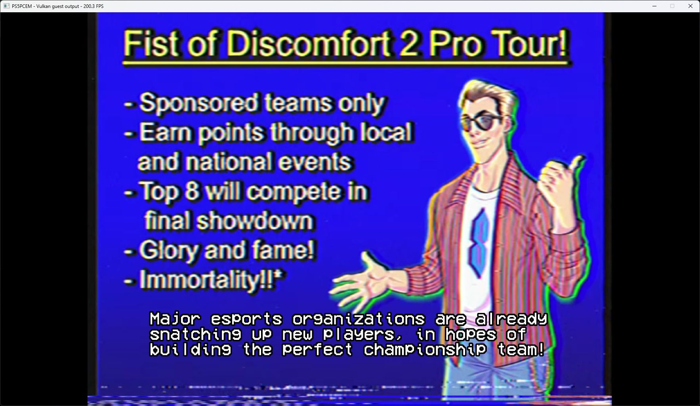

# Arcade Spirits: The New Challengers startup — October 11, 2026

Title: PPSA06409, content version 01.000.000. Development build.

## Linking failure

The executable could not link because five `libkernel` imports were missing:

| NID | Implemented function |
|---|---|
| `GEnUkDZoUwY` | `scePthreadSemInit` |
| `C36iRE0F5sE` | `scePthreadSemWait` |
| `H2a+IN9TP0E` | `scePthreadSemTrywait` |
| `aishVAiFaYM` | `scePthreadSemPost` |
| `Vwc+L05e6oE` | `scePthreadSemDestroy` |

These are counted synchronization operations, not successful no-ops. They use
the existing kernel semaphore store and scheduler wait queues. Init retains the
optional diagnostic name and initial count. Wait consumes a token or parks;
Trywait consumes one only when available and otherwise returns kernel `EAGAIN`.
Post increments the count and reserves tokens for blocked waiters before waking
them, preventing a racing poll from stealing a grant. Overflow returns
`EOVERFLOW`. Destroy rejects attached waiters with `EBUSY` and clears the handle
only after successful destruction. Invalid or stale handles return `EINVAL`.
Only process-private creation is supported; nonzero flags are rejected.

The local KytyPS5, SharpEmu and AnyPS5 implementations were compared to identify
the imports and their conventions. The implementation reuses PS5PCEM's own
counted objects and does not patch game code or add a title-specific bypass.
The generic maximum count is `INT_MAX`, consistent with the
[FreeBSD semaphore declaration](https://github.com/freebsd/freebsd-src/blob/main/sys/sys/_semaphore.h).

## Validation

- New tests cover initial counts, token consumption, empty polling, overflow,
  invalid flags, stale handles, preservation of adjacent memory, busy destruction,
  and posting while a waiter is parked with a competing poll before it resumes.
- Import registration checks verify that all five NIDs belong to `libkernel`.
- `zig build test-hle -Doptimize=ReleaseSafe`: **625/625 passed**.
- `zig build build-game-run -Doptimize=ReleaseFast`: succeeded. The installed
  runner is signed with the existing project certificate and a DigiCert
  timestamp. Its certificate root is not trusted on the local host.

## Runtime result

The visible startup check passes initialization of the embedded Python/Ren'Py
runtime and reaches the main menu, with **START, LOAD, PREFS, PRIZES and ABOUT**
rendered over the title artwork. The runtime loads the main-menu VPX video and
OGG music streams. Loading an audio stream is not a listening-quality check.

Short Down-key inputs sent through the UI automation tool did not appear in the
Pad diagnostics, so manual menu navigation remains unverified by that check.
This report establishes menu rendering, not gameplay, save recovery, full
completion or long-session stability.

The final signed runner also reaches this menu with keyboard input selected and
automatic button pulses disabled. Thirty one-second window-counter readings
span 29.939 seconds: **252.9 FPS median, 221.1–272.3 FPS range** on the RTX 3070 Ti.
This is menu performance, not gameplay or a before/after comparison. The output
request is 1920×1080; the guest allocates a 3840×2160 internal render target.
The final trace has 517 periodic GPU-gap reports, all with zero reported gaps,
and no guest fault or sampled-image rejection. That does not establish coverage
of later scenes or every shader operation.

A further launch of the same signed executable with the runner's normal
automatic Cross pulses selects START and advances into the opening story,
including the Fist of Discomfort 2 Pro Tour video and readable subtitles.
This confirms that supplied pad input can leave the menu; it is not a manual
control or complete-playthrough test. The visible counter reads 200.3 FPS at
the saved intro frame, which is an observation rather than a timed benchmark.
Its 278 periodic GPU-gap reports are also zero, with no guest fault or
sampled-image rejection recorded.
Both final test processes were stopped after recording their results.

Installed runner SHA-256:
`f64f3df7dad8d6e5d6adfdd4fee0b0f09333c7a061b30649e0f005d8b76398fa`.

