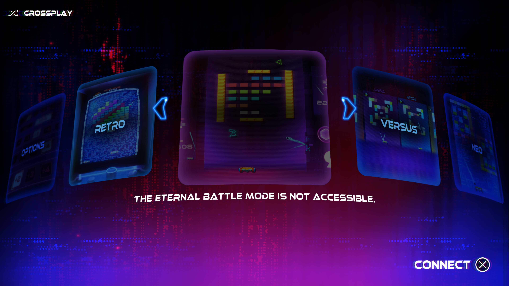

# Arkanoid: Eternal Battle — Vulkan confirmation and DirectX 12 startup

November 7, 2026. PPSA06328, content version 01.002.000. Development build.

## Vulkan playthrough confirmation

The maintainer reports that the game is fully playable and completable on Vulkan,
with good gameplay FPS. The compatibility grade is now **Playable · Completable**
for **Vulkan**. This is a user-confirmed playthrough result, not a new automated
completion test or a numerical gameplay benchmark.

The [October 11 menu measurements and captures](arkanoid-fiber-startup-2026-10-11.md)
remain historical. Online multiplayer has not been revalidated.

## DirectX 12 failure and implementation

The unmodified runner stops at the first publisher-image draw with
`GraphicsSamplerModeNotImplemented`. The guest uses `IMAGE_SAMPLE_L` with an
explicit scalar LOD, anisotropic bilinear minification and ordinary bilinear
magnification. Treating it as implicit-derivative anisotropic sampling incorrectly
rejects this combination.

Explicit `SAMPLE_L`/`SAMPLE_LZ` now retain the guest point/linear minification and
magnification choices without the implicit-derivative anisotropic tap expansion.
Scalar LOD supplies no directional footprint. This follows the
[Vulkan sampling specification](https://docs.vulkan.org/spec/latest/chapters/textures.html)
used by the existing shader translation: explicit Lod sets derivatives to zero.
Implicit anisotropy keeps its existing validation and implementation.

Passing the publisher logos reveals another sampler rejection: an anisotropic
bilinear minifier paired with an ordinary bilinear magnifier. The per-tap filter
comparison now uses the point/linear bit, independently of the anisotropy bit.
Both combinations keep the existing derivative-based tap expansion. Mixed
point/linear implicit anisotropy remains rejected rather than approximated.

The next post-processing draw uses anisotropy with mip filtering disabled. This
now selects the base mip by clamping the native sampler LOD range to zero while
retaining the directional XY taps. Explicit scalar-LOD samples obey the same
no-mipmap state. The checks deliberately supply a nonzero guest minimum LOD to
verify that this mode cannot accidentally select a smaller level.

The DirectX sampled-image path also supports native **BC7 UNORM and sRGB**.
Guest tiling is decoded into compressed blocks and D3D12 performs BC7 sampling;
the implementation does not replace the images with placeholders. Sampled atlases
have a separate **512 MiB** bound, including mip chains and arrays. The game's
16K atlas views require `0x0aaaaac0` and `0x15555560` bytes for their 14 selected
levels. Framebuffer and individual buffer bounds are unchanged.

These are shared DirectX resource fixes, without title-specific shader patches,
skipped draws or a Vulkan fallback. The Vulkan rendering implementation is unchanged.

## Validation

- `zig build test-d3d12 -Doptimize=ReleaseFast -j2 --summary all`: **51/51 passed**.
  Footprint checks cover the two 14-level 16K BC7 views, a complete 15-level tail,
  over-budget arrays and invalid compressed 3D shapes without allocating them.
- Native `d3d12-smoke.exe`: **complete hardware suite passed** on RTX 3070 Ti.
  **544 full-frame sampler comparisons** cover implicit anisotropy and explicit
  scalar LOD/LZ, fractional/clamped LOD, mixed min/mag filters and 2D/array layers.
  BC1/2/3/7 probes exercise tiled and linear blocks, padded native row pitches,
  alpha and sRGB decoding, and unchanged guest source bytes.
- Website: `npm run typecheck` and the compatibility, API-history and locale
  checks passed (**72 tests**). Both API reports and the capture are included in
  all twelve locales.

## Observed DirectX result

The final standard `zig-out/bin/game-run.exe` passes the publisher sequence and
renders the mode-selection carousel with Retro, Eternal Battle, Versus and Neo.
The **194.5-second** run reaches captured flip **169**, with no rejected draws,
rejected dispatches or guest faults in its trace. The three reproduced sampler
stops no longer occur. Automatic Cross is enabled
for this startup check; physical input is disabled. **Menu rendering is still
very slow.** This change restores startup, not Vulkan-level performance.

The selected online Eternal Battle mode reports that it is not accessible.
Offline paddle control, complete DirectX gameplay, audio quality and long-session
stability remain unverified. The **Playable · Completable** grade applies to the
maintainer's Vulkan report, not this DirectX check.

Host: Windows, NVIDIA GeForce RTX 3070 Ti; Speed preset, 1920×1080 output request,
guest-controlled 3840×2160 internal render target. The capture below is taken
directly from the DirectX renderer, converted from PPM to JPEG without changing
the game rendering. No unsupported draws are skipped.

The final build completed **21/21 steps** with **51/51 tests passed**.
Tested runner SHA-256:
`FC1106C0AB5BE2959EBF2A8667D1E6F8DF43267FDBAAE5B1722314D472C6E9FB`.
