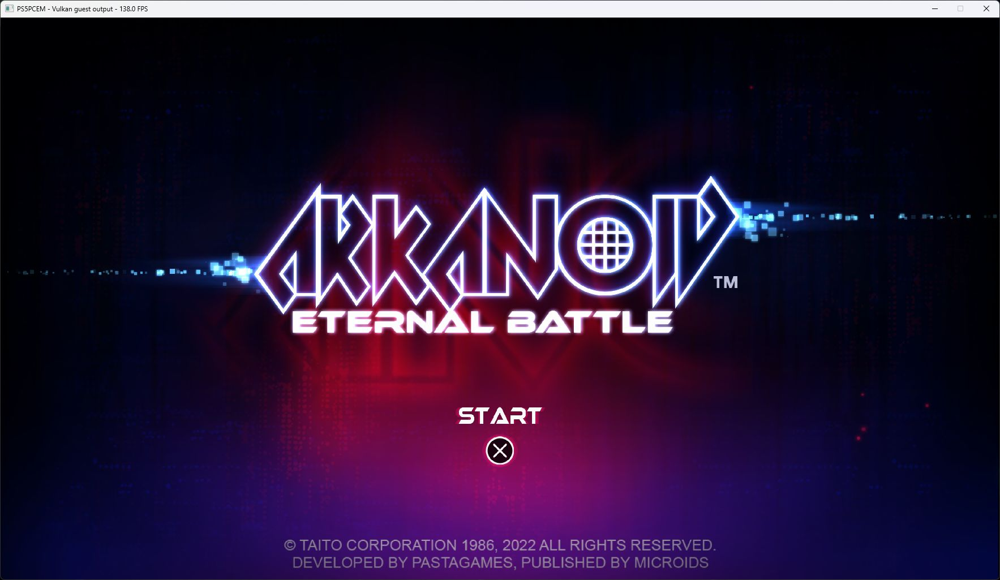

# Arkanoid: Eternal Battle startup — October 11, 2026

Title: PPSA06328, content version 01.002.000. Development build.

## Missing imports

The executable failed to link on four firmware imports:

| NID | Implemented function | Behavior |
|---|---|---|
| `uq2Y5BFz0PE` | `sceFiberGetInfo` | Validates the live fiber and caller's 128-byte record; returns entry, initialization argument, context range and current name without overwriting reserved bytes. |
| `JzyT91ucGDc` | `sceFiberRename` | Renames the live fiber, truncating to 31 bytes plus NUL; handles a source that aliases the old name. |
| `EXv3ztGqtDM` | `pthread_mutexattr_setpshared` | Validates and records process-private synchronization, which the title requests. Cross-process sharing returns `ENOTSUP`, since mutex handles are owned by one emulated process. |
| `juWbTNM+8hw` | `fsync` | Flushes the real host file, preserves its cursor, and propagates descriptor and host-I/O failures through the POSIX ABI. |

`sceKernelFsync` now uses the same real filesystem operation, replacing its
previous read-only placeholder. Fiber stack-usage checking is not enabled;
GetInfo reports the defined unavailable-margin value instead of invented usage.

## Failures after linking

Resolving imports exposed two independent fiber bugs:

1. The firmware-stack nesting flag remained set when switching from a wrapped
   `sceFiberRun` into guest code. Later HLE calls therefore ran on Arkanoid's
   256 KiB fiber stack, overflowing it with Windows status `0xc00000fd`.
   Every fiber now owns its firmware-stack allocation, nesting state and
   suspended guest-stack record. Switching transfers all three together.
2. The job scheduler suspends `primaryLoadingJOB` and resumes it on another
   worker. The old host-fiber ownership check returned `0x80590005` from
   `sceFiberSwitch`, leaving the game clearing and presenting black frames.
   Native fibers now migrate between workers. The registry lock spans the
   native switch and is released by its destination, so another worker cannot
   acquire a source before Windows has saved its context. Post-switch HLE TLS
   is resolved again on the destination thread. Return-to-thread uses that
   thread's root context.

The implementation applies to all native Windows guests. It does not patch
the game or bypass its loading jobs. Local AnyPS5, KytyPS5 and SharpEmu sources
were compared for the Fiber information ABI. The synchronized migration follows
[Windows fiber semantics](https://learn.microsoft.com/en-us/windows/win32/procthread/fibers).

## Missing menu atlas

Once the scheduler resumed loading, the publisher images and START prompt
rendered, but the title artwork was missing. Both BC7 menu atlases were rejected
by the sampled-texture path because it reused the 128 MiB framebuffer limit.
Their complete mip chains need `0x0aaaaac0` (16384×8192) and `0x15555560`
(16384×16384) staging bytes. Sampled-image uploads now have a separate 512 MiB
bound; framebuffer limits, descriptor validation and guest-memory checks remain
in force. This uses the existing BC7 tiling and Vulkan upload implementation.

## Validation

Focused tests cover bounded rename, information record guards and reserved
bytes, real file flushes and injected I/O failures, mutex attribute errors,
independent firmware stacks, and direct fiber switches followed by migration
between two live OS threads. The stack tests execute 512 KiB HLE frames from
256 KiB guest fibers and check restoration of native stack bounds.

- `zig build test-hle -Doptimize=ReleaseSafe -Dtest-filter=fiber`: 5/5 passed.
- `zig build test-hle -Doptimize=ReleaseSafe`: 623/623 passed.
- `zig build test-vulkan -Doptimize=ReleaseSafe`: 244/244 passed, including
  the 16K BC7 atlas sizes and rejection of empty/over-budget uploads.
- `zig build build-game-run -Doptimize=ReleaseFast`: succeeded. The installed
  runner is signed with the existing project certificate and a DigiCert
  timestamp; the certificate root is not trusted on the local host.

## Runtime result

Two launches of the final signed runner pass the publisher sequence and render
the animated title artwork. The repeat using the runner's automatic Cross pulse
also opens the main mode-selection carousel. The missing-import error, stack
overflow and cross-thread Fiber permission error no longer occur in these runs.
The final traces contain no sampled-image rejections or guest faults.

On the RTX 3070 Ti, the title screen counter is observed at 138–149 FPS.
The main menu has a **45.6 FPS median, 43.5–46.6 FPS range** over 30 one-second
window-counter samples spanning 29.962 seconds. Automatic Cross remains enabled
during this menu sample; this is not gameplay performance or a before/after
performance comparison. The requested output is 1920×1080, while the game still
selects a 3840×2160 internal target.

The online Eternal Battle mode displays “not accessible”; the guest reports
failed server connections. Short keyboard presses delivered by the UI tool did
not appear in the Pad diagnostics, so selecting an offline mode and character/
paddle control remain unverified. No completion, audio-quality or long-session
stability claim is made. The test processes were closed after recording evidence.

Installed runner SHA-256:
`d7228920a1c500e184e16eea8faab54d670c885c4d2c2e8541a9b121a90b0d5b`.

