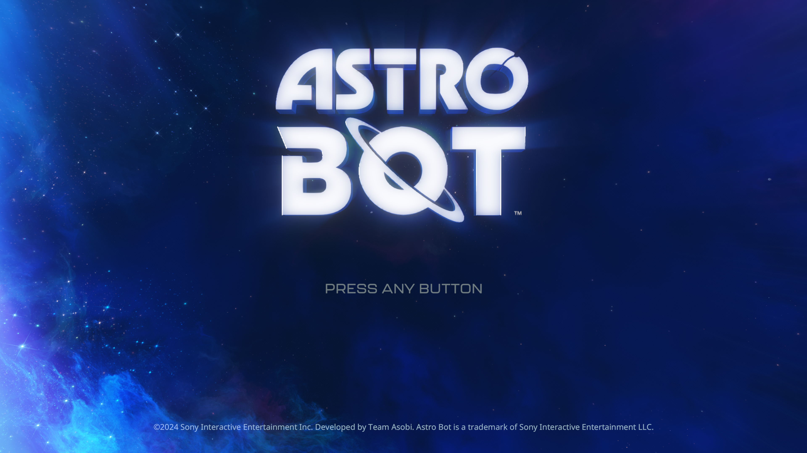
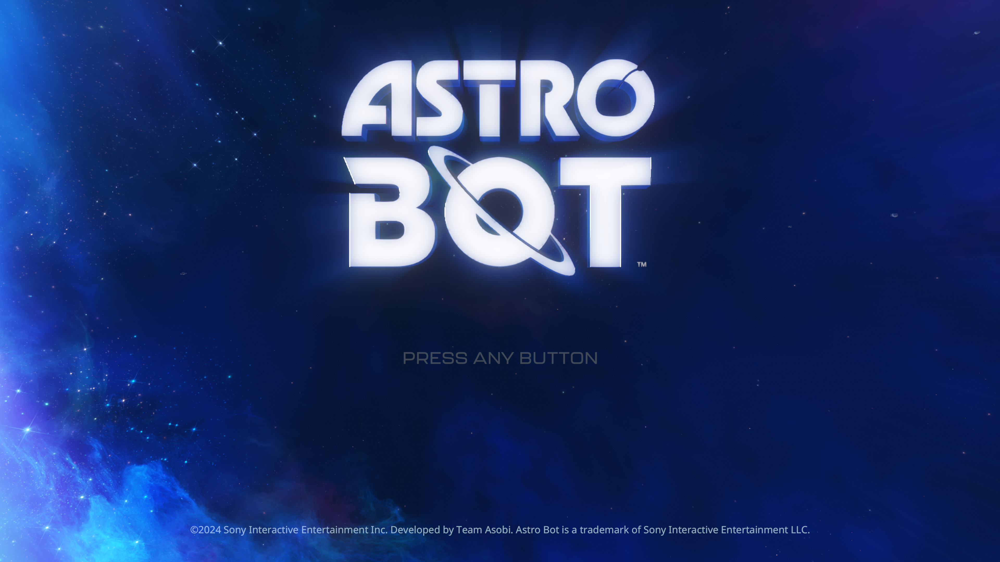
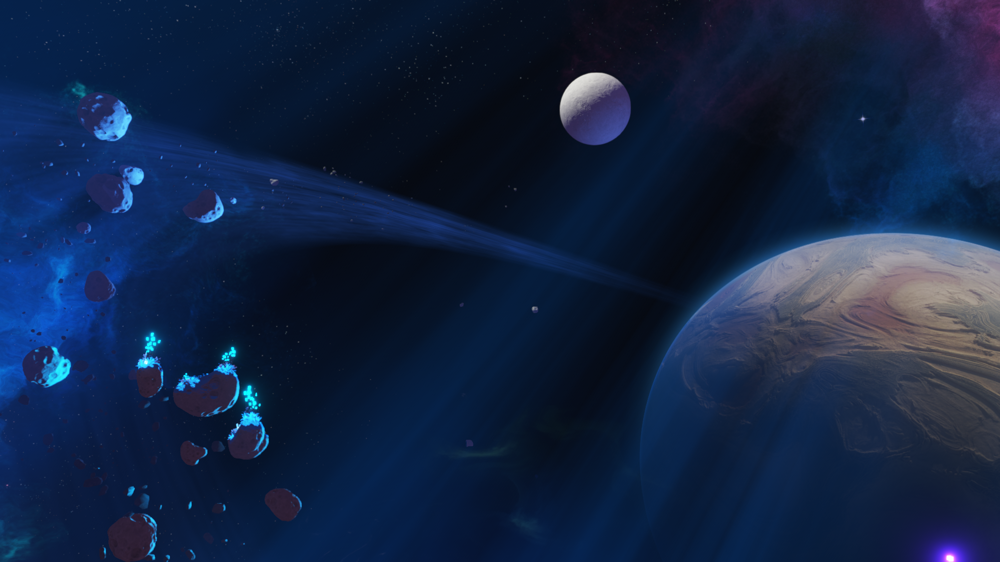
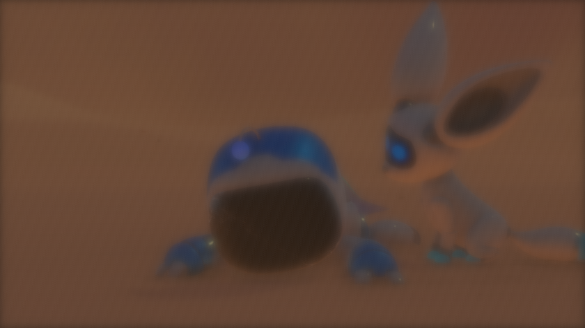
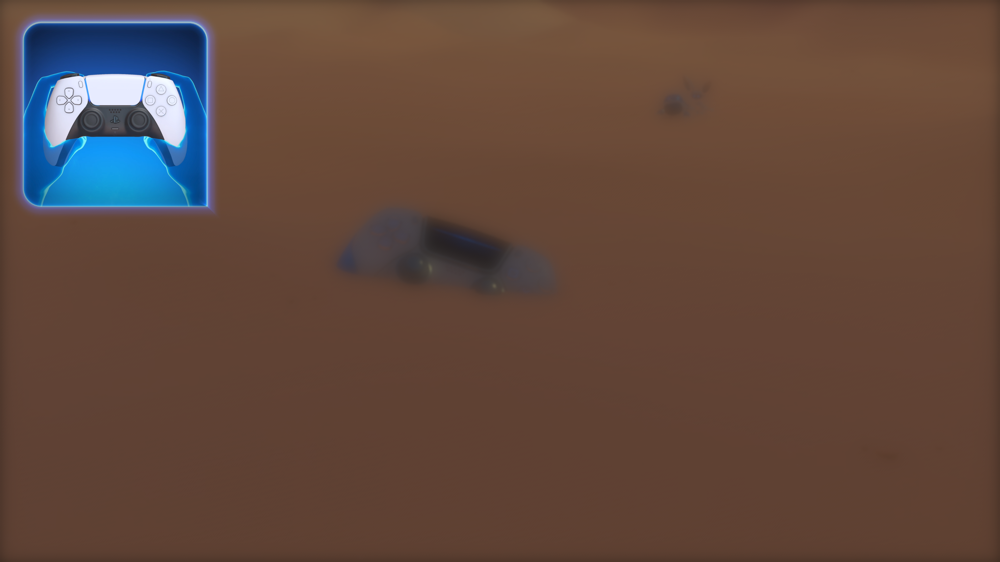

# ASTRO BOT: verified internal 1080p profile — November 1, 2026

The loader can select ASTRO BOT's existing 1920x1080 render mode for the
verified PPSA21564 01.018.000 executable. This changes the scene resolution
chosen by the game; the ordinary output/window setting alone did not do that.

## Implementation and identity

- Source executable SHA-256:
  `aaef7a00968bebdeae17c0ee874cc0a9dbadf412c833cb1a9e1428c0ddc24aaa`.
- The [DLSSKytyPS5 resolution profiles](https://github.com/iska0702/DLSSKytyPS5/blob/main/_Patches/PPSA21567.json)
  supplied the selector and three setter/table pairs. Although that profile
  names PPSA21567, all 13 original-byte guards independently matched the local
  PPSA21564 SELF. The profiles are not treated as interchangeable by title ID.
- The instruction at ELF virtual address `0xc62a97` changes from loading the
  requested mode to selecting mode zero. Its six replacement bytes are
  `b8 00 00 00 00 90`. Mode zero's three setter copies and three width/height
  table pairs already specify 1920x1080 and are checked without changing them.
- The entire file hash and every guard are checked before any write. Guard
  failures cannot leave a partially patched executable. SELF segment mapping
  translates virtual addresses to physical payload positions.
- Only the private loader buffer is edited before mapping/execution. Installed
  game files remain unchanged. The common graph path supports folder and
  ZArchive sources; this run uses a folder installation.
- GI, renderer selection, texture detail, physics, frame timing and DLSS/FSR
  changes from the upstream collection are outside this profile.

`PS5_GAME_PATCHES=auto` is the default. It selects the profile only for PPSA21564
with 1080p output and applies it only when the executable hash matches. Unknown
executables run unchanged. `PS5_GAME_PATCHES=off` restores the original mode
selection. Explicit `PS5_GAME_PATCHES=astro-bot-1080p` requires the matching title
and executable; a mismatch stops the launch with a diagnostic.

## Validation

- 18 focused tests passed, including ELF/SELF parsing, profile selection,
  rejection of unknown identities, all-or-nothing guard validation, BSS/range
  rejection and translation of SELF addresses to physical payloads.
- ReleaseFast `build-game-run`: 15/15 build steps succeeded.
- Paired runtime measurements use the same binary, Vulkan, Speed, Performance
  game preference, uncapped flips, 1080p output and hybrid input on a Ryzen 7
  7700 / RTX 3070 Ti Windows host. The runner SHA-256 is
  `516dfd81453d6e8734da4a54f6fd6d566caa5e51ebb2ef9c0de23dee6a27f718`.
- An initial automatic-input warm-up entered the cinematic and was excluded
  from the comparison. The comparison uses a fresh hybrid-input launch and
  the stable title screen. Renderer captures are disabled during FPS intervals.
- The mapped selector at guest address `0xca2a97` contains the six replacement
  bytes. The installed game's SHA-256 remains unchanged after launch.
- The tested executable and its matching PDB are installed in `zig-out/bin`.

## Paired title-screen measurements

These intervals count completed renderer flips against a monotonic host clock.
Presentation counters agree, apart from one frame crossing a sampling boundary
in the second baseline interval. The animated title screen has no input during
each interval. Both processes use existing caches; this is not a cold-start test.

| Interval | Original mode selection | Verified 1080p profile | Change |
|---|---:|---:|---:|
| 90 seconds | 999 / 90.0227 s = **11.10 FPS** | 1,047 / 90.0004 s = **11.63 FPS** | **+4.83%** |
| Additional 60 seconds | 663 / 60.0004 s = **11.05 FPS** | 686 / 60.0002 s = **11.43 FPS** | **+3.47%** |

This is a modest improvement on this host and scene, not a guaranteed gain
throughout the game. The two intervals repeat one baseline launch and one
patched launch; they are not an estimate across multiple independent runs.
Periodic profiles report no new graphics or compute pipelines during these
four intervals, so they do not measure first-time shader compilation.

The patch selects an existing game mode rather than resizing every allocation.
The live target census confirms many 1920x1080 targets, but **recently used
2432x1368 intermediates and 3840x2160 final targets remain**. A 1080p output
request therefore still does not mean that every pass runs at 1080p. The
renderer captures below are the original 3840x2160 scanout.

The observed storage-image cache footprint falls from about **480 to 314 MiB**.
Median profiled GPU readback volume remains **113,764 KiB (111.1 MiB) per frame**
in both cases, while uploads remain about 26 MiB. Median sampled frame time
changes from 89 to 85 ms in the first intervals and from 92 to 88 ms in the
second intervals. Reducing scene resolution does not remove this transfer and
synchronization work; resolving it remains a separate performance task.
In the patched 90-second interval, median profiled counts are **169 host queue
submissions per frame** and **15.96 ms of fence waits**; most readback volume
comes from buffers (109,714 KiB), not render targets. These counters identify
remaining costs, not an isolated causal benchmark of any one operation.
For a representative patched profile at flip 4,080, the two largest submission
sites resolve through the matching PDB to `dcbDraw` (60 submissions) and
`dcbRelease` (57). The largest listed wait site resolves to
`publishDeferredStorageWrites`; other waits include `mapStorageReadbackRanges`
and `dcbWait`. This points the next investigation toward resource visibility
and queue submission work rather than additional resolution reductions.

| Original mode selection | Verified 1080p profile |
|---|---|
|  |  |

## Opening sequence and limits

Selecting the save proceeds into `intro_next` and loads resources for
`hub_crashsite_tutorial`. One **60.0004-second opening-cinematic interval records
595 flips and presents, or 9.92 FPS**. This moving scene has no matched baseline
and is not a controllable-gameplay measurement.
A later opening-sequence interval records **450 flips and presents / 60.0003 s =
7.50 FPS**, with 30-second windows of 7.32 and 7.68 FPS. It is another moving
cinematic segment, not a repeat of the planet shot or a before/after comparison.



The sequence subsequently reaches the crash-site wake-up scene. Its capture
shows pronounced blur; an equivalent unpatched frame is needed to distinguish
the intended cinematic effect from a rendering defect or a patch regression.



The sequence then reaches a stationary DualSense wake-up prompt. That interval
records **278 flips and presents / 60.0004 s = 4.63 FPS**; its two 30-second
windows are 4.66 and 4.60 FPS. This is the crash-site prompt before confirmed
free character control, not a verified gameplay interval. No matching unpatched
measurement was collected here, so the title-screen percentage gain must not
be applied to this result or compared with the older 3.47 FPS gameplay report.

Four periodic profiles in this interval have median frame time **219 ms**,
about **262 host submissions**, **53.49 ms of fence waits**, **255.9 MiB of
readbacks** and **113.8 MiB of uploads** per frame. These remaining costs are
substantially larger than at the title screen.



The measured intervals have no recorded draw, dispatch, flip or synchronization
error. Periodic opening profiles still alternate between zero and **12 unresolved
storage bindings**, without draw/dispatch failures or unsupported-compute counts.
These resource-preparation counters can include inactive shader paths; they do
not by themselves prove that an executed shader access or a whole draw was skipped.
The later crash-site arrival also logs repeated `sampler missing for s0`
diagnostics. This run does not establish whether they predate the patch; a
matched unpatched check of this scene is still needed.
The retained first diagnostic identifies pixel program `0x500a38f00`,
instruction PC `0x854` (`image_sample`), with an empty known-scalar snapshot.
This supplies a concrete resource-resolution case for follow-up investigation.
Full graphics correctness, later gameplay performance and completion are not
established by this resolution test. Renderer-owned captures are not a separate
verification of the image on the physical display.

## Reproduction and rollback

For the exact executable above, the normal 1080p launcher/runner path enables
the profile automatically. To compare without it in PowerShell:

```powershell
$env:PS5_GAME_PATCHES = 'off'
.\zig-out\bin\game-run.exe '<ASTRO BOT installation>\eboot.bin'
```

Restore the default before the next launch:

```powershell
Remove-Item Env:PS5_GAME_PATCHES -ErrorAction SilentlyContinue
```

No reinstall or executable restoration is needed because game files are never
modified. Other titles and unknown ASTRO BOT executable hashes remain unchanged
in automatic mode. DirectX 12 and ZArchive runtime behavior are not benchmarked
in this check.
