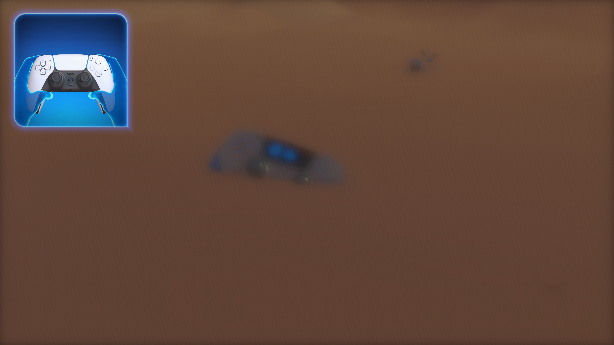
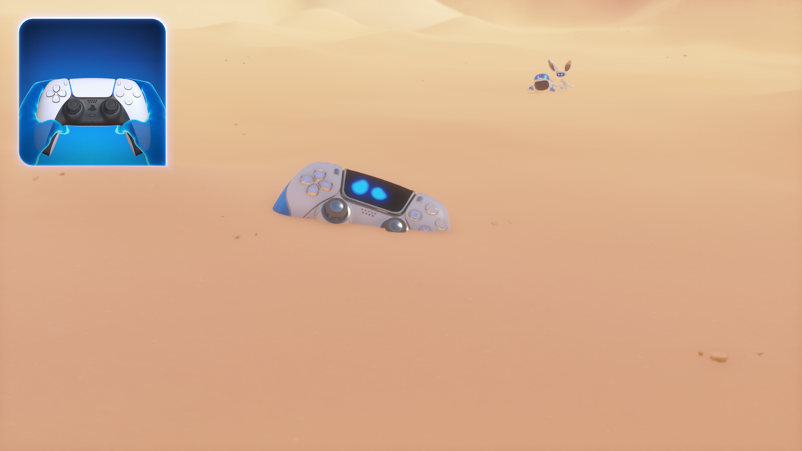
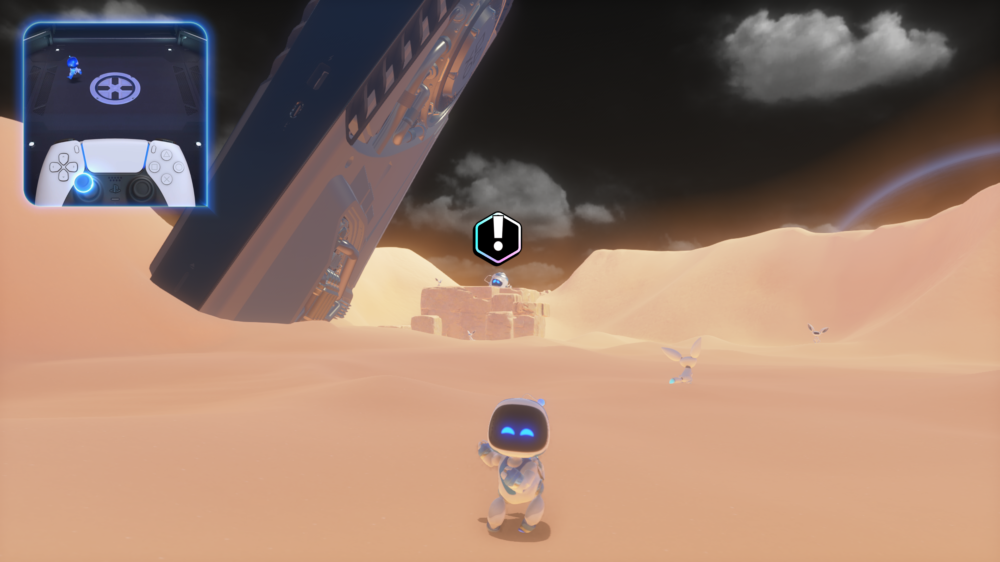

# ASTRO BOT: preserve computed HDR contents across DCC initialization

Date: November 1, 2026. PPSA21564 v01.018.000, Vulkan development build.

## Live follow-up to the blend-constant correction

The [blend-constant implementation](astro-bot-blend-constants-2026-11-01.md)
passes native GPU tests, but its first live crash-site check still shows the
dark, blurred world behind a sharp tutorial overlay. It is necessary for
the bloom equation and is not sufficient to fix the image by itself.

A new capture confirms that the bloom draw now receives **(0.9, 0.9, 0.9, 1)**.
Nevertheless, its RGBA16F output has zero alpha and only the blurred source.
The preceding depth-of-field composite contains a sharp image with alpha one.
The raster attachment is uninitialized at this hand-off: an old zero DCC
clear is applied again, erasing the computed destination before blending.

Private diagnostic captures include compute program `0x5007b1300` at flip
44477 and bloom programs `0x5003e3000` / `0x5003e3a00` at flip 44189.
The source and destination use address `0x53aa00000`, a 2432×1368 RGBA16F
view, with metadata at `0x570854000`. A later bounded frame trace confirms
the compute-to-raster publication path. These addresses identify evidence;
the implementation contains no game-address checks or shader replacements.

## Implementation and scope

A committed compute image records the tracked generation of its DCC
metadata. Raster initialization may retain those expanded pixels only when
the complete image layout, allocation, metadata range, guest contents and
tracked generation still agree. The proof survives publication into guest
memory and therefore covers both native GPU copies and the ordinary upload
path. CPU replacement, a new upload or retirement invalidates the proof.

A later metadata write revokes it even if the same zero bytes are written
again. Unavailable write tracking, pending buffer writers and dispatches
that explicitly write the metadata keep the existing conservative path.
Unknown store preparation also declines this proof. DCC clearing remains
enabled; no post-processing effect is disabled.

## Validation

Native GPU checks cover unpublished and published HDR output, a repeated
zero clear, a different fixed-color clear, CPU pixel replacement, missing
tracking, an unrelated CPU write, explicit metadata stores and incomplete
store preparation, with native hand-off both enabled and disabled. All
**18 native GPU cases pass**. An initial CPU-replacement failure exposed a
stale observation; invalidating it when storage contents are replaced is
part of the final fix.

The full ReleaseFast runner and smoke build pass **606 tests** (333 GPU and
273 Vulkan). The native blend-constant, storage-to-color initialization,
DCC metadata-clear and DCC single-texel-clear regressions also pass.
The runner SHA-256 is
`2d3b34f1ce20c1c0529a1f245a3285369cc2b7ffa758cd144bc0180cfda2c276`.

## Live visual comparison

The rebuilt runner reaches the crash-site DualSense wake-up prompt. In one
process, toggling only `preserve_computed_dcc_contents` **on → off → on**
restores, loses and restores the sharp world image. The camera remains in
the same position; the controller, prompt and particles retain their idle
animations. All game effects and the corrected blend constants remain
enabled in every interval. This confirms the reported scene-wide blur fix
at this location, not complete graphics correctness in every level.

Each interval follows ten seconds of settling and measures flip and present
counters for thirty seconds. Captures are taken **outside** those intervals.
Host: Ryzen 7 7700, RTX 3070 Ti; Vulkan, Speed, performance game preference,
hybrid input, retained caches, default-enabled exact-build 1080p profile.
The game still uses a 2432×1368 HDR intermediate and a 4K final target.

| DCC preservation | Flips/presents | Seconds | FPS | World image |
| --- | ---: | ---: | ---: | --- |
| On | 143 | 30.001283 | 4.77 | Sharp |
| Off | 144 | 30.001325 | 4.80 | Dark and heavily blurred |
| On again | 140 | 30.000885 | 4.67 | Sharp again |

This is a correctness result, **not a speedup**. These intervals precede
free character movement. All sampled profile rows have zero rejected draws,
rejected dispatches and unsupported compute operations, but **12 unresolved
storage bindings remain**. Their median readback volume is about **255.9 MiB
per frame**, with **253–260 submissions** and **51–52 ms** of fence waits.
The corrected path uploads about 25.4 MiB more per frame because it retains
the computed destination instead of replacing it with a clear. Keeping that
image resident across the hand-off is a remaining optimization target.

| Old behavior, fix temporarily disabled | Default behavior, fix restored |
| --- | --- |
|  |  |

These are unmodified renderer checkpoints, losslessly converted from PPM to
PNG, at flips **20800** and **21056**. They are not desktop-window captures,
enhanced previews or separate replay renders. The first restored-state
capture at flip 20544 shows the same sharp result.

A separate native HDR capture after bloom at flip **19624** preserves alpha
**1** in all **3,326,976** pixels. The earlier blend-only capture at flip
44189 had alpha **0** throughout. These captures are from different moments;
their HDR maxima are not treated as a brightness benchmark. The shader and
texture diagnostic blobs remain private.

The maintainer subsequently reported that the blur also appears resolved in
the actual game window. The same process accepts the DualSense shake,
continues through the wake-up animation and reaches the third-person view
behind ASTRO with the objective marker. Sharp details remain visible during
that transition; this is consistent with the renderer-checkpoint comparison.

## Movement tutorial follow-up

The same runner then reaches the first movement tutorial, with ASTRO in the
third-person world view and the objective marker visible. The camera remains
fixed in the before/after captures; ASTRO, the tutorial inset, clouds and
other scene elements continue their idle animations. A separate interval
records **160 flips and 160 presents in 30.000633 seconds: 5.33 FPS**.
The DCC correction stays enabled and captures occur outside the measurement.
This is the starting gameplay/tutorial view, not the preceding controller
wake-up prompt. No new movement-input test or later-level claim is made for
this interval; character control was verified in the earlier November 1 run.

The three profile samples in this interval have median **234.6 MiB/frame
readbacks**, **129.1 MiB/frame uploads**, **227 submissions** and **43.4 ms of
fence waits**. They contain **zero draw/dispatch failures and unsupported
compute**, with **12 unresolved storage bindings** still present. This is
not a paired FPS improvement over another version or scene. Full graphics
correctness, later levels and completion remain unverified.

Unmodified renderer checkpoint at flip **30208**, captured after the timed
interval (flips 29908–30068). The earlier checkpoint at flip 29696 confirms
the same camera position. Neither image is a desktop-window capture.

## Earlier run and remaining verification

The preceding blend-only run measured **259 flips/presents in 30.000321 s,
8.63 FPS**, in the moving space introduction. This is not a gameplay benchmark.
That run was deliberately terminated by the diagnostic memory guard after
three samples below 768 MiB of host commit headroom during compilation;
the stop is not attributed to a new game crash. Builds and subsequent game
runs are kept sequential.
