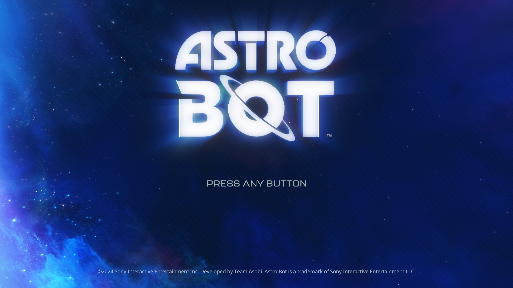

# ASTRO BOT: immutable entry scalar reads

October 15, 2026. Development build, ASTRO BOT PPSA21564 v1.018, Ryzen 7 7700,
RTX 3070 Ti 8 GB, 32 GB RAM. Host output is 1920×1080; the captured game-owned
scanout is 3840×2160. This is an animated title-screen test, not character control.

## Change and validation

Graphics resource preparation can now reuse recovered S_BUFFER load values
instead of preparing another buffer for the same read. Eligibility requires
both graphics stages to be read-only, no tessellation, an exact retained analysis,
forward-only control flow, and a complete producer-specific snapshot before the
first branch. Loops, calls, writes, partial values and conditional reads retain
the existing path. Values remain in the per-draw dynamic scalar upload; changing
constants does not bake them into a new shader. Scalar-only draw replay remains
conservative for these reads.

The first experimental build lost the proof when passing the vertex scalar
list to translation and produced noise. It was rejected and never installed
as the main runner. The corrected build marks the actual uploaded vertex list.
A native graphics regression now reuses the same V# registers for a different
buffer and compares every tested output pixel with the old path. It also changes
constants and relocates their sources. Separate native checks cover partial
proofs, partial-dword bounds, dynamic updates and live vector reads from the same
V#. Vulkan synchronization validation reports no errors.

- GPU and Vulkan suites: **558/558 pass** (290 + 268).
- ReleaseFast runner and native probe builds pass; final Vulkan rerun: 268/268.
- RDNA2: **285/295 pass**, with the same ten failures and one test leak already
  reproduced against the baseline in the [previous review](anyps5-descriptor-review-2026-10-14.md).
- The corrected title run reports no failed draws/dispatches or unsupported
  compute programs. Its 12 unresolved storage-preparation bindings remain.

## Balanced comparison

Both modes were warmed in one process. Each mode covers eleven 60-frame blocks,
balanced across eleven animation phases. Builds, tests, frame capture and stack
sampling were stopped during timing. Exact draw reuse was invalidated at each
mode switch.

| Mode | Frames | Seconds | FPS |
| --- | ---: | ---: | ---: |
| Previous buffer preparation | 660 | 43.950 | 15.02 |
| Recovered entry values | 660 | 44.236 | 14.92 |

**No FPS improvement is established. 25 FPS is not reached.** The new path
avoids 271,304 buffer preparations across its 660 frames,
about 411.1 per frame. Reduced resource work is useful,
but must not be presented as the requested additional 10 FPS.

A separate 20-second stack sample (3,305 samples) still concentrates in resource
preparation, scalar evaluation, guest-memory copies/checks, and CPU waits for GPU
completion. Inclusive counts overlap and are not additive timing percentages.
Further work should remove repeated static instruction scans and avoid unnecessary
GPU-to-CPU-to-GPU transfers while preserving writer ordering.

## Reference review

Reviewed local AnyPS5 `c26982f63` and KytyPS5
`9e41d8320a2774b303fbad344c2347e8d0292e83`. Their reported FPS is not an equivalent
benchmark on this machine and scene. This change is an independent Zig
implementation, not a claim that their renderers have been fully imported.

- Kyty's [reuse of dominating descriptor loads](https://github.com/KytyPS5/KytyPS5/commit/7e884f55e0fafc06dfd8832017b7514b9a6e3304)
  and [memoized material-record analysis](https://github.com/KytyPS5/KytyPS5/commit/f1577a5a9488b4e1881b54ede6f844e5bf53352e)
  reinforce retaining immutable proofs while re-reading live inputs.
- Kyty's buffer cache can bind containing resident ranges; image-to-buffer copies
  can stay on the GPU. PS5PCEM's narrower-view publication path is a follow-up
  candidate, with alias ordering and CPU edits still needing proof.
- AnyPS5's [saved bytes outside the write watch](https://github.com/boykopovar/AnyPS5/commit/69702ef10543a10039567f8f6a45f2ea2aa11fef)
  addresses repeated uploads and writeback coherence. It is relevant to audit,
  not a reason to disable change tracking.
- AnyPS5's [16-byte stream-copy kernel](https://github.com/boykopovar/AnyPS5/commit/fc24253487fa6a407a9093ccd5f3cb0970af4ddf)
  has a precise code/descriptor match. No matching ASTRO BOT dispatch has been
  established here, so no title-wide copy shortcut was added.

## Follow-up: unused uniform reads and compute scans

[Later comparison and reference review](astro-bot-uniform-scan-2026-10-15.md):
49 CPU proof reads omitted per frame, **14.95 versus 14.91 FPS**, with no
established performance improvement; 560 GPU/Vulkan tests pass.
