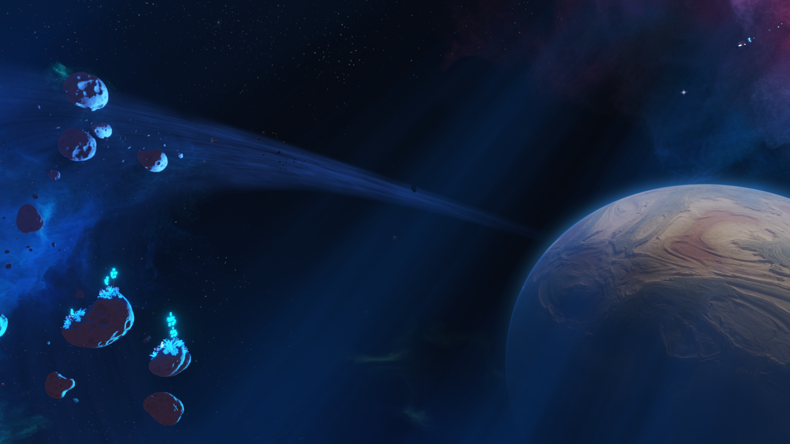
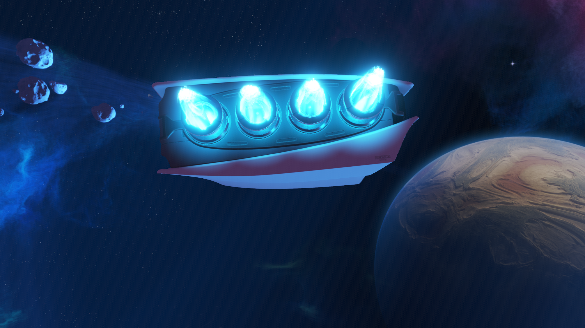
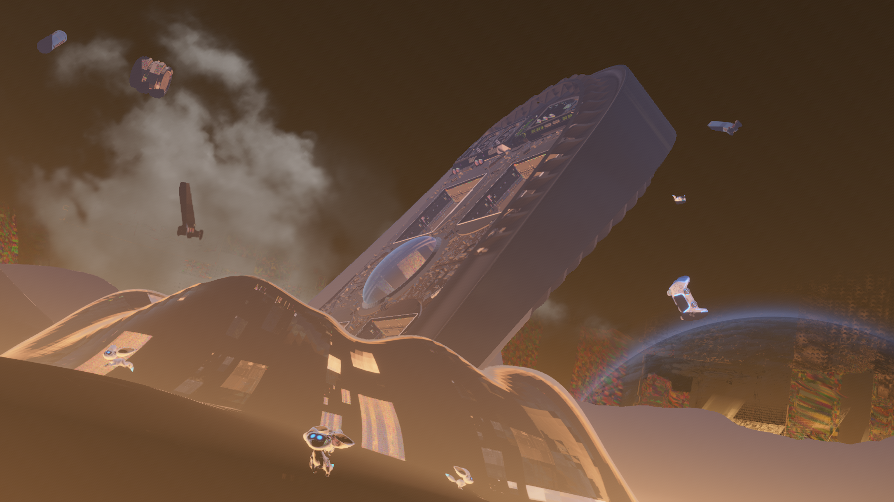
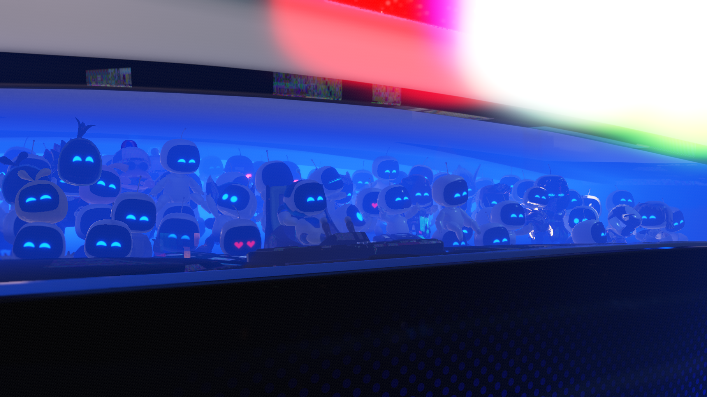

# ASTRO BOT: controllable gameplay and graphics fixes, October 24, 2026

ASTRO BOT **PPSA21564 v1.018** reaches character-controlled gameplay on the
development build. The maintainer confirmed movement in the crash-site scene
before the latest restart, and reports that the graphics look corrected after
restarting with the new texture-cache fix. Fresh renderer captures show the
opening cinematic with recognizable geometry, lighting and textures.

This advances the recorded compatibility result from a diagnostic cinematic to
**In-game · graphics improved · low FPS**. It does not establish completion,
correct rendering throughout the game, or a stable gameplay frame rate.

Frame 3200 of the restarted run: the opening space scene. This is a cinematic,
not a character-control screenshot.

Frame 4224 of the same run: the ship's engines and hull. Both images are
unretouched 3840×2160 renderer captures, taken outside the timed interval.
The maintainer separately confirmed the visual improvement in the game window.

A later capture from the same run still shows rendering defects. The improvement
in these opening shots must not be read as a claim that the whole cinematic or
game is now visually correct.

## What changed

### RG16F DCC clears

Two-channel half-float color targets now handle the observed DCC clear forms,
including the physical position of the alpha-controlled channel and clear
register values. The sampled-image clear path also supports RG16F. Previously,
an unsupported clear could leave stale displacement data in a fullscreen pass.
The change applies to the format, without a title-specific shader replacement.

### Preserve prepared texture bindings

Converting an overlapping raster allocation into a storage image can publish
bytes before or after the destination image. A neighboring storage image may
already be pinned for the same dispatch, with its CPU-change baseline captured,
even though it has not yet been marked GPU-dirty.

The conversion previously protected dirty storage images only. Its outer
publication could therefore change the clean neighbor's baseline. After the
dispatch, the CPU-replacement check mistook those older raster bytes for a new
CPU write and discarded the newly computed image.

Native color/storage conversion now rejects overlaps with **clean pinned
storage images as well as dirty images** and retains the existing fallback.
The normal fast path remains enabled for nonconflicting resources. CPU writes
are still checked; depth of field, bloom and guest shaders remain enabled.

In the earlier crash-site investigation, the producer's depth-of-field input
was finite, but it was discarded before the composite. The composite then
produced infinities, NaNs and extreme half-float values, followed by a magenta
wash. Temporarily disabling native color/storage conversion preserved the
input and removed that wash; restoring it reproduced the corruption. The
diagnostic switch was restored before the final build and restart.

## Measurements and limits

Host: **Ryzen 7 7700 / NVIDIA GeForce RTX 3070 Ti**, Windows, Vulkan, Speed preset,
retained caches, uncapped runner. Requested output is **1920×1080**; the guest
still supplies a **3840×2160 scanout** with internal passes up to **2432×1368**.
No shader, draw or effect was disabled for the restarted run.

| Observation | Frames / elapsed | Average |
| --- | --- | ---: |
| Earlier controllable scene, before the cache fix | 209 / 30.000204 s | 6.97 FPS |
| Opening cinematic after restart | 266 / 30.000208 s | 8.87 FPS |

These are **different scenes, not a paired performance comparison**. The earlier
camera was not controlled for an A/B test. The new cinematic interval contains
changing shots; its five-second blocks range from about 4.20 to 11.20 FPS.
Captures were taken outside measurement. A fresh measurement of the same
controllable crash-site scene remains pending.

Sampled cinematic frames report **zero draw failures, dispatch failures,
unsupported compute programs, unresolved storage bindings, null storage
bindings and rejected storage bindings**. The earlier title and crash-site
frames reported 12 unresolved bindings, so zero in this cinematic does not
prove that every resource path in every scene is resolved. GPU sampled/flat
memory fault counters remain clear at the recorded checks.

The earlier crash-site capture also contained orange checkerboard/material
artifacts. Although the maintainer reports a corrected picture after restart,
frame 7616 of the new cinematic still contains patchy surfaces and color
artifacts. This is an observed remaining defect, not just an untested area.
A matched crash-site capture is still needed. Later levels, audio quality,
long-session stability and completion are unverified.

Frame 7616 of the same development build, with the normal rendering paths
enabled. Kept alongside the improved frames to document the remaining work.

## Validation and build

- Four focused DCC unit tests and the native color-initialization/alias probe pass.
- The native color/storage probe covers pinned neighbors in the published prefix
  and tail, unchanged guest memory on rejection, later successful conversion,
  CPU replacement, and immediate/batched commands. The added regression fails
  before the protection and passes with it.
- Native storage-layout conversion and covered-raster-initialization probes pass.
- All **64 full-image overwrite configurations** pass. The checked native-probe
  logs contain no Vulkan validation errors.
- Formatting and `git diff --check` pass. `game-run.exe` and its matching PDB
  were rebuilt and installed; the restart uses the new executable.

This is a **development build**, not a newly published release. The tested
executable SHA-256 is
`FAEC6BEBDFD0E33EA5146991DF2DD5F1F8BEDB025B5CFF1007C497C1303DDD30`.

Local evidence: `.codex-astro24-coherence-visible.{out,err}.log`,
`.codex-astro24-coherence-intro-measure.txt`, `.codex-astro24-layout-final.log`,
`.codex-astro24-storage-layout.log`, `.codex-astro24-covered-raster.log` and
`.codex-astro24-overwrite.log`. These diagnostic files and raw texture dumps
remain local; only the selected screenshots are published.

## Follow-up: compute control flow and motion input

The next investigation found partially written depth-of-field output. In a
captured dispatch of program `0x5007a7600`, all 77 output texels containing
non-finite half-float values were bit-for-bit unchanged from the input backing.
The translated program used a 256-block dispatcher limit. This is evidence of
missing writes; it does not by itself establish why each write was missed.

A first development candidate allowed 65,536 dispatcher block visits and reported
unfinished compute control flow through the existing deferred shader-fault
record. The finite guard remains enabled. An intermediate 4,096-visit candidate
reported three unfinished invocations in particle program `0x555f4f500` and
stopped the graphics queue. A later captured particle table contains three
2,048-element definitions; such a loop can exceed 4,096 block visits. The
65,536-visit run passes the previous stop and reaches the animated title screen
without a recorded shader fault.

Native GPU tests verify complete 512-, 2,048- and 5,000-iteration loops, explicit
failure records at deliberately insufficient budgets, and pipeline reuse.
The original 256-visit limit completes only 84 stores in the nested-loop probe.
**A matched gameplay comparison is still pending.** Neither the depth-of-field
artifacts nor the remaining material/color defects are declared fixed by this
title-screen result. No new gameplay FPS result is claimed.

The reported missing motion input had two confirmed session-level causes:
the earlier executable predated commit `593935b`, and that diagnostic run used
`PS5_INPUT_MODE=keyboard`, which deliberately excludes physical controllers.
The restarted candidate includes the motion implementation and uses `hybrid`.
Live process samples show enabled motion sensors, calibrated acceleration,
angular velocity and changing orientation. **ASTRO BOT's tilt tutorial has not
yet been reached again**, so its response remains unverified.

Additional local evidence: `.codex-astro24-dispatch-visible.err.log`,
`.codex-astro24-dispatch64-visible.{out,err}.log`,
`.codex-astro24-dispatch64-probe.log`, and
`.codex-astro24-motion-samples.log`.

That intermediate executable and matching PDB were rebuilt and installed without
closing the running test. Installed executable SHA-256:
`A6797E735B81CCB09533E2914C49AEDE6409F1E66469B9F65847CE2E2987B1CA`.
The live title-screen check used the preceding diagnostic executable with its
exported compute budget set to the same 65,536 value before shader compilation.

### Afternoon follow-up: reproduce the particle loop before raising the guard

A fresh launch of that executable reached the opening cinematic. At flip 4520,
both captured outputs of the depth-of-field producer contained no NaN/Inf and
its shader fault record was clear. This is a different shot from the earlier
77-texel capture, so it does not establish a matched visual fix. Frame 4736 still
shows noisy surfaces and excessive color/glow.

This is an unretouched renderer capture of the **intermediate** executable,
not evidence that the subsequent change fixes every visual defect.

At flip 5049, the same run stopped after particle program `0x555f4f500`
exhausted 65,536 block visits in block 122. The deferred fault check prevented
the incomplete result from being silently treated as successful work.

An isolated Vulkan replay made the cause testable without another full intro:

- Replaying the earlier frame-1093 capture reproduced all six captured output
  buffers byte for byte, including the empty fault record.
- A diagnostic fixture then used emitter, definition and parameter snapshots
  from the stopped scene and covered all emitter slots. This is a reconstructed
  workload, **not an exact replay of the failing frame**.
- With 65,536 block visits, it reproduced the same particle-loop failure.
  Register instrumentation recorded **2,340 completed iterations against a
  finite bound of 4,000**. The loop increments its counter by one and has many
  conditional blocks per particle; it was not simply stuck at a fixed counter.
- With budgets of **262,144 and 1,048,576**, the fault records were clear and
  all six output buffers matched byte for byte between those two runs.

The follow-up changes the ordinary compute dispatcher guard to **1,048,576
block visits**, retaining the finite bound and explicit exhaustion error.
The separate checked-BVH budget is unchanged. The value is part of the shader
translation key. No guest shader, effect or draw is disabled.

The native regression now also exercises 5,550 iterations through a wide loop
body, alongside the shorter loops, intentionally insufficient budgets and
pipeline reuse. This addresses a real long-loop workload; it does not promise
that every future kernel will fit the guard or that the remaining material
defects are fixed. A fresh end-to-end gameplay check is still required.

Local follow-up evidence: `.codex-astro24-noon-visible.{out,err}.log`,
`.codex-astro24-replay-original.log`, `.codex-astro24-replay-params.log`,
`.codex-astro24-replay-budget262k.log` and
`.codex-astro24-replay-budget1m.log`. Replay fixtures and guest shader binaries
remain local.

The final follow-up builds successfully (**18/18 build steps**). The native
dispatcher regression passes with `VK_LAYER_KHRONOS_validation` requested and
no reported validation errors; formatting and whitespace checks pass.
`game-run.exe` and its matching PDB are installed. Executable SHA-256:
`EFDC38BB5DE1F3E59855F5F10394C90E586DAEEE3075752E848FE34296DC939C`.
The new live run uses the normal Vulkan path and hybrid controller input.
Logs: `.codex-astro24-dispatch1m-build-final.log`,
`.codex-astro24-dispatch1m-probe.log` and
`.codex-astro24-dispatch1m-visible.{out,err}.log`.
