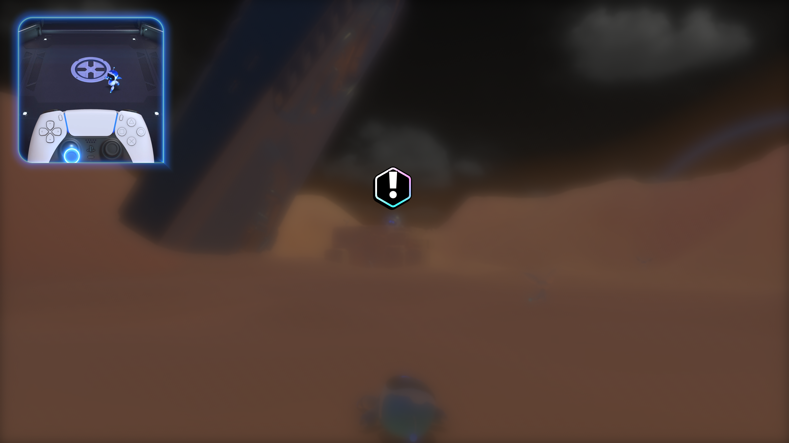
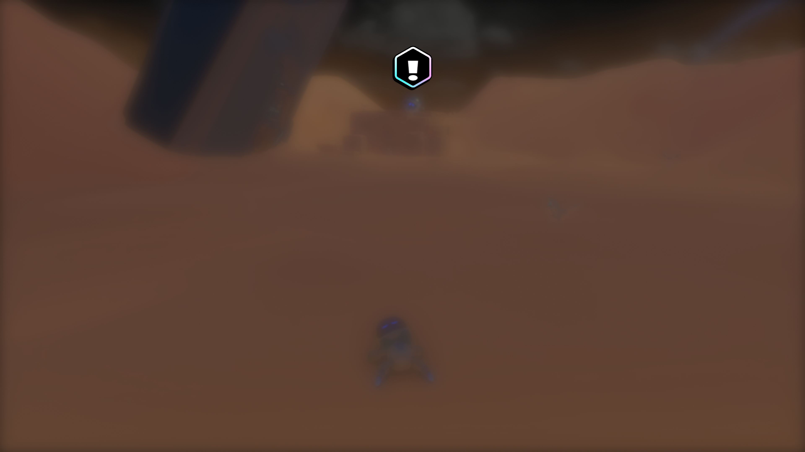

# ASTRO BOT: packed linear CPU copies — November 1, 2026

This follows the [linear readback investigation](astro-bot-linear-readbacks-2026-11-01.md).
The tested title is PPSA21564 v01.018.000 on a Ryzen 7 7700 / RTX 3070 Ti,
using Vulkan, 1080p output and the verified internal 1080p profile.

## Profile and implementation

A separate 20-second stack sample of the busiest rendering thread collected
3,021 samples. Exclusive samples include 650 in the GPU synchronization wait,
348 in `memcpyFast`, 177 in `copyBytes`, 158 in long-input hashing and 105 in
byte comparison. These describe one sampled thread, not total CPU utilization
or an exact breakdown of frame time. Sampling was disabled during FPS timing.

The linear tiling path copied every row separately, even when its visible rows
and layers occupied one contiguous range. Large packed ranges now use the
existing bounded copy pool. A packed row with physical gaps between layers is
copied one visible layer at a time; first-slice and mip offsets are retained.
Rows with padding retain their previous handling.

The fast path requires more than one configured pool participant and at least
4 MiB per copied range, matching the pool's existing threshold. An initial
serial variant slowed some L3-sized images in an isolated comparison, so it
was not retained. Single-participant configurations and smaller ranges keep
their original row copies. The change does not alter shaders, resolution,
image contents, page ownership or completion ordering.

The exported `contiguous_linear_copies` switch supports same-process comparison;
`contiguous_linear_copy_bytes` records eligible transferred bytes. Native
completion batching remains a separate setting.

## Validation

The final ReleaseFast build passes **21/21 steps and 601/601 tests**: 330 GPU
tests and 271 Vulkan tests. The new byte-for-byte checks cover packed layers,
physical slice gaps, padded rows, nonzero first slices and mip offsets, both
copy directions, 8/16-byte elements and one/four pool participants. They compare
the complete destination including untouched padding, as well as independent
coordinate offsets and round trips.

The first full compiler was deliberately stopped when running it alongside
the game exhausted the reserved host commit headroom; the game stayed alive.
After recording the baseline and stopping that owned run, the runner built
successfully. One combined build reported a test-runner communication timeout;
the same test executable passed all 330 cases directly, then the normal cached
build/test command passed all 601 with exit code zero.

The candidate executable SHA-256 is
`10ac222682e1fa386e7d0bcc7af779c172c16aae6e6642a3f15f07922fa9af80`.

## Isolated copy measurement

An ordinary host-memory microbenchmark ran after the build, before restarting
the game. Each interval performs 96 copies after warm-up, in off/on/on/off order.
The table averages the two intervals per path with four copy participants.

| Packed linear layout | Bytes | Row copies | Pooled range copy |
|---|---:|---:|---:|
| 10240 × 320, 8-byte element | 25 MiB | 1.183 ms | 0.835 ms |
| 10240 × 320, 2-byte element | 6.25 MiB | 0.097 ms | 0.043 ms |

These are short, repeated CPU copy measurements, **not FPS results**. They do
not measure GPU retirement, guest-memory publication or padded layouts. The
one-participant configuration now executes the original path with either switch
value.

## Same-process title comparison

The candidate uses the same Vulkan/1080p/Speed/Performance settings and retained
shader caches as the preceding runner. Completion batching remains enabled.
Only `contiguous_linear_copies` changes. Each interval lasts 45 seconds after a
ten-second settling period; captures, compilation and stack sampling are off.

The first off/on/on/off sequence measured **11.400 / 12.800 / 12.977 / 12.800 FPS**.
Because the return baseline also improved, the initial difference cannot be
attributed to this optimization. A second sequence on the warmed process gives:

| CPU copy path | Flips | Frames / seconds | FPS | Median fence wait |
|---|---|---|---:|---:|
| Row copies | 6160–6730 | 570 / 45.000964 | 12.666 | 13.073 ms |
| Pooled packed ranges | 6860–7431 | 571 / 45.002771 | 12.688 | 13.205 ms |
| Pooled, repeat | 7565–8137 | 572 / 45.001311 | 12.711 | 13.357 ms |
| Row copies, return | 8266–8836 | 570 / 45.001272 | 12.666 | 13.184 ms |

The difference is only one or two frames over 45 seconds, approximately 0.26%
between the paired means. **No meaningful whole-frame speedup is established.**
The new path processes about 31.25 MiB per title frame, but median GPU readbacks
remain 113,764 KiB per frame and fence waiting is essentially unchanged. These
results support a cheaper CPU copy primitive, not a claimed large FPS increase.

All eight intervals have clear last-error fields. Their periodic profiles report
zero draw failures, dispatch failures and unsupported compute, with the existing
12 unresolved storage bindings. This clean draw count applies to the title;
the gameplay baseline below still has a failed sampled-image draw. The switch
is restored to its enabled default. The later crash-site comparison is below.

## Candidate crash-site comparison

After the opening and DualSense wake-up, the user left the game without input.
The stationary crash-site view still includes the left-stick tutorial inset.
The compiler was stopped before timing; frame captures were disabled throughout
all four intervals. Each interval follows ten seconds of settling:

| CPU copy path | Flips | Frames / seconds | FPS | Median fence wait |
|---|---|---|---:|---:|
| Row copies | 41495–41743 | 248 / 45.001209 | 5.511 | 40.438 ms |
| Pooled packed ranges | 41800–42050 | 250 / 45.002538 | 5.555 | 41.513 ms |
| Pooled, repeat | 42104–42354 | 250 / 45.000794 | 5.555 | 43.117 ms |
| Row copies, return | 42409–42654 | 245 / 45.013494 | 5.443 | 41.522 ms |

The paired mean difference is approximately **+1.4% in this sequence**, only
two to five frames per interval. This is a small result, not evidence of a
stable large gain. It is not directly comparable with the different camera
position in the preceding runner's baseline.

Packed copies process about 62.7 MiB per frame here, but median readback volume
is unchanged at **240,228 KiB/frame** (234.6 MiB). Uploads remain approximately
103.7 MiB/frame, with about 221–225 submissions in the periodic profiles.
All 16 profiled frames still have **one failed draw and 12 unresolved storage
bindings**; dispatch failures and unsupported compute are zero. Clear last-error
fields do not cancel those per-frame failures.

The next [sampler investigation](astro-bot-uniform-samplers-2026-11-01.md)
addresses that rejected draw separately. No sampler fix is active during these
copy measurements.

## Confirmed gameplay baseline

The preceding runner reached controllable ASTRO at the crash site: the user
shook the DualSense to wake him, moved with the left stick, then left the camera
stationary. Four 45-second intervals measured **4.667–5.155 FPS**, with no
convincing benefit from completion batching in this scene. See the linked
report for individual results and method.

The normal renderer capture below is taken after measurement and saved
losslessly as PNG. The world remains visibly blurred. One draw per profiled
frame fails with `UnsupportedSampledImage`, and 12 storage bindings remain
unresolved. This is a recorded baseline, not evidence of corrected graphics.

