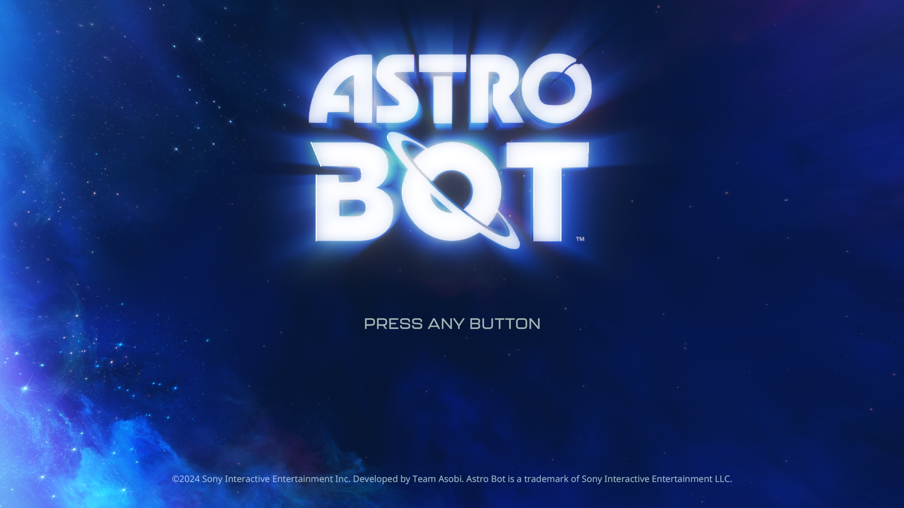

# ASTRO BOT: linear image completion readbacks — November 1, 2026

This follow-up investigates the remaining costs after the
[verified 1080p profile](astro-bot-1080p-2026-11-01.md). The baseline is the
stationary crash-site DualSense wake-up prompt, before confirmed free character
control, on the Ryzen 7 7700 / RTX 3070 Ti host using Vulkan.

## Attribution and rejected tuning

The legacy `readback_kib(...buf=...)` label includes storage-image publication,
not just storage buffers. In the wake-up frame, explicit buffer transfers are
about 14 MiB while the overall readback counter is about 256 MiB. The live trace
identifies 39 storage-image readbacks, including repeated 25 MiB linear images
and separate mip views of the same allocation. Completion publication is a
major source of these operations; they cannot simply be skipped because a
native CPU thread may read the data immediately after its completion label.

Changing the command recording budget alone did not establish a speedup:

| Recording budget | Frames / measured interval | FPS |
|---|---|---:|
| 250 microseconds, initial baseline | 135 / 30.0011 s | 4.50 |
| 1,000 microseconds | 132 / 30.0008 s | 4.40 |
| Unlimited | 105 / 30.0007 s | 3.50 |
| 250 microseconds, return baseline | 119 / 30.0013 s | 3.97 |

The return baseline also varies, so these samples are not a precise causal
estimate. The existing 250-microsecond default is retained. Each interval has
zero recorded draw, dispatch, flip and synchronization errors. The diagnostic
setting was restored before stopping that owned benchmark process.

## Implementation

Independent linear image outputs can share one transfer allocation and one
GPU retirement before their ordinary CPU publication. Groups are bounded to
16 images and the existing frame-transfer byte limit. Overlapping allocations
and special native/retiled backings retain the individual path. Suitable
disjoint mip views use the existing mip-chain publisher at completion too.

The ordinary publisher still checks for CPU replacement after GPU retirement,
preserves row padding, updates image ownership and publishes bytes before the
completion label. Shader work and output bytes are retained. The exported
`batch_linear_image_readbacks` switch permits a comparison with the individual
path in the same development binary.

## Native GPU validation

The final ReleaseFast build passes **21/21 build steps and 271/271 Vulkan unit
tests**. Native probes run on the RTX 3070 Ti; they test the actual copy path,
not a simulated command counter.

The extended `vulkan-smoke --linear-image-completion` probe performs real
IMAGE_STORE dispatches and checks guest memory directly from the completion
label callback. With and without the timeline scheduler:

- Three independent images reduce completion submissions **4 → 2**, with
  identical CPU-visible bytes before the label.
- Replacing one image from the CPU retains the new bytes and still gives
  **4 → 2** submissions. This passes both before completion and when the
  replacement occurs after the shared GPU copy, during earlier publication.
- Overlapping image allocations retain **4 → 4** submissions and match the
  original output byte for byte.
- The original FP32 copy, repeated allocation reuse and row-padding checks
  also pass.
- The native resident-mip-chain suite passes for 2D/3D producers, same-frame
  changes, odd dimensions, LODs, sRGB/swizzles and CPU replacement. A separate
  unit regression keeps interleaved interior-address aliases out of completion
  mip batching.

These are correctness and work-count results, not a game FPS measurement.

## Live comparison

The rebuilt executable has SHA-256
`e3e69ab43417ba110f8e78e755bc6ca7476417ce4c799fe639f1f3b942b0096e`.
It uses Vulkan, 1080p output, the verified internal 1080p profile, Speed,
Performance preference, hybrid controller input and no host FPS cap. Existing
shader caches are retained. A contained `WebApiJobWorker` fault at startup also
occurs in the previous baseline; rendering continues in both runs.

After startup, the same process is measured in an off/on/on/off sequence,
45 seconds per interval, with a ten-second settling period after each switch.
Capture is disabled during every timing interval. The scene is the animated
title screen, not controlled gameplay.

| Path | Flips | Frames / seconds | FPS | Median submits | Median fence wait |
|---|---|---|---:|---:|---:|
| Individual | 2169–2696 | 527 / 45.001348 | 11.711 | 169.5 | 15.632 ms |
| Batched | 2818–3350 | 532 / 45.001268 | 11.822 | 167 | 15.590 ms |
| Batched, repeat | 3473–4005 | 532 / 45.001051 | 11.822 | 168 | 15.232 ms |
| Individual, return | 4127–4654 | 527 / 45.001429 | 11.711 | 168 | 16.421 ms |

This is a small, repeatable **approximately 0.95% title-screen gain**, not a
large reduction in total frame cost. Profile medians use 8/9/9/9 periodic
samples respectively; readback volume remains **113,764 KiB per frame** in
all four. The switch is restored to its enabled default after measurement.
All four intervals have zero last draw/dispatch/flip/sync errors and zero
reported draw failures, dispatch failures or unsupported compute. The existing
**12 unresolved storage bindings** remain; this optimization does not resolve
those bindings or establish full graphics correctness.

The title capture below is taken after measurement using the renderer's normal
PPM checkpoint, saved losslessly as PNG. It is not included in timing. Gameplay
improvement has not yet been measured.

The larger remaining costs are image preparation, GPU/CPU transfers and their
visibility checks. The wake-up baseline's 256 MiB/frame is a different scene
from this title benchmark. Removing those bytes requires proving when the CPU
needs them or retaining compatible image consumers on the GPU; dropping the
completion publication would break direct guest CPU reads.
