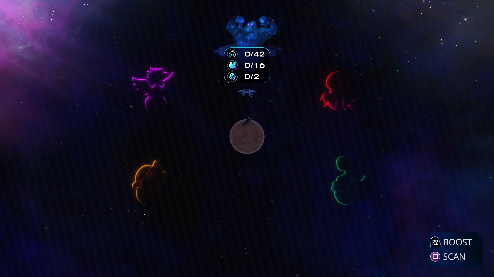
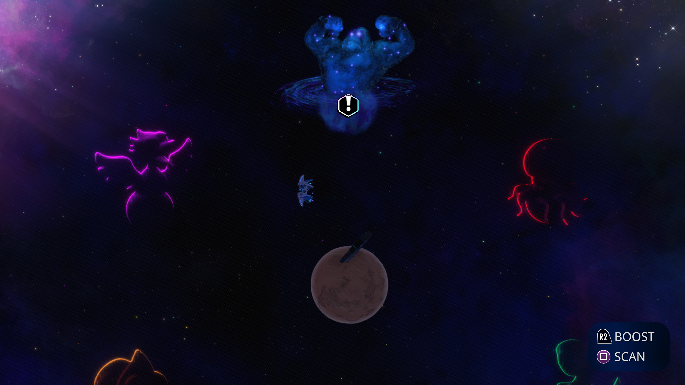

# ASTRO BOT: invalidated mip sources and repeated uploads

The November 1–2 investigation follows the crash-site blur correction. It
targets repeated transfers of the eight-level, R32F, depth-tiled resource at
`0x53ab20000` in PPSA21564 v1.018. Addresses identify this local run, not a
title-specific workaround.

## Observed cause

A one-frame trace records every storage-chain rejection and every upload
origin. Attachment capture/readbacks are disabled during this trace; it
does not force publication at each producer. The diagnostic runner SHA-256
is `1e809da4513583daff6c4af0eb866e316bdebd1b6a04f652cd30188899f546e6`.

At gameplay flip **1999**, shader `0x500793a00` generates mip 0 at dispatch
20 and mips 1–7 at dispatches 21–27. Each output is a one-level storage view;
the sampled input exposes levels 0–7.

| Dispatches | Chain decision | State at the rejection |
| --- | --- | --- |
| 21–25 | `missing-current-source mip=6` | Image valid, generation 0, clean, unpinned |
| 26 | `missing-current-source mip=7` | Image valid, generation 0, clean, unpinned |
| 27 | Assemble | All levels now have current contents; copy 8/8 |
| 33 | Assemble | Copy only the subsequently written mip 7: 1/8 |

The six failures each upload **691,600 bytes** through the ordinary sampled
path: **4,149,600 bytes per frame**, in addition to storage initialization,
readbacks, detiling and synchronization. A valid Vulkan allocation is not
evidence of valid contents. An end-of-frame snapshot misses the generation-zero
states which occur before those levels are regenerated.

The control traces at flips **333** and **1215** use the resident chain for
every downsample step, copying one changed level per step without these
sampled uploads. The failure is scene/state dependent.

The next trace, flip **1977** of the recovery run, identifies the
invalidation site. While preparing the later HDR storage destination at
`0x53aa00000` (dispatch 94, shader `0x50075bd00`),
`tryStageStorageLayout` detects replaced guest texels and retires the dirty
mip 6 and 7 sources. The earlier mips have already been published by the
sampled fallbacks. The next frame therefore begins with valid allocations
but invalid contents in the tail. This is a coherence transition, not a
misordered compute commit.

## Interpretations ruled out

- `content_generation` is assigned from a renderer-wide sequence, not a
  per-image write count. In the failing trace, the two changes per output
  are a guest upload followed by the compute write. This is not evidence of
  an off-by-one error. The normal path records dispatch before committing
  storage writes.
- The rejection happens before the CPU-change/reload loop. It is not caused
  by `reloadChangedStorageMip` returning false or by the output mip's pin.
- `depth_reject=4` means an address mismatch while scanning depth targets.
  A depth tile mode alone does not make this R32F storage resource a depth
  attachment.
- `match=false` for another pyramid reports ceil/floor extent differences;
  sufficiently large sources remain eligible. It does not itself mean a
  chain rejection.
- Mip-backing reuse and level-copy counters include all chains. Copies of
  changed levels remain GPU-to-GPU operations and do not require CPU reloads.

## Recovery path

An existing invalidated mip can be selected for recovery only when it is
idle, has no pending initialization or dirty GPU contents, and belongs to
the exact same uncompressed physical resource. A stable watched guest
snapshot is uploaded for that mip before the full chain is assembled.
Current GPU siblings are retained. Missing allocations still fall back.

Pending buffer/color writes retain their existing rejection paths. Recovery
also declines overlapping incompatible dirty storage images, depth/stencil
writers and deferred color publications. A pinned invalidated destination
cannot be overwritten by the sampler. Unavailable or unstable guest-write
tracking retains the ordinary fallback.

An incompatible storage entry is first checked with the same guest-texel
replacement proof used by storage-layout conversion. An old scratch view
whose bytes have been replaced can be retired; an actual current GPU writer
still rejects recovery. The initial recovery candidate omitted this stale
writer check and remained blocked by an overlapping HDR representation.

`recover_invalidated_mip_sources` allows a same-process diagnostic comparison.
Reason and upload-origin logs are emitted only for an explicitly selected
trace frame.

## Validation

`zig build test-vulkan -Doptimize=ReleaseFast -Dtest-filter="storage mip"`
passes. The native Vulkan `--resident-mip-chain` probe passes all eight
2D/3D, tracked/untracked and even/odd-extent cases with validation enabled.
The added tracked-memory regression replaces a GPU-written tail mip on the
CPU, invalidates its old contents through the real publication path, then
checks sampled colors, unchanged GPU siblings, padding and the absence of
full sampled-image uploads or sibling readbacks. Disabled recovery and a
pinned invalidated destination both reject the fast path. Existing queued
consumers, sRGB/swizzles and cache-pressure checks also pass.

The recovery runner SHA-256 is
`c0d3ed174ddb8063b7d9805f77c3b0bedfdc90b6ceba46529f5b3e041ae34b00`.
At the maintainer's request, verification uses one enabled measurement per
candidate rather than another on/off/on comparison. The
earlier 5.33 FPS movement-tutorial result is a reference, not a paired control.

The initial recovery candidate recorded **212 flips/presents in 30.000192
seconds (7.07 FPS)** after the maintainer reported returning to the same
location. Its trace still had all six uploads, rejected by
`invalidated-source-storage-writer`. This number is **not attributed to the
optimization**.

The stale-writer refinement builds successfully and passes the native mip
probe. Runner SHA-256:
`8160dd7d616b84645d3b028fc10a5cf65759829fdcbe054e57b33a15085aca0c`.
In worldmap trace 2881, the same pyramid performs one full sampled upload,
then restores five invalidated tail levels (10,948 bytes) and uses resident
assembly for the remaining downsample dispatches. The earlier six-upload
trace was taken in a different run, so this is a verified fast-path result,
not a paired FPS comparison. On-foot crash-site validation remains pending.

After the maintainer returned to the requested location, the enabled-only
measurement recorded **208 flips/presents in 30.000400 seconds (6.93 FPS)**,
flips 7481–7689. The subsequent capture identifies the location as the
worldmap with ship controls, not the on-foot crash-site scene. Compilation,
GPU probes, frame tracing and screenshots were outside this interval.
There were no draw, dispatch, flip or synchronization errors; periodic
profiles still reported 14 unresolved storage bindings.

Trace 8041 confirms one full pyramid upload and five small level reloads.
The periodic samples have 40,424 KiB of sampled uploads (previous candidate:
43,801 KiB) and no repeated sampled-address uploads. Total readback remains
182,303 KiB, versus 182,472 KiB in the earlier candidate: removing repeated
uploads does not remove the much larger completion publications. The
6.93 versus 7.07 FPS results do not establish an FPS improvement.

## Larger readback investigation

The `buf` component of `[gpu frame] readback_kib` includes storage images as
well as ordinary buffers. The previous 178,422 KiB number must not be described
as 178 MiB of ordinary buffer transfers. Buffer publication diagnostics also
print the size of a mapped prefix, which can exceed the dirty spans actually
copied/published; it is not by itself a transfer-byte counter.

Worldmap trace 2881 identifies 92.69 MiB of ordinary storage-image publication.
The largest sources are:

| Resource | Calls | Published image bytes |
|---|---:|---:|
| `0x55d700000`, 240x135x64 volume | 2 | 31.64 MiB |
| `0x556970000`, 10240x320 RGBA image | 1 | 25.00 MiB |
| `0x525b10000`, 240x135x64 volume | 1 | 15.82 MiB |
| `0x53bcf0000`, 960x540 image | 2 | 7.91 MiB |
| `0x559b70000`, 10240x320 image | 1 | 6.25 MiB |

PDB symbolization attributes these large publications to
`publishDeferredStorageWrites`, including its batched linear-image path.
They make linear IMAGE_STORE results CPU-visible before completion labels.
Removing publication would break that contract.

After the maintainer returned to the requested location, trace 8041 contains
149.45 MiB of storage-image publication: the 25 MiB image is published twice,
and a 25.38 MiB HDR image at `0x53aa00000` also appears. This is the larger
workload corresponding to the enabled-only worldmap measurement above.

A separate candidate, `coalesce_linear_release_readbacks`, queues the required
image transfers before waiting for the producer's older completion tick.
The transfer wait still precedes CPU labels and interrupts, and buffer-only
completion retains its existing early wait/write-extent narrowing. This aims
to remove redundant submissions and waits, not claim that every byte of the
readback can be eliminated.

The dedicated native `--linear-release-readback` probe passes with Vulkan
validation enabled: a queued image producer and publication require **one
submission instead of two**, with identical texels and row padding checked
inside the CPU label callback. A rejected output write withholds the label;
retry succeeds. The full `--linear-image-completion` and `--deferred-release`
probes also pass, including CPU replacement during publication, overlapping
images, host/device buffers, interrupt labels and failed-write behavior.
The combined runner SHA-256 is
`41839245cb9194f448007f11950224d764c30dc43d0a0c24b81b4967c6acaec1`.
The full `test-vulkan` target and the native mip-chain probe also pass with
this build. An initial 30.000282-second sample recorded 330 flips/presents
(11.00 FPS), but capture 3840 identifies it as the **title screen**. It is
excluded from the worldmap comparison.

After the maintainer returned to the worldmap, capture 21120 confirmed the
ship-control scene before the enabled-only measurement. The runner recorded
**225 flips/presents in 30.000401 seconds (7.50 FPS)**, flips 21443–21668.
Compilation, native GPU tests, frame captures and additional tracing were
outside that interval. The four last-error fields remained clear.

| Periodic profile | Previous mip-recovery runner | Combined runner |
|---|---:|---:|
| GPU submissions per frame | 266–284 | 245–247 |
| Fence waits per frame | 15.51–18.38 ms | 13.05–14.24 ms |
| Compute dispatches | 111 | 111 |
| Draws | 840–846 | 777–784 |
| Total published readback | 182,303 KiB | 182,294 KiB |
| Sampled-image uploads | 40,424 KiB | 40,424 KiB |

The 7.50 versus 6.93 FPS result is a historical comparison, not a paired
speedup measurement. Both captures show the worldmap, but the view and draw
count differ. The scheduling change has a controlled native submission
reduction and the live counters move in the expected direction; the entire
FPS difference cannot be attributed to it. The large readback volume remains
approximately **178 MiB per frame**, including storage images and buffers.

Post-measurement trace 22321 preserves the mip-recovery result: one 691,600-byte
full pyramid upload, followed by five small tail-level reloads totaling
10,948 bytes. No draw/dispatch failures or unsupported compute were reported;
the existing **14 unresolved storage bindings** remain. This is not a claim
that all graphics issues have been eliminated.

After the mip measurement and screenshot, the owned runner was deliberately
terminated by the memory guard when host commit headroom stayed below 768 MiB
for three samples during compilation. This was not recorded as a guest crash.

The maintainer also reports brief partial blackening of the flying 3D letters
and loading icon during startup. The saved startup frame has not captured
the failing instant. Texture reload or synchronization remains a hypothesis;
this artifact is not yet fixed or attributed to the mip recovery.
