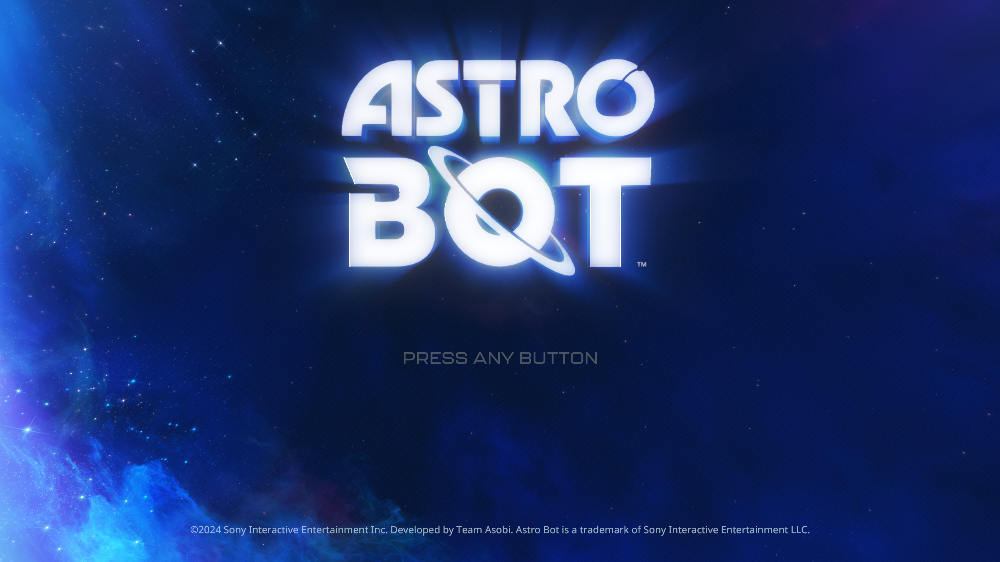

# ASTRO BOT: resource walks and content checks, 16 October 2026

This development build continues the animated-title measurements for PPSA21564
v1.018. It does not establish character-controlled gameplay or fix the known
cinematic rendering defects. Host output remains 1920×1080, with a game-controlled
3840×2160 source and internal passes up to 2432×1368, on a Ryzen 7 7700 and
RTX 3070 Ti. Existing shader caches are retained.

The final uninterrupted measurement is **17.8295 FPS over 2,640 frames in
148.0689 seconds**, with 60-frame blocks at **16.0807–19.7487 FPS**. The previous
confirmation was 18.0451 FPS in a separate run. An aggregate FPS improvement is
not established, and **20 FPS remains unmet**.

The image is a renderer capture taken after the timed interval, at frame 9472.

## Changes

Resource preparation borrows immutable decoded instructions and texture-layout
plans instead of copying large structures during each scan. Sampled-image lookup
uses a smaller bucket hash, while equality still compares every descriptor and
sampler field. Its hash policy remains fixed until the table is cleared.

Scalar-buffer snapshot checks use a single pass with word masks. Duplicate
registers preserve the first-match rule, and later loads still replace earlier
values. SPIR-V prefix entries retain up to eight immutable program identities
after comparing all prefix bytes. Anonymous or new identities still require
the complete comparison.

Content fingerprints use XXH3 for spans of at least 1 KiB and retain Wyhash for
short spans. The algorithm is fixed throughout a process; changing it while
GPU resources are resident would invalidate coherence baselines. Large pooled
fingerprints retain four fixed partitions regardless of worker availability.
Chunked draw-reuse reads use the same length-selected digest, and native texture
checks still inspect all covered texel bytes. No content checks are sampled or
removed. Windows x64 string copies now start at 256 KiB, with the original
disjoint-range contract and joined worker lifetimes.

Resource plans retain immutable loop-write masks. They invalidate the same
scalar registers as the original loop walk; live vector-lane spills retain the
dense path. Plans also omit known inert scalar operations from CPU resource
analysis. Those instructions remain in the GPU shader. Branches, scalar memory
reads, unsupported instructions and conservative dense-budget accounting remain.

## Measurements

Comparisons alternate 60-frame blocks across the eleven phases of the title
animation. FPS is total frames divided by total elapsed time. Compilation,
native tests, CPU profiling and capture run outside measured intervals.
Separate experiments are not additive percentage gains.

| Comparison | Control FPS | Enabled FPS | Interpretation |
| --- | ---: | ---: | --- |
| Borrow decoded instructions (115) | 17.3545 | 17.5328 | Small improvement in this comparison |
| Compact sampled-image bucket hash (118) | 17.8243 | 18.1334 | Full-key equality retained |
| Borrow texture layouts and use 256 KiB string-copy threshold (121) | 17.6188 | 17.8512 | Retained |
| Immutable loop-write masks (124) | 17.7719 | 17.8249 | Small difference; less repeated analysis |
| Omit inert CPU scalar steps (125) | 17.8479 | 17.8827 | 1,320 frames per mode; FPS difference inconclusive |

The final comparison used the shortened plan **685,871 times over 1,320 frames**.
It reduces interpreter work, but the roughly 0.2% FPS difference is too small
to establish a meaningful frame-rate gain by itself.

The hash microbenchmark is substantially faster for large spans, but candidate
123's uninterrupted title measurement was **17.6374 FPS over 2,640 frames**.
It does not demonstrate an overall FPS gain from hashing alone.

Pointer-load/buffer-opcode indexes, direct scalar fallthrough, short-copy and
short-fill specializations were removed after comparisons failed to show a
benefit. A 1,000-microsecond command age did not improve the latest comparison;
the existing 250-microsecond default and resource-walk cache remain enabled.

## Validation and limits

The final candidate passed **582 ReleaseFast GPU/Vulkan tests** and **308 Debug
GPU tests**. Native resource-worker, entry-scalar-snapshot, counted-image-loop,
scalar-loop and CPU-storage-texel-hash probes passed with Vulkan synchronization
validation and no validation errors. Coverage includes changed guest data,
chunked reads, signed-zero keys, colliding descriptors, allocation ownership,
scalar aliases, loop dependencies and copy/hash boundaries.

The earlier confirmed runner averaged 18.0451 FPS; see the
[15 October report](astro-bot-resource-costs-2026-10-15.md). This work targets
shared emulator paths rather than title-specific skipped draws or reduced
resolution. The 20 FPS target, unresolved resource bindings and gameplay
verification must be assessed separately from these CPU optimizations.

The final title logs retain **12 unresolved storage bindings per frame**, with
zero draw failures, dispatch failures and unsupported compute operations in the
sampled intervals. Background shader compilation was idle during those samples.
The title capture does not establish correct cinematics or character control.

`zig-out/bin/game-run.exe` and its matching PDB were updated to candidate 125.
The executable uses the existing PS5PCEM signing certificate and a DigiCert
timestamp. The self-signed chain reports `UnknownError` locally; the expected
signer and timestamp are present. No release version was assigned.

Local raw results and probe logs are retained under `out/astro-oct15-*`,
`out/astro-oct16-*` and `.codex-astro16-*`. They are diagnostic artifacts, not
repository assets. Reference review included local AnyPS5 resource-program
preparation and sharpemu's compiled resource evaluator; no source was copied.
