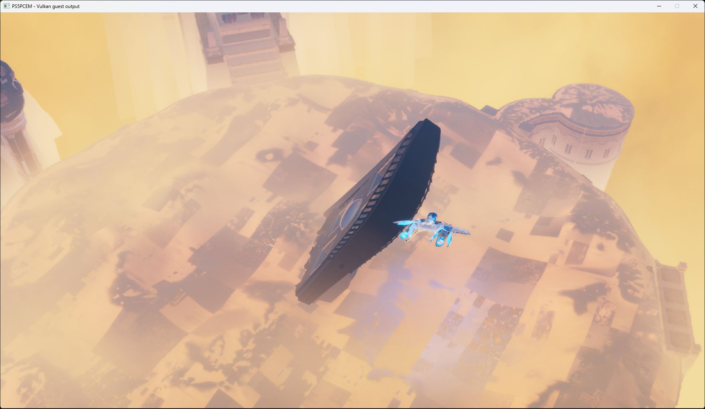

# ASTRO BOT startup and rendering investigation — October 13, 2026

PPSA21564 v1.018, development changes after `8d36d40`, RTX 3070 Ti,
1920×1080 requested output, Speed preset and keyboard input. Existing caches
were retained. This is a diagnostic cinematic checkpoint; controllable
gameplay and completion are not verified.

## Observed result and prerequisites

The diagnostic run loads `hub_crashsite` and renders the arrival cinematic
through the scene beside the ship. The earlier SDWA fix removes severe green
color corruption; the latest wave32/wave64 scalar-state and LDS-barrier fixes
remove the frequent horizontal lighting bands. Dark and patchy-looking surfaces
still need investigation. Cross and Options reach the guest pad state, but
character control was not established. Runs are stopped at the user's request.

The latest run uses opt-in checked BVH snapshots and a 16,384-block traversal
budget. Sampled frames after enabling the switch report no failed draws or
dispatches and no unsupported compute programs; four warm-up programs were
rejected before it was enabled. Generic BVH staging remains disabled by default.
An ordinary startup with this path enabled from the beginning is not verified.

This unmodified window capture is from a diagnostic configuration, not an
ordinary successful launch. The available package and its backport do not
contain eight font files requested by the title. A separate local app0 overlay
aliases existing game fonts to those missing names and uses the title's native
`-lvl hub_crashsite` argument. Original game files are unchanged; neither the
fonts nor the overlay are distributed with these changes.

The run also sets `PS5_AUDIO_PROPAGATION_DISABLED=1`. This opt-in diagnostic
mode retains object lifetimes and attributes but produces no propagation
paths or reflected/occluded audio contribution. The normal default continues
to return an unsupported error for the unimplemented propagation backend.
This is not a complete implementation of acoustic simulation.

## Implemented changes

- JSON values now keep stable borrowed references, typed scalar getters,
  owned deep copies, mutable array/object members, serialization and array
  iterators with the observed hidden-result-pointer ABI. Storage grows past
  the old fixed node and binding limits. Unknown Json2 calls remain explicit
  failures and are now traceable.
- APR/AMPR command lists grow within the caller's byte capacity, preserve
  command order and own deferred snapshots instead of imposing a 32-command
  ceiling. A regression test submits a 901-command batch.
- Font text sources, parser callbacks, line metrics, glyph ownership and
  weight effects are implemented. PlayGo reads the installed binary chunk
  count. Kernel range-name clearing and GPI reads are added. Local Share
  lifecycle/policy is tracked; capture and unavailable online services still
  report failure rather than pretending to complete requests.
- RDNA lowering adds `S_ORN2_SAVEEXEC_B32`, `S_SETPRIO` and `V_FFBH_I32`,
  corrects unsigned 64-bit multiply-add carry/literals and SDWA VCC selection,
  and honors graphics-stage wave32 flags. One-dimensional storage images use
  height-one Vulkan views with correct load/store/atomic coordinates.
- Scanout respects the registered packed 10-bit channel order. Compute writes
  retire stale raster aliases when an allocation is reused at a new extent,
  preventing an old smaller attachment from replacing the new result.
- Explicit SDWA DWORD destinations are distinguished from ordinary f16 half
  writes. A conversion must clear the old high half when the instruction
  requests a full DWORD; ordinary half writes still preserve the other half.

The last fix addresses the green corruption in compute program `0x5007b1300`.
The GPU regression failed before the change: expected `0x00003e00`, observed
`0x47293e00`. It passes afterward. In the earlier arrival-scene capture, the
green channel reached 43,328 after this pass, with 1,080,849 extreme green
outliers. A later capture of the same pass after the fix has no such outliers;
the maximum green value remains 1.5684 before and after the pass. These are
different frames, not a pixel-identical performance comparison.

## Resolution and performance limits

1080p currently controls output, not every internal render pass. Captures show
1920×1080 raster work, a 2432×1368 postprocess surface and 3840×2160 scanout.
The postprocess surface contains about 60% more pixels than 1080p. No universal
internal-resolution cap is implemented by this change.

The moving cinematic varies substantially: the latest selected frame profiles
range from 339–380 ms in lighter views to 1,493–2,332 ms in heavier views.
These observations are not a stationary gameplay benchmark or proof of an FPS
improvement. Heavy views repeatedly evict and upload hundreds of textures,
sometimes transferring more than 2 GiB of texture data in one frame.
A temporary 2048-to-3072 MiB sampled-cache experiment was inconclusive because
the camera entered a lighter view; the original limit was restored.

## Validation

- ReleaseFast runner and Vulkan smoke build: 12/12 build steps succeeded.
- Latest GPU regressions: scalar-state/LDS rendezvous in both wave sizes,
  divergent multi-wave32 and multi-wave64 scheduling, LDS exchange and spilled
  LDS all pass. BVH coverage includes eight combinations of node bounds, opaque
  children and snapshot lookup layout; both snapshot metadata unit tests pass.
- The checks below also record earlier stages of this investigation; unchanged
  HLE and package tests were not rerun for the final lighting-only follow-up.
- Full HLE suite: 671/671 tests passed.
- Targeted final SDWA decoder/translator checks: 10/10 tests passed.
- GPU half-write regression: 40 cases × 128 lanes, covering explicit DWORD,
  PAD/PRESERVE, ordinary VOP1/VOP2, VOP3 half selection, wave32/wave64 and
  inactive lanes. Existing SDWA and packed-float probes also pass.
- GPU checks for signed/unsigned first-bit scans, unsigned 64-bit multiply-add,
  SAVEEXEC, priority hints, 1D storage operations, packed scanout and raster
  alias replacement passed with Vulkan validation enabled.
- The earlier full RDNA suite still has 10 failures and one leak, also
  reproduced on base commit `8d36d40`. A clean full-suite result is not claimed.

## Package extraction changes

CNT metadata extraction now reads entries from their actual file offsets
instead of truncating the container to a 64 MiB prefix. NAPS block-boundary
lookups use sorted offsets and binary search instead of scanning every file
for every block. Metadata decompression reports its size and block count.
All 23 package tests and the ReleaseFast extractor build pass. This does not
recover files absent from the source package, including the missing fonts above.

## Follow-up: BVH and optional lighting branches

The local KytyPS5 checkout at `df5b9b92` contains software ray/triangle and
ray/box intersection in `spirvEmitterBvh.cpp`, backed by checked GPU address
translation. Its resource-tracking tests also cover a disabled feature whose
BVH table is null. These are code comparisons, not a measured KytyPS5 FPS result.

Two captures of ASTRO BOT compute program `0x5005ab600` (flips 200 and 321)
have a null acceleration-structure pointer and a zero ray-tracing enable word
at offset `0x1c` of the associated constant buffer. Rejecting the entire program
because it contains BVH instructions therefore needs investigation separately
from supporting active ray traversal. The new opt-in failed-compute capture
preserves the code, state, prepared buffers, scalar values and coherent user-data
pointer pages even when translation fails. Normal runs do not perform these
extra readbacks.

A separate checked-BVH bug was reproduced on the GPU: an FP32 box at the
descriptor's last 64-byte node incorrectly caused an unmapped-memory fault.
FP32 boxes require two nodes; the descriptor must contain both. The corrected
bound returns an ordinary miss. The regression failed before the fix (one
unexpected fault) and passes afterward with both snapshot lookup layouts,
including the existing triangle, FP16/FP32 box and missing-memory checks.

The generic BVH diagnostic switch is disabled by default. It uses the real
intersection implementation with a runtime fault record, allowing a test to
distinguish an inactive branch from an actual missing acceleration structure.
It is not evidence that generic BVH memory staging is complete.

The next diagnostic run found an active query (`0x500523800`, BVH instruction
at `0x8f8`), which correctly reported an unmapped node at `0x401bd0c00`.
Its PSR version-9 TLAS contains 2,622 instances sharing one 752-byte BLAS.
The diagnostic path now validates allocation headers, snapshots complete
coherent TLAS/BLAS ranges, deduplicates shared geometry and bounds recursive
discovery. Unknown or unreadable referenced structures still fail explicitly.
The snapshot reservation is contiguous so upload-ring wrapping cannot overwrite
an earlier region while publishing the same dispatch's descriptors.

Box intersection also now preserves opaque child-pointer kinds 6/7; guest
traversal interprets these after the box test. Eight GPU variants cover opaque
children, the FP32 boundary and both snapshot lookup layouts. The metadata
parser's two unit tests pass. Candidate 24 passes the formerly failing active
query and continues through the arrival cinematic. Subsequent sampled frame
reports have zero draw/dispatch failures and zero unsupported compute programs.
Dark surfaces and horizontal bands remain; this is not a completed rendering
or gameplay result.

Captures of frame 612 locate the bands in the four 16×16 lighting producers,
before the final 8×8 composition pass. A separate 256-lane wave32 GPU regression
reproduces incorrect scalar-branch behavior: after a lane-zero EXEC condition,
lane 1 retains scalar value 7 instead of receiving its wave's assignment of 42.
The follow-up work is testing whole-wave scalar state and cross-wave LDS
rendezvous, independently of BVH geometry staging.

The wave32 regression passes after retaining physical wave masks for compute
kernels with LDS barriers and scheduling divergent waves through a converged
dispatcher. Native ballots and shuffles select their own 32-lane partition
when a host subgroup is wider. A second GPU probe covers eight waves with
different loop counts, cross-wave LDS reads, partial EXEC and early termination.
Existing LDS, wave64 ballot/divergence, spilled-LDS and BVH probes also pass;
the targeted RDNA wave tests pass 3/3. Wider host subgroups were not tested on
this NVIDIA machine.

The first full candidate-25 run then stops in a different diagnostic check:
13 invocations in `0x500523800` reach the 4,096-block dispatcher limit. A repeat
captures 25 successive dispatches of this program in frame 180. The first 24
finish with no snapshot fault; dispatch 125 records the same 13 exhausted
invocations in block 17 (triangle-list traversal, guest PC `0x45c`). The next
experiment exposes a bounded 4,096–65,536 iteration diagnostic setting while
retaining explicit failure reporting. Candidate 27 completes the corresponding
captured query with a 16,384-block limit and a zero fault record, then continues
through the cinematic. This establishes that the smaller guard can truncate
this workload; it does not establish that every ray result is correct.

The frame-660 capture still has horizontal bands in the first lighting output.
Its emitted SPIR-V has only the two guest barriers and no converged scheduler:
this particular shader is wave64 and does not meet the old automatic-selection
criteria. The wave32 regression fix alone therefore cannot correct this pass.
A matching wave64 test reproduces lane 1 retaining 7 rather than its wave's 42.
The automatic selection now also includes multi-wave LDS kernels with barriers,
without requiring a constant upper-half READLANE operand. Both wave sizes pass
the scalar-rendezvous regression after this change. Multi-wave64 divergence,
LDS exchange and spilled LDS (both wave sizes) also pass.

Candidate 29 renders the arrival scene without the previous frequent horizontal
bands. Frame 257 captures all four lighting passes; the final lighting image has
continuous shading within the workgroup tiles, and the real window capture is
saved as `out/astro-oct13-wave64-lighting29.png`. Dark and patchy-looking surface
details still require investigation and comparison with the intended scene.
This is a rendering correction, not confirmation of controllable gameplay.
The diagnostic BVH staging switch and 16,384-block limit were enabled for this
run. The final local `zig-out/bin/game-run.exe` includes the verified fixes;
generic BVH diagnostics remain off by default. The untested change to enable
them by default was withdrawn before committing.

A tile-row analysis supports the visual finding: the median absolute difference
between the first two rows and remaining rows of a 16×16 lighting tile, normalized
by its mean, fell from 6.397 to 0.0335 in eligible nonzero tiles. The captures
contain different frames and camera positions, so this is evidence about the
repeating band pattern, not a pixel-identical accuracy or performance benchmark.
Host subgroup widths other than 32 still need hardware validation.
