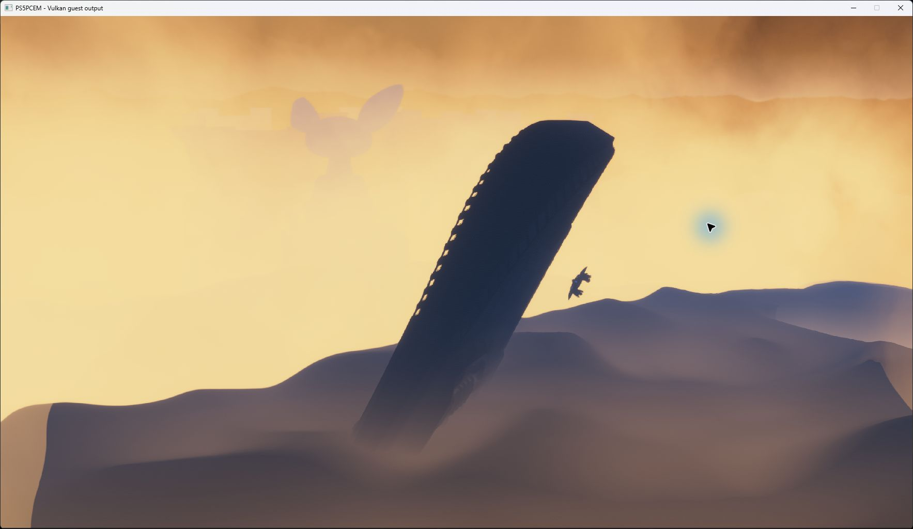

# ASTRO BOT startup and rendering investigation — October 13, 2026

PPSA21564 v1.018, development changes after `8d36d40`, RTX 3070 Ti,
1920×1080 requested output, Speed preset and keyboard input. Existing caches
were retained. This is a diagnostic cinematic checkpoint; controllable
gameplay and completion are not verified.

## Observed result and prerequisites

The diagnostic run loads `hub_crashsite` and renders the arrival cinematic
through the scene beside the ship. The final candidate removes the severe
green color corruption. Objects remain too dark, and four compute programs
using `IMAGE_BVH_INTERSECT_RAY` are still rejected. Cross and Options reach
the guest pad state, but character control was not established. Runs are stopped.

This unmodified window capture is from a diagnostic configuration, not an
ordinary successful launch. The available package and its backport do not
contain eight font files requested by the title. A separate local app0 overlay
aliases existing game fonts to those missing names and uses the title's native
`-lvl hub_crashsite` argument. Original game files are unchanged; neither the
fonts nor the overlay are distributed with these changes.

The run also sets `PS5_AUDIO_PROPAGATION_DISABLED=1`. This opt-in diagnostic
mode retains object lifetimes and attributes but produces no propagation
paths or reflected/occluded audio contribution. The normal default continues
to return an unsupported error for the unimplemented propagation backend.
This is not a complete implementation of acoustic simulation.

## Implemented changes

- JSON values now keep stable borrowed references, typed scalar getters,
  owned deep copies, mutable array/object members, serialization and array
  iterators with the observed hidden-result-pointer ABI. Storage grows past
  the old fixed node and binding limits. Unknown Json2 calls remain explicit
  failures and are now traceable.
- APR/AMPR command lists grow within the caller's byte capacity, preserve
  command order and own deferred snapshots instead of imposing a 32-command
  ceiling. A regression test submits a 901-command batch.
- Font text sources, parser callbacks, line metrics, glyph ownership and
  weight effects are implemented. PlayGo reads the installed binary chunk
  count. Kernel range-name clearing and GPI reads are added. Local Share
  lifecycle/policy is tracked; capture and unavailable online services still
  report failure rather than pretending to complete requests.
- RDNA lowering adds `S_ORN2_SAVEEXEC_B32`, `S_SETPRIO` and `V_FFBH_I32`,
  corrects unsigned 64-bit multiply-add carry/literals and SDWA VCC selection,
  and honors graphics-stage wave32 flags. One-dimensional storage images use
  height-one Vulkan views with correct load/store/atomic coordinates.
- Scanout respects the registered packed 10-bit channel order. Compute writes
  retire stale raster aliases when an allocation is reused at a new extent,
  preventing an old smaller attachment from replacing the new result.
- Explicit SDWA DWORD destinations are distinguished from ordinary f16 half
  writes. A conversion must clear the old high half when the instruction
  requests a full DWORD; ordinary half writes still preserve the other half.

The last fix addresses the green corruption in compute program `0x5007b1300`.
The GPU regression failed before the change: expected `0x00003e00`, observed
`0x47293e00`. It passes afterward. In the earlier arrival-scene capture, the
green channel reached 43,328 after this pass, with 1,080,849 extreme green
outliers. A later capture of the same pass after the fix has no such outliers;
the maximum green value remains 1.5684 before and after the pass. These are
different frames, not a pixel-identical performance comparison.

## Resolution and performance limits

1080p currently controls output, not every internal render pass. Captures show
1920×1080 raster work, a 2432×1368 postprocess surface and 3840×2160 scanout.
The postprocess surface contains about 60% more pixels than 1080p. No universal
internal-resolution cap is implemented by this change.

The moving cinematic varies substantially: selected frame profiles range
from roughly 0.32 seconds to more than 1 second, with some heavy frames above
1.4 seconds. These observations are not a stationary gameplay benchmark or
proof of an FPS improvement. Heavy views repeatedly evict and upload hundreds
of textures, sometimes transferring about 1 GiB of texture data in one frame.
A temporary 2048-to-3072 MiB sampled-cache experiment was inconclusive because
the camera entered a lighter view; the original limit was restored.

## Validation

- ReleaseFast runner and Vulkan smoke build: 12/12 build steps succeeded.
- Full HLE suite: 671/671 tests passed.
- Targeted final SDWA decoder/translator checks: 10/10 tests passed.
- GPU half-write regression: 40 cases × 128 lanes, covering explicit DWORD,
  PAD/PRESERVE, ordinary VOP1/VOP2, VOP3 half selection, wave32/wave64 and
  inactive lanes. Existing SDWA and packed-float probes also pass.
- GPU checks for signed/unsigned first-bit scans, unsigned 64-bit multiply-add,
  SAVEEXEC, priority hints, 1D storage operations, packed scanout and raster
  alias replacement passed with Vulkan validation enabled.
- The earlier full RDNA suite still has 10 failures and one leak, also
  reproduced on base commit `8d36d40`. A clean full-suite result is not claimed.

## Package extraction changes

CNT metadata extraction now reads entries from their actual file offsets
instead of truncating the container to a 64 MiB prefix. NAPS block-boundary
lookups use sorted offsets and binary search instead of scanning every file
for every block. Metadata decompression reports its size and block count.
All 23 package tests and the ReleaseFast extractor build pass. This does not
recover files absent from the source package, including the missing fonts above.
