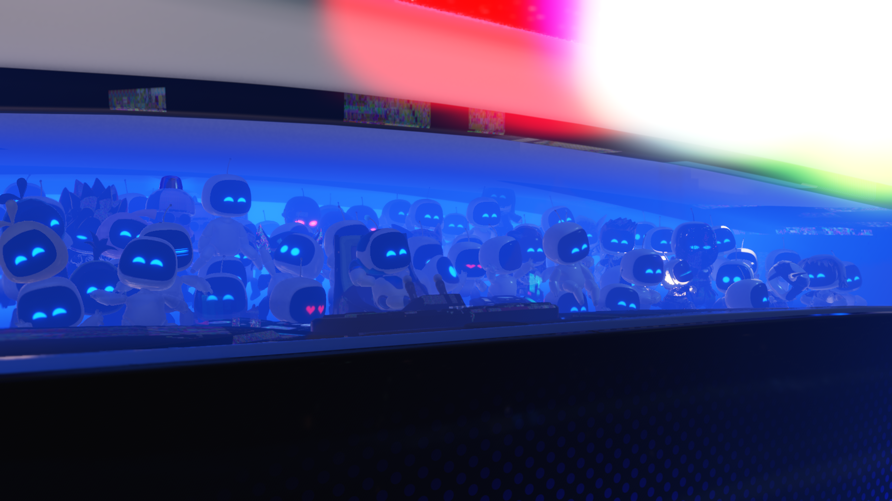
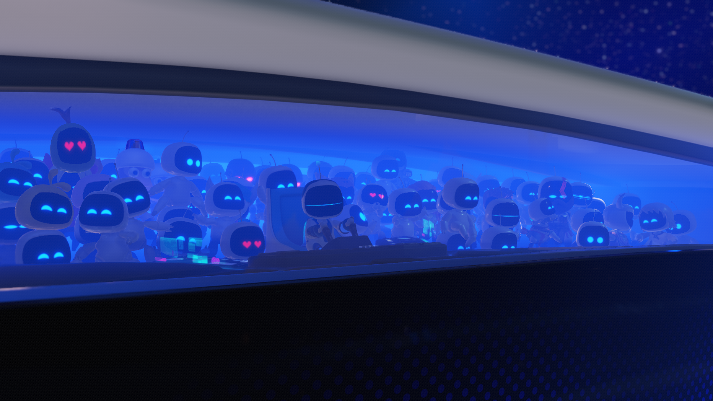
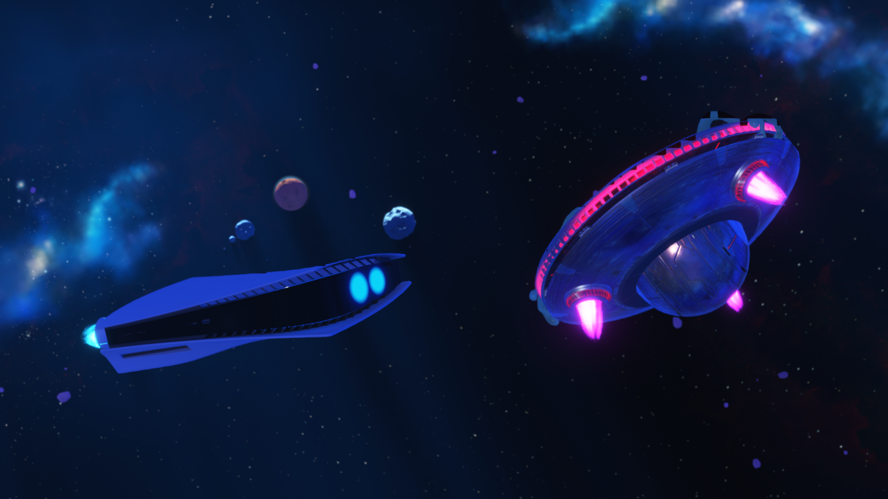

# ASTRO BOT: streamed texture minimum LOD

Date: October 24, 2026. Title: PPSA21564 v1.018. Vulkan development build.

## Reproduction and cause

The compute-loop follow-up passes the previous particle-dispatch failure and
continues through the opening cinematic into the arrival sequence. The live
run records no deferred shader fault through flip 7275. This confirms progress
beyond that stop, not complete graphics correctness or a new gameplay result.

Colored noise remains on robot hands, panels and the enemy's surfaces. Targeted
captures place it in the material buffer before depth of field and final color
processing. At flip 5059, the first captured draw using vertex program
`0x500b3c700` and fragment program `0x500b3fc00` adds 127,179 changed material
pixels, including the corrupted enemy surfaces.

Two BC7 sRGB descriptors used by this draw have addresses `0x10d1370000` and
`0x10d1430000`, dimensions 2048 x 2048 and `MIN_LOD = 0x400` (4.0). Offline
decoding with the emulator's own tiling layout shows:

- Mip zero contains unrelated patches and colored noise, matching the visible
  corruption. It is outside the descriptor's permitted sampling range.
- Mip four contains coherent authored textures.
- The Vulkan path decoded the image descriptor's minimum LOD but did not apply
  it to sampling. It also staged the excluded higher-resolution mip levels.

The descriptor uses unsigned 4.8 fixed point in resource mip space. It must be
distinguished from sampler bounds, which are relative to the base mip and apply
at a different stage. The Vulkan
[image-view minimum LOD extension](https://docs.vulkan.org/refpages/latest/refpages/source/VK_EXT_image_view_min_lod.html)
provides this separate constraint, including fractional values. SharpEmu's
local image-view implementation was also inspected for comparison.

## Implementation

The candidate queries and enables `VK_EXT_image_view_min_lod`, attaches the
clamp to sampled image views, and includes it in view-cache identity. Rebasing
the uploaded mip chain subtracts the guest base mip from the image clamp.

Staging reads only the resident mip range. Excluded high mips retain their
host image dimensions but are initialized without reading unrelated guest
memory. Fractional clamp changes can share the same uploaded bytes; changing
the first resident mip invalidates that upload identity so newly available
levels are not left stale. The same sampled-image path serves graphics and
compute. A nonzero effective clamp on a device lacking the extension reports
an explicit unsupported-feature error instead of sampling excluded levels.

## Validation

The ReleaseSafe runner and native Vulkan probe build successfully. All eight
cases of `vulkan-smoke --image-min-lod` pass with Vulkan validation enabled:
missing high mips, repeated descriptors, fractional interpolation, a changed
resident mip boundary, nonzero base mip, a clamp below the view base, a clamp
beyond the last mip, and returning to the original cached descriptor. The
sampler maximum is zero throughout, checking that the image constraint still
wins. The probe refuses reads of the deliberately absent high mips.

The existing `--streamed-mips`, `--bc4`, `--sampled-view-reuse` and
`--resident-mip-chain` probes also pass with validation enabled. No Vulkan
validation error was reported in these runs.

The complete ReleaseSafe Vulkan unit suite passes **266/266** tests. Its first
run exposed two unrelated fixture defects: the submission-polling mock left
its storage-image list uninitialized, and an overlap-index test overflowed
while forming the inclusive last byte of a range ending at `UINT64_MAX`.
Both test fixtures are corrected; no runtime workaround was added for them.

Candidate runner SHA-256:
`BBEFB0282E4725F0F76C6FAE3458933F323F1FC314041C63171AEDE9D6953141`.

The extension is optional at device creation, but sampling a view with a
nonzero effective minimum LOD requires it. Devices without the extension
still need an equivalent shader fallback.

## Live result and captures

The rebuilt runner starts ASTRO BOT, reaches the opening cinematic and passes
flip **4261** without a deferred flat-memory or sampled-image shader fault.
The maintainer confirms that the graphics in the opening cinematic are now
corrected. The repeated ship-interior shots no longer contain the colored
noise on the panels or the extreme rainbow glow visible before this change.

These are unedited renderer captures of the same cinematic section in two
runs, not identical animation frames. The former loop-budget change is present
in both runs, isolating the new texture-LOD implementation between builds.

| Before MIN_LOD support, flip 3264 | After MIN_LOD support, flip 3840 |
| --- | --- |
|  |  |

A second fresh capture, flip **4544**, shows the following two-ship shot:

A separate uncapped opening-cinematic interval presents **327 frames in
30.0001754 seconds: 10.90 FPS**. This is not a stationary gameplay measurement
or a matched performance comparison with the earlier 8.87 FPS sample.
Hardware: RTX 3070 Ti; Vulkan, Speed preset, retained caches, 1920 x 1080 output.
The game still controls internal render dimensions; the renderer captures its
3840 x 2160 scanout. No resolution override or retouching is applied to these
published captures.

There are no draw/dispatch failures or unsupported-compute reports in the
sampled cinematic profile rows so far. Some rows still report 12 unresolved
storage bindings; zero deferred shader faults does not prove all bindings or
all later effects are correct. This run has not yet reverified controllable
gameplay, the motion-control tutorial, later levels or completion. The current
game session is left running for the maintainer.

Local evidence: `.codex-astro24-dispatch1m-visible.{out,err}.log`,
`out/vertex-capture-5059-500b3c700.*`,
`.codex-astro24-material5059.txt`, and decoded texture diagnostics under
`C:\PS5PCEM-diagnostics\astro-2026-10-23\material3876`.
The new run is `.codex-astro24-minlod-visible.{out,err}.log`; its measured
interval is `.codex-astro24-minlod-cinematic-fps.log`.
Guest texture/shader dumps remain local and are not distributed in the repository.
