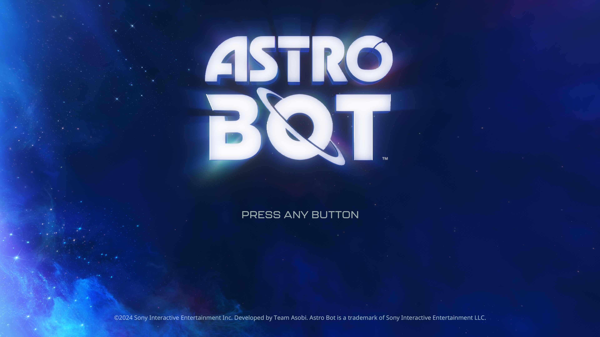

# ASTRO BOT: uniform-load and sampled-scan review

October 15, 2026. Development build; PPSA21564 v1.018, Ryzen 7 7700,
RTX 3070 Ti 8 GB, 32 GB RAM. Host output 1920Г—1080; game-owned capture
3840Г—2160, with internal targets up to 2432Г—1368. Animated title screen;
this run does not establish character control.

## Changes

- Uniform control-flow analysis can omit CPU scalar-memory reads whose entire
  destination is unused by its scalar interpretation. The immutable plan records
  a conservative union of scalar source registers across all blocks, including
  wide sources, address chains, offsets and implicit EXEC/VCC masks. Replaced
  instruction allocations and manual plans without this summary keep the old
  reads. GPU instructions, resource discovery and scalar specialization remain
  intact; no constants or descriptors are substituted with guessed values.
- Compute sampled-image preparation visits retained instruction indices instead
  of scanning and copying every decoded instruction. Uncached analyses retain
  a scan that filters instructions before copying them.

## Verification and measurements

GPU/Vulkan: **560/560 tests pass** (292 + 268). ReleaseFast runner and native
probe build pass. Native Vulkan probes cover storage-image copying, texture
sampling, compressed array fetch/gather, changing uniform output guards,
producer-specific scalar values and descriptor-register reuse. No Vulkan
validation or synchronization errors were reported. The game capture is intact,
with no failed draws/dispatches or unsupported compute programs in the measured
title frames. The previous **12 unresolved storage bindings per frame remain**.

Each comparison uses eleven 60-frame blocks per mode, balanced across eleven
animation phases in one process. Both modes were warmed. No builds, tests,
capture or stack profiling ran during the timed intervals. The toggles control
unused proof loads and the retained compute sampled index; both modes use the
new fallback loop, so this is not a complete old-executable comparison.

| Window | Disabled | Enabled | Frames per mode |
| --- | ---: | ---: | ---: |
| Early, flips 2640–3960 | 14.10 FPS | 14.07 FPS | 660 |
| Later, flips 5280–6600 | 14.91 FPS | 14.95 FPS | 660 |

The enabled mode omits **49 uniform-proof reads per frame**, 32,340 across each
660-frame sample. **These measurements do not establish an FPS improvement;
25 FPS is not reached.** The early and later windows also demonstrate why
separate runs should not be compared as if only one optimization changed.

A separate 20-second stack sample (3,275 samples) still concentrates in CPU
resource preparation, scalar interpretation, guest-memory copies/checks and GPU
completion waits. Readback tracing identifies indirect-dispatch argument reads,
resource preparation and a 960Г—540 color-target materialization. Inclusive stack
counts overlap and must not be summed as percentages. Moving indirect dispatch
to GPU arguments needs a separate correctness implementation, including users of
the dispatch dimensions; it is not included here.

## AnyPS5 and KytyPS5 review

Local heads remain AnyPS5 `c26982f63` and KytyPS5
`9e41d8320a2774b303fbad344c2347e8d0292e83`. This is independent Zig work informed
by their resource-tracking approaches, not a wholesale renderer import.

- Kyty's dominating descriptor-load reuse and immutable proof reuse remain
  relevant; see the [preceding review](astro-bot-entry-scalars-2026-10-15.md).
- Kyty's containing-buffer reuse and GPU image-to-buffer synchronization suggest
  further work on PS5PCEM's alias/coherence handling. Pending CPU writes and newer
  overlapping GPU writers must remain ordered before reusing a resident range.
- AnyPS5 commit `69702ef10543a10039567f8f6a45f2ea2aa11fef` retains bytes from GPU
  stores outside CPU write-watch coverage until completion. It is a coherence
  design reference, not a reason to disable writeback.
- AnyPS5 commit `fc24253487fa6a407a9093ccd5f3cb0970af4ddf` recognizes a specific
  16-byte stream-copy kernel. None of 78 local ASTRO shader dump files matched
  that exact instruction sequence. This does not prove it is absent from the
  entire game, and no blanket copy-kernel shortcut was added.

## Rejected experiment: graphics uniform specialization

The same binary also tested its existing vertex and fragment uniform-specialization
switches together. Both modes retained the new unused-load filtering and warmed
their pipeline variants before the comparison at flips 8580–9900. Eleven balanced
60-frame blocks per mode measured **14.93 FPS disabled** versus
**13.48 FPS enabled**. The visible title remained intact with the
same 12 unresolved storage bindings, but texture-preparation savings were
outweighed by CPU analysis and additional transfers/waits. Both graphics switches
remain **disabled by default**; this experiment is not an installed performance fix.
