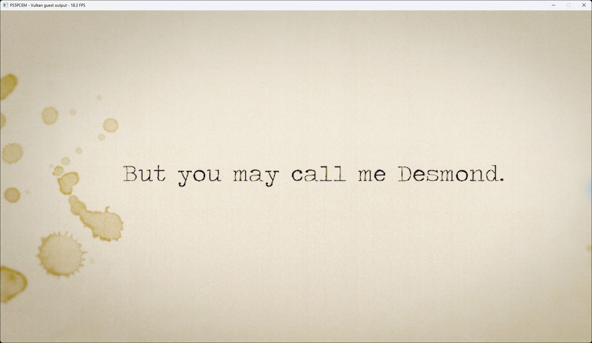

# Charon's Staircase startup — October 11, 2026

Title: PPSA06603, content version **01.000.000**. Existing development runner;
no emulator implementation changes were made for this check.

## Result and method

The runner links the title, displays the Indigo Studios screen, and advances
through the illustrated introduction. After the loading screen, the first
3D forest-road scene renders with trees, road lighting and lens flare.

RTX 3070 Ti, 1920×1080 output, Speed preset, Performance system-game preference.
The log reports a largest internal target of **3456×1944**. Existing caches
were retained. Scripted Cross, FPS display and Pad diagnostics were enabled.
No manual movement was tested; this is evidence of the rendered opening world,
not proof of playable controls, progression or completion.

## Timing and remaining issues

Thirty one-second window-counter readings over **29.852 seconds** in the
stationary forest view give a **9.1 FPS median**, **8.0–9.3 FPS** range.
Automatic Cross remains enabled. This is a scene-specific counter sample,
not a minimum across the game or a before/after comparison. Intro captures
read 18.3–22.3 FPS; these are separate, individual observations.

The transition at flip 2547 takes **32,342 ms**. Graphics pipeline misses
account for **26,810 ms**, out of 28,897 ms spent processing draws. This is
direct evidence of expensive first-use pipeline work in the tested transition,
not an unexplained freeze. Later sampled forest frames take about 110–114 ms,
with approximately 560 draws, 47 dispatches and 24 ms of fence waits.

Of **64** periodic GPU-gap reports, **63** contain nonzero unresolved storage
bindings: commonly 72, and 144 in an early frame. Draw failures, dispatch
failures, unsupported compute, null storage and rejected storage counters
remain zero in those reports. No guest fault or missing sampled-image
diagnostic was logged. The exact visual consequences of unresolved storage
bindings have not been isolated; shader/resource coverage is incomplete.

The scene is very dark with a bright road patch and prominent lens flare.
No reference comparison establishes which lighting details are incorrect.
Audio output has nonzero PCM peaks, but audible quality was not verified.
Manual controls, saves, completion and long-session stability remain untested.
The process was stopped after the scene measurement.

Runner SHA-256:
`798263b7e66f498cf9d14de6b93a352030e0c44cca3bdc7d34601c5db5297287`.
