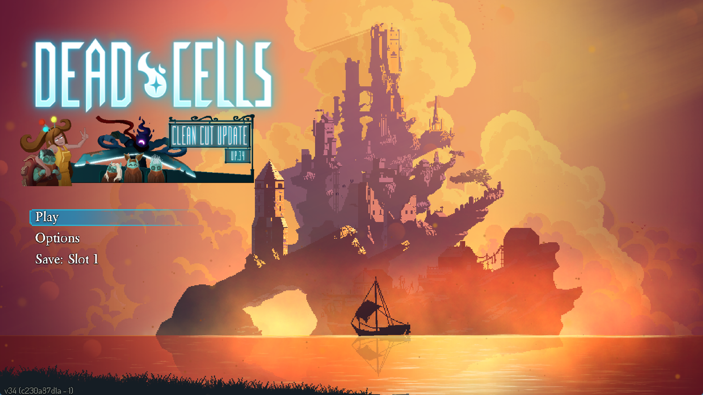
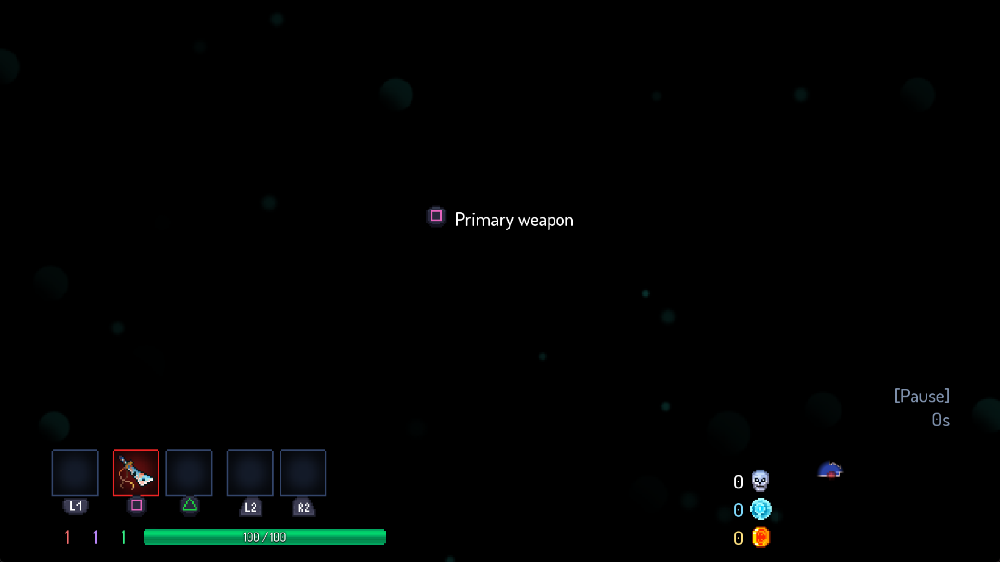

# Dead Cells NGS2 linking — October 11, 2026

Dead Cells (PPSA15552 v01.005.000) did not start at all: the loader refused
to link `eboot.bin` because eight `libSceNgs2` imports had no implementation.

```text
unresolved eboot.bin: koBbCMvOKWw libSceNgs2 func
unresolved eboot.bin: 0eFLVCfWVds libSceNgs2 func
unresolved eboot.bin: eF8yRCC6W64 libSceNgs2 func
unresolved eboot.bin: cLV4aiT9JpA libSceNgs2 func
unresolved eboot.bin: 7Lcfo8SmpsU libSceNgs2 func
unresolved eboot.bin: 0lbbayqDNoE libSceNgs2 func
unresolved eboot.bin: pgFAiLR5qT4 libSceNgs2 func
unresolved eboot.bin: 1WsleK-MTkE libSceNgs2 func
cannot link D:\[PS5]_PPSA15552_Dead Cells\eboot.bin: UnresolvedImport
```

## The missing functions

| NID | Function |
|---|---|
| `pgFAiLR5qT4` | `sceNgs2SystemQueryBufferSize` |
| `koBbCMvOKWw` | `sceNgs2SystemCreate` |
| `0eFLVCfWVds` | `sceNgs2RackQueryBufferSize` |
| `cLV4aiT9JpA` | `sceNgs2RackCreate` |
| `7Lcfo8SmpsU` | `sceNgs2GeomResetListenerParam` |
| `0lbbayqDNoE` | `sceNgs2GeomResetSourceParam` |
| `1WsleK-MTkE` | `sceNgs2GeomCalcListener` |
| `eF8yRCC6W64` | `sceNgs2GeomApply` |

The first four create the NGS2 system and racks inside a buffer the title
supplies, instead of through an allocator callback. The others are the 3D
audio helpers that turn a listener and a positioned source into volume,
panning and pitch.

## Implementation

**Buffer-backed creation** shares the creation path of the existing
`...WithAllocator` entry points. `Create` checks that the caller's buffer
exists and is at least the queried size; the system or rack remembers it, and
`SystemDestroy`/`RackDestroy` now return that buffer description so the title
can free it. They previously ignored that argument. NGS2 state stays on the
host, so the reported sizes are budgets rather than layouts: 64 KiB for a
system, and 16 KiB plus 1 KiB per voice for a rack (`maxVoices` from the rack
option, 64 when absent).

**Geometry** (`src/hle/ngs2_geom.zig`) uses the SDK's public structure
layouts, which are asserted at compile time (listener parameters 60 bytes,
listener work 96, source parameters 108, attribute 308), and computes:

- an orthonormal listener basis from position, front and up, in left-handed
  coordinates or, with flag 1, right-handed ones;
- distance rolloff — inverse, linear or exponential, clamped between the
  reference and maximum distance;
- cone directivity, interpolating from the inner to the outer level by full
  aperture angle;
- Doppler pitch along the source–listener axis, clamped below the speed of
  sound;
- a constant-power level matrix for mono, stereo, 5.1 and 7.1, panning
  between the two speakers that bracket the source and spreading evenly when
  the source is overhead, at the listener or inside its own radius. LFE takes
  its own level;
- the listener-space position and volume for 3D audio objects.

The SDK documents what the fields mean but not the arithmetic, so these are
the usual positional-audio formulas (OpenAL's distance models and Doppler).
Two encodings are inferred rather than documented: rolloff models are
numbered inverse (the reset default), linear, exponential; and
`matrix_format` counts the source's input channels, each a row of eight
output levels, matching the existing pan matrix.

## Run

Development runner built from this change, after release 0.3.4; RTX 3070 Ti,
Speed preset, 1920×1080 output request, Performance game preference.

- The title links and reaches the main menu. The window counter read
  **71–72 FPS** there (single readings, not a timed median).
- Without an input mode, the runner's automatic Cross presses start a game.
  The gameplay HUD, weapon slot, health bar and the tutorial prompt render,
  but **the level and the character stay dark**. The counter read
  **52–62 FPS** in that scene.
- **Audio:** the maintainer reports no sound in the main menu, and sound in
  gameplay.
- Sampled draw and dispatch failure counters are zero. The gameplay run logs
  about fifteen `image_sample` translations rejected with
  `InvalidStorageBinding`; whether they cause the dark scene is not yet
  established.





### Calls observed

A traced run through the menu shows the title using every new entry point
except `sceNgs2GeomApply`, and every call returning success:

| Function | Calls | Result |
|---|---:|---|
| `sceNgs2SystemQueryBufferSize` / `sceNgs2SystemCreate` | 1 / 1 | 0 |
| `sceNgs2RackQueryBufferSize` / `sceNgs2RackCreate` | 3 / 3 | 0 |
| `sceNgs2GeomResetListenerParam` | 1 | 0 |
| `sceNgs2GeomResetSourceParam` | 16 | 0 |
| `sceNgs2GeomCalcListener` | 884, about one per frame, flags 0 | 0 |

`sceNgs2GeomApply` was not called in the menu or in the first minutes of the
dark gameplay scene, so its output is verified by tests only.

## Validation

- Five geometry tests cover the left- and right-handed listener basis and a
  degenerate orientation, the three rolloff models, constant-power stereo
  panning including the overhead and inside-radius cases, 7.1 pairwise
  panning with a separate LFE level and repeated input rows, and the cone,
  level limits and Doppler ratio.
- The full test suite passes 1600 of 1611 tests; the ten failures are the
  long-standing SPIR-V tests and are unchanged.

## Limits

- The level and character render dark in gameplay, and the main menu is
  silent. Both are fixed in the
  [follow-up report](dead-cells-level-and-menu-audio-2026-10-11.md).
- The NGS2 mixer still accepts voice matrix levels without applying them, so
  `sceNgs2GeomApply` results do not yet change what is heard.
- `sceNgs2PanGetVolumeMatrix` still routes every input to the first output
  channel.
- Playability, saves, longer sessions and performance beyond the counter
  readings above are not established.
