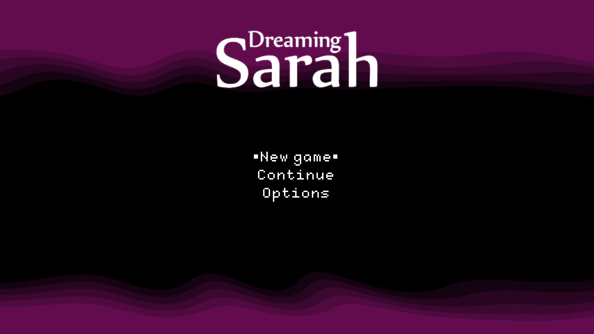

# Dreaming Sarah — DirectX 12 startup restored

November 7, 2026. PPSA02929 v01.000.000. Development build.

## Failure and implementation

The previous runner stops on the first fullscreen draw with
`UnsupportedPrimitive`. The packet is `DRAW_INDEX_AUTO`, count 3, primitive
type 17 (`DI_PT_RECTLIST`), using the merged NGG/export shader path.

The DirectX backend now recognizes this single auto rectangle and invokes the
guest vertex shader four times, drawing a triangle strip. This preserves the
fourth corner's guest-computed attributes, including values that cannot be
reconstructed by affine completion of the first three vertices. Counts 3 and 4
are supported for type 17. The existing type 7 path retains counts 1, 3 and 4.

Indexed or non-NGG type 17 draws, unsupported counts and flat rectangle
interpolation still report explicit errors. This change covers the form actually
used by Dreaming Sarah; it is not a claim of complete legacy primitive support.
There are no skipped draws, replacement shaders or Vulkan fallback.

## Validation

- `zig build test-d3d12 build-d3d12-smoke build-game-run -Doptimize=ReleaseFast -j2 --summary all`:
  **21/21 build steps and 51/51 unit tests passed**.
- The updated native `d3d12-smoke.exe` hardware suite passed on RTX 3070 Ti.
  Type 17 counts 3 and 4 produce the same complete image as an explicit
  four-vertex strip, including a deliberately non-affine fourth attribute.
  Invalid counts and indexed forms leave the target untouched. Existing type 7
  rectangle and graphics/resource probes also pass.
- Two launches pass the original rejection and reach the main menu. The visible
  keyboard-input run reaches captured flip **852**, with no rejected draws or
  dispatches, guest faults or device-loss messages in the captured trace.
  Both the game window and renderer capture show the logo and New game,
  Continue and Options entries.
- Website type checking and **86 compatibility/history/locale/release tests**
  pass. The dated DirectX report and capture are included in all twelve locales.

The standard `zig-out/bin/game-run.exe` was rebuilt in ReleaseFast. Tested SHA-256:
`2D41554B3CF9F2C28F1B66E334028967AD1E9EEDD2E49AD6CB7588984E793779`.

## Result and remaining checks

**DirectX 12: main menu reached.** Gameplay and character control were not
confirmed before the interactive check ended. No sustained FPS measurement,
audio-quality check, save/reload test or completed DirectX playthrough is claimed.

The existing **Playable · Completable** grade and October 10 performance results
refer to **Vulkan**; see the
[earlier gameplay report](dreaming-sarah-vertex-upload-performance-2026-10-10.md).

Host: Windows, NVIDIA GeForce RTX 3070 Ti, Speed preset, 1920×1080 output request.
The guest registers a 3840×2160 scanout. The image below is the final scanout from
the DirectX renderer, converted losslessly from PPM to PNG.

