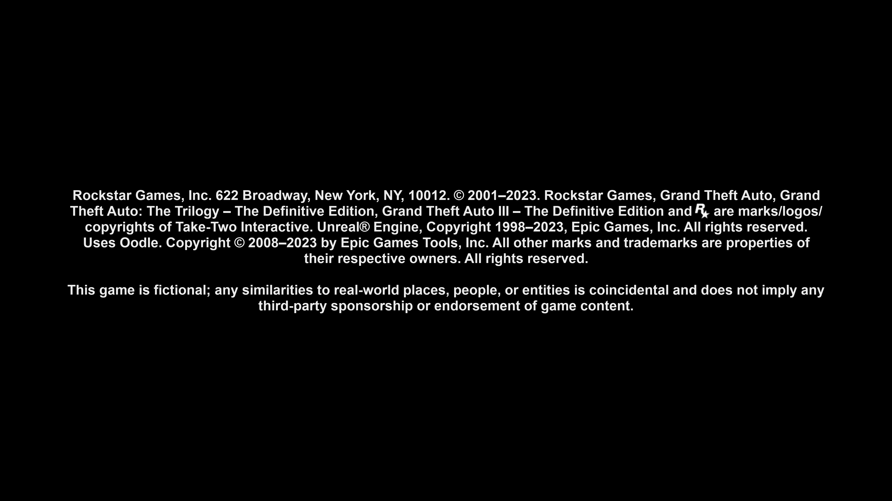
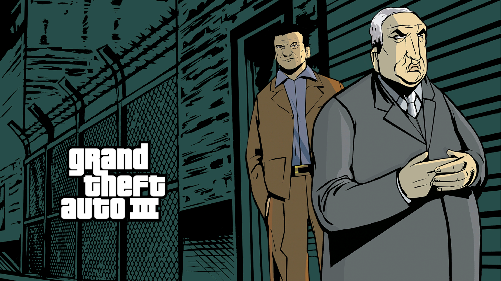

# GTA III — DirectX 12 startup blockers

November 12, 2026. PPSA03527 v1.007, Windows, RTX 3070 Ti.
Development build following `d33ebb9`; native D3D12, Speed preset,
1920×1080 output request. Internal target dimensions remain game-controlled.

## Sampler addressing

The first reproducible stop after the NGG/volume-target work was
`GraphicsSamplerAddressModeNotImplemented`. Guest MIRROR_ONCE_LAST_TEXEL
now maps to native MIRROR_ONCE, and CLAMP_BORDER maps to native BORDER.
Validation admits MIRROR_ONCE on all three sampler axes. The sampler diagnostic
also now covers failures after descriptor decoding, rather than ending its
scope before the failing checks.

The GPU suite checks 180 normalized-coordinate draws across cache configurations:
point and bilinear filtering, negative/outside/edge coordinates, all fixed border
colors, and preservation of source texels. A new GTA launch passes the original
sampler rejection.

## Single-sample CMASK fast clears

The next target is a 1680×946 R11G11B10_FLOAT image using color swizzle 27 and
CMASK metadata swizzle 24. These are independent register fields. Treating
the metadata layout as the color layout incorrectly rejects this valid pair.

The D3D12 staging path now uses the actual FMASK_SW_MODE and
CMASK_PIPE_ALIGNED fields with the existing shared GFX10 metadata equations.
Active CMASK nibbles of zero materialize the register clear value; expanded
nibbles preserve backing texels. Clearing includes the whole 8×8 block at view
edges. Color bytes are published before the active metadata nibbles are marked
expanded. Inactive nibbles are preserved.

Queued draws include CMASK metadata in dependency checks and target identity.
Conflicting attachment ranges and unsupported compression, MSAA, array/volume,
DCC+CMASK, metadata swizzle and alignment combinations remain explicit errors.
This implements single-sample fast clears, not general CMASK decompression.

Hardware checks compare complete backing allocations against independently
expanded references for RGBA8, R11G11B10F and RGBA16F, with both R and Z color
swizzles. They cover mixed clear/expanded blocks, edge padding, metadata reads
that flush queued draws, repeated staging and rejection without memory changes.
GTA passes this stop and begins decoding its opening video/audio frames.

## sRGB color targets

The subsequent draw uses a 1792×1080 BGRA storage target, guest RGBA8 format 10,
number type 6 (sRGB), with DCC enabled. The native format is now
R8G8B8A8_UNORM_SRGB. Staging preserves encoded bytes and the existing red/blue
swizzle; the native RTV performs RGB encoding and linear-space blending.
Alpha remains linear. This follows Microsoft's
[color-space conversion](https://learn.microsoft.com/en-us/windows/win32/direct3ddxgi/converting-data-color-space)
and [output-merger behavior](https://learn.microsoft.com/en-us/windows/win32/direct3d11/d3d10-graphics-programming-guide-output-merger-stage).

Thirty-six GPU cases compare against a CPU sRGB transfer-function reference,
including both curve segments, destination-dependent blending, alpha, BGRA,
DCC register clears and switching the same backing between UNORM and sRGB.

The sRGB build passes the rejection, displays the legal notice and reaches
the illustrated GTA III loading screen. It then stops on a 128×128 RGBA16F
render target with eight resource mip levels.

## Color mip and single-slice views

The color target path now uses the shared GFX10 subresource layout for mip
placement, tail coordinates and array-slice XOR. Host render dimensions and
MRT compatibility use the selected view dimensions, not the base allocation
dimensions. Changing the selected view flushes preceding queued work; staging
and publication preserve neighboring levels, slices and padding.

The GPU suite checks **216 draws** over RGBA8/RGBA16F, linear/R/Z layouts,
128×128 and odd 129×73 allocations, all eight mip levels and two array slices.
Whole allocations are compared with independently rendered flat-target
references placed through the shared texture layout. MRT views from differently
sized allocations are accepted when their selected dimensions match; mismatched
views are rejected without writes. DCC subresource views, CMASK subresources,
multisampling and volume mips remain outside this implementation.

The next live run passes color-target validation and reaches sampled texture
staging in that draw. Its next rejection identifies a 256×256 BC6H unsigned
HDR cube, sampled as an array of six faces, with nine mip levels.

## BC6H HDR textures

Guest formats 179/180 now map to native BC6H_UF16/BC6H_SF16. Footprint checks
retain 16-byte compressed blocks through the 1×1 tail. The signed format is
explicitly excluded from the former even-format-means-sRGB rule, and forced
sRGB is rejected. Decompression stays on the GPU with HDR values intact.

The hardware suite passes **576 frame comparisons** for unsigned/signed data,
negative/HDR values, 2D/cube/array views, linear/tiled sources, all mip levels
and fractional LOD. Mode-11 blocks use an independent constant-endpoint
reference based on the [BC6H specification](https://learn.microsoft.com/en-us/windows/win32/direct3d11/bc6h-format).
Full images, row padding and unchanged compressed source bytes are checked.

## Validation and current boundary

- `test-d3d12`: **57/57 tests passed**.
- `build-d3d12-smoke`: passed; the complete native hardware suite passed,
  including the sampler, CMASK, sRGB, mip/slice and BC6H checks above.
- `build-game-run`: **15/15 build steps passed**, ReleaseFast; the standard
  `zig-out/bin/game-run.exe` is updated.
- Live logs `.codex-gta3-step5.err.log` and `.codex-gta3-step6.err.log` show the
  sampler and CMASK stops being passed in sequence. These logs are local
  diagnostic artifacts, not repository files.
- The captured frames before the sRGB change are black. The next run
  (`.codex-gta3-step7.err.log`) displays the legal notice and loading artwork
  before the mip-target rejection. Menu and gameplay are not yet established.
- The mip-target run (`.codex-gta3-step8.err.log`) passes target validation
  and stops at the BC6H source descriptor in the same reflection draw.
- The follow-up BC6H run (`.codex-gta3-step9.err.log`) ended during startup,
  before reaching the reflection draw. In-game validation of this last change
  remains pending. No DirectX playability or FPS claim is made here; the
  existing completed-playthrough grade is a Vulkan result.

Installed runner SHA-256:
`392F1E926EDFEE2354883ACD505F9D6A53141B2055139FFA4F0CA6CC18A077BF`.

No skipped draws, replacement shaders or Vulkan fallback are used.

The following images are direct renderer captures, converted losslessly from
PPM to PNG. They establish startup progress, not gameplay.

