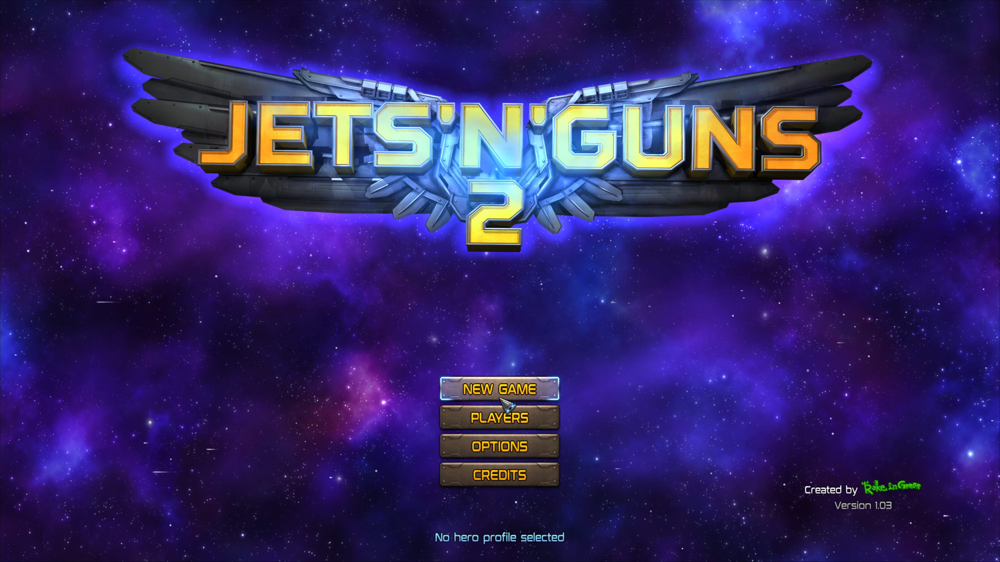

# Jets 'n' Guns 2 — DirectX 12 performance, November 7, 2026

PPSA17163, content version 01.000.002 (in-game version 1.03), Windows,
NVIDIA RTX 3070 Ti, native DirectX 12, ReleaseFast development build.

## Result and scope

The animated main menu improves from an observed **0.7–0.8 FPS** before the
changes to **1.22 FPS** in the final measured interval: **40 presentations in
32.801 seconds**, between logged flips 107 and 147. The final seven-frame
interval reaches 1.28 FPS. The maintainer also reports a small visible improvement.
This is still very slow. The earlier FPS readings were window-counter samples,
not an equally timed benchmark, so no precise percentage speedup is claimed.

The title still supplies a **3840×2160** scanout with the runner configured for
1920×1080 output. Resolution was not reduced for this comparison. The isolated
test profile remained at the main menu. Gameplay FPS, controls, audio quality,
completion and long-session stability were not revalidated; the earlier
**Playable · Completable** result belongs to **Vulkan**.

This is the renderer's actual RGBA scanout, saved as PNG, not a desktop capture.
The final log has no recorded guest fault, rejected draw or device-removal error.

## Changes

- `ACQUIRE_MEM` no longer forces a CPU fence/readback between otherwise ordered
  draws. Native command order is preserved. Overlapping attachment reads,
  texture-generation checks, dispatches, DMA, CPU-visible reads/writes, releases
  and presentation retain their completion boundaries. Both standard and custom
  acquire packets are covered. No draws are skipped and there is no Vulkan fallback.
- DirectX uses four participants in the existing bounded copy/tiling pool by
  default. `PS5_GPU_COPY_WORKERS` still overrides it; Vulkan defaults are unchanged.
- The lazily allocated CPU surface-conversion cache has a 512 MiB limit instead
  of 256 MiB. `PS5_D3D12_SURFACE_CACHE_MIB` selects 0–1024 MiB, and
  `PS5_D3D12_SURFACE_CACHE=0` still disables it. Fresh snapshots and exact byte
  comparisons remain mandatory; this is not unchecked texture reuse.
- Optional `PS5_D3D12_PROFILE=1` reports cumulative CPU timing buckets and a
  monotonic timestamp. Batch reports now count acquire packets retained in order.

## What still costs time

Approximate per-frame profile averages from the animated menu:

| Measurement | Before: flips 175–221 | Final: flips 107–147 |
| --- | ---: | ---: |
| Completed draw groups | 43.2 | 29.7 |
| Draw preparation | 329.8 ms | 208.4 ms |
| Of which attachment preparation | 278.3 ms | 176.4 ms |
| Native batch execution, submission and readback | 380.0 ms | 219.4 ms |
| Publishing attachment pixels to guest memory | 309.3 ms | 143.8 ms |
| Surface-cache evictions | 25.0 | 24.0 |

Preparation sub-buckets overlap; these rows must not all be added together.
Animation/work counts differ between intervals. Shader compilation is not the
sustained bottleneck: it was zero in the baseline interval and only 31 ms total
in the final interval. Large attachment copies and layout conversions dominate.

The larger surface cache removes startup eviction churn, but **does not eliminate
menu thrashing**. A separate trial of native attachment upload reuse plus four
copy participants measured 1.13 FPS, practically unchanged from acquire batching
alone (1.12 FPS). It avoided transfers but added comparison work, so that optional
native attachment cache and the general upload cache remain disabled by default.
Keeping intermediate render targets on the GPU is the next substantial task.

## Validation and installed build

- **51/51 portable D3D12 tests** pass.
- The complete native D3D12 hardware probe passes on the RTX 3070 Ti, without the
  Windows debug layer. Deliberately invalid shaders in negative tests still reject.
- New GPU tests compare the complete pitched color backing after three
  order-sensitive blended draws, with immediate execution versus batching across
  standard/custom acquire packets. They also verify target feedback, wait/live
  reads, guest writes, release labels and submission drains still publish pixels.
- Existing depth, stencil, HTILE, MRT, textures, allocation-pressure and batch
  failure-recovery probes pass. No new Vulkan run was performed.
- `zig-out/bin/game-run.exe` was rebuilt and replaced. Optimizations are enabled
  by default; timing and capture diagnostics are opt-in.

Runner SHA-256:
`DF7F50D756550964D9E7582268C51C78F61336567BF0767FFE9A82C92466FDA3`.
