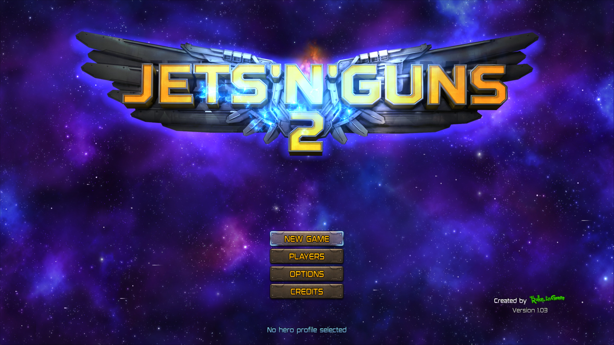

# Jets 'n' Guns 2 — DirectX 12 startup, November 5, 2026

PPSA17163, content version 01.000.002. Windows, NVIDIA RTX 3070 Ti,
native DirectX 12, ReleaseFast development build after v0.3.6.

## Failure and fix

The previous runner stopped on its first color-clear draw with
`MissingDepthTarget`. The guest left depth/stencil tests and both clear bits
enabled while the depth/stencil plane formats were invalid. D3D12 interpreted
the control bits as requiring an attachment even though no plane was enabled.

The backend now derives effective depth/stencil controls from `DB_Z_INFO`
and `DB_STENCIL_INFO` independently. An invalid depth format disables depth
testing, writing, clearing and bounds checks; an invalid stencil format disables
stencil operations. A valid format with missing backing or unsupported layout
still fails attachment validation. The color draw executes normally.

This follows the plane-format distinction also tested by AnyPS5 in
`UnwrittenDepthPlaneTests`. The implementation is confined to the native
D3D12 backend; no title-specific exception, skipped draw, dummy attachment or
Vulkan fallback was introduced. Rejection diagnostics now include the raw
depth/stencil descriptor registers.

## Validation

- All **50 portable D3D12 tests** pass.
- The complete native D3D12 hardware probe passes on the RTX 3070 Ti.
- A new GPU regression check compares the entire guest backing for color draws
  with unwritten or explicitly invalid depth/stencil formats, stale test/clear/
  bounds bits and stale addresses. Rendered pixels match the baseline and
  unrelated bytes remain intact.
- Valid stencil formats without backing still reject before writing guest
  memory. Existing depth comparisons, stencil, HTILE, MRT, textures and batching
  probes pass. The Windows D3D12 debug layer was not enabled.
- The ReleaseFast `game-run.exe` was rebuilt and installed in `zig-out/bin`.
- A fresh, isolated save profile reaches the animated main menu with the logo,
  background and readable options. The run has no logged unsupported draw,
  guest fault or device-removal error. Existing user saves were not used.
- The bounded run lasted **149.6 seconds**, reached logged flip **108**, and
  was stopped deliberately after capture. End-of-run private memory was
  **2,709 MiB**. Rendering was slow; this is not a performance improvement.

Runner SHA-256:
`1d0410e73fec0ffe248f09c08c3bba39f32acc5a4afa5c182b6908cda3b20fc8`.

The image is a renderer scanout capture, saved as JPEG, rather than a desktop
screenshot. The game supplies a **3840×2160** scanout despite the runner's
configured **1920×1080** output. No internal-resolution patch was applied.

## Scope

This verifies startup and main-menu rendering. Gameplay, audio quality,
completion, long-session stability and a representative FPS benchmark were
not verified in this DirectX run. The earlier **Playable · Completable**
result remains the separate Vulkan result. DirectX 12 remains experimental.

Window automation was unavailable (`native pipe unavailable`); the test used
the runner's existing scripted Cross input and periodic scanout capture.
