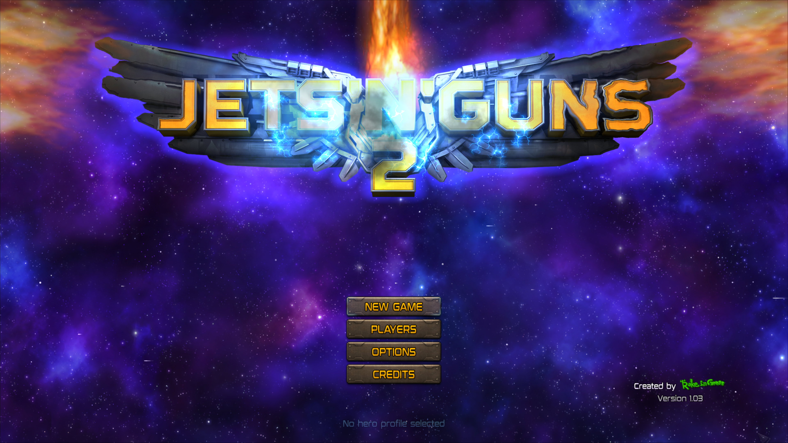

# Jets 'n' Guns 2 first-run save mount — October 29, 2026

Issue [#9](https://github.com/iStark/PS5PCEM/issues/9) reports an uncaught
`System::SystemException*` followed by `UD2` at `libc.prx+0x365af` in
PPSA17163. The same title/build (01.000.002) reproduces the exact fault and
caller stack when launched with a separate, empty host save directory. A
launch using an existing populated save directory does not reproduce it.

## Cause

The guest creates the `jng2` save container with mount mode `0x30`, unmounts
it, then mounts it read-only (`0x01`) to check for settings. At that point a
new container legitimately has no game files yet. The host treated an existing
container without nonempty payload as absent, returning `0x809f0008` from
`sceSaveDataMount3`. The guest throws at `eboot.bin+0x4ee043` in response.
The null callback and terminal illegal instruction occur during termination;
they are not missing imports responsible for startup failure.

## Change

Named mounts now use container existence independently of file contents.
An existing empty container returns the existing-container status, including
after unmount/remount and when creation is allowed. Missing non-creating
mounts still report not found and preserve an already active mount. Existing
files are not removed or rewritten by mounting. Save search retains its
existing filtering of unfinished payloads; this change is confined to named
mounts.

## Validation

- Five targeted save-data tests pass, including the first-run
  create/unmount/read-only sequence, missing-file probing, writing settings
  and reading them after remount.
- The complete HLE test suite passes: **730/730** tests.
- The pre-fix clean-directory run reproduces `libc.prx+0x365af` and the
  report's `eboot.bin+0x4ee047` caller exactly.
- The rebuilt Vulkan runner reaches the rendered main menu from a new, empty
  working directory. Both create and read-only `sceSaveDataMount3` calls return
  success. The game subsequently writes `game.ini` and `save/save_1.jsg` in
  that isolated profile. No user save was modified for this test.
- A second launch using that new profile also passes startup and continues
  rendering beyond 780 flips without the reported guest fault. Its music
  worker logs `sceAudiodecDecode` error `0x807F000E`; audio correctness is not
  established by this startup regression check.

The image is a renderer capture (frame 256), not a desktop screenshot. The
game's menu target is 3840×2160 despite the configured 1920×1080 output.

This is a startup fix, not a new gameplay-performance or completion claim.
