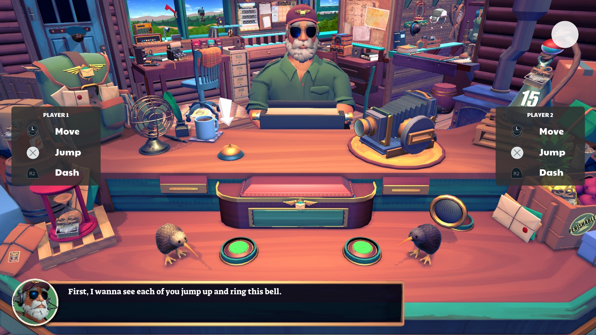
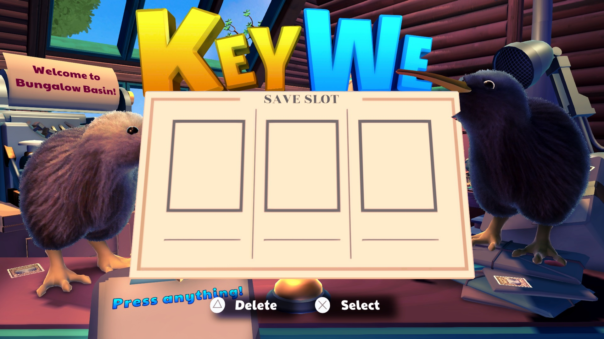

# KeyWe save-slot initialization — October 30, 2026

**Status: Playable · Completable**, confirmed by the project maintainer on
October 30, 2026. The development checks below verify the save-slot fix and
opening tutorial; they do not repeat a complete playthrough.

PPSA02210, content version 01.000.000. Development build after 0.3.5,
Windows, NVIDIA GeForce RTX 3070 Ti, Vulkan, 1920×1080 output.

## Result

The empty, unresponsive SAVE SLOT panel is fixed. A fresh run creates a slot,
writes it to disk and reaches the post-office tutorial with both kiwis,
dialogue, and Move / Jump / Dash prompts. Restarting the same installation
with the same save directory reaches the tutorial again. Scripted Cross
input also makes the first kiwi jump.

The image is a 1920×1080 renderer presentation capture from the final build,
converted to JPEG for documentation. It is not a desktop/window capture.

Before the fix, the same build family rendered the background and input
prompts but left all three slot cards empty:

## Two initialization failures

### Save-memory readiness

Unity calls `sceSaveDataGetSaveDataMemory2` with no data descriptor to query
whether its save memory is ready. The previous implementation returned
`0x80020016` (`EINVAL`). The caller at `eboot.bin` runtime address `0xfc62cb`
checks specifically for `0x809f0012` (`MEMORY_NOT_READY`) before taking the
`sceSaveDataSetupSaveDataMemory2` path. Returning the wrong error aborts
initialization rather than asking Unity to allocate/load its save memory.

The implementation now returns `MEMORY_NOT_READY` before setup and accepts
a no-output readiness query after setup. Real transfers retain address and
range validation. A metadata-only request is not silently accepted without
filling its outputs.

### Missing native Unity dialog plug-in

Fixing that return value alone was insufficient. Managed exception strings
in the live guest process showed `DllNotFoundException: Unable to load DLL
'Dialogs'`, followed by failures in save/profile initialization and the
profile-selection reveal coroutine. The game ships
`Media/Plugins/Dialogs.prx`, but it is requested through P/Invoke rather than
a `DT_NEEDED` dependency, and was missing from the runner's deferred list.

Both directory and ZArchive launch discovery now include the shipped
`Dialogs.prx`, alongside the other native Unity plug-ins. The game's real
module is linked and initialized. No guest executable patches, title-ID
special cases or successful no-op imports were added for this fix.

## Validation

- **734/734 HLE tests pass** in ReleaseSafe. New regressions cover the
  readiness query, setup, real writes, rejection of an out-of-range write,
  sync to disk, and reloading after the in-memory allocation is discarded.
- The final `game-run.exe` uses normal module discovery, with no manual
  `PS5_DEFERRED_MODULES` override. Its module list includes `Dialogs.prx`.
- A fresh-save run and a restart run each last approximately 102.5 seconds
  and reach the tutorial. Both are stopped by the diagnostic watchdog;
  neither logs an unresolved import, guest fault or GPU queue stop.
- `GetSaveDataMemory2` reports `MEMORY_NOT_READY` on process startup;
  `SetupSaveDataMemory2` and the following read succeed. Later readiness
  queries, writes and sync calls also return success.
- The title writes an actual **33,554,432-byte** save-memory file at
  `<working-directory>/savedata/PPSA02210/sce_sdmemory/memory.dat`.
  Fresh-run and restart SHA-256:
  `aaa96b6b925aa45febbd8c2d76c8effd62901f80a97640ecc2eea61d019d7763`.
  Test saves were isolated from user saves.
- The rebuilt runner is installed at `zig-out/bin/game-run.exe`.
  SHA-256: `f6530970d7f83f0c7275290277c185dd3982980f47288bd10769644bc725f939`.

The runs use the built-in scripted Cross input and a diagnostic 30 FPS cap.
The cap is **not a measured frame rate** or a sustained gameplay benchmark.
Two-controller behavior, manual movement and audio quality were not assessed
in these development checks. ZArchive discovery is updated in code but this
runtime test uses the unpacked directory.

## Earlier evidence

The [October 11 startup report](keywe-pthread-cancel-state-2026-10-11.md)
records the original import fixes and limited save-slot rendering. It remains
historical; the captures and save results above supersede its startup limit.
