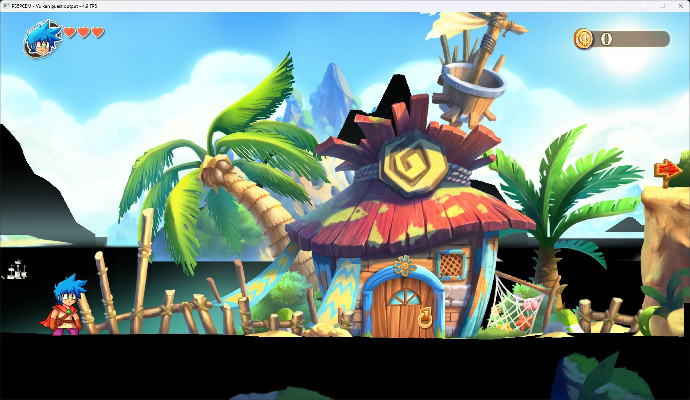

# Monster Boy: New Game and gameplay verification — October 12, 2026

Title: **Monster Boy and the Cursed Kingdom**, PPSA02787, v01.000.004.
Development build; this run is not assigned to a published release.

## Verified result

**In-game · severe rendering defects.** New Game now creates a save and reaches
the first controllable level, “Welcome To Monster World”. Keyboard movement
shifted the character to the right; the intro could be skipped with Options.
The HUD, character, hut and palm trees render, but large black polygons obscure
parts of the ground, water and background. Jumping was not captured conclusively.
This is a first-level check, not a completed playthrough.

### Performance and limits

On the RTX 3070 Ti development host, 30 one-second window-counter samples from
a stationary first-level scene ranged from **3.8 to 5.7 FPS**, with a **4.2 FPS
median** and **4.32 FPS arithmetic mean**. The interval was 00:43:28–00:43:57
on October 12, 2026 (UTC+3). Other compilation processes were running throughout,
so this is a contended observation, not an isolated performance benchmark.
Output was 1920×1080, Speed preset, keyboard input; the captured client area was
1765×993. Full HLE tracing and profiling were disabled; pad diagnostics and the
FPS counter were enabled.

Representative periodic frame splits were 223–256 ms per frame, of which
210–243 ms was attributed to the guest-side interval and 13 ms to submission.
That interval includes guest work, waits and scheduling; it does not identify a
specific CPU routine as the bottleneck. Recorded draw/dispatch failure and
unsupported-compute counters remained zero in the inspected run despite the
visible rendering defects. Zero counters do not establish rendering correctness
or universal shader support.

The title wrote `SYSTEM/system.dat` (92 bytes), `monsterboy0/monsterboy0.dat`
(24,844 bytes), and both slot icons (411,163 bytes each). Save reload was not
tested. Audible output was not verified; sampled audio peaks were zero. Complete
NGS2 graph mixing and delay effects are still outside the implemented port-state
query. Graphics and low gameplay FPS remain unresolved.

### Validation

- ReleaseFast runner build succeeded; SHA-256:
  `9A8F815F65F4935E2612723D381C2FA855E431208854BE131249394B8B7E2922`.
- HLE suite: **640/640 passed**. Focused save-icon rerun: **2/2 passed**.
- Input tests: **17 passed, 1 platform skip**.
- Tests cover independent NGS2 port state and bounds, short input taps, progress
  dialog lifecycle, exact icon byte counts, rejected writes and slot isolation.

## Startup and New Game fixes

The missing `sceNgs2VoiceGetPortInfo` import now resolves to a stateful,
validated per-port query. See the [NGS2 implementation report](monster-boy-ngs2-port-info-2026-10-11.md)
for the ABI, control handling and remaining audio-renderer limitations.

Short keyboard taps could fall entirely between the guest's controller polls.
The window thread now latches initial key-down events until the next foreground
keyboard read. Held keys still use physical state; focus loss clears pending
taps. The runtime pad log confirmed Cross, Options and D-pad transitions,
and manual navigation opened Options and returned to the main menu.

Two independent save-service problems then blocked New Game:

1. A system progress dialog reported FINISHED immediately. The title's state
   machine at `0x55f965` waits for RUNNING before starting save work, so it
   repeatedly reopened the dialog from `0x5607cd`. Save progress bars, system
   progress messages and user messages without buttons now stay RUNNING until
   the title closes them. Ordinary headless confirmations retain their prior
   completion policy.
2. `sceSaveDataSaveIcon` returned an unimplemented-service error. The title
   checks that result at `0x32ca90` and skips writing its save payload on
   failure. The export now validates the mounted slot and icon descriptor,
   then persists exactly `data_size` bytes as the slot's `sce_sys/icon0.png`.
   Metadata-only slots remain excluded from save discovery.

These are general service/input changes; no game executable or save payload
was patched to force progress.

The save-dialog enums and layouts were checked against
[shadPS4's dialog definitions](https://github.com/shadps4-emu/shadPS4/blob/main/src/core/libraries/save_data/dialog/savedatadialog_ui.h).
The icon descriptor was checked against local AnyPS5 sources. Its existing
SaveIcon stub was not used as the implementation: the emulator writes the
supplied bytes to its actual save backing.
