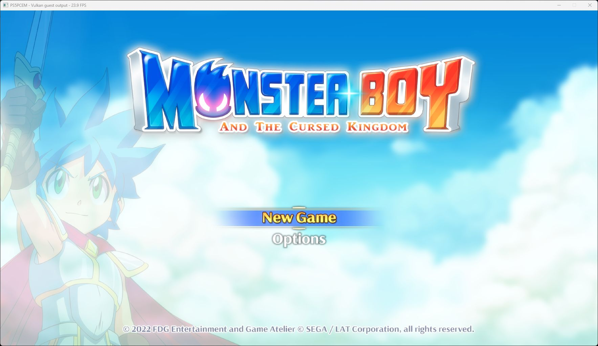

# Monster Boy: NGS2 port information and startup — October 11, 2026

Follow-up: the [October 12 gameplay report](monster-boy-gameplay-2026-10-12.md)
records the additional input/save fixes and the first controllable level.

Monster Boy and the Cursed Kingdom (PPSA02787, v01.000.004) previously
stopped before executing the game because `WCayTgob7-o` from `libSceNgs2`
was unresolved. The NID identifies `sceNgs2VoiceGetPortInfo`.

The development runner now links the title and renders the animated main
menu, including the logo, background and **New Game / Options** labels.
The captured window counter reads **23.9 FPS**. This is one menu reading,
not a sustained performance measurement or a gameplay result.

## Implementation

The new export returns a 24-byte record containing the selected port's
matrix ID, volume, delay in samples, destination input and destination
voice handle. It checks the voice handle, port index, output size and
writable memory range before writing. Other bytes in the caller's buffer
are left intact.

Voices now own independent port records sized from the rack options.
Ordinary default racks expose eight ports and one matrix; a default
mastering rack has no output ports. The implementation bounds explicitly
configured port counts at 256. New ports start disconnected, with unity
volume, no delay and matrix ID -1.

Parameter-list volume, matrix, delay and patch commands update these
records. Compact volume and matrix commands use the port index in their
command ID. Destroying a destination disconnects incoming patches; reused
voice slots get fresh state. Port zero's volume continues to drive the
existing direct PCM mixer.

This implements the state query and its associated control bookkeeping.
Full graph routing, matrix mixing and delay processing in the audio
renderer are still incomplete. Recording these settings does not establish
that every requested audio effect is rendered.

The ABI and command layouts were cross-checked against local AnyPS5
sources ([voice implementation](https://github.com/boykopovar/AnyPS5/blob/main/core/libs/prx/libSceNgs2.native/src/Voice.cpp),
[types](https://github.com/boykopovar/AnyPS5/blob/main/core/libs/prx/libSceNgs2.native/include/Ngs2Types.hpp)).
Voice, port, patch and matrix error identifiers were also checked against
[shadPS4's NGS2 error definitions](https://github.com/shadps4-emu/shadPS4/blob/main/src/core/libraries/ngs2/ngs2_error.h).

## Validation and limits

- The full HLE suite passed: **637/637 tests**. After adding further
  protection and lifecycle coverage, the focused NGS2 suite passed
  **13/13 tests**.
- Tests cover linked and compact controls, independent ports, invalid
  handles/indexes/sizes, non-finite volume, invalid matrix selection,
  destination destruction, slot reuse, canaries, read-only memory and
  output spanning a read-only page boundary.
- `zig build build-game-run -Doptimize=ReleaseFast` succeeded and installed
  `zig-out/bin/game-run.exe`. SHA-256:
  `35b56c6a91845001cbcd689a712748a622e6355ea48e89aec5fd85b09dfc21a4`.
- The first runtime check used scripted Cross input on an RTX 3070 Ti,
  Speed preset and 1920x1080 output request. The actual window was
  1765x993. The import failure disappeared and the main menu rendered.
- Startup logged several `InvalidStorageBinding` lowering attempts;
  observed periodic GPU-gap counters through flip 1740 reported zero
  draw/dispatch failures, unsupported compute and unresolved storage.
  This does not prove complete shader coverage or rendering correctness.
- Gameplay, manual navigation, audio quality, saves and completion have
  not been established by this startup check.
