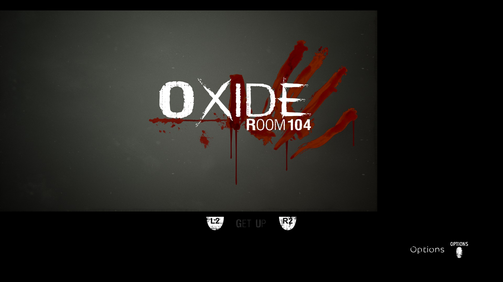

# OXIDE Room 104: black screen after Cross, October 29, 2026

**PPSA07653 v01.000.000 now passes the reproduced post-Cross graphics stop
on Vulkan using Unreal's raster rendering path.** The diagnostic run reaches
the animated introduction, subtitles and a later `L2 / R2 — GET UP` prompt.
Character control and further progression have not been verified. This is a
development build after v0.3.5, not a new release or a completion result.

## Why the audio log kept growing

The baseline failed graphics work while the audio thread remained alive and
continued submitting silent PCM (`peak=0.000`). Those audio messages were a
symptom, not evidence of an audio deadlock.

The first captured failure was a checked FLAT read in compute program
`0x7502500`, instruction `0xd4`. Its address was readable guest memory, but
the shader's address-space snapshot was empty. Per-lane pointers loaded from
structured buffer records had not been staged. After fixing that preparation,
both initial bounds-building programs pass their former stops. The following
ray-tracing material program still uses data-dependent `S_SWAPPC_B64` calls
which the translator cannot link (`InvalidScalarCall`). Aborted GPU work then
causes queue stops and secondary WAIT/memory errors.

## Changes

- Recover both words of buffer-loaded FLAT pointers through active-lane
  provenance, including an EXEC mask constrained by either operand of AND.
- Snapshot bounded constant-offset reads from those records after storage
  coherence. Reserve all snapshot uploads together and preserve checked
  faults for executed reads outside the captured regions.
- Recognize PSR BVH version-4 metadata and its instance-pointer layout in
  addition to version 9. Root discovery also recognizes encoded BVH address
  pairs. This is preparation support, **not complete ray-tracing support**.
- Default **PPSA07653** to Unreal's own `-noraytracing` option through a
  virtual `ue4commandline.txt`. Directory and ZAR reads, positional reads and
  file sizes agree; already-open descriptors retain their immutable contents.
  The installed command-line file and archive are not edited. Other titles
  retain their existing default.

The runner announces the raster preference at launch. For diagnosis,
`PS5_UNREAL_RAY_TRACING=1` restores the title's original command line; it
does not make the remaining ray-tracing shader path work. An explicit `0`
requests the same raster preference for another Unreal title with a readable
command-line file.

## Validation and limits

The initial raster comparison used an isolated content overlay. A subsequent
normal-path launch, with no `--app0` override, confirms that the new profile
passes `-noraytracing` to the engine and advances beyond the baseline stop.
The extended comparison reached more than **2,600 flips** without a queue
stop or guest fault; its periodic GPU-gap reports are zero. A full-ray-tracing
control run still rejects the material call and later BVH preparation with
`InvalidStorageDescriptor`. It is not reported as fixed.

**326 GPU tests pass**, as do the new directory/archive command-line tests
and the existing Unity boot-document regression. The ReleaseSafe runner
build and formatting/diff checks pass.

The later heavy scene samples take roughly **0.6–0.7 seconds per frame**.
These are diagnostic timing observations, not a controlled gameplay FPS
benchmark: captures were enabled for parts of the run and builds overlapped
earlier intervals. Output is 1920×1080; the game still renders internal targets
up to 3840×2160. Nonzero PCM submissions resume, but audible music/effects,
rendering correctness, saving, completion and long-session stability remain
unverified. No unsupported draws or dispatches were deliberately skipped to
obtain the result.

This is the renderer's final exported scanout, resized from 3840×2160 to
1920×1080 for documentation. It is not an independent desktop/window capture
or proof of working character movement. No brightness or rendering correction
was applied to the image.

Runner SHA-256:
`4bd3dc405683a944aed7667bb13891af6cef953d9400c0978dc30bd250e90371`.
