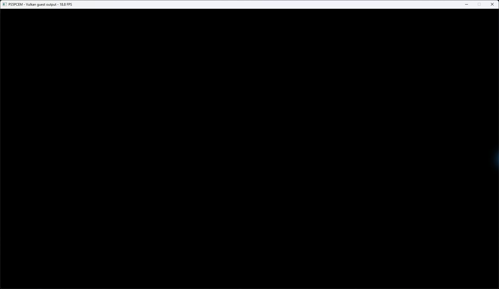

# Oxide Room 104 startup — October 11, 2026

Title: PPSA07653, content version **01.000.000**. Existing development runner;
no emulator implementation changes were made.

## Two launch paths

Both processes pass linking and initialize the engine.

1. With `PS5_INPUT_MODE=scripted`, automatic Cross advances startup, but the
   observed output is black. The process remains alive and audio submissions
   continue. Later graphics work reports explicit shader and command failures.
   This process was stopped after approximately 77 seconds.
2. With `PS5_INPUT_MODE=keyboard`, no automatic button presses occur. The
   autosave notice, animated icon and Cross/OK prompt render. A short Space
   press through the UI tool does not advance the screen and does not appear
   as Cross in Pad diagnostics. This is a test-input limitation, not proof that
   normal manual controls are broken. The repeat stays on this notice.

The visible notice in the repeat establishes that a startup screen is rendered;
the first run's black output must not be described as a universal failure
before any UI. Conversely, no working main menu or gameplay is established.

## Concrete rendering blockers

The scripted run logs:

- `flat_load_dwordx3` at pc 0xd4 and `flat_load_dword` at pc 0xac:
  `UnsupportedBufferAddressing`, followed by skipped dispatches.
- `image_bvh_intersect_ray` at pc 0x2a0: `UnsupportedOpcode`,
  with a skipped dispatch for program 0x80084c0000.
- `InvalidScalarCall` for program 0x8008490000.
- Rejected `DMA_DATA` packets and `[dcb] queue stopped: BackendRejected`.

These errors coexist with the black screen; their individual contribution to
the visible failure has not been isolated. The keyboard repeat does not reach
this later rendering path.

There are **13** periodic GPU-gap reports in the scripted run, **12** with
unresolved storage bindings; the repeat has **40** reports, **39** nonzero.
The unresolved count is commonly 72 and reaches 144 in an early frame.
The early periodic reports do not cover all later rejected work: zero
unsupported-compute counters there do **not** contradict the explicit
subsequent shader errors. No guest CPU fault was recorded in either run.

## Performance and scope

RTX 3070 Ti, output 1920×1080, Speed preset, Performance system-game preference.
Existing caches were retained. Both runs enable FPS display and Pad diagnostics.
The notice reports a largest internal target of 1920×1080; the later failed
scripted path also creates 3840×2160 depth targets.

Thirty one-second window-counter samples on the repeat's autosave notice span
**29.829 seconds**, with **18.45 FPS median**, **17.5–19.1 FPS** range.
Automatic input is disabled during this measurement. This is a startup-screen
sample, **not gameplay performance or a before/after comparison**.

The black-screen capture retains an **18.8 FPS** title from earlier output;
it must not be used as a sustained FPS result after the queue failures.
The repeat's published notice capture reads 18.7 FPS.

Audio quality, actual saving, manual navigation, character control, completion
and long-session stability are unverified. Both test processes were stopped
after inspection.

Runner SHA-256:
`798263b7e66f498cf9d14de6b93a352030e0c44cca3bdc7d34601c5db5297287`.
