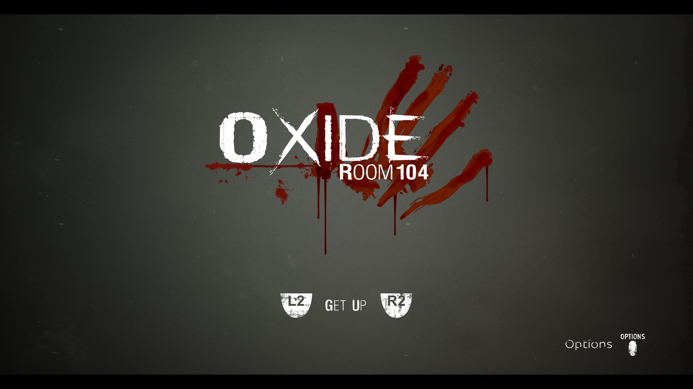
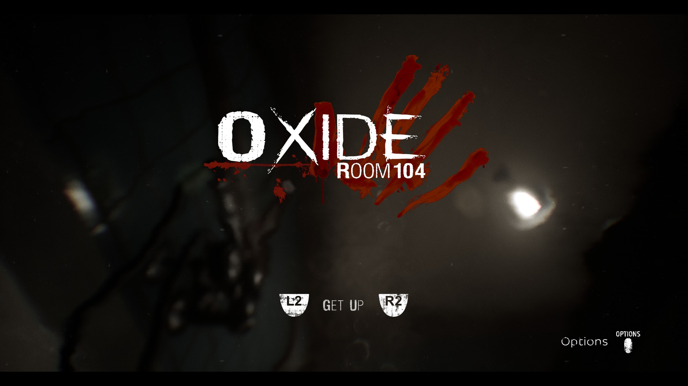
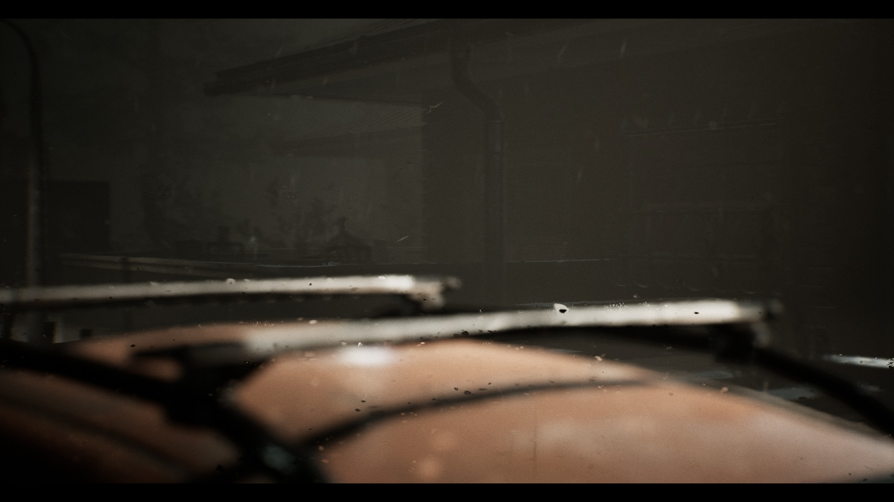

# OXIDE Room 104: retaining scene depth across shadow passes

PPSA07653 v01.000.000, Windows, Vulkan. Follow-up to the November 14
full-frame resolve fix. The user reported missing graphical elements both
in the rainy introduction and in the room after GET UP.

## Observed result

The new run shows the introductory character and room geometry. At the
GET UP prompt, walls, a chain and the light are visible behind the logo;
the older capture shows an almost uniform gray background.

Before:

After:

Introduction:

These are separate renderer frames, resized from 3840×2160 to 1920×1080
without cropping, brightness adjustments or repairs. Animation timing
differs. This is not an independent desktop capture. Character control
and the room after confirming GET UP still require verification; this
does not certify that all graphical defects are fixed.

## Reproduced failure

The main scene writes a 2880×1620 active area into a 3840×2160 D32S8
attachment at guest address `0x2036670000`. A capture immediately after
its depth prepass contains 4,665,600 nonzero depth pixels. After the shadow
passes, the attachment is absent from the resident cache. The first
G-buffer draw recreates it and applies the old uniform HTILE clear value,
zero. A capture of the depth sampled by the main ambient-occlusion pass
then contains only zeroes.

The old cache kept at most 16 depth attachments. Shadow array slices are
separate attachments and evicted the main scene surface. Eviction called
`materializeDepthTarget`, but that operation is disabled by default and
cannot transfer every multisample layout. The subsequent destruction
therefore discarded the only copy of the depth/stencil contents.

The earlier 512×1024 viewport observation belongs to an auxiliary view,
not the main scene; overriding it would be incorrect. Captured OXIDE PM4
register lists use offset/value pairs, so the separately corrected
sequential register-load format is not the cause of this rendering error.

## Change

Retain initialized depth/stencil attachments instead of treating the old
16-entry threshold as permission to destroy their contents. The threshold
now only recycles unused allocations. Matching allocations continue to be
reused across frames. This is shared Vulkan behavior, without title-ID
conditions or game asset changes.

Retaining the authoritative images uses more GPU memory than discarding
them. A future memory-pressure spill needs a lossless backing store and
correct HTILE provenance; an optional readback call alone is insufficient.

## Validation

The new `--depth-cache-pressure` GPU probe passes with Vulkan validation
enabled. It renders nonuniform depth and stencil, creates 32 shadow
attachments, then verifies both original planes and reuse on a second
frame. Both persistent and transient depth passes pass. The validation
layer emits only the existing unused fragment-output warning for a
depth-only pipeline.

`--inferred-depth-resize`, `--depth-storage`, and
`--multisample-depth-pass` also pass, including 2×/4× MSAA,
depth/stencil preservation, storage-image access and repeated clears.
ReleaseFast runner and smoke builds succeed (18/18 build steps).

In the new run, captured AO inputs at flips 1459 (introduction) and 2007
(room/GET UP scene) both contain all 4,665,600 nonzero depth pixels of
the active area, rather than zeroes. The allocation moved to
`0x2036630000` in this launch. GPU gap counters remain zero in the recorded
samples through flip 1980. The scene progresses to GET UP without a
recorded guest fault or failed GPU command. Extensive tracing was then
disabled; this was not a controlled FPS comparison.

The cache reached 186 attachments / 358.6 MiB at flip 2015 after loading
the introductory scenes and room, and remained at that count and size
at flip 2153. Long-session memory-pressure behavior is not established.
This cost is retained scene data, not additional per-frame depth readback.

The separate PM4 correction supports sequential indirect register loads
and snapshots their actual word count. All 335 GPU unit tests pass,
including queued register loads with narrow mappings. It is not credited
for OXIDE's visual improvement: this game's captured lists use pairs.

The updated runner is installed at `zig-out/bin/game-run.exe`, SHA-256
`ebd6cd5e139941fef5f2ec7779ab995f2c77543271246d1af03d6ec8255651bc`.

Local evidence is in
`D:\PS5PCEM-tests\oxide-vulkan-2026-11-14\missing-geometry`:

- `vertex-capture-3062-200aba0000-depth-2036670000-3840x2160-vk130.bin`:
  main depth before shadows; nonzero data.
- `vertex-capture-3141-2108f50000.*`: first main G-buffer draw; no resident
  initialized depth exists to capture.
- `vertex-capture-3044-200bc60000-sampled-1-2036670000-3840x2160-fmt22.bin`:
  main AO input after shadows; all zero.
- Full frame trace 3013: depth recreated and cleared during draw 5488,
  although the draw requests depth testing without a clear or depth write.

These captures are different frames of the same stationary diagnostic
scene. Native desktop capture was unavailable; renderer captures are not
independent confirmation of the displayed window.
