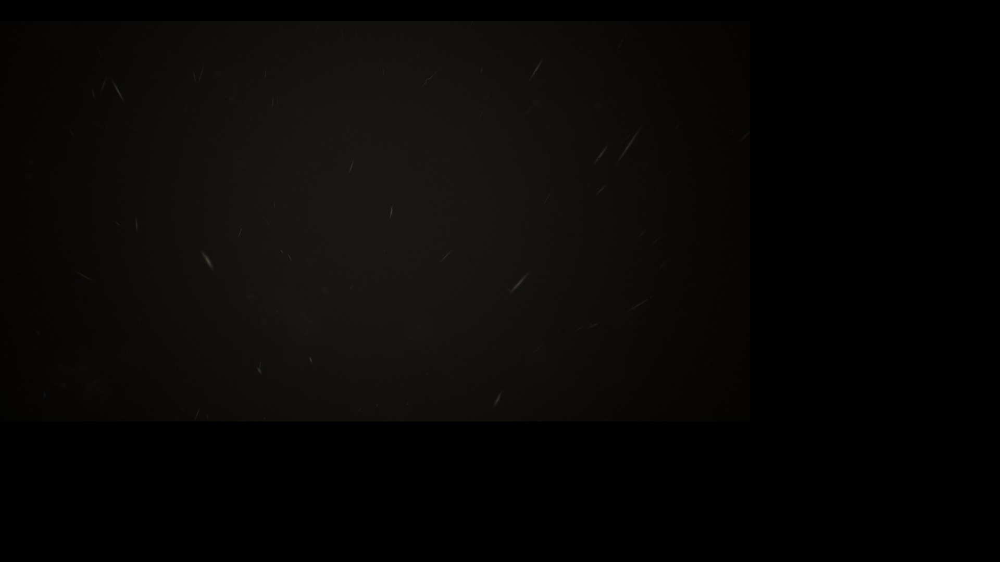
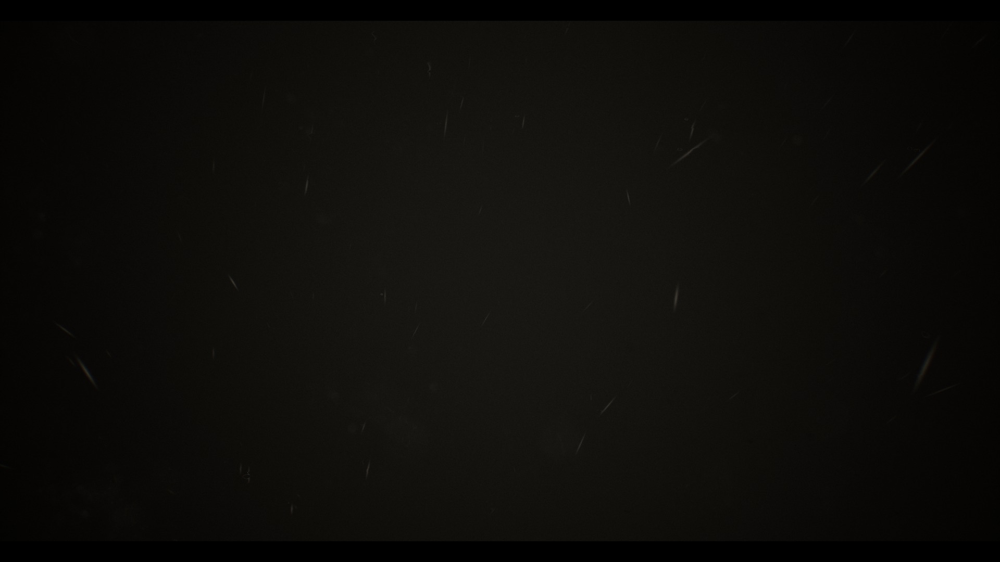

# OXIDE Room 104: Vulkan scene scaling, November 14, 2026

PPSA07653 v01.000.000, Windows, Vulkan, 1920×1080 output. Development
build after v0.3.6. The existing Unreal raster-rendering preference remains
enabled.

## Result

The introduction's 3D image now fills the frame instead of occupying its
upper-left 75% while later interface elements use the full display. The
comparison below uses exported renderer frames from the same introductory
sequence in separate launches; animation timing is not identical.

Before:

After:

These are renderer captures resized from 3840×2160 to 1920×1080. No crop,
brightness adjustment or image repair was applied. Native window automation
was unavailable, so this is not an independent desktop capture.

## Cause and change

The game resolves an active 2880×1620 scene from a 3840×2160 allocation.
The captured vertex constants describe both dimensions and the texture
coordinate transform. A Vulkan shortcut recognized three indexed corners,
one sampled image and a 4K target as a full-image copy. It bypassed the
guest shaders and copied the unused portion of the allocation as well.
Later overlays were unaffected, producing the mixed-size composition.

Remove that shortcut and execute the translated vertex and fragment
shaders. The existing geometry completion path still preserves the
translated corner positions and parameters. The change is in the shared
Vulkan renderer, with no title-ID condition or game-file modification.
The legacy fallback for missing vertex buffers and the DirectX backend
are unchanged.

## Validation and limits

- The ReleaseFast runner build succeeds; all 274 Vulkan unit tests pass.
- The new `--fullscreen-corner-scale` GPU regression passes every-pixel
  comparisons for four 4K frames: 75% source scaling, a cropped region,
  inverted vertical UVs and an unscaled copy. It uses a metadata-backed
  indexed corner draw with runtime constants.
- `--fullscreen-orientation`, `--resident-blit-orientation` and
  `--dynamic-viewport-scissor` pass, including retained depth, later
  overlays and chained copies.
- The live run advances into the animated introduction and reaches the
  `GET UP` prompt. All 101 recorded GPU gap reports are zero, through
  flip 2163, with no guest fault, failed GPU command or device-loss report.
  This diagnostic run was then stopped.
- Formatting and diff checks pass.

This fixes the reproduced composition error. It does not establish that
every model, effect, subsequent level or gameplay control is correct.
Captures and compilation overlapped parts of the run, so the timings are
not a controlled FPS comparison.

Installed `zig-out/bin/game-run.exe` SHA-256:
`9c3db634920ff8b93edf1c3f9df2fa17366288839b3bcbc7d8a07f6b42b08512`.
