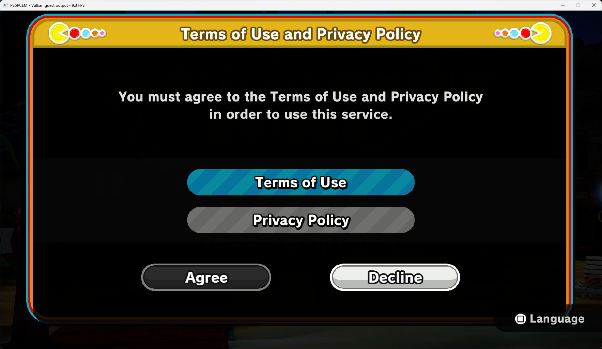
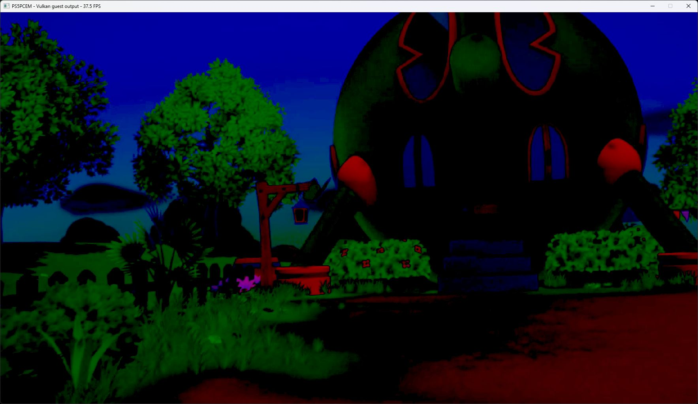

# PAC-MAN WORLD Re-PAC startup — October 11, 2026

Title: PPSA06399, content version **01.000.002** from `sce_sys/param.json`.
This is a test of the existing development runner, with no emulator changes.

## Method and result

RTX 3070 Ti; 1920×1080 output, Speed preset, Performance system-game preference.
The reported largest internal target is 1920×1080. Existing caches were retained.
`PS5_INPUT_MODE=scripted`, `PS5_SHOW_FPS=1` and `PS5_PAD_DIAGNOSTICS=1`
were enabled; automatic Cross pulses were active throughout.

The first launch was accidentally closed by the user. A fresh process passes
linking and Unity initialization. AvPlayer opens the 143,310 ms `Opening.mp4`
at 1920×1080 with NV12 video and PCM16 audio. The movie advances, but its
colors and brightness are severely wrong: dark areas are crushed and red,
green and blue are oversaturated. The source of this defect was not investigated
or fixed in this documentation run.

After the movie, the title logo, Cross prompt and Terms of Use/Privacy Policy
panel render. Automatic Cross cycles between startup screens. This run stops
there; entering a level and character control were not verified. The dark title
capture was taken during this sequence and is not proof of a separate lighting
bug in gameplay.

## Performance and diagnostics

Thirty one-second window-counter readings span **29.927 seconds**:
median **9.55 FPS**, range **5.9–14.1 FPS**. The interval includes title/terms
transitions, automatic input, and concurrent desktop launcher activity.
It is an observational startup sample, **not a controlled stationary benchmark,
a gameplay measurement, or a before/after comparison**. Movie captures earlier
showed 37.5 and 41.1 FPS, also individual observations.

All **180** periodic GPU-gap reports in the repeat have zero draw failures,
dispatch failures, unsupported compute and unresolved/null/rejected storage
counters. No guest fault or missing sampled-image diagnostic was logged.
These counters do not establish correct rendering; the movie defect is visible.
Late title frames typically take 73–77 ms, with about 770 draws and nine
dispatches; one transition frame takes 387 ms.

Manual controls, audible audio quality, saves, completion and long-session
stability are untested. The process was stopped after inspection.

## Captures

Runner SHA-256:
`798263b7e66f498cf9d14de6b93a352030e0c44cca3bdc7d34601c5db5297287`.
