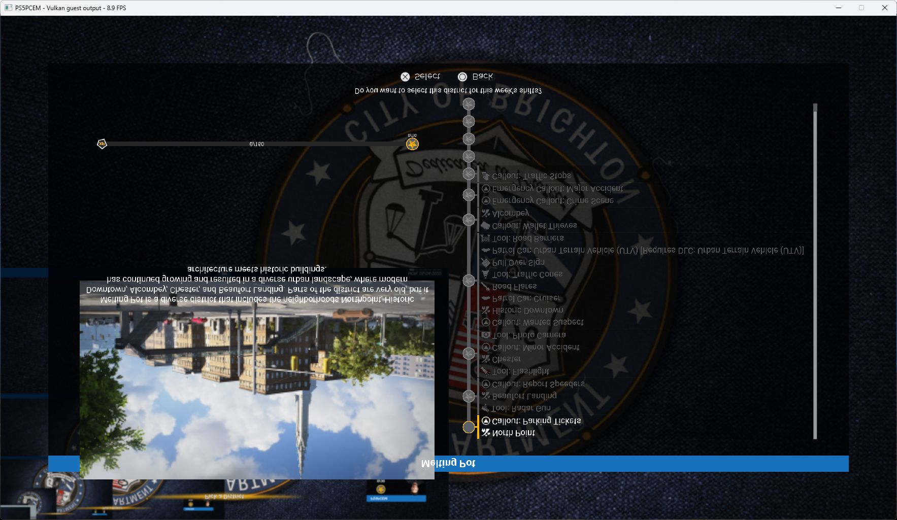

# Police Simulator: Patrol Officers — October 12, 2026

PPSA05831, v01.000.000. Development build, not assigned to a published release.
This run used the same ReleaseFast runner as the Monster Boy gameplay check:
SHA-256 `9A8F815F65F4935E2612723D381C2FA855E431208854BE131249394B8B7E2922`.
No additional emulator code changes or game-file patches were made for this test.

**Intro/menu · severe rendering defects.** Startup, career creation and district
selection were verified. Controllable street gameplay could not be verified:
the shift-selection screen was missing its map and heavily obscured by flipped,
repeated background images. This entry is not graded playable.

## Startup and career flow

The title linked without unresolved imports and passed its disclaimer and
autosave notices. Cross opened the main menu, New Career opened character
selection, and Start created the `Career0beta` save slot. The run then reached
the shift tutorial and district confirmation for Melting Pot.

The main-menu background is heavily corrupted by bright green/white output.
After starting a career, the badge background and interface are vertically
flipped, with smaller recursive copies accumulating in the lower-left corner.
Menu text becomes intermittently obscured by that stale background. These are
rendering defects; a responsive counter does not make the scene usable.

## Measurement and diagnostic evidence

The main-menu capture showed **16.3 FPS**; that is a single reading.
Thirty one-second counter samples during the corrupted district-selection
screen ranged from **8.2 to 9.9 FPS**, with **9.2 FPS median** and **9.23 FPS
arithmetic mean**. The interval was 00:51:28–00:51:57 (UTC+3); no Zig compiler
process was running during these samples. This is a menu/selection measurement,
not gameplay performance, and its backdrop was already visibly incorrect.

Host: RTX 3070 Ti, Speed preset, 1920×1080 output, keyboard input. The captured
client area was 1765×993. The title still used internal targets up to 2560×1440;
output resolution does not imply every internal target is 1080p. Full HLE
tracing/profiling were disabled; FPS and pad diagnostics were enabled.

At flip 3300, a representative frame reported 113 ms, 205 draws/31 ms,
36 dispatches/26 ms, 14 submits, 15.1 ms fence waits, 29,039 KiB uploads and
2,834 KiB readbacks. These counters overlap and should not be summed as a
complete frame breakdown. They point to resource/submission work worth
investigating after rendering correctness is restored.

Periodic diagnostics reported `storage_unresolved=72`, with zero draw failures,
dispatch failures and unsupported-compute programs in the inspected reports.
The unresolved count describes resource-preparation candidates, including
potential inactive paths; it does not prove 72 executed accesses or skipped
draws. The run had no observed guest fault or unresolved-import stop.

Nonzero PCM peaks appeared (for example 0.157); audible quality and timing were
not verified. The title wrote its career save and a 72,464-byte icon. Save reload
and complete progression were not tested.

## Follow-up priorities

Check offscreen target/viewport orientation and the repeated sampling of a
previous presentation image, then trace the unresolved storage candidates to
their descriptors and active shader paths. These are investigation directions,
not proven root causes. Repeat the shift-to-street transition and measure actual
gameplay after the interface and scene can be observed reliably.
