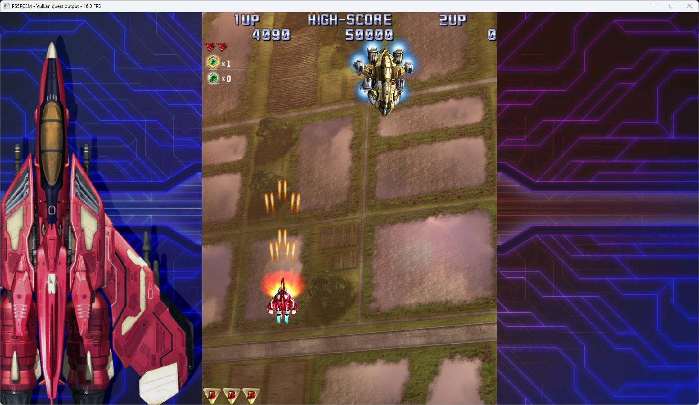

# Raiden IV x Mikado Remix startup and rendering — October 11, 2026

Title: PPSA08832, content version 01.000.000. Development build.

## Startup failure

Loading the title failed with `TruncatedSelf` before guest execution:

```text
[self] truncated: want 0x77d180..0x77d1a7 of 0x77d180 (short by 39)
```

The failing image was `sce_module/libSceNpCppWebApi.prx`, not `eboot.bin`.
The module ends at `0x77d180`, exactly after its last stored SELF segment.
Its ELF program headers also declare a 39-byte `PT_SCE_LIBVERSION` segment
(`0x6fffff01`) that is not stored in the container. `libc.prx` has the same
layout with a 26-byte version segment.

The loader mislabeled this type as a newer `PT_SCE_DYNLIBDATA`, then tried
to read it immediately after the last SELF payload. This produced a false
truncation error. An older workaround treated the corresponding absent
segment in bare ELF files as an empty dynamic table, but SELF files still
failed.

## Fix

- Distinguish `PT_SCE_LIBVERSION` (`0x6fffff01`) from the actual dynamic-table
  segment `PT_SCE_DYNLIBDATA` (`0x61000000`).
- Read the title's standard `DT_STRTAB`, `DT_SYMTAB`, `DT_RELA` and
  `DT_JMPREL` through their mapped `PT_LOAD` ranges. The executable and both
  bundled libraries already contain these tables; no replacement bytes
  or import stubs are needed.
- Remove the bare-ELF empty-table workaround. Missing or partially truncated
  **real** dynamic-table segments remain errors.
- Restrict the unlisted SELF dynamic-table tail mapping to the actual
  `PT_SCE_DYNLIBDATA` type.

Compared the local AnyPS5 `GuestImageReader.cpp`, KytyPS5 `elf.cpp`/`elf.h`,
and SharpEmu `SelfLoader.cs`. AnyPS5 explicitly distinguishes library-version
metadata from dynamic tables; KytyPS5 selects `0x61000000` for dynamic data.
The implementation remains in PS5PCEM's existing ELF/SELF loader and applies
to all titles, without product-ID checks or changes to installed game files.

## Validation

- A synthetic SELF fixture reproduced the exact 39-byte truncation before
  the fix, then passed after it. The same standard-address table lookup is
  checked in a bare ELF image.
- Tests cover absent library-version metadata, correct selection of a real
  dynamic-table segment when both header types exist, and rejection of
  missing or partially truncated required tables in ELF and SELF images.
- Full loader suite: **59/59 passed**, including relocation, import/export,
  TLS, image mapping and startup-array tests, with `ReleaseSafe`.

```powershell
zig test -O ReleaseSafe --dep memory '-Mroot=src/loader/root.zig' '-Mmemory=src/memory/root.zig'
zig build build-game-run -Doptimize=ReleaseFast --summary all
```

## Firmware imports revealed after SELF loading

The first rebuilt run passed SELF parsing and exposed five unresolved imports.

- `sceNgs2ParseWaveformFile`: reads the mounted guest filesystem at a supplied
  offset, scans RIFF chunks without copying encoded audio, and returns PCM16,
  float PCM or ATRAC9 geometry. ATRAC9 configuration is checked with the pinned
  decoder. Sample counts, delay, loop bounds, aligned blocks and file-relative
  data offsets are retained; malformed and unknown formats report errors.
- `sceNgs2RackGetInfo`: returns rack identity, backing buffer, owner, configured
  limits and activity. Supports the common 216-byte layout and the 232-byte
  query used here, preserving the common prefix. Rack creation now reads the
  full SDK option layout with its 64-byte name, rather than reading the voice
  count from the middle of that name.
- `sceFontAttachDeviceCacheBuffer`: retains borrowed storage or allocates an
  owned buffer when the pointer is null. Glyph transfer images use that
  storage; replacement, detach and library destruction release owned memory.
- Private Pad NID `n3kSX62fgNo`: the executable's SDK wrapper tail-calls it
  immediately after `scePadInit`, without preparing arguments. It shares the
  controller initialization state. This is an inferred initialization ABI;
  the public name and any additional hardware-specific behavior remain unknown.
  It does not interpret stale register contents as writable pointers.
- `scePthreadCancel`: adds the kernel-status entry alongside the existing
  POSIX entry. Invalid handles are rejected; cancellation of a live thread
  still reports `ENOSYS`. Safe guest cancellation/unwinding is **not** claimed
  as implemented, and this entry does not report fake success.

Focused checks: **10/10 NGS2 tests** and **13/13 font tests** passed. New
fixtures cover both rack-info sizes with adjacent-byte guards, file offsets
and descriptor cleanup, ATRAC9 loop preroll without reading encoded payload,
and borrowed/owned font cache lifetime with actual glyph output.

The complete HLE suite also passed: **619/619 tests** with `ReleaseSafe`.

## Packed sampled textures

The first linked run reached the animated title screen but reported sampled
format 136 as unsupported. Add native Vulkan views for the four packed 16-bit
UNORM layouts (565, 5551, 1555 and 4444), their two-byte upload geometry, and
compose the guest descriptor selectors with the packed Vulkan channel order.
The mapping agrees with KytyPS5 and SharpEmu's texture transfer layouts; no
CPU pixel conversion or title-specific shader replacement is used.

The full Vulkan unit suite passed **243/243** in `ReleaseSafe`. Tests include
Raiden's BGRA selectors on RGBA4444, preservation of constant zero/one
selectors, and upload element sizes for all four formats.

## Black level scene: raw depth clears

With the loader and texture fixes, automatic Cross input passed the title and
mode menus, but the first level initially showed only its border and HUD.
Frame 3000's per-draw readbacks stayed black through the first 542 scene draws;
HUD pixels first appeared at draw 543. The draw/dispatch failure counters were
zero, so those counters alone did not establish rendering correctness.

The title fills its uncompressed float depth plane at `0x102f2b0000` with
`1.0` through a compute buffer-fill shader. This bypasses `DB_DEPTH_CLEAR`.
The emulator published the guest bytes but retained stale depth in the Vulkan
attachment, rejecting the level geometry. Enabling general depth transfer did
not fix recurring clears of an already cached attachment.

Full uniform float-depth writes now update the resident image at command or
compute publication. First-use attachments can also initialize from a complete
uniform raw plane. The implementation checks the entire allocation, accepts
only finite values in [0, 1], and excludes compressed, multisample and
subresource layouts. Partial or mixed writes are not misidentified as full
clears. Existing stencil contents survive later depth-only clears.

Both real Vulkan probes passed:

```powershell
.\zig-out\bin\vulkan-smoke.exe --raw-depth-clears
.\zig-out\bin\vulkan-smoke.exe --htile-clears
```

The new probe checks initial bytes with a different register clear value,
retained raster depth, partial-write guards, emulated and native compute
writers, and stencil preservation. The HTILE probe checks the existing
metadata path against the shared clear operation.

## Runtime result

The final ReleaseFast run entered the first level and rendered the launch
carrier, player ship, terrain, enemies, projectiles and HUD. Automatic Cross
input fired the ship's weapon; the score advanced to 4090 in the saved capture.
This was an automatic-input bring-up check, not a complete playthrough or
manual controller validation. General depth transfer remained at its default
(disabled); no replacement shader or diagnostic render override was enabled.

The capture shows **16.0 FPS**; an earlier carrier frame showed **20.7 FPS**.
Twenty sampled profile frames from flips 2700 through 3840 had a median of
49 ms, with a 29–110 ms range. These changing scenes are not a controlled
performance comparison. No guest fault, unsupported sampled-format report or
nonzero draw-failure counter appeared during this checked portion.



The local `zig-out/bin/game-run.exe` was rebuilt and signed with the existing
PS5PCEM certificate and a DigiCert timestamp. Windows reports an untrusted
root for the local signing chain; a publicly trusted signature is not claimed.

## Remaining limits

ATRAC9 waveform **metadata parsing** is implemented here. This does not add
ATRAC9 block playback to the NGS2 sampler, and audio correctness is not yet
verified. Live-thread cancellation still returns `ENOSYS`, as described above.
