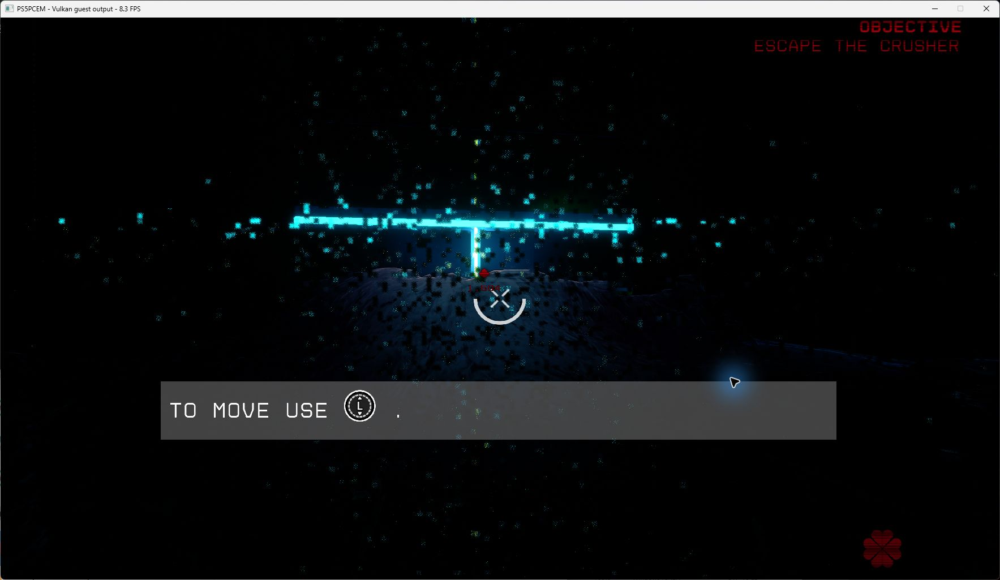
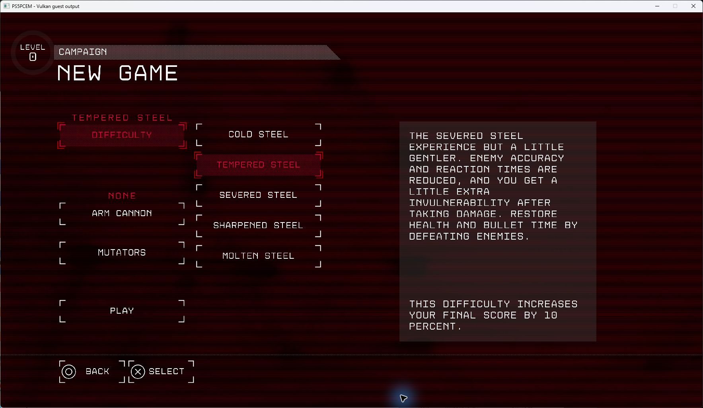

# Severed Steel startup and first-level check, 20–21 October 2026

**PPSA05106 v01.000.000 reaches the first controllable level on Vulkan with
ray tracing disabled through the game's own command line.** New Game,
difficulty selection, the illustrated introduction and Continue were checked.
The first level, **Trash Compactor**, displays the **Escape the Crusher**
objective and movement prompt; keyboard movement changes the viewpoint and
objective distance. The result is **In-game · rendering defects · low FPS**.
This is a development build after v0.3.5, not a released compatibility result.

## Captures

*Unedited game-window capture from the October 21 repeat. The dark scene and
speckled patches are unresolved rendering defects. The title-bar reading of
8.3 FPS was captured after the measurement interval below.*

*October 20: the composited New Game interface remains visible over its
background movie after the presentation fix.*

## Black-screen investigation and changes

The original run rejected a ray-tracing compute program with
`InvalidScalarCall` at the first flip. The aborted GPU command queue later
reported `MemoryReadFailed`; the guest then timed out waiting for its render
thread. Those later errors did not establish a separate bad WAIT address.

The tested startup workaround is to append **` -noraytracing`** to the existing
`ue4commandline.txt` in the extracted game's root, preserving its project path
and other arguments. This is a game-supported switch, applied locally for
these tests. **The runner does not add it automatically, and these changes do
not implement the rejected ray-tracing path.**

The accompanying emulator changes are:

- Read the shader header's private scratch size and supply it to compute
  translation when `COMPUTE_PGM_RSRC2.SCRATCH_EN` is enabled. The existing
  scene-collision minimum allocation remains intact.
- Prefer the current frame's completed registered display target when it
  contains the composited menu. An active background movie must not replace
  that image and hide its UI. Explicit fullscreen-video priority and stale
  video expiry retain their existing behavior.
- Report failed WAIT operand reads and GPU publication errors with the
  address and operation that failed, making the original queue failure
  easier to distinguish from downstream symptoms.

## Performance observation

Host: NVIDIA GeForce RTX 3070 Ti, Windows, Vulkan, Speed preset, **1920×1080
output**, retained caches, keyboard input. Internal rendering remains
game-controlled: targets up to **3264×1836** were observed during the run;
1080p output does not imply every internal target is 1080p. The window capture
includes its border/title bar and is 1767×1025.

Six stationary window-title FPS readings were taken at five-second intervals
during a 30-second check. The first and last readings span **25.133 seconds**:

| Local time, October 21 (UTC+3) | Window-counter FPS |
| --- | ---: |
| 01:13:18.741 | 10.0 |
| 01:13:23.784 | 10.1 |
| 01:13:28.809 | 9.7 |
| 01:13:33.834 | 10.0 |
| 01:13:38.857 | 9.5 |
| 01:13:43.874 | 9.2 |

Arithmetic mean: **9.75 FPS**; median: **9.85 FPS**; range: **9.2–10.1 FPS**.
These are samples of the window counter, **not total presented frames divided
by elapsed time**, and no before/after FPS gain is established. Private process
memory was approximately 7,838–7,842 MiB. The earlier main menu displayed
roughly 35–38 FPS without a controlled benchmark.

## Validation and remaining limits

- GPU metadata tests: **10 passed**; RDNA2 scratch tests: **4 passed**;
  composited-menu Vulkan tests: **2 passed**; video Vulkan tests: **3 passed**.
  The ReleaseFast `game-run.exe` build completed successfully.
- A new campaign reached the first level on October 20. An October 21
  Continue/reload reached it again; keyboard movement was verified.
- The successful repeat has no logged `GuestFault`, rejected dispatch,
  `OutOfMemory` or `NoSpaceLeft`. Its periodic GPU-gap counters report no draw
  or dispatch failures, unsupported compute, or unresolved/null/rejected
  storage bindings. **These counters do not establish correct graphics**:
  the captured image still has visible defects.
- One earlier run failed compute translation with `OutOfMemory`; this was not
  reproduced in the successful repeats and is not claimed fixed.
- A separate repeat could not stage the introduction movie because the output
  disk was full (`NoSpaceLeft`). Removing old generated movie staging files
  allowed the next run to proceed. A fast counter on that black loading screen
  was not gameplay performance; automatic recovery from this failure remains
  unimplemented.
- Ray tracing, lighting correctness, audio quality, later levels, completion
  and long-session stability remain unverified. No full-playability or
  completion claim is made. Test processes were stopped after capture.
