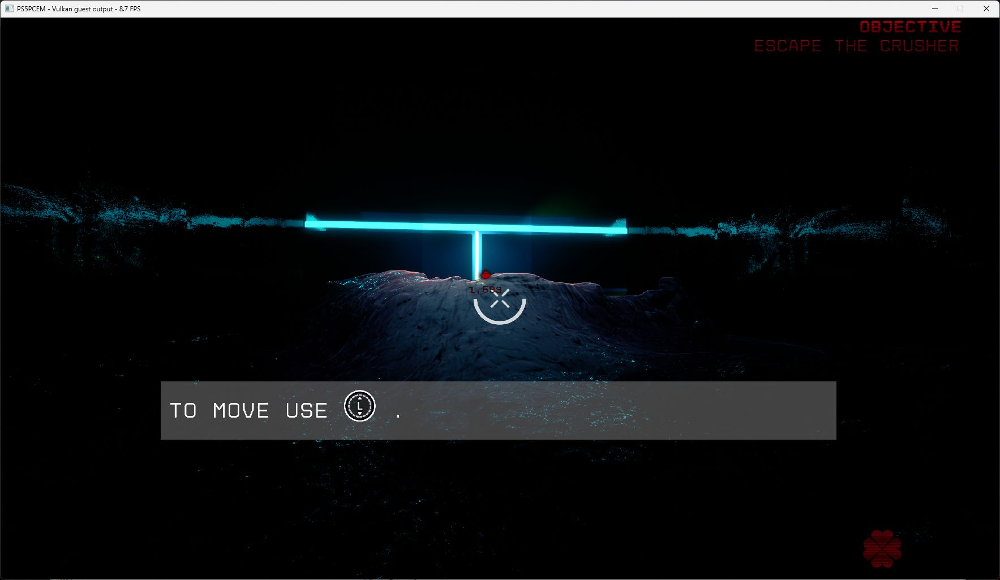

# Severed Steel startup and first-level check, 20–21 October 2026

**PPSA05106 v01.000.000 reaches the first controllable level on Vulkan with
ray tracing disabled through the game's own command line.** New Game,
difficulty selection, the illustrated introduction and Continue were checked.
The first level, **Trash Compactor**, displays the **Escape the Crusher**
objective and movement prompt; keyboard movement changes the viewpoint and
objective distance. The result is **In-game · rendering defects · low FPS**.
This is a development build after v0.3.5, not a released compatibility result.

**October 21 follow-up:** the repeated black-frame flicker is fixed in the
tested scene, confirmed by the user on the monitor. The latest stationary
measurement is **261 flips / 30.0004 seconds = 8.70 FPS**. The 13 FPS target
has not been reached; complete rendering correctness is not established.

## Captures

*October 21: unedited, unobstructed game-window capture saved at 13:17 (UTC+3) from the
successful repeat after the exposure fix. This is the displayed gameplay frame,
not an intermediate render target or a depth-disabled diagnostic. The screenshot
alone cannot demonstrate absence of flicker; the user confirmed it during the
live check. Its 8.7 FPS title-bar reading is separate from the flip-count
measurement. No new run was made for publication.*

### Earlier captures, before the follow-up fixes

*Unedited game-window capture from the October 21 repeat. The speckled patches
are unresolved rendering defects. The opening scene is intentionally dark;
darkness alone is not evidence of incorrect rendering. The title-bar reading of
8.3 FPS was captured after the measurement interval below.*

*October 20: the composited New Game interface remains visible over its
background movie after the presentation fix.*

## Black-screen investigation and changes

The original run rejected a ray-tracing compute program with
`InvalidScalarCall` at the first flip. The aborted GPU command queue later
reported `MemoryReadFailed`; the guest then timed out waiting for its render
thread. Those later errors did not establish a separate bad WAIT address.

The tested startup workaround is to append **` -noraytracing`** to the existing
`ue4commandline.txt` in the extracted game's root, preserving its project path
and other arguments. This is a game-supported switch, applied locally for
these tests. **The runner does not add it automatically, and these changes do
not implement the rejected ray-tracing path.**

The accompanying emulator changes are:

- Read the shader header's private scratch size and supply it to compute
  translation when `COMPUTE_PGM_RSRC2.SCRATCH_EN` is enabled. The existing
  scene-collision minimum allocation remains intact.
- Prefer the current frame's completed registered display target when it
  contains the composited menu. An active background movie must not replace
  that image and hide its UI. Explicit fullscreen-video priority and stale
  video expiry retain their existing behavior.
- Report failed WAIT operand reads and GPU publication errors with the
  address and operation that failed, making the original queue failure
  easier to distinguish from downstream symptoms.

## Performance observation

Host: NVIDIA GeForce RTX 3070 Ti, Windows, Vulkan, Speed preset, **1920×1080
output**, retained caches, keyboard input. Internal rendering remains
game-controlled: targets up to **3264×1836** were observed during the run;
1080p output does not imply every internal target is 1080p. The window capture
includes its border/title bar and is 1767×1025.

Six stationary window-title FPS readings were taken at five-second intervals
during a 30-second check. The first and last readings span **25.133 seconds**:

| Local time, October 21 (UTC+3) | Window-counter FPS |
| --- | ---: |
| 01:13:18.741 | 10.0 |
| 01:13:23.784 | 10.1 |
| 01:13:28.809 | 9.7 |
| 01:13:33.834 | 10.0 |
| 01:13:38.857 | 9.5 |
| 01:13:43.874 | 9.2 |

Arithmetic mean: **9.75 FPS**; median: **9.85 FPS**; range: **9.2–10.1 FPS**.
These are samples of the window counter, **not total presented frames divided
by elapsed time**, and no before/after FPS gain is established. Private process
memory was approximately 7,838–7,842 MiB. The earlier main menu displayed
roughly 35–38 FPS without a controlled benchmark.

## Validation and remaining limits

- GPU metadata tests: **10 passed**; RDNA2 scratch tests: **4 passed**;
  composited-menu Vulkan tests: **2 passed**; video Vulkan tests: **3 passed**.
  The ReleaseFast `game-run.exe` build completed successfully.
- A new campaign reached the first level on October 20. An October 21
  Continue/reload reached it again; keyboard movement was verified.
- The successful repeat has no logged `GuestFault`, rejected dispatch,
  `OutOfMemory` or `NoSpaceLeft`. Its periodic GPU-gap counters report no draw
  or dispatch failures, unsupported compute, or unresolved/null/rejected
  storage bindings. **These counters do not establish correct graphics**:
  the captured image still has visible defects.
- One earlier run failed compute translation with `OutOfMemory`; this was not
  reproduced in the successful repeats and is not claimed fixed.
- A separate repeat could not stage the introduction movie because the output
  disk was full (`NoSpaceLeft`). Removing old generated movie staging files
  allowed the next run to proceed. A fast counter on that black loading screen
  was not gameplay performance; automatic recovery from this failure remains
  unimplemented.
- Ray tracing, lighting correctness, audio quality, later levels, completion
  and long-session stability remain unverified. No full-playability or
  completion claim is made. Test processes were stopped after capture.

## October 21 follow-up: flicker and GPU-to-CPU visibility

Repeated captures established **intermittent black frames**, not a permanent
black screen. The defect was already present before the latest candidate fixes.
A clean stationary counter measurement recorded **293 flips in 30.0002 seconds
(9.77 FPS)** before the linear-image publication change; 13 FPS has not been
established.

The investigation followed the bad frame backwards through tone mapping, TAA,
reflections and lighting. The GPU exposure image contained approximately
`(1.0666665, 1.0666665, 1, 1024)`, and the image-copy shader produced the same
result in its linear destination. However, direct CPU memory at that destination
still contained an old movie filename starting with `file`. Those four bytes,
interpreted as a float, became approximately `6.98e22` in the next frame's
pre-exposure constants. The matching reciprocal was also present in the view
constants. Thus the extreme lighting values were already inputs to the shaders.

The fix publishes GPU-written linear storage images before a
guest-visible completion label or interrupt. It uses the existing readback path
with CPU-replacement and row-padding checks. KytyPS5 independently maintains
a download set for GPU-modified non-tiled images; this supports the same
coherency requirement, rather than a game-specific shader replacement.
An isolated FP32 image-copy probe passed synchronous and queued release
checks with direct CPU reads and preserved padding. In the repeated game run,
the inspected reflection shader received a finite pre-exposure value of `1.0`
instead of the stale filename bytes. The user confirmed that flicker disappeared.

The same changeset also:

- Computes the synthetic zero-position clip value from the final vertex
  position after shader control flow reconverges. Native straight-line and
  dispatcher probes preserve valid triangles and reject dormant zero vertices.
- Handles RGBA16 UNORM DCC clears, including metadata-only changes to resident
  attachments. The captured velocity target changed from stale nonzero values
  to the expected zero clear, removing the long vertical smearing seen earlier.
- Accepts single-layer 2D array storage views of depth attachments. The native
  depth probes cover D16 array views as well as D16/D32 ordinary views.
- Adds conservative per-size-class bounds to buffer overlap lookup. Stale
  bounds can add work but cannot hide an overlapping resource. No independent
  FPS gain is claimed from the small earlier A/B differences.
- Extends explicitly enabled draw diagnostics with depth, pipeline, translated
  vertex code and scalar-load captures. These captures are off during ordinary
  execution and the reported measurements.

### Follow-up measurement and validation

The successful repeat used the same RTX 3070 Ti, Vulkan, Speed preset, retained
caches, 1920×1080 output and game-controlled internal targets up to 3264×1836.
The camera was stationary; no profiler, shader capture or build ran during the
30-second measurement with the game in the foreground.

| Elapsed seconds | Cumulative flips |
| ---: | ---: |
| 5.0004 | 44 |
| 10.0007 | 86 |
| 15.0012 | 130 |
| 20.0019 | 175 |
| 25.0023 | 217 |
| 30.0004 | 261 |

Result: **8.70 FPS**. An earlier interval in this repeat recorded **269 flips /
30.0002 seconds = 8.97 FPS**, but other desktop windows overlapped the game.
The corrected run is slower than the earlier 9.77 FPS interval with broken
exposure; these were separate runs, so this does not isolate the cost of one
change. There is no claim of an FPS increase or of reaching 13 FPS.

ReleaseFast game-run and smoke builds succeeded. Native probes passed for
linear-image completion ordering, CPU allocation reuse, deferred releases,
internal-release FIFO ordering, DCC color initialization, zero-position clipping
and depth storage; the overlap-index tests also passed. Failure-injection cases
verify that failed publication withholds completion. These checks preceded the
user's request to stop runs.

One initial candidate launch reported `OutOfMemory` / `MemoryAllocationFailed`
and ended before gameplay; that failure remains unresolved. The successful
repeat reached gameplay without those errors or a guest fault. No claim is made
that every visual artifact, audio issue, later level or completion is fixed.
The next performance investigation identified CPU image clears, resource
preparation and GPU waits; moving those clears to GPU execution was only planned,
not implemented or benchmarked in this changeset. Runs are paused at the user's
request while this report and the existing screenshot are published.
