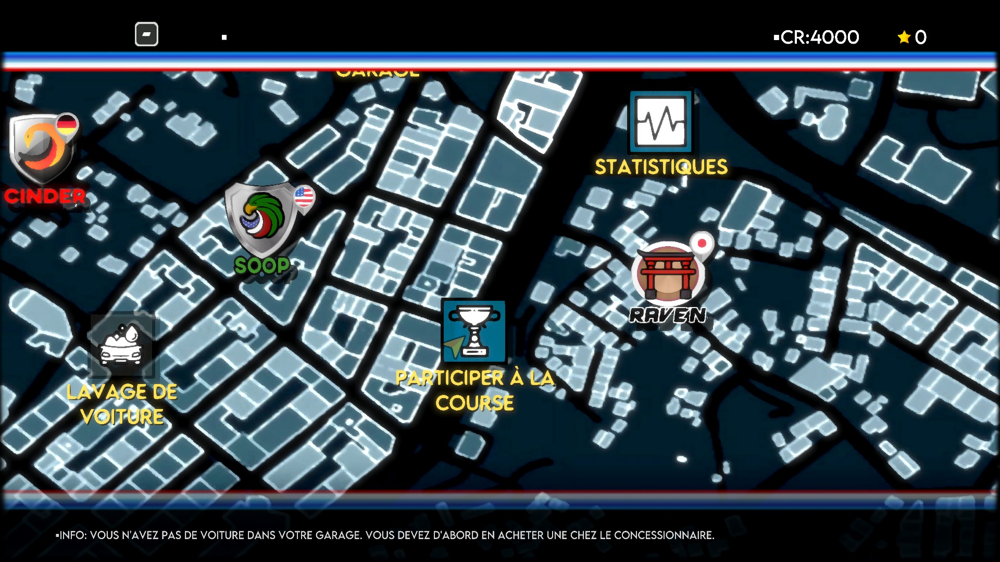

# Super Woden GP — DirectX 12 font uploads, October 30, 2026

PPSA07211, content version 01.000.003. Windows, RTX 3070 Ti,
1920×1080 output, native D3D12. Development build after v0.3.5.

## Cause

The map's text consisted of solid rectangles. Captures taken before native
texture upload showed three R8 atlases (1024×1024, 512×1024 and 512×512)
filled with `0xCD`, without glyph coverage. Disabling the texture/surface
caches or GPU page tracking did not restore the glyphs. The original text
shader and its `(0, 0, 0, R)` image component mapping were already correct.

The D3D12 backend had no `dma_data` callback. The AGC bridge always installs
its own callback, which returned success when the selected renderer did not
implement DMA. This also prevented the command executor's generic copy
fallback from running. The guest's atlas uploads were therefore acknowledged
without copying their bytes.

## Change

- D3D12 now executes `DMA_DATA` memory/L2 copies and immediate 32-bit pattern
  fills, including partial final words and overlapping ranges.
- GDS transfers use the same persistent 64 KiB storage as compute shaders.
- Queued draws complete before a transfer reads or overwrites their memory.
  Writes use the normal guest-memory publication path, so later texture
  snapshots observe the changed bytes.
- Invalid ranges/selectors fail explicitly. Zero-byte ordering packets and
  the observed four-byte immediate writes to low sentinel addresses retain
  their synchronization behavior without dereferencing an unmapped address.

This is a general D3D12 command implementation. No game-specific font,
replacement shader or skipped draw is used. Vulkan implementation is unchanged.

## Validation

The diagnostic run reached the map and captured real glyph coverage in all
three atlases. `GARAGE`, `STATS`, `GO RACE`, the balance and information line
render as text. The final executable also renders French labels and accented characters correctly.

The portable tests cover overlap, pattern tails, GDS persistence, bad ranges,
unsupported selectors and failure propagation through the backend callback.
The native GPU probe uploads R8/R16/RG8 textures through DMA, exercises
alpha-only R8 coverage, tiled/linear layouts and one-layer array views, then
copies a queued draw's pixels through DMA to check completion ordering.

- ReleaseSafe runner and native hardware-probe builds succeed.
- **48/48 D3D12 boundary tests pass.**
- The full native D3D12 GPU suite passes, including the new **16 DMA-backed
  narrow-image cases at each of three cache configurations** and queued-draw
  readback ordering. The D3D12 debug layer is unavailable on this host.
- A second, **72.4-second** run uses the final executable without temporary
  shader/atlas diagnostics. It reaches logged flip **579**, peaks at **3,912 MiB**
  sampled private memory and ends by watchdog. No guest fault, backend rejection
  or device-removal error appears in its log. This does not prove long-run stability.
- The tested executable and symbols are installed in `zig-out/bin`.

Runner SHA-256:
`71275db6e5009055f8fed2f1a693fd13645231c205107d7fd9b07ae11f1aee74`.

The image is the final renderer's 1920×1080 presentation capture, not an
independent desktop capture or a race gameplay screenshot.

## Scope

This verifies map/menu text, not race gameplay, audio, saves or completion.
The scripted runs use a diagnostic 30 FPS cap and are not FPS benchmarks.
The previously observed Vulkan memory growth is outside this change.

See the earlier [DirectX 12 startup report](super-woden-gp-d3d12-startup-2026-10-30.md)
for the pre-fix screenshot and startup feature coverage.
