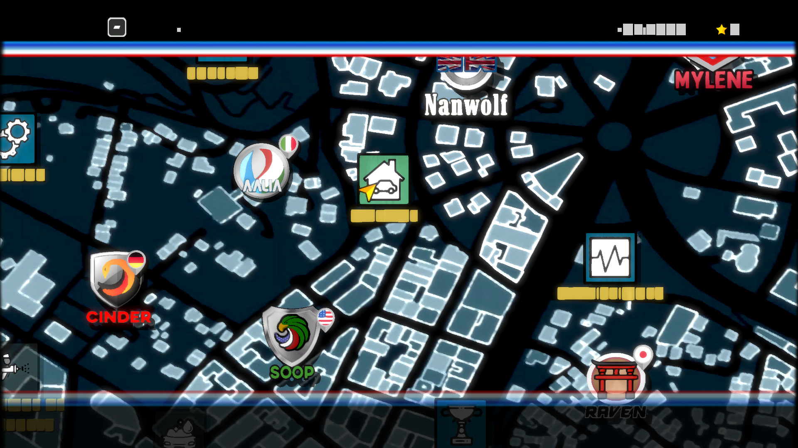

# Super Woden GP — DirectX 12 startup, October 30, 2026

PPSA07211, content version 01.000.003. Windows, RTX 3070 Ti,
1920×1080 output, native D3D12. Development build after v0.3.5.

## Diagnosis

The exit after the logos was an explicit rejection of unsupported graphics
work, rather than a guest CPU access violation. The baseline stopped with
`UnsupportedRenderTargetLayout` on a 1920×1080 RGBA16F target. Resolving that
exposed three further stops on the way to the map:

1. `FragmentInterpolationModeNotImplemented`: a stencil-clear draw retained
   a pixel shader whose ATTR0 input selects a hardware default constant,
   without a matching vertex PARAM export.
2. `GraphicsImageOperationNotImplemented`: a shader sampled a 3D volume,
   initially a 1×1×1 RGBA8 resource.
3. `GraphicsTextureFormatOrMipNotImplemented`: a draw sampled a 1024×1
   `R16_UNORM` lookup texture.

## Implementation

- RGBA16F color targets, mixed MRT and sampled images keep their original
  eight-byte pixels. Uploads/readbacks use the actual attachment texel size;
  blending preserves negative and HDR values. Float DCC remains unsupported.
- D3D12 explicitly lowers the four `SPI_PS_INPUT_CNTL.DEFAULT_VAL` vectors.
  These inputs need no native varying or VS export. Ordinary interpolation
  and MOV P0 are supported; custom/flat-default modes still reject. The new
  shared-translator option defaults to disabled and is enabled only by D3D12.
- 3D sampling uses native Texture3D resources and the shared guest volume
  layouts, including shrinking mip depths. Uploads include every Z slice.
  Native texture reuse distinguishes 2D and 3D resources even with identical
  bytes and extents. Independent XY/Z filtering is rejected unless it has an
  exact native equivalent; compressed volumes and volume DCC are not accepted.
- `R16_UNORM` textures retain both bytes and normalize on the GPU, with the
  guest component selectors preserved. They are not reduced to an R8 channel.

These are shared backend implementations. There is no game-ID exception,
replacement game shader, skipped unsupported draw or Vulkan fallback.

## Validation

- ReleaseSafe runner and D3D12 hardware-probe builds succeed.
- All **46 D3D12 boundary tests** pass.
- The native GPU suite passes, including six RGBA16F guest layouts, mixed
  float/UNORM/SNORM MRT, all four constant-input presets, **1,360 volume frame
  comparisons**, 2D/3D batch isolation, Z addressing/filtering, mip blending,
  and R8/R16/RG8 sampling and source-preservation checks.
- The focused fragment-input translator tests pass (**2/2**).
- The full RDNA2 suite has **306 passing and 10 failing tests**, including one
  leak in a failing test. The same ten failures and leak reproduce on the
  unmodified `e90d8b35` source; this is not a claim that the full suite passes.
- The Windows D3D12 debug layer is unavailable on this machine. Native pixel
  comparisons pass, but a debug-layer validation pass is not claimed.

## Live result

The final ReleaseSafe runner passes the logos and reaches the map/main menu
on native D3D12. No unsupported-draw bypass or Vulkan fallback was enabled.
The bounded run lasted **120.6 seconds**, reached logged flip **721**, and
was deliberately stopped by the watchdog. No guest fault, unsupported-work
rejection or device-removal error was logged. Sampled private memory peaked
at **4,227 MiB**; this short run does not establish bounded long-term usage.
The tested executable and symbols were installed to `zig-out/bin`.

The image below is a 1920×1080 renderer capture, not a race gameplay frame
or an independent desktop capture. It deliberately shows the remaining
text defect rather than substituting the earlier Vulkan screenshot.

Runner SHA-256:
`6c6b3f2f96b77f95fc7bcc253cb47e1c05b0d498ea04bcb267e566315da42433`.

## Remaining limits

The map renders, but several labels appear as solid rectangles. This startup
work does not fix that text-rendering problem. The runs use scripted input and
a diagnostic 30 FPS cap; this is not a race benchmark or a 30 FPS result.
Race gameplay, audio quality, saves, completion and long-session stability
remain unverified. Earlier Vulkan memory growth is not declared resolved.

The separate [Vulkan orientation report](super-woden-gp-ui-orientation-2026-10-29.md)
and its screenshots continue to describe Vulkan only.
