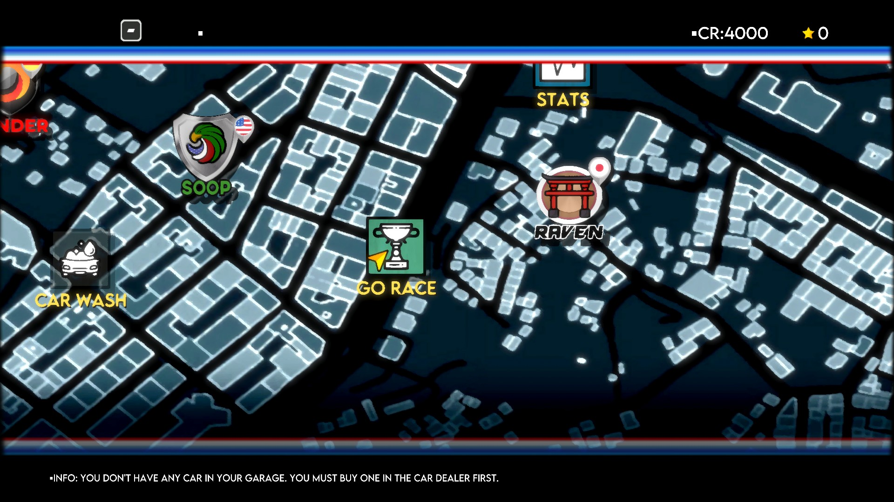
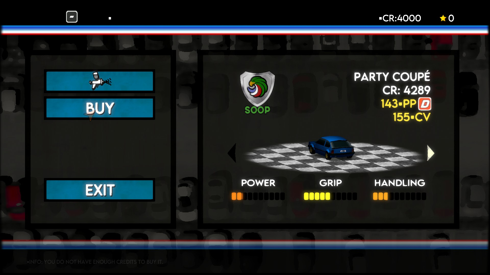

# Super Woden GP UI orientation — October 29, 2026

PPSA07211, content version 01.000.003. Windows, RTX 3070 Ti, Vulkan,
1920×1080 output. Development build; no new released version is assigned.

## Result

The world-map labels, manufacturer icons, car dealership controls, credits and
bottom information line now have the correct vertical orientation in the
captured frames. The earlier partially inverted interface was reproduced before
the changes. The final check reached the map and dealership using the existing
scripted input profile; it did not establish race gameplay or completion.

These are renderer frame captures, converted to JPEG without changing their
orientation or colors. Windows UI automation became unavailable during the
check, so the final image was not separately confirmed by a desktop capture.

## Two causes

1. A resident fullscreen copy stored its requested Y flip as deferred scanout
   metadata instead of flipping the copied pixels. UI drawn afterwards was
   consequently flipped together with the earlier scene at presentation. The
   Vulkan blit now applies the orientation immediately, so later draws, sampled
   consumers and readback all see the same pixel order.
2. The indexed fullscreen shortcut inferred orientation from the viewport sign
   even when recovered vertex buffers and the guest shader described different
   projection/UV transforms. Buffered draws now execute the translated shader.
   The legacy shortcut remains only for draws without recovered vertex buffers;
   the procedural-triangle behavior is unchanged.

The changes are in the shared Vulkan renderer. There is no title-ID check,
shader-address patch, replacement UI shader or global display flip. DirectX
code was not changed.

## Validation

- ReleaseSafe `game-run` and `vulkan-smoke` builds pass.
- All **267 Vulkan unit tests pass**.
- `--fullscreen-orientation` checks every pixel for procedural triangles and
  buffered indexed quads, both viewport signs, runtime UV scale/bias, CPU-backed
  and resident image sources, and later masked draws.
- `--resident-blit-orientation` checks alternating flipped/unflipped copies to
  a reused destination, a later overlay restricted to the top half, and a
  subsequent GPU copy. The Vulkan validation layer is enabled for this probe.
- Packed scanout conversion, scanout channel order, dynamic viewport/scissor
  and retained render-pass probes also pass.
- `zig fmt --check` and `git diff --check` pass.

These synthetic checks cover the affected shared paths; they do not establish
that every other game has been retested. The renderer captures show corrected
orientation, not a clean bill of health for all graphics or audio.

## Limits and memory growth

The initial candidate fixed the outside information line but left map labels
inverted. The final candidate also removes that second inversion. Incorrect
flag colors were visible in the baseline and first candidate's language screen;
their resolution is not claimed here.

Checks used a 60 FPS limit initially and a 30 FPS limit for the final scripted
map/dealership run. These are diagnostic limits, not measured performance
ceilings or race benchmarks. The final scripted run's periodic GPU-gap counters
are zero, but that alone does not prove visual correctness.

An earlier map run grew to approximately 15 GB of private process memory and
was stopped. The final scripted run was bounded to 90 seconds and 8 GiB; it
ended at about 8,076 MiB. This growth remains unresolved. A previous run ended
before a system reboot and had `PlayerPrefs` thread-creation failures, but the
cause of the computer freeze has not been established. All test game processes
were stopped; long-session stability, races, saving and completion are not
claimed.

The updated local `zig-out/bin/game-run.exe` is a development build. SHA-256:
`aaaeb70d3b4a2ad681a7d9d7c41498258f58b6642f4ea567755c6dc912149319`.
