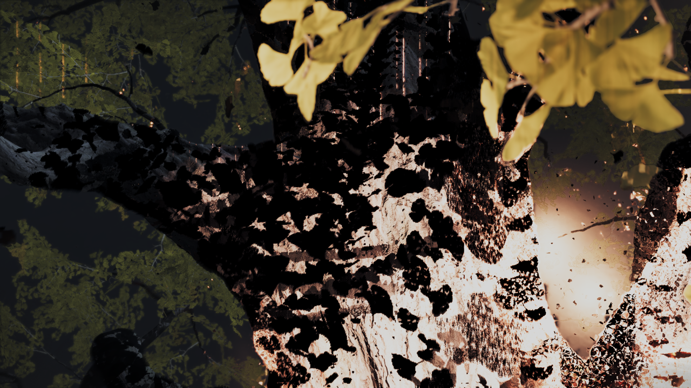

# Ghost of Yōtei: GLOBAL parameter-block recovery

Title: PPSA26344. Backend: Vulkan. Baseline: PS5PCEM 0.3.6 (`7c836bb`).

The ordinary startup run stalled at flip 1023. Compute program `0x80002d6700`
reported 2,469 unmapped snapshot words, with the first read at PC `0x9f0`
(`GLOBAL_LOAD_DWORDX4`, scalar base plus a vector offset and 236). Deferred
release publication then failed with `GuestMemoryReadFailed`; the command
queues stopped while audio continued. This was not a shader-compilation wait.

The shader uses the same entry scalar pointer for fixed-offset SMEM reads and
indexed GLOBAL reads of a small parameter block. SMEM values were prepared,
but the GLOBAL snapshot contained only the empty fault-reporting region.

The new preparation path identifies parameter roots from SMEM accesses
sharing an unchanged entry scalar pair with GLOBAL loads. It flushes previous
GPU writes and captures readable pages in a bounded 64 KiB window from each
root on every dispatch. This window is a staging limit, not a claimed guest
allocation size. It does not create guest mappings, zero-fill failed reads,
or skip the shader.
Unmapped pages split the snapshot; unknown roots and reads outside the
captured pages retain the checked fault path. The saved 1,974-instruction
shader yields a 772-byte parameter span.

An initial repeat exposed a boundary error before the first flip: program
`0x80003c8100` has indexed GLOBAL fields immediately after its last fixed SMEM
field. Capturing only the SMEM byte extent was insufficient. The page-based
revision passed that first failure, but the same kernel later failed at flip
758 when an indexed tail crossed the last SMEM page. Its AGC header declares
only two SRT words, so that field does not supply the dynamic table's extent.
The bounded-window revision covers the tail without guessing its contents or
committing memory; unreadable pages remain holes. It also reuses the existing
immutable scalar-definition cache: the local
100-query probe took 586,467 microseconds without that cache and 282
microseconds after warming it. These are CPU analysis timings, not game FPS.

Validation before the repeat run:

- The captured-shader metadata probe passes.
- All 164 focused metadata/provenance tests pass in ReleaseSafe, including
  pointer clobbers, branch joins, dynamic offsets and excessive extents.
- The GPU test build/run completes successfully.

The bounded-window repeat passes the earlier failures before the first flip
and at flip 758, and continues past the baseline's flip 1023. The original
faulting program is present in the repeat's translation cache. At flip 1185,
596,881 compute dispatches and 163,487 draws had translated without a reported
draw, dispatch, flip or synchronization failure. Captures show the Digital
Deluxe bonus notification and then a dark transition. Character control and
a sustained gameplay FPS improvement are **not yet verified**.

## Pipeline reuse follow-up

Loading still incurs substantial cold driver compilation. At flip 880,
211 compute-pipeline misses consumed 215,759 ms of a 221,403 ms frame. A cache
snapshot contained 487 translations for 389 program prefixes; one program
had 22 resource variants. These are loading costs, not steady gameplay FPS.

The next build keeps metadata descriptors at the high end of the storage
bank, separate from ordinary buffers allocated from its low end. Changing
candidate counts no longer automatically renumbers every later metadata
descriptor. Both allocation paths share occupancy and retain exhaustion
checks; no extra descriptor capacity is assumed.

Runtime buffer lookup candidates also retain one translation-key entry per
instruction site. The complete candidate list is still validated before a
cache hit. Only the first binding supplies generated code; the remaining
descriptor choices come from the live lookup table. Tests compare cached
SPIR-V byte-for-byte with fresh translation for changing candidate counts
and reject malformed secondary candidates.

- All 268 Vulkan backend tests pass, including sparse occupancy, interleaved
  allocation and full-bank exhaustion.
- All 317 RDNA2 tests pass in ReleaseSafe, including the candidate-count reuse
  and fresh-translation comparisons.
- The repeat with both changes passes the original GLOBAL failure and reaches
  flip 1367. Draw preparation reports unreadable textures during streaming;
  investigation of those failures is described below. Character control is
  still unverified.

### Runtime lookup headers

Buffer lookup capacity, probe limits and payload offsets now live in a checked
SSBO header. Changing a candidate population or moving a table payload can
reuse the same shader. An unmatched lookup uses the table's known-bound slot
as a safe address; the existing match predicate still returns zero for loads
and suppresses stores. The header checks capacity, alignment implied by word
offsets, table bounds and overflow before entering the probe loop. Static
lookup lowering retains its prior SPIR-V instruction order.

The translation cache validates every candidate before canonicalization,
including candidates omitted from its key. Reordering candidates no longer
specializes the masked fallback slot. On one captured Yōtei program, 21
resource variants produce 19 distinct modules with the new headers and stable
fallback. This is a limited reduction, **not a measured gameplay FPS gain**:
other ordinary descriptor slots and resource shapes still vary.

- All 318 RDNA2 tests pass in ReleaseSafe, including fresh-translation equality
  across population changes and rejection of malformed secondary candidates.
- All 268 Vulkan tests pass in ReleaseFast; the ReleaseFast runner builds.
- The native Vulkan buffer-table probe passes with the validation layer and
  no reported validation errors. It covers reads, stores, collisions, exact
  misses, changing table populations and malformed/truncated headers.
- Captured generated SPIR-V passes `spirv-val --target-env vulkan1.3`.
- Only the diagnostic `vulkan-smoke` executable receives a larger stack
  reserve (128 MiB), needed by its expanded independent probe fixtures.

The repeat using this executable passed the wolf brightness screen and
reached the tree. Renderer checkpoints at flips 1088 and 1152 show both;
the tree still has black patches and overly bright areas. These are renderer
captures, not independent window captures. Character control remains unverified.

*Flip 1152, Vulkan; resized from the renderer's 3840×2160 checkpoint to
1280×720 for documentation. No brightness or color correction was applied.*

Warm frames 1020 and 1080 took 656 and 671 ms (about 1.5 FPS), with no graphics
or compute pipeline misses. Frame 1210 took 1098 ms, including 255.6 ms of fence
waits, 320.2 MiB uploaded and 200.7 MiB read back. Symbolized waits identify
release completion (61.2 ms), storage-image publication (40.0 ms), ordered
buffer publication (39.1 ms), and mapping readback ranges (36.5 ms) among the
remaining costs. These are individual scene observations, not a matched
before/after FPS claim.

No draw or dispatch failures were counted in these frames, but their unresolved
storage preparations ranged from 1021 to 2228. Such a count does not prove an
executed missing access: the instruction may be on an inactive path. It also
does not establish full resource coverage. A trace of the next progressing
scene is needed before attributing the visible artifacts to those gaps.

The subsequent frame again compiles new compute variants for several minutes.
The compiler completion count advances and submitted GPU work is complete;
this interval is not a sustained gameplay FPS measurement. A concurrent build
started after these warm-frame samples, so later timings during that build
are excluded from performance comparisons.

### Further resource-slot work

A captured program's 21 variants produce only three distinct SPIR-V modules
in an offline experiment that also places ordinary buffer bindings before
variable-length indirect candidates. This is a translation experiment, not
a measured loading-time or FPS improvement. The implementation under test
plans known instruction-local V# slots without moving resource reads, staging,
mapping insertion or stores out of instruction order. Pending slots cannot
be mistaken for successfully staged resources, and unclaimed slots are released
before metadata preparation. The ordinary graphics path is unchanged.

All 270 Vulkan unit tests pass. The native buffer-table probe also passes
with `VK_LAYER_KHRONOS_validation` and no reported validation errors. Its
2→1→2 candidate-population sequence preserves actual reads, stores, aliasing,
out-of-bounds results and untouched neighboring words. With slot planning,
it creates one pipeline and reuses it twice; without planning, the same
sequence creates two pipelines and reuses one. This establishes a reduction
in redundant variants for that fixture, not a gameplay FPS gain.
The ReleaseFast runner and probe build successfully (18/18 build steps).

### Reference review

AnyPS5's October 31 change
[`684dfc1d56`](https://github.com/boykopovar/AnyPS5/commit/684dfc1d561d09a8c35c7c153c95bcfed7e49896)
invalidates raw descriptor pages when entering forced synchronization and
retries materialization/validation within that scope. Our shader reader already
publishes overlapping deferred metadata and our resource-walk cache re-reads
its dependencies. A corresponding stale-snapshot case has not yet been
reproduced here; the reference change has not been copied as an unproven fix.

## Streaming texture failures and Windows address collisions

In the stable-slot repeat, texture `0x92696e0000` repeatedly failed staging.
This had an earlier kernel cause: fixed direct-memory mapping at that exact
address returned `0x8002000c` (`fixed map not owned`). AddressSpace owned
`0x1000000000..0x9269600000` and `0x926f800000..0xfc00000000`; the intervening
host allocation contained the runner's own live AddressSpace object at
`0x926a37fd18`. The texture address therefore collided with host-owned memory,
rather than merely naming an uncommitted guest mip. The failed batch also
leaves later streaming work incomplete.

The renderer now reports the first failed source range, mip and layer, plus
the shader program and T# LOD fields. Detailed source reports are bounded to
32 per process. Failed reads remain failures; this does not manufacture
backing or substitute blank texture data.

The next process has uninterrupted host ownership across the observed
`0x9000000000..0xa000000000` texture window. That avoids this particular
collision for the repeat, but **does not fix arbitrary Windows ASLR collisions**.
A permanent address-space solution remains open. Intermediate cached color
attachments show the tree and fire; they are not proof of final presentation
or character control. The previous bounded-window run did not log this mapping
collision, so it should not be attributed to the lookup-header change.

## Completed-buffer pool probe

A live 32/128/32 MiB pool comparison suggests allocation churn can be reduced.
The 128 MiB interval's three logged frames averaged 13.80 ms allocating and
5.68 ms freeing buffers, versus 14.70 ms and 15.04 ms in the following 32 MiB
interval's five logged frames. The first interval included cold compilation,
and the scene changed throughout; frame counts are not a controlled FPS
comparison. The original 32 MiB budget was restored and remains the default.

At a warm frame (1353), 1,633 dispatched compute calls still required about
328 MiB of uploads, 204 MiB of readbacks and 257 ms of fence waits. Removing
cold pipeline stalls alone will not remove these steady rendering costs.

## Rejected shared-lookup experiment

The next loading frame (1180) took 629,086 ms, including 593,514 ms for 42 cold
compute pipelines and 27,682 ms for 36 graphics pipeline misses. The run was
stopped deliberately after reaching flip 1185, to measure compiler changes
without another game or build competing for resources.

A captured collision shader has seven checked memory regions. Lowering the
shared snapshot-lookup threshold from 16 regions to four reduced its SPIR-V
from 3,681,980 to 3,354,644 bytes. Both modules pass `spirv-val` for Vulkan 1.3;
the regenerated original matches the captured module byte for byte.
However, sequential uncached pipeline probes on the same RTX 3070 Ti and the
same probe executable measured 65,878 ms for the modified module versus
42,092 ms for the original. Peak process commitment was approximately
3.40 GB versus 3.24 GB. This one controlled pair does not establish performance
across other shaders, but provides no reason to adopt the lower threshold.
The experiment remains outside the emulator source. These are compile-only
measurements, not dispatched GPU time or game FPS.

## Reviewed upstream contributions

Five commits from `kleinergoo7/PS5PCEM` were cherry-picked with authorship
preserved: `cf6daec`, `21f25a4`, `181d48c`, `13d7f01`, and `d717347`.
They add opt-in thread-name tracing, restore rejection of unsnapshotted
absolute FLAT reads, update shader assertions to the current lowering, and
use a wall-clock deadline for deferred APR tests. The resulting tree passes
all 316 RDNA2 tests in ReleaseSafe and all 25 APR tests in ReleaseFast.

`bc712a0` (commit reserved GPU memory on demand) is not included. A reserved
virtual range is not evidence that an arbitrary GPU read should create its
backing. The read hook is also used for speculative resource discovery;
automatically committing zero-filled pages there can conceal missing
mappings or bad descriptors. A per-access 512 MiB limit does not bound
cumulative commitment. This needs a demonstrated guest mapping/lazy-commit
contract and coverage of aliases, holes, context ownership and memory budgets
before it can become default behavior.

## Resident 3D mip chains

A bounded trace of the direct-slot runner found a 128×128×128 R8 volume at
`0x500c8b7000`, sampled across levels 0–6. All seven GPU-written mip images
were resident, but the assembly path accepted only 2D textures. Sampling the
volume therefore fell back to publication, CPU detiling and another upload.

Resident mip assembly now supports 3D images, including the depth of each
level. Its cache distinguishes image dimensionality and depth; matching a
volume producer also checks its guest tiling, pitch and full mip geometry.
Every requested level must be available and current. Same-frame writes
invalidate only the changed levels, and CPU replacement retains the existing
coherence checks. The frame profile reports `volume_levels` separately.

When the CPU actually needs the volume, compatible disjoint mip images can
now share one readback submission and one guest-memory publication. The
copies include all Z slices. Incompatible layouts and overwrite baselines
still use the guarded per-image fallback; guest padding and CPU-edited mips
are preserved.

Validation:

- All 270 Vulkan unit tests pass; ReleaseFast runner and probe builds pass
  all 21 requested build steps.
- The native resident-mip probe passes eight 2D/3D cases on the RTX 3070 Ti
  with `VK_LAYER_KHRONOS_validation` enabled and no reported validation
  errors or warnings.
- The probe reads the final Z slice of each 3D level, verifies queued
  consumers across same-frame updates, odd dimensions, LODs, swizzles and
  sRGB, then checks individual CPU mip edits, padding, batched publication
  and full CPU allocation reuse. Backing images are reused without stale
  pixels or unnecessary sampled-image uploads.

The preceding direct-slot run reached flip 1253 without recorded draw,
dispatch, flip or synchronization errors, and was deliberately stopped to
avoid host memory pressure during the build. A census of the 5,916-byte
program with prefix hash `09939c9b7c759fa9` found three cached variants in
that run versus 19 in the earlier run. These censuses cover different scene
positions, so they do not establish a final total or loading-time ratio.
Warm frames 1080 and 1140 took 713 and 666 ms (about 1.4–1.5 FPS); frame 1140
still uploaded 326.9 MiB and read back 204.6 MiB. These are observations before
the 3D mip change, not a measured FPS improvement. Character control remains
unverified.
