# Project status and compatibility

[← Documentation index](README.md) · [Project README](../README.md)

Development captures and the furthest repeatable point reached in each observed
title. What the emulator can do subsystem by subsystem is listed separately in
[Implementation status](implementation-status.md).

**Release 0.3.5:** includes the Linux runtime and GTK launcher, Windows controller
vibration and LightBar, audio corrections, renderer optimizations and 15 newly
documented titles. See the [complete changes since 0.3.4](release-notes/v0.3.5.md)
and [release checks](development/release-0.3.5-validation.md). Existing game grades
and dated FPS results are unchanged by the release preparation.

## Compatibility and progress

Compatibility grades are maintained by the project maintainer; dated notes
below distinguish playthrough reports from development checks. **Playable · Completable** means the title
can be played through; other entries describe the furthest observed milestone.
Performance measurements refer to the current test host. Title content is
supplied locally and is not included in this repository.

| Title | Status | Notes |
|---|---|---|
| **ASTRO BOT** 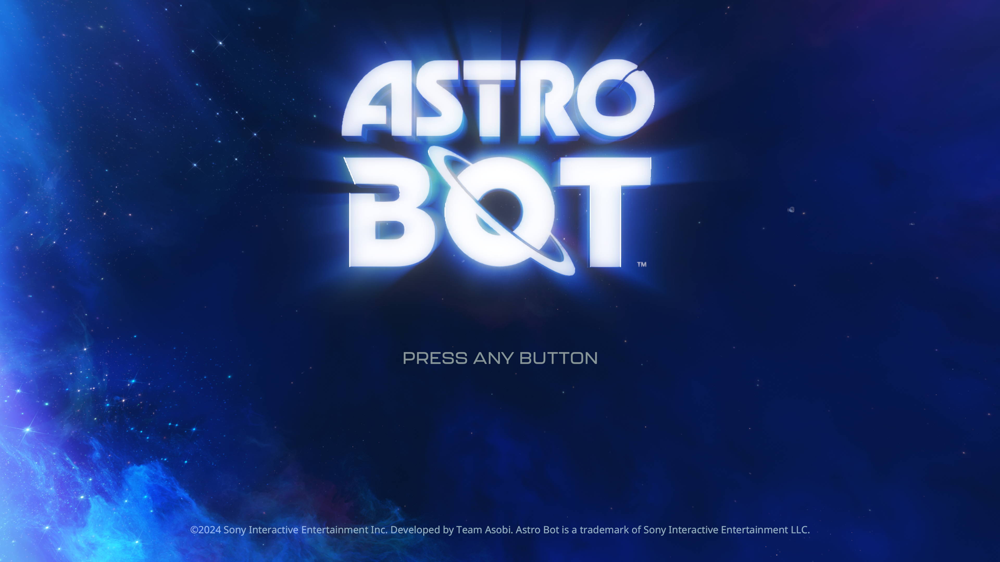 | **Diagnostic cinematic · rendering defects** | **October 16, 2026, PPSA21564 v1.018:** animated title **20.07 FPS over 2,640 frames / 131.56 seconds**; 60-frame blocks **18.39–21.68 FPS**. Direct CPU-replacement checks avoid 26.125 MiB of copies per frame; queue discovery avoids about 117 repeated pointer probes. The storage comparison measures **19.55 → 19.99 FPS**. This reaches a 20 FPS title average, **not a 20 FPS minimum or gameplay result**. Twelve unresolved storage bindings and cinematic defects remain. Earlier crowd sample: 4.60 FPS over 10 seconds. Development build, Ryzen 7 7700 / RTX 3070 Ti, 1080p output with a game-controlled 4K source. 680 HLE tests, 274 Vulkan tests and 64 native overwrite configurations pass; local runner updated and signed. [Measurements and capture](development/astro-bot-storage-readbacks-2026-10-16.md) |
| **Goat Simulator 3** 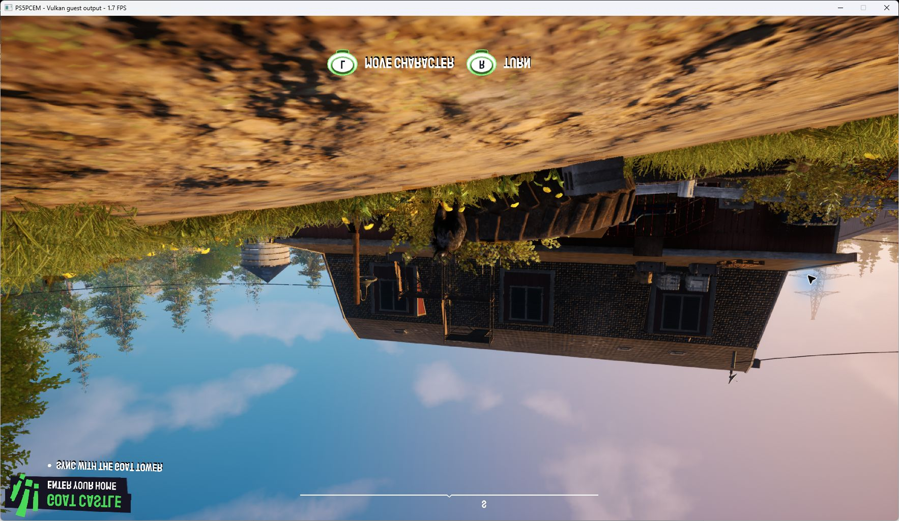 | **In-game · inverted image · low FPS** | **October 13, 2026, PPSA04158 v01.000.000:** the full installation and existing runner reach the farm after a long new-world load and cart introduction. Keyboard movement is verified; the compass and Goat Castle objective render. **1.8 FPS median (1.7–1.8)** from 30 stationary window-counter readings over 30.011 seconds. The scene/HUD remain inverted after closing pause; repeated menu subframes, shading artifacts, unsupported 3D storage images and unresolved bindings remain. Save files are created; reload, audio quality, multiplayer and completion are unverified. Development build, RTX 3070 Ti, 1080p output, internal targets up to 3200×1800. [Gameplay capture and report](development/goat-simulator-3-gameplay-2026-10-13.md) |
| **Minecraft Legends** 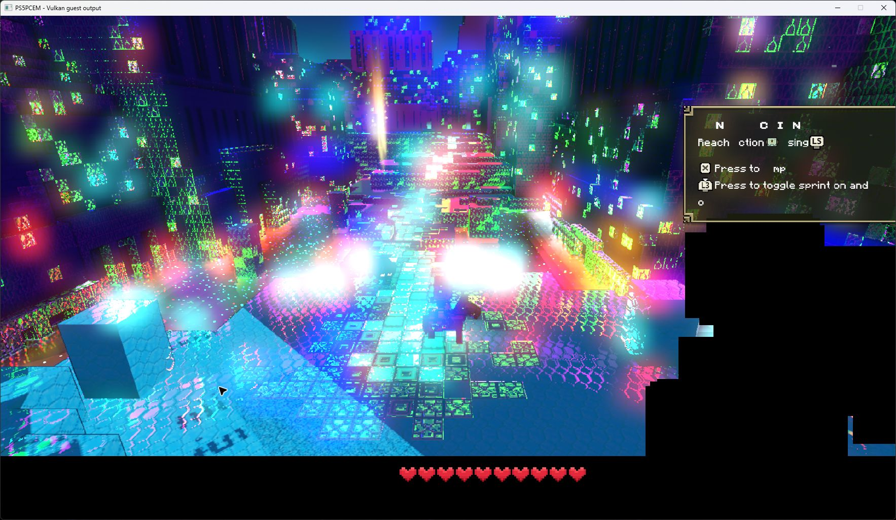 | **In-game · severe rendering defects** | **October 13, 2026, PPSA05510 v01.013.000:** real file rename unblocks LevelDB world creation. A fresh run reaches the opening tutorial; keyboard movement and turning are verified. Severe color/lighting corruption, large black regions and missing glyphs remain. No sustained FPS benchmark, save reload, audio-quality or completion check. 653 HLE tests pass. Development build. [Gameplay capture and report](development/minecraft-legends-campaign-2026-10-13.md) · [Startup fixes](development/minecraft-legends-startup-2026-10-12.md) |
| **Police Simulator: Patrol Officers** 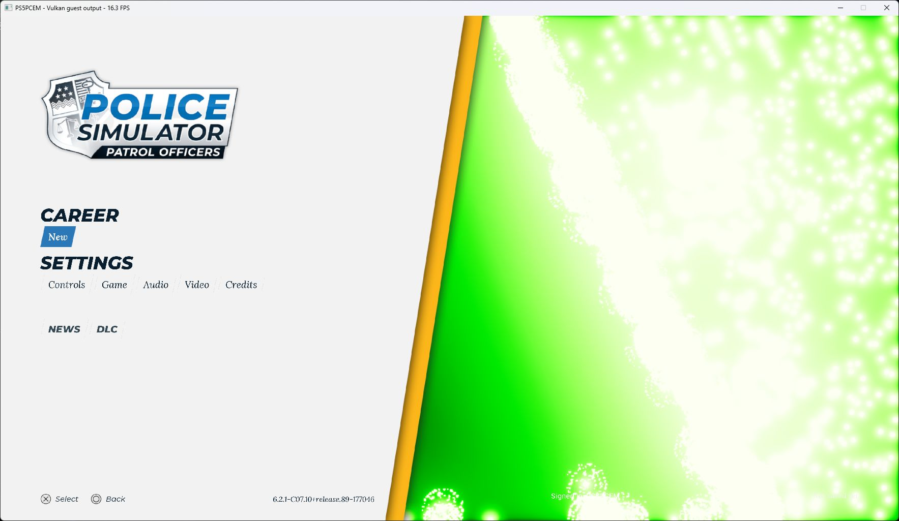 | **Intro/menu · rendering defects** | Startup, New Career and district confirmation verified. Green menu corruption, flipped UI and recursive image copies obscure shift selection. Menu capture 16.3 FPS; district-selection samples 8.2–9.9 FPS (median 9.2). Controllable street gameplay unverified. [Run report](development/police-simulator-career-2026-10-12.md) |
| **Monster Boy and the Cursed Kingdom** 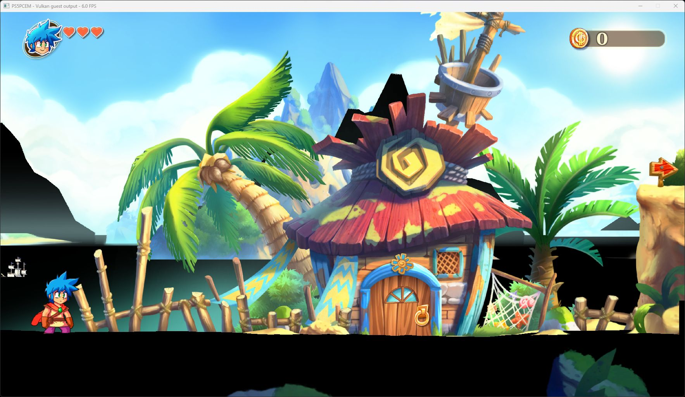 | **In-game · rendering defects** | New Game saves and reaches the first controllable level. Keyboard movement verified. Large black polygons obscure the scene. Observed 3.8–5.7 FPS (median 4.2) during concurrent compilation; audio and save reload unverified. [Run report](development/monster-boy-gameplay-2026-10-12.md) |
| **Oxide Room 104** 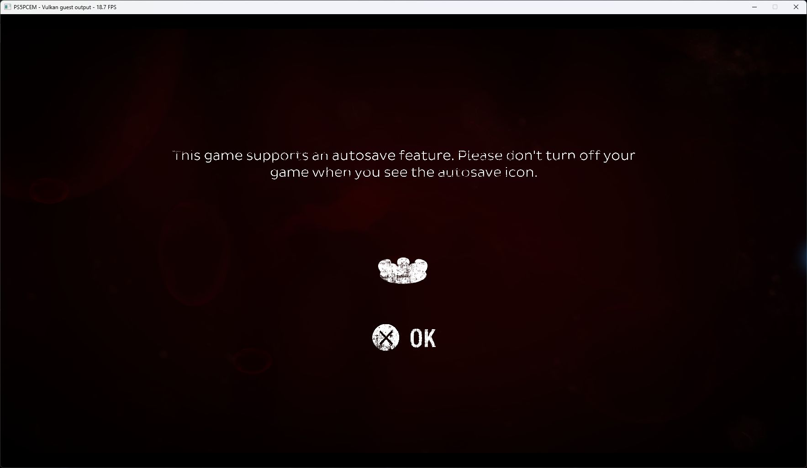 | **Startup notice · later black screen** | **October 11, 2026, PPSA07653 v01.000.000:** two launches pass linking. The scripted-Cross run becomes black and logs `UnsupportedBufferAddressing`, unsupported `IMAGE_BVH_INTERSECT_RAY`, `InvalidScalarCall` and `DMA_DATA: BackendRejected` queue stops. A keyboard-only repeat renders the autosave notice at **18.45 FPS median (17.5–19.1)** over 30 readings spanning 29.829 seconds. This is a startup-screen result, not gameplay. Unresolved storage bindings occur in both runs; no guest fault was recorded. RTX 3070 Ti, 1080p output; rendering correctness, controls and progression are unverified. [Run report](development/oxide-room-104-startup-2026-10-11.md) |
| **Medieval Dynasty** 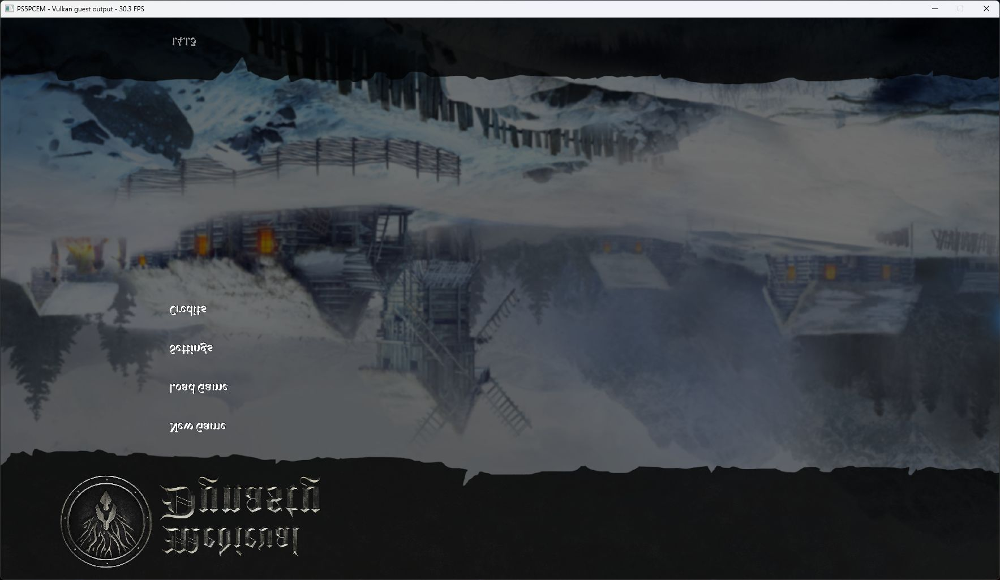 | **Main menu · vertically inverted image** | **October 11, 2026, PPSA07933 v01.413.001:** the unchanged development runner reaches the main menu, but its artwork, logo and option text are vertically inverted. **32.3 FPS median (28.8–33.2)** over 30 window-counter readings spanning 29.763 seconds. Scripted Cross did not enter a level during this observation. 38 of 50 periodic GPU-gap reports have 72 unresolved storage bindings; no guest fault was logged. RTX 3070 Ti, output and largest internal target 1920×1080. Gameplay, manual navigation, audio quality and completion are unverified. [Run report](development/medieval-dynasty-startup-2026-10-11.md) |
| **Charon's Staircase** 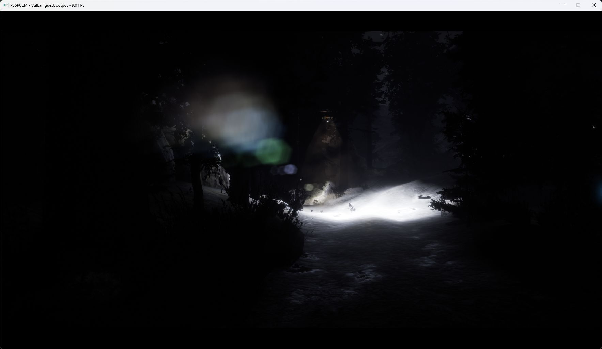 | **Opening 3D scene · controls unverified** | **October 11, 2026, PPSA06603 v01.000.000:** the unchanged development runner renders the illustrated introduction and the first 3D forest-road scene. **9.1 FPS median (8.0–9.3)** from 30 window-counter readings over 29.852 seconds, with automatic Cross active; character control is unverified. The transition contains a **32.342 s frame**, including 26.810 s of graphics pipeline misses. 63 of 64 GPU-gap reports have unresolved storage bindings; no guest fault was recorded. RTX 3070 Ti, output 1080p, largest internal target 3456×1944. Audio quality, saves, completion and long-session stability are untested. [Run report](development/charons-staircase-startup-2026-10-11.md) |
| **PAC-MAN WORLD Re-PAC** 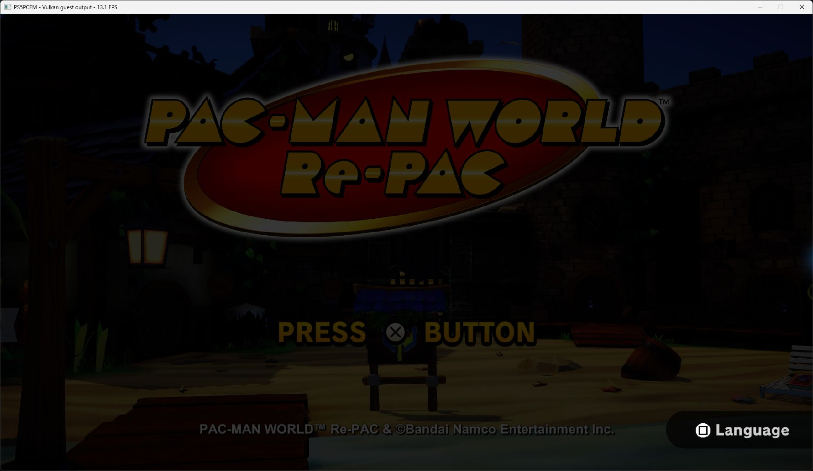 | **Intro · title and terms screens** | **October 11, 2026, PPSA06399 v01.000.002:** the existing development runner links Unity and plays the opening movie, then reaches the title and Terms of Use/Privacy Policy screens. Movie colors are severely distorted. Scripted Cross cycles through startup screens; 30 window-counter samples show **9.55 FPS median (5.9–14.1)** across 29.927 seconds, not a stationary or gameplay benchmark. All 180 periodic GPU-gap reports are zero; no guest fault was logged. Gameplay remains unverified. RTX 3070 Ti, 1080p output/internal target, existing caches retained. [Run report](development/pac-man-world-re-pac-startup-2026-10-11.md) |
| **KeyWe** 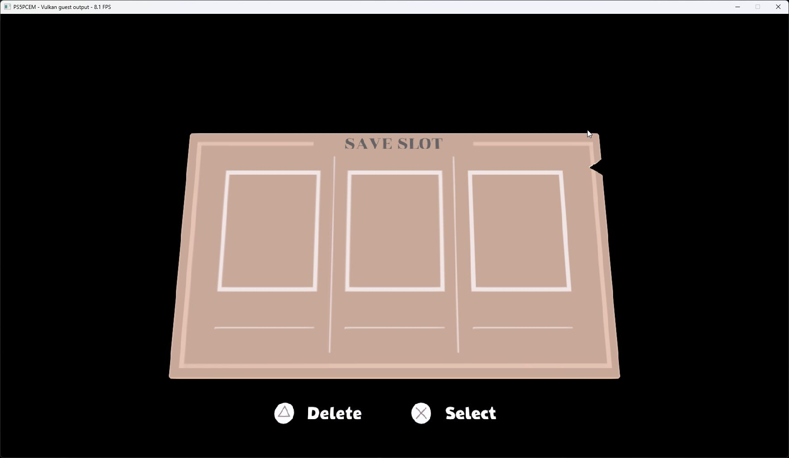 | **Startup · save-slot menu · rendering incomplete** | **October 11, 2026, PPSA02210 v01.000.000:** per-thread `pthread_setcancelstate` and seven Audio3d imports resolve the link failures. Two launches pass Unity initialization and the publisher sequence. Scripted Cross reaches the save-slot panel at a captured **8.1 FPS** on RTX 3070 Ti, 1080p output/internal target; this is a single observation. The subsequent screen is black despite continuing submissions; a keyboard-only repeat also becomes black after the logos. All 58 GPU-gap reports across both runs have zero counters, which does not establish correct graphics. Gameplay, audio quality, manual controls, saves and completion are unverified. Audio3d provides approximate stereo mixing, not full spatial audio; these runs use ordinary AudioOut. Development build. [Implementation, limits and capture](development/keywe-pthread-cancel-state-2026-10-11.md) |
| **Super Woden GP** 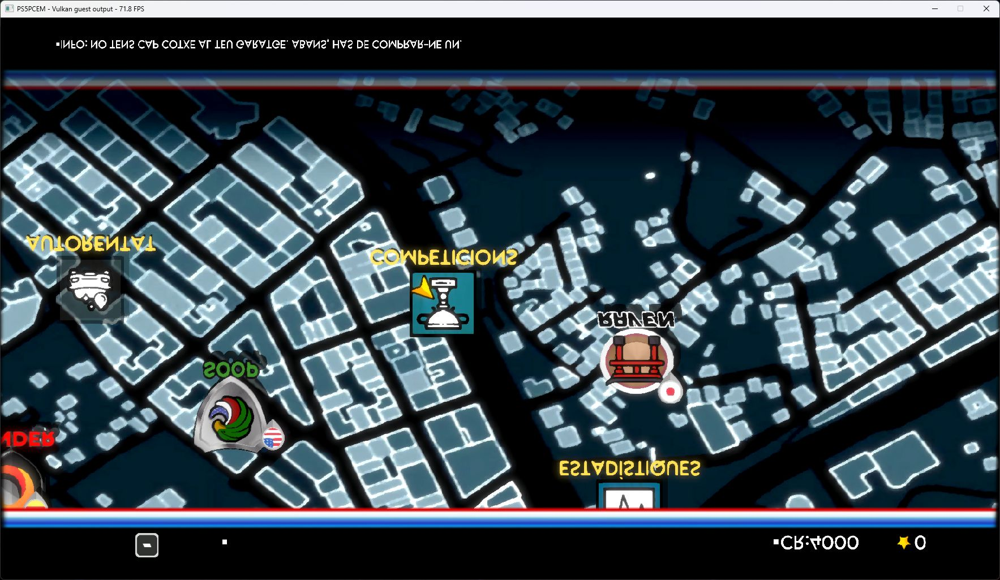 | **Main menu · graphical issues · gameplay unverified** | **October 11, 2026, PPSA07211 v01.000.003:** real per-thread cleanup stacks resolve two missing Unity `libkernel` imports. Three launches pass linking and startup; scripted Cross/Down input reaches the world-map menu. The captured counter reads **71.8 FPS** on RTX 3070 Ti at 1080p; this is a single observation, not a sustained benchmark. All 164 GPU-gap reports in the menu run are zero, but flag colors and orientation of several labels/icons remain incorrect. Manual controls, racing, audio quality, saves and completion are unverified. Development build. [Implementation, checks and capture](development/super-woden-gp-pthread-cleanup-2026-10-11.md) |
| **Arcade Spirits: The New Challengers** 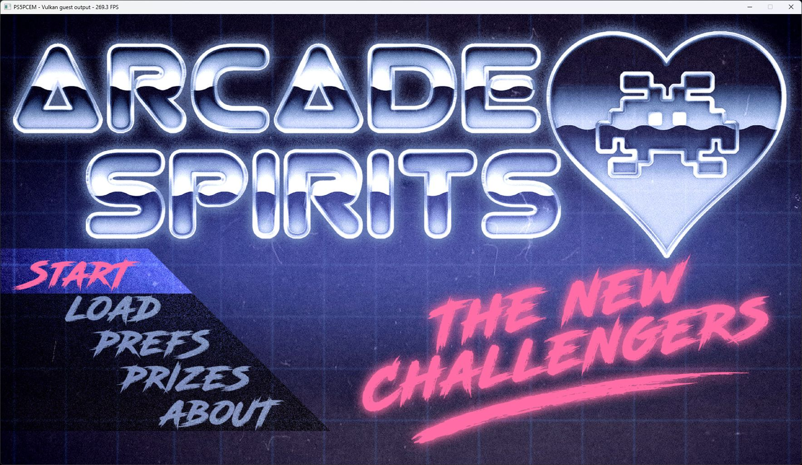 | **Main menu · gameplay unverified** | **October 11, 2026, PPSA06409 v01.000.000:** five missing `scePthreadSem*` imports now use real counted semaphores and scheduler waits, with empty-poll, overflow and lifetime errors. The Python/Ren'Py runtime initializes and the main menu renders on the signed runner. Menu counter: **252.9 FPS median (221.1–272.3)** over 30 one-second samples on RTX 3070 Ti; requested output 1080p, internal target 4K. All 517 periodic GPU-gap reports in this check are zero. Manual navigation, gameplay, audio quality, completion and long-session stability remain unverified. Development build. [Implementation, validation and capture](development/arcade-spirits-pthread-semaphores-2026-10-11.md) |
| **Arkanoid: Eternal Battle** 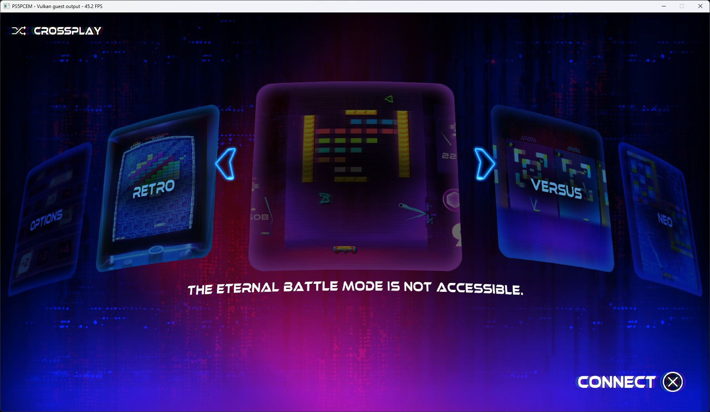 | **Title screen · main menu · gameplay unverified** | **October 11, 2026, PPSA06328 v01.002.000:** real Fiber information/rename, private mutex attributes and file flushing resolve four missing imports. Independent HLE stacks and synchronized cross-thread fiber migration fix the subsequent crash and black loading loop. A separate sampled-texture upload bound restores the large BC7 menu atlases. Two final launches pass the publisher sequence; automatic Cross opens mode selection. The menu counter has a **45.6 FPS median (43.5–46.6)** over 30 samples on RTX 3070 Ti. Online Eternal Battle remains inaccessible; manual offline navigation, gameplay, audio quality and completion are unverified. Development build. [Fixes, tests and captures](development/arkanoid-fiber-startup-2026-10-11.md) |
| **Raiden IV x Mikado Remix** 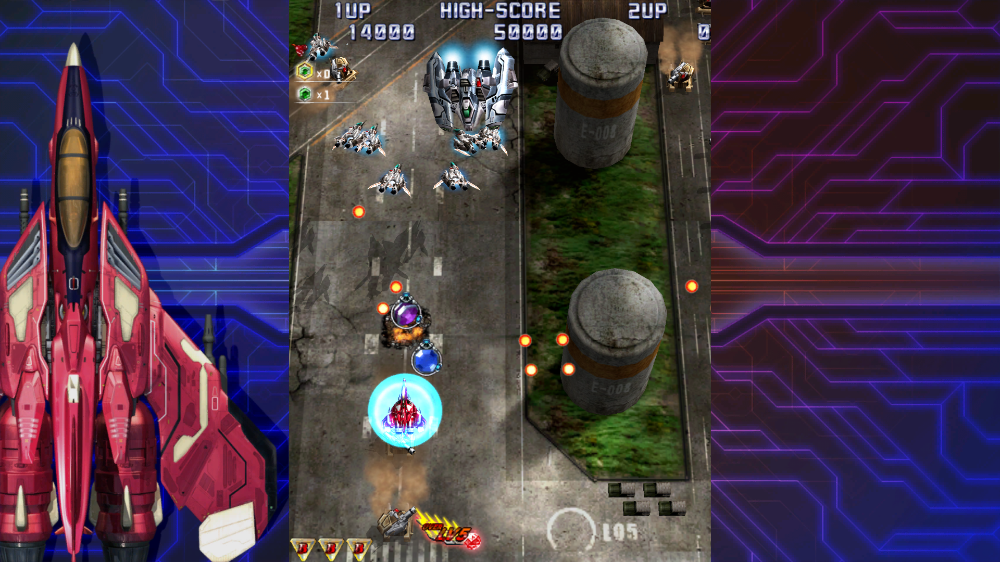 | **Playable · Completable** | **October 17, 2026, PPSA08832 v01.000.000, development build:** first-level gameplay, death and continuation checked. NGS2 rack allocation, ATRAC9 decoding and memory waveform parsing restore effects; the user confirms button sounds, but reports music only around death. Retained render passes and sampled-image descriptor handling reduce overhead. **39.75 FPS over 1,193 frames / 30.013 seconds**, one-second intervals **24.99–63.97 FPS**; later heavy combat around **18–22 FPS**. RTX 3070 Ti, 1920×1080 output and observed internal target. **60 FPS remains unmet.** Grade set by the maintainer; this check does not verify completion or long-session stability. Final register-snapshot optimization was not included in the timed candidate. [Report and gameplay capture](development/raiden-iv-audio-rendering-2026-10-17.md) |
| **Dead Cells** 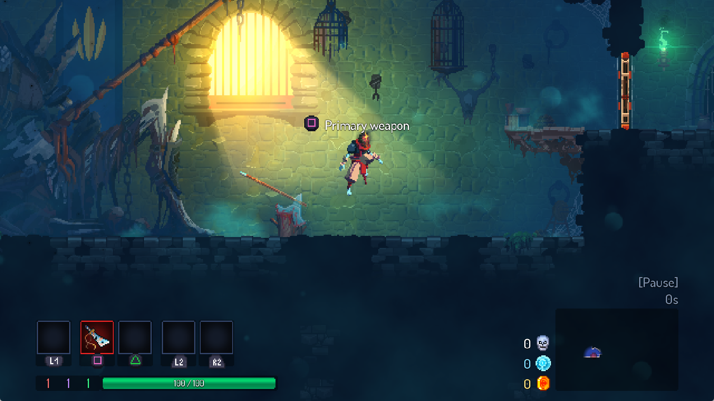 | **Main menu · first level renders · playability not established** | **October 11, 2026, PPSA15552 v01.005.000:** the title previously failed to link on eight missing `libSceNgs2` imports; buffer-backed system/rack creation and the geometry helpers now resolve them. The Prisoners' Quarters level, the character and the HUD now render. Previously a full-screen copy shortcut ignored blending and replaced the lit scene with the black emissive buffer; it now runs only for replace blending. The menu music was not being played: the title's custom sampler rack (`0x4001`) passes waveform format and blocks under its own parameter IDs, which were ignored, so its voices mixed silence. The menu mix now peaks at about 0.12 of full scale; this is a measured level, not yet confirmed by listening. The window counter read **59.2–68.1 FPS** in the starting room and **71–72 FPS** in the main menu. Draw/dispatch failure counters are zero. The game was started by automatic Cross presses; combat, progression and saves are untested. RTX 3070 Ti, Speed preset, 1080p output, development build after 0.3.4. [Level and menu-audio fixes](development/dead-cells-level-and-menu-audio-2026-10-11.md) · [NGS2 linking](development/dead-cells-ngs2-2026-10-11.md) |
| **Little Nightmares Enhanced Edition**  | **In-game · save/reload verified · rendering incomplete** | October 3, 2026, PPSA10737 v01.004.000. Fixed asynchronous save writes, positional writes and truncation; fresh processes now Resume the opening room from nonempty saves. Shared HTILE handling and eager readback batching reduce CPU/transfer costs; the title uses four copy workers. The updated installed runner records **4.46 FPS beside the suitcase and 3.73 FPS after moving right**, each over 30 seconds. RTX 3070 Ti, 1080p output request, Speed preset, in-game Performance; internal resolution remains game-controlled. **5 FPS is not achieved.** Dark/reflective materials, unsupported FLAT/ray-intersection shaders, resource-binding gaps and intermittent allocator failures during startup remain. Completion and long-session stability are unverified. [Fixes, measurements and validation](development/little-nightmares-saves-performance-2026-10-03.md) · [Current capture](images/little-nightmares-saves-performance-2026-10-03.png) · [Earlier 2.16 FPS check](development/little-nightmares-gameplay-2026-10-03.md) |
| **Grand Theft Auto III: The Definitive Edition** 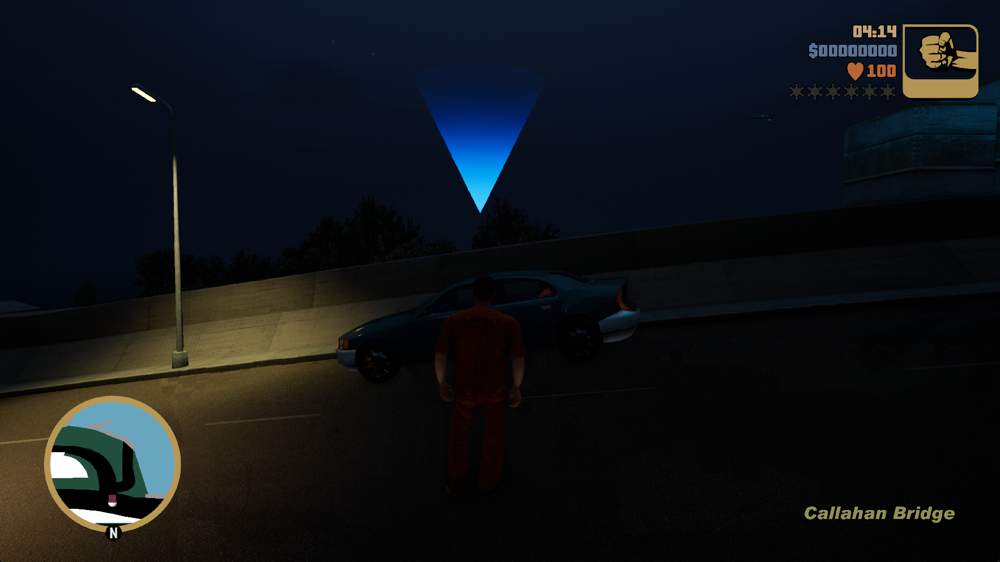 | **Playable · Completable** | October 10–11, 2026, PPSA03527 v1.007. The real launcher reaches the menu automatically in **139 seconds** with both active emulator caches absent; neither startup movie was manually skipped. AvPlayer callback/EOF ordering fixes remove the observed startup hang. Ordered buffer, storage-image and cube-face publication removes the observed green reflections, verified in all eight captured reflection mips. Read-only uniform shader guards remove inactive resource references; the tested opening scene reports **zero draw/dispatch failures, unsupported compute and unresolved/null/rejected storage bindings**. A 30-second opening-street sample records **8.27 FPS**; 10 FPS and later-game shader coverage remain unverified. Performance mode, Bloom/Motion Blur off, Classic Lighting on; output 1080p, internal resolution game-controlled. Moving vehicle/object shadows and duplicated player shadows are reported and remain open; one vertex-only initialization draw is still under investigation. Whole-game completion, saves and audio correctness are unverified. [Investigation and measurements](development/gta3-startup-reflections-2026-10-10.md) · [Gameplay capture](images/gta3-startup-reflections-2026-10-10.png) · [Previous performance report](development/gta3-renderer-performance-2026-10-03.md) |
| **Subnautica: Below Zero** 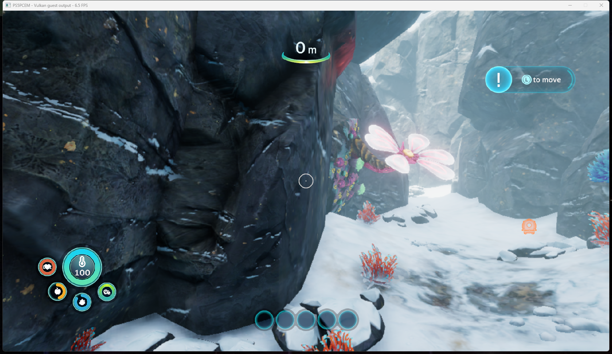 | **Playable · Completable** | **October 10, 2026, PPSA02457 v1.022.125:** ACM convolution and valid batch completion fix the reproduced startup crackle/NaN/silence chain. Fresh launches produce finite PCM; the maintainer confirms clear sound on repeated starts. New Game / Survival reaches controllable gameplay and writes a nonempty save. Stationary 30-second window-counter samples give **4.85 FPS median near the glowing plant** on the validation candidate and **14.20 FPS in the main menu** on the final signed runner. Output 1080p, Speed preset, normal audio enabled. These differ from the October 3 crash-site view and do not establish an audio-related slowdown or speedup. **30 FPS is unmet.** Rendering defects, long-session stability, a new full playthrough and short audio/capture discontinuities remain open. [Current audio investigation, FPS and captures](development/subnautica-acm-audio-2026-10-10.md) · [Historical October 3 measurements](development/subnautica-performance-repeat-2026-10-03.md) · [Save, startup and stack checks](development/subnautica-vector-walk-save-2026-10-02.md) · [sRGB fix](development/subnautica-backing-spans-2026-10-01.md) · [New-game investigation](development/subnautica-new-game-2026-10-01.md) |
| **Terminator 2D: No Fate** 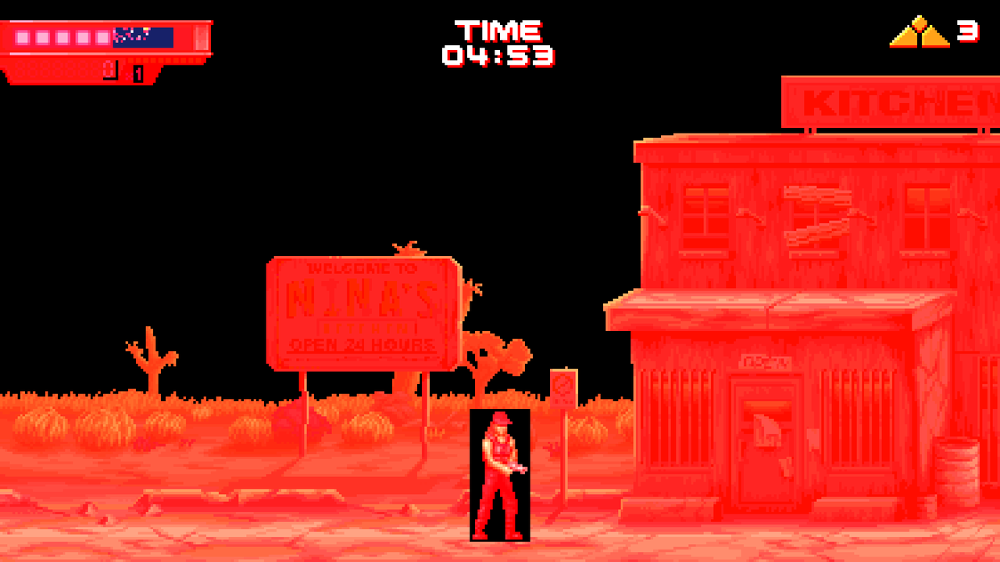 | **Playable · Completable** | Completed without reported problems. Correct backgrounds, characters, HUD, textures and colors; warmed-up startup frames measure 22–65 ms on the current test host. [Gameplay capture](images/live-gameplay.png) |
| **Pistol Whip** | Maps the native PS VR2 plugin and Burst module, then starts loading Unity asset archives | Headset, tracking, controller, and host OpenXR support are intentionally deferred |
| **Propagation: Paradise Hotel** | Mounts the 8.8 GiB UE PAK, completes ICU/config bootstrap, opens the cooked Global shader archive, creates AGC shaders, and submits the first DCB | This milestone predates the new synchronization packet constructors and needs a fresh run; VR presentation still has no host headset bridge |
| **Big Helmet Heroes** 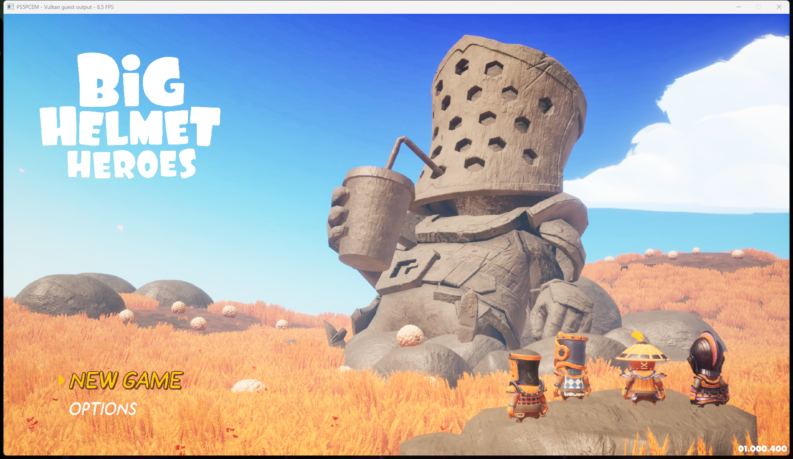 | **Main menu · tutorial scene renders · playability unverified** | **October 10, 2026, PPSA19943 v01.000.400:** stationary menu improves from **4.9 to 9.4 FPS median (9.0–9.5)** over 45 seconds on the RTX 3070 Ti. Bounded readbacks, coherent volume/mip reuse, parallel publication and shorter asynchronous batches reduce repeated work. Dense grass is restored after excluding a faulty intermediate stencil-image discard. Sampled draw/dispatch/resource failure counters are zero; this is not proof of universal shader coverage. **Stable 15 FPS is unmet.** 1080p output, internal targets up to 2848×1600; normal audio. Tutorial performance, gameplay and long-session stability are not revalidated. [Current measurements, changes and limits](development/big-helmet-heroes-menu-performance-2026-10-10.md) · [Historical tutorial check](development/big-helmet-heroes-scalar-history-2026-09-29.md) |
| **Tetris Effect: Connected** | **Developer logos · readable license screen · Journey Mode selection · gameplay and stability unverified** | Verified on September 24, 2026 with PPSA07923 v2.000.022. The translated composite replaces speculative 4K overrides. Faster tiled clears reduce the median license frame from 235 to 159 ms (about 4.3 to 6.3 FPS). Publishing linear metadata fills and supporting R11G11B10/RGB10A2 DCC clears remove accumulated UI copies and the vertical scene boundary. A 128-target title profile retains the approximately 100-attachment working set; observed Journey frames take 318–396 ms instead of 1127–1276 ms with the smaller cache. Dark interface elements and an unresolved compute texture binding remain under investigation. Later video playback faults in the guest H.264 decoder; a secondary host diagnostic alignment panic is corrected and regression-tested. Longer-run stability and gameplay are not established. The particle capture below records an earlier milestone |
| **The Precinct** | Links the complete six-image guest graph, starts Unity plug-ins through `sceKernelLoadStartModule`, indexes its audio assets, and plays both observed intro movies as synchronized 3840×2160 NV12 video and 48 kHz stereo PCM. It renders the complete 1920×1080 title artwork, opens `PLAY GAME`, and displays the readable `NEW GAME` confirmation shown below. Holding `Triangle` enters the cold world load; an earlier guarded run reached the `Cross` prompt and produced the first verified in-engine gameplay image. Target-thread exception delivery completes Unity's stop-the-world handshake, resident typed storage images preserve its compute graph, and dynamic compute scalars prevent runtime SGPR values from generating a new Vulkan pipeline every frame. Its world-load frame measures 2.1 s where it measured 5.1 s, after descriptor recovery stopped replaying each kernel's prolog once per resource it names | The first world transition still takes several minutes on the current RTX 3070 Ti test host because first-use shader translation, NVIDIA pipeline compilation, synchronous submission, and resource staging remain expensive. The former title- and shader-signature-specific NVIDIA compiler guard has been removed in favor of the general shader path, so the transition needs a fresh end-to-end validation before current gameplay compatibility is claimed |
| **Jets 'n' Guns 2** 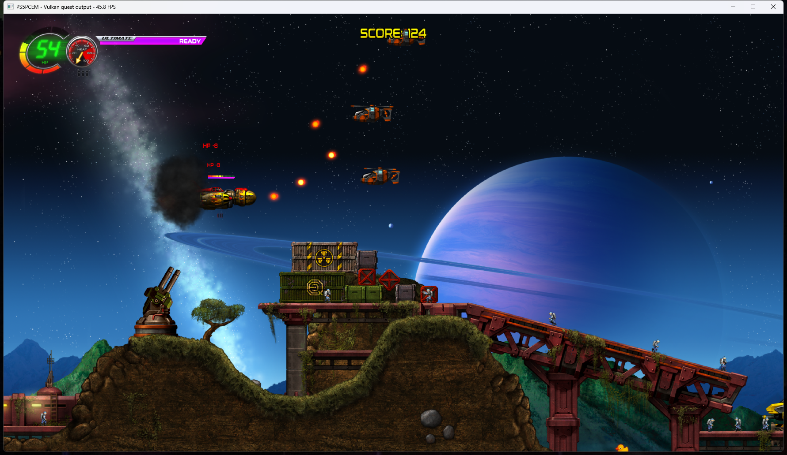 | **Playable · Completable** | Playthrough confirmed by the maintainer on September 15, 2026. October 9 development build: music and effects have independent host streams, and underrun recovery preserves PCM order. The 20-second mission-menu recording falls from 92.25% silent blocks to zero; two 13-second combat samples also have no silent 10 ms blocks. The 0.3.2 routing mitigation did not cover this batch-output path; this fix postdates 0.3.4. Combat UI counters sampled at 35.7–45.8 FPS; the older 11–14 FPS measurement is historical and is not a matched comparison. [Retest, limits and capture](development/jets-audio-streams-2026-10-09.md) |
| **Asterix & Obelix: Slap Them All!** 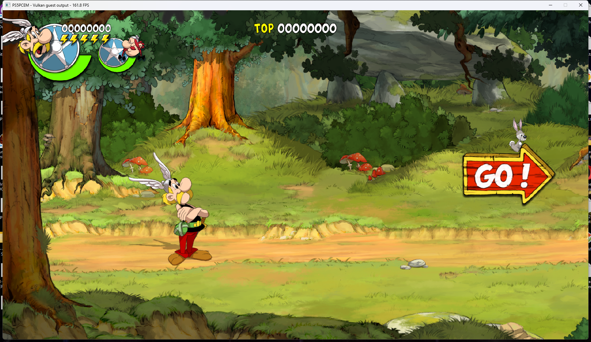 | **Playable · Completable** | Earlier playthrough confirmed by the maintainer. October 9 development build: matching MSAA depth/stencil-only passes restore stencil masks and eliminate four accidental full-frame diagnostic readbacks. Matched stationary opening-forest UI-counter medians rise from **46.45 to 162.20 FPS**, each sampled for 30 seconds on the RTX 3070 Ti at 1080p output. This is not a minimum across levels. Movement, jumping and the first Roman encounter are rechecked; all 233 Vulkan tests and native 2×/4× depth/stencil probes pass. The signed runner is updated. The earlier movie-startup fix remains included; these changes postdate 0.3.4. [Performance comparison and capture](development/asterix-msaa-depth-performance-2026-10-09.md) · [Movie-startup fix](development/asterix-video-buffers-2026-10-09.md) |
| **Cat Quest III** 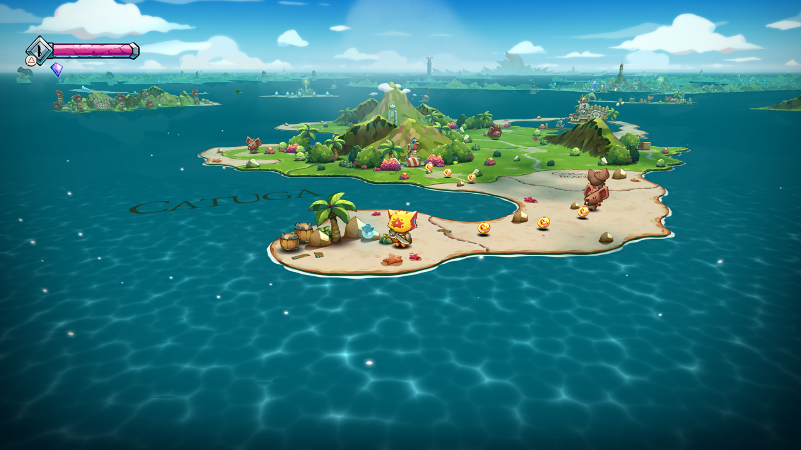 | **Playable · Completable** | Playthrough confirmed. Menus, adventure cards, dialogue, island terrain and colors render correctly in the captured scenes. Latest opening-island samples have a median of 124 ms (about 8 FPS), versus roughly 148 ms before optimization. [Gameplay capture](images/cat-quest-iii-world.png) |
| **Dreaming Sarah** 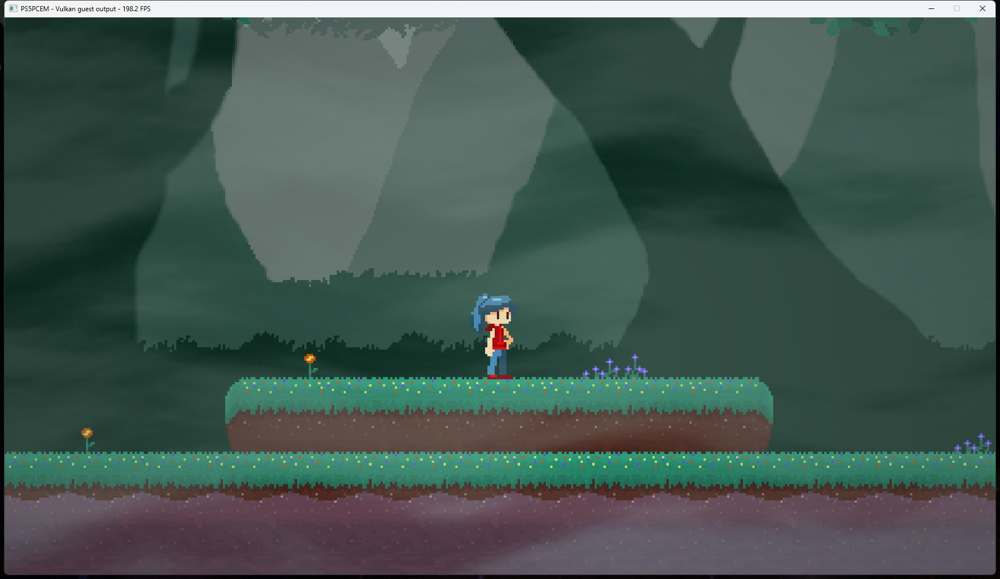 | **Playable · Completable** | **October 10, 2026:** proven vertex ranges reduce oversized sprite uploads from about 78 to 4.9 MiB per opening frame. The signed installed runner records **198.25 FPS median (187.8–203.2)** over 60 seconds in the opening forest, up from **53.25 FPS**. After waking: **197.25 FPS**; next platform screen: **144.35 FPS**, each over 30 seconds. All sampled seconds exceed 100 FPS. RTX 3070 Ti, 1080p output request, Speed preset, normal audio; internal resolution unchanged. Movement, jumping and the next screen are verified. These are window-counter samples, not a minimum across the entire game. The September 15 completed-playthrough report remains historical. [Fix, measurements and captures](development/dreaming-sarah-vertex-upload-performance-2026-10-10.md) |
| **Quake II (2023)** 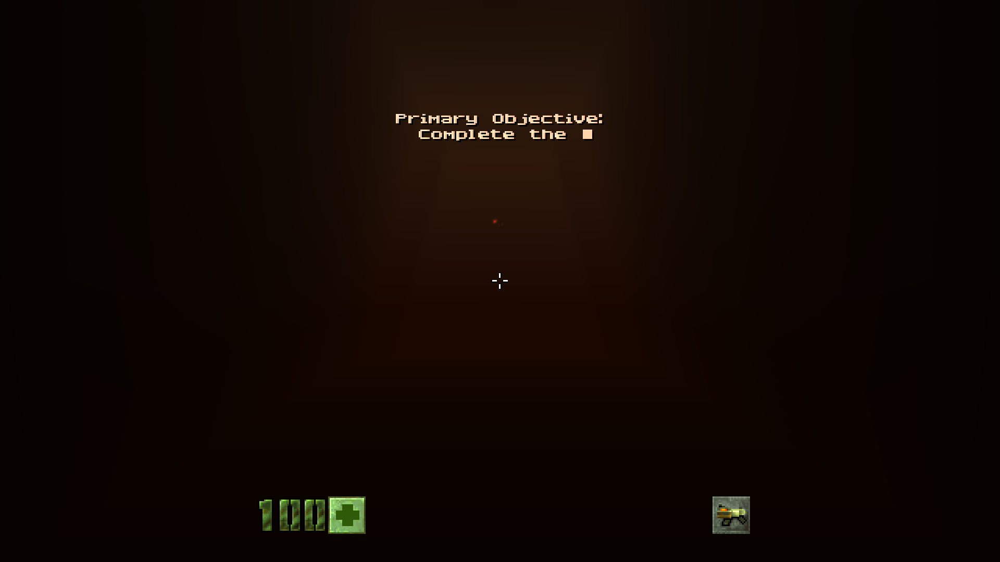 | **Playable · Completable** | Playthrough confirmed on September 16, 2026; rendering rechecked on September 25 with PPSA09477 v1.003. Level lighting, textures, weapons and NPCs are visible: the earlier dark-world and missing-model problems are resolved in the observed gameplay. Menus, HUD and controller input work. Buffer reuse and GPU clears reduce transfer overhead; the maintainer reports peaks of 60–70 FPS in lighter scenes, while busy combat scenes still run more slowly. Performance optimization continues; these peaks are not a stable minimum. [Gameplay capture](images/quake-ii-gameplay.png) · [Performance investigation](development/quake2-performance-2026-09-25.md) |
| **Jurassic Park Classic Games Collection** | **Playable · Completable** | Playthrough confirmed. Intro, animated title and collection selection work. Earlier sampled title/selection frames measured about 27/33 ms; performance varies by collection game and hardware |
| **REANIMAL** | Resolves the observed native and firmware modules, plays the company-logo sequence, and sustains the animated 3840×2160 title-menu render graph. Narrow Unity UI intermediates no longer replace the full scanout, dynamic R8 font atlases invalidate stale sampled images, and the buoy background, full title logo, water highlights, and `SELECT` prompt are visible in the live capture below | The central menu-option labels are still reduced to small red marks, so navigation and the transition into gameplay have not been verified. Performance and longer-run stability remain unmeasured, and gameplay is not claimed |
| **Mighty Morphin Power Rangers: Rita's Rewind** 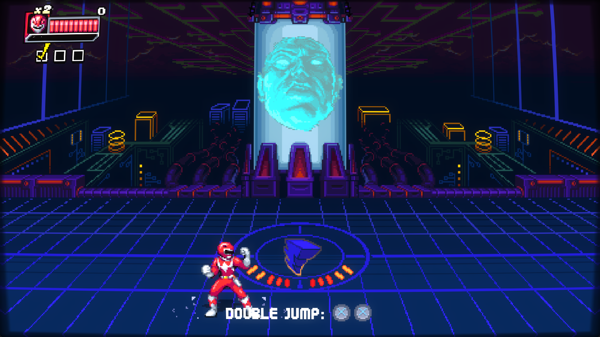 | **Playable · Completable** | Playthrough confirmed by the maintainer on September 24, 2026. The publisher sequence, title menu, and gameplay render and respond to controller input; the capture shows the Red Ranger in the Command Center training stage with the HUD, health bar, objectives, and button prompts. Native cooperative fibers retain suspended guest stacks, and exact `V_SAD_U32`, `V_MUL_HI_I32`, and `V_CVT_FLR_I32_F32` lowering removes the diagnostic shader fallback. The exact guest CRT composite still produces static on the current host, so a strict shader-signature fallback performs the observed 4× RGBA8 scene scale before post-processing. [Gameplay capture](images/ritas-rewind-gameplay.png) |
| **Ghost of Yōtei**  | **Intro · setup · post-tree cinematic and illustrated movie · character control unconfirmed** | **October 13 development checkpoint:** the tree/settings interval presents **38 frames in 30.001 seconds (1.27 FPS)**. Shared renderer changes reduce redundant Vulkan commands and array-layer copies, index pending shader metadata, compact large snapshot shaders and limit retained CPU frame capacity. Native checks pass; two complete compute replays match every captured buffer. Tree streaks, lighting defects, high memory use and expensive first-use pipeline creation remain. An earlier BVH traversal stall is still unresolved; synchronized captures do not prove it fixed. No controlled FPS improvement or character control is established. Runs are stopped; the displayed image is from October 5. [Current changes and validation](development/yotei-renderer-followup-2026-10-13.md) · [October 5 cinematic measurements](development/yotei-cache-memory-2026-10-05.md) · [Earlier measurements and captures](development/yotei-array-layers-2026-10-04.md) |

## Dated development reports

**October 19, 2026 — DirectX 12 CPU staging reuse:** add a separate 128-buffer / 256 MiB scratch pool for graphics snapshots, textures, color/depth and scanout. Every use still reads fresh guest contents; writeback preserves newly changed padding, and active leases cannot alias or be evicted. All 23 portable tests and the full native GPU suite pass, including resource-sampling checks with CPU retention disabled/enabled. Raiden IV's heavy transition stabilizes at 109,459 KiB / 76 CPU allocation misses; the first three warm frames each reuse 21,563 CPU buffers without new allocations. Six warm intervals before profiling take **13.257--13.704 seconds per frame**, versus 19.046--20.003 in the previous run. These are separate loading-transition observations, not gameplay FPS. Memory-filling samples drop from 286/1,292 to 19/1,297; surface conversion, copies and synchronous waits dominate. The level and score HUD appear behind opening doors, but control remains unverified. Runner rebuilt and signed, test stopped, Vulkan grades unchanged. [Implementation, validation and limits](architecture/d3d12.md).

**October 19, 2026 — DirectX 12 native resource reuse:** add a completion-gated graphics storage pool bounded to 256 objects / 256 MiB, retaining fresh guest uploads and full writeback. All 17 portable tests and the native GPU suite pass, including complete pooled/unpooled color/depth comparisons and eviction/overflow checks. Raiden IV's heavy transition settles at 163 objects / 167,360 KiB with no eviction; two consecutive warm frames reuse 39,760 resources each without new allocations or compilation. Presentation intervals are 19.360 and 19.154 seconds, versus roughly 33 seconds in the preceding run; these are separate loading-transition observations, not gameplay FPS. Surface conversion, memory filling/copying and synchronous waits remain the main work. The level becomes visible behind opening doors, but control is unverified. Runner rebuilt and signed, test stopped, Vulkan grades unchanged. [Implementation, validation and limits](architecture/d3d12.md).

**October 19, 2026 — DirectX 12 dynamic graphics scalars:** move changing VS/PS register values into a per-draw read-only buffer instead of recompiling shaders for each value set. Eight complete images match independent literal-shader references; all 17 portable tests and the native GPU suite pass. In Raiden IV's heavy level transition, the cache stabilizes at 35 shaders / 31 PSOs and 828 ms total compilation, replacing the preceding run's 812 new shader compilations per heavy frame. Five warm presentation intervals still take 32.521--33.932 seconds each with no new compilation: surface copies, tiling, allocation and GPU waits dominate. Loading doors begin opening and reveal the level; gameplay/control and a gameplay FPS gain are unverified. Signed runner updated, test stopped, Vulkan grades unchanged. [Implementation, validation and limits](architecture/d3d12.md).

**October 19, 2026 — Native DirectX 12 triangle fans:** implemented bounded fan-to-list expansion with automatic and 8/16/32-bit indices, signed base vertices, winding and primitive restart. All 17 portable D3D12 tests and the native GPU suite pass, including 252 fan/reference comparisons. Raiden IV passes the former fan rejection and processes additional level shaders, but the loading transition remains extremely slow: one adjacent-frame interval incurs 812 shader-cache misses and 44.655 seconds of compilation. Visible gameplay/control and an FPS gain are not established. Local runner rebuilt and signed; Vulkan compatibility grades are unchanged. [Implementation and live evidence](architecture/d3d12.md).

**October 19, 2026 — DirectX 12 vertex descriptor recovery:** preserve proven scalar conditions across vector instructions when recovering packed vertex-buffer descriptors. All 19 scalar-resource tests and the full native GPU suite pass. A fresh Raiden IV run passes the former buffer failure and advances to a ten-vertex triangle-fan draw, which stops explicitly at `UnsupportedPrimitive`. Fan-to-list conversion is the next observed blocker; no complete gameplay frame, control or FPS improvement is claimed. Local runner rebuilt and Authenticode-signed; Vulkan compatibility grades are unchanged. [Implementation, validation and live result](architecture/d3d12.md).

**October 19, 2026 — Native DirectX 12 viewport depth:** explicit guest 0..1 pixel-depth clamps now support out-of-range viewport transforms while preserving GL/DX clipping and small D32 values. All 15 portable boundary tests, two targeted shared-IR tests and the native GPU suite pass, including 1,280 new viewport cases and the existing 960 depth configurations. A fresh Raiden IV run passes the former unrestricted-depth rejection after weapon selection; the next blocker is vertex-buffer descriptor recovery (`DynamicGraphicsBufferNotImplemented`, ES `0x418600`, PC `0x104`). No completed gameplay frame or FPS improvement is established. Signed local runner updated; Vulkan grades are unchanged. [Implementation and live result](architecture/d3d12.md).

**October 18, 2026 — Native DirectX 12 guest depth:** implemented D16/D32 attachments, all eight depth comparisons, write masks and read-only views. Linear and depth-tiled guest layouts preserve untouched bytes and carry GPU depth results into subsequent draws. All 14 portable tests and the native GPU suite pass, including 960 depth configurations and rejected-layout/writeback checks. Raiden IV again reaches weapon selection, then stops on the first gameplay draw because its observed viewport depth range is -1..1; its D32 attachment layout now passes staging. No gameplay frame or FPS improvement is established. Signed local runner updated. HTILE, depth clears, stencil, multiple color targets and asynchronous resident-resource rendering remain unimplemented. [Implementation, live result and next blocker](architecture/d3d12.md).

**October 18, 2026 — Native DirectX 12 packed textures:** implemented native RGBA4444 sampling with guest channel selectors, tiled layouts and padded upload rows. All 12 portable boundary tests and the GPU probes pass, including 32 packed-versus-expanded texture comparisons. A fresh Raiden IV run passes the former packed-format blocker, renders the introductory video and reaches the labeled main menu, OverKill setup and weapon selection. Entry into the level stops explicitly at an unimplemented depth test/write draw. Menu throughput is only about 1 FPS; this is experimental D3D12 progress, not a change to the Vulkan compatibility grade or a gameplay result. [Implementation, limits and menu capture](architecture/d3d12.md).

**October 18, 2026 — Animal Well NGS2 import:** added `sceNgs2VoiceQueryInfo` (`9eic4AmjGVI`), the missing import reported in [issue #7](https://github.com/iStark/PS5PCEM/issues/7). Channel queries return configured per-voice state with exact output-size and writable-memory checks. Tests cover the registered guest entry point, channel changes, voice lifetimes and memory boundaries. No local Animal Well run or compatibility grade is established. [Implementation and validation](development/animal-well-ngs2-query-info-2026-10-18.md).

**October 17, 2026 — Raiden IV audio and rendering:** rack-scoped voice allocation, bounded ATRAC9 decoding and memory waveform parsing restore effects. The user confirms button sounds; background music remains incorrect. Retained Vulkan passes, optional update-after-bind image banks and unchanged-register snapshot reuse reduce unnecessary work. A moving first-level interval measures **39.75 FPS over 1,193 frames / 30.013 seconds**; later heavy combat is around **18–22 FPS**, so **sustained 60 FPS is not achieved**. New gameplay capture and maintainer-assigned **Playable · Completable** grade; completion and long-session stability remain unverified. [Implementation, validation and limits](development/raiden-iv-audio-rendering-2026-10-17.md).

**October 16, 2026 — ASTRO BOT storage copies and queue discovery:** final animated-title confirmation **20.07 FPS over 2,640 frames / 131.56 seconds**, with 60-frame blocks at **18.39–21.68 FPS**. Checking CPU replacement before copying obsolete storage removes **26.125 MiB per frame**; paired result **19.55 → 19.99 FPS**. Queue discovery removes about 117 repeated probes per frame, with an inconclusive 20.09 → 20.15 FPS difference. **680 HLE tests, 274 Vulkan tests and 64 native overwrite configurations pass.** New title capture, signed runner and website history in all eight languages. This establishes a 20 FPS title average in this run; **20 FPS minimum, cinematic correctness and character control remain unverified**, with 12 unresolved storage bindings. [Measurements and validation](development/astro-bot-storage-readbacks-2026-10-16.md).

**October 16, 2026 — ASTRO BOT resource walks and content checks:** immutable shader/layout references, compact descriptor keys, content fingerprints and loop-write masks reduce CPU work. Final title confirmation: **17.83 FPS over 2,640 frames / 148.07 seconds**, 60-frame blocks **16.08–19.75 FPS**. The last comparison is **17.85 → 17.88 FPS**; aggregate FPS improvement over the previous 18.05 FPS confirmation is not established. **582 GPU/Vulkan tests, 308 Debug GPU tests and five native probes pass.** New title capture and signed local runner. **20 FPS is unmet; 12 unresolved bindings, cinematic defects and unverified character control remain.** [Changes, measurements and rejected experiments](development/astro-bot-resource-walks-2026-10-16.md).

**October 15, 2026 — ASTRO BOT resource costs and title confirmation:** the latest runner averages **18.05 FPS over 2,640 title frames**, with 60-frame blocks at **16.95–19.59 FPS**. Bounded timeline-counter polling improves the balanced comparison from **17.78 to 18.02 FPS**. Packed linear texture reads, smaller scratch initialization, static-query caches and earlier shared memory/scheduling changes reduce CPU work. **573 GPU/Vulkan tests and native validation pass.** New title capture and signed local runner; 12 unresolved storage bindings, cinematic defects and unverified character control remain. Development build. [Full measurements and rejected experiments](development/astro-bot-resource-costs-2026-10-15.md).

**October 15, 2026 — ASTRO BOT uniform-read and sampled-scan review:** omit 49 unused CPU proof reads per frame and reuse the compute sampled-instruction index. Later balanced comparison: **14.95 versus 14.91 FPS**, 660 frames per mode; no established gain and 25 FPS remains unmet. 560 GPU/Vulkan tests and native Vulkan validation pass. The 12 unresolved storage bindings remain. [Capture, measurements and AnyPS5/KytyPS5 review](development/astro-bot-uniform-scan-2026-10-15.md).

**October 15, 2026 — ASTRO BOT entry scalar reads:** avoid redundant buffer preparation for proven read-only entry loads; preserve producer identity through vertex translation. Balanced title result: **14.92 FPS versus 15.02 FPS**, 660 frames per mode; no measured FPS gain and 25 FPS remains unmet. About 411 buffer preparations avoided per frame. 558 GPU/Vulkan tests and native graphics validation pass; existing RDNA2 failures remain. [Review, capture and results](development/astro-bot-entry-scalars-2026-10-15.md).

**October 14, 2026 — AnyPS5 review and scalar descriptors:** correct unused-field handling for host/GPU scalar buffer reads and recover bounded texture records assembled by multiple loads. ASTRO BOT title: **14.97 FPS**, 660 frames; 25 FPS is not reached. All 556 GPU/Vulkan tests and native validation probes pass; ten broader RDNA2 failures reproduce on the baseline. New title capture; no new Yōtei gameplay/FPS claim. [Review, changes and validation](development/anyps5-descriptor-review-2026-10-14.md).

**October 14, 2026 — ASTRO BOT draw capture and cache comparison:** avoiding unusable replay capture measures **15.33 versus 15.22 FPS**, 660 frames per setting. A larger resource-walk cache did not improve FPS; the default is unchanged. All 553 GPU/Vulkan tests and native validation probes pass. New title capture; **25 FPS and character control remain unverified**. [Measurements and capture](development/astro-bot-renderer-performance-2026-10-14.md#follow-up-avoid-unusable-draw-capture).

**October 14, 2026 — ASTRO BOT storage ownership and scalar loop budgets:** latest balanced title samples measure **14.48 versus 14.26 FPS**, 660 frames per setting. GPU storage-layout conversion preserves native padding, rectangular overwrite proofs avoid redundant uploads, and exact instruction counts govern shared scalar walks. All 551 GPU/Vulkan tests and native validation probes pass. New title capture; **25 FPS is not reached and character control remains unverified**. [Measurements, capture and validation](development/astro-bot-renderer-performance-2026-10-14.md#follow-up-storage-ownership-and-scalar-loop-budgets).

**October 14, 2026 — ASTRO BOT static shader analysis and narrow layouts:** balanced title samples measure **14.25 versus 14.19 FPS**, 660 frames per setting. Reuse of immutable call/NGG analysis, sequential overlap queries and bounded Vulkan waits reduce repeated work. GPU layout support now includes 8/16-bit texels; GPU storage uploads remain off after their slower comparison. All 548 GPU/Vulkan tests pass. New title capture; **25 FPS is not reached and character control remains unverified**. [Measurements, capture and validation](development/astro-bot-renderer-performance-2026-10-14.md#follow-up-static-shader-analysis-and-narrow-layouts).

**October 14, 2026 — ASTRO BOT scalar analysis and queued completion:** balanced title samples measure **13.79 versus 13.43 FPS**, 660 frames per setting. Dependency saturation, indexed scalar merges and cached immutable shader interfaces reduce repeated analysis. Dirty-buffer completion indexing, queued satisfied waits and large host copies also pass checks. All 542 GPU/Vulkan tests pass. New title capture; **25 FPS is not reached and character control remains unverified**. [Measurements, capture and validation](development/astro-bot-renderer-performance-2026-10-14.md#follow-up-scalar-analysis-and-queued-completion).

**October 14, 2026 — ASTRO BOT bounded recording and storage proofs:** a 250-microsecond recording budget improved the balanced title sample from **11.69 to 12.43 FPS**. The subsequent storage comparison measured **12.55 versus 12.49 FPS**, too close to claim another gain, while avoiding 26.125 MiB of redundant hashing per frame. Interior raster conversions pass native checks but have no title hits. The reference clock now uses 100 MHz; native GPU timestamp batching remains optional. All 537 GPU/Vulkan tests and 64 overwrite configurations pass. A new title capture is available; **25 FPS and character control remain unverified**. [Capture, measurements and validation](development/astro-bot-renderer-performance-2026-10-14.md#follow-up-bounded-recording-and-storage-proofs).

**October 14, 2026 — ASTRO BOT scalar checkpoints and uploads:** register snapshots are half the previous size while preserving dependency tracking; scalar uploads no longer clear unused slots. Native tests start with nonzero poisoned buffers and cover loops, changing inputs, pixels and worker/shared paths; 535 GPU/Vulkan tests pass. A 1,320-frame observation measured **11.62 FPS**. The balanced upload comparison measured **11.79 versus 11.69 FPS**, 660 frames per setting, a small 0.9% observed difference. No fresh visual/control check; **25 FPS remains unmet**. [Measurements and validation](development/astro-bot-renderer-performance-2026-10-14.md#follow-up-compact-scalar-checkpoints-and-uploads).

**October 14, 2026 — ASTRO BOT CPU overwrite baselines:** exact texel digests replace retained old-image copies; checked fingerprints also avoid the temporary CPU snapshot. Balanced title comparisons: **11.19 versus 10.83 FPS** for digest baselines and **11.51 versus 11.36 FPS** for direct fingerprints, 660 frames per setting. Each step removes one **26.125 MiB CPU copy per frame**. Native checks cover 32 configurations, padding, newer CPU writes, unavailable fingerprints, aborted preparation and mip publication. No fresh visual/control verification; **25 FPS remains unmet**. [Measurements and fallback guarantees](development/astro-bot-renderer-performance-2026-10-14.md#follow-up-cpu-overwrite-baselines).

**October 14, 2026 — ASTRO BOT relative vector moves:** M0-indexed shader moves now preserve indirect register reads/writes, masked lanes and loop state. Native validation passes 128 GPU dispatches; GPU/Vulkan tests pass 534/534. The warmed animated title measured **10.85 FPS across 1,320 frames**, comparable to the previous build. No new draw/dispatch failures appeared; visual defects and character control remain unverified. The **25 FPS target is not reached**. [Implementation and validation](development/astro-bot-renderer-performance-2026-10-14.md#follow-up-relative-vector-moves).

**October 14, 2026 — ASTRO BOT full-image overwrite proof:** complete compute stores now avoid old-pixel uploads and fully covered raster readbacks, while retaining padding, newer CPU writes and recovery after aborted preparation. Native checks cover immediate/batched commands, DCC metadata preservation and partial-coverage fallback. Balanced title comparison: **10.95 FPS enabled versus 9.68 disabled**, 660 frames each, approximately **13.1% faster**; one raster readback and 25.38 MiB of uploads are avoided per frame. The **25 FPS target remains unmet**. No fresh screenshot or character-control result. [Proof, measurements and validation](development/astro-bot-renderer-performance-2026-10-14.md#follow-up-proven-full-compute-image-stores).

**October 14, 2026 — ASTRO BOT native image and buffer transfers:** exact texel comparisons, GPU retiling and retained padding pass native checks, including CPU changes during GPU waits. Exact interior buffer publication preserves CPU edits and newer overlapping GPU writes; completion batches reuse valid prefetched copies. Vulkan tests pass **259/259**. Balanced title measurements remain **9.42 FPS** with native storage transfers versus **9.55 FPS** with the CPU path, and **9.50 versus 9.55 FPS** after the prefetch completion fix. These experimental transfers remain disabled by default. Exact interior publication recorded no uses in its measured scene. The **25 FPS target remains unmet**, with no new screenshot or character-control claim. [Measurements and validation](development/astro-bot-renderer-performance-2026-10-14.md#follow-up-storage-image-uploads-and-native-publication).

**October 14, 2026 — ASTRO BOT GDS/publication follow-up:** deferred counter snapshots preserve FIFO ordering across resets and CPU writes; standalone transfers can share a command buffer. Full-image overwrites retain conservative handling for partial, pending and depth/stencil uses. The warmed title baselines are **9.20–9.65 FPS** over 20 seconds, with no confirmed gain in paired comparisons. Repeated mixed-size render-target readbacks remain expensive. No fresh screenshot or character-control verification was possible while window automation was unavailable. [Follow-up measurements and native checks](development/astro-bot-renderer-performance-2026-10-14.md#follow-up-gds-snapshots-and-full-image-overwrites).

**October 14, 2026 — ASTRO BOT renderer performance:** shared command state, resource analysis, cache recovery and native GPU transfers pass targeted tests. Warmed title observations are about **9–10 FPS**; the crowd scene measures **4.60 FPS**. The later title benchmark records no uses of the exact 2D storage-to-color path. Rendering defects remain and 25–30 FPS is not achieved. [Measurements, validation and remaining costs](development/astro-bot-renderer-performance-2026-10-14.md).

**October 13, 2026 — ASTRO BOT diagnostic cinematic:** JSON ownership/iterators, large APR batches, font operations, packed scanout and shader fixes allow the diagnostic hub arrival sequence to render. Explicit SDWA DWORD half-float writes now remove the severe green corruption. The run uses local font aliases and disabled acoustic propagation; dark surfaces, unsupported BVH shaders and character control remain unresolved. [Report and capture](development/astro-bot-startup-2026-10-13.md).

**October 13, 2026 — ASTRO BOT lighting follow-up:** whole-wave scalar branches and converged LDS barriers remove the frequent horizontal bands in the arrival cinematic. Wave32/wave64 GPU regressions pass. BVH fixes preserve opaque child pointers and check two-node FP32 boxes; opt-in PSR v9 snapshots complete a captured active query with a larger checked traversal budget. Dark/patchy surfaces and character control remain unverified; there is no stationary FPS improvement claim. The final run is stopped. [Updated report and capture](development/astro-bot-startup-2026-10-13.md#follow-up-bvh-and-optional-lighting-branches).

**October 13, 2026 — Ghost of Yōtei renderer follow-up:** shared Vulkan state suppression, changed-layer texture refreshes, depth/storage transfers, indexed metadata reads and smaller snapshot shaders pass native probes. Completed-frame storage now releases excessive spare capacity without discarding pending peers. The observed tree/settings interval is **1.27 FPS**; visual defects, an earlier traversal stall and character control remain unresolved. [Changes, measurements and limitations](development/yotei-renderer-followup-2026-10-13.md).

**October 13, 2026 — Goat Simulator 3 gameplay:** the complete installation reaches the controllable farm scene on the existing development runner. Movement is verified and a genuine gameplay capture is published. Stationary median: **1.8 FPS**. Inverted presentation, resource-binding gaps and other rendering defects remain. [Run report and screenshot](development/goat-simulator-3-gameplay-2026-10-13.md).

**October 13, 2026 — Minecraft Legends gameplay:** implemented native file rename to unblock the campaign database. The fresh run reaches the controllable opening tutorial, with a gameplay capture and verified keyboard movement. Severe rendering corruption remains; no playable/completable grade or FPS benchmark is claimed. [Run report and screenshot](development/minecraft-legends-campaign-2026-10-13.md).

**October 12, 2026 — Minecraft Legends:** fixed startup imports, recycled direct-memory mappings, explicit filled polygon mode and interior GPU-written index reads. The title reaches readable initial settings with keyboard navigation. A further physical-memory search optimization removes repeated full-list scans; main menu and gameplay remain unverified. [Investigation and validation](development/minecraft-legends-startup-2026-10-12.md).

**October 12, 2026 — Police Simulator: Patrol Officers:** Recorded startup, career saving and district selection, with captures of severe rendering defects and a qualified menu FPS sample. Street gameplay remains unverified. [Run report and evidence](development/police-simulator-career-2026-10-12.md).

**October 12, 2026 — Monster Boy and the Cursed Kingdom:** Stateful NGS2 port queries, buffered keyboard taps, application-controlled save progress and persistent save icons unblock the first level. Gameplay captures and a qualified FPS observation are included. [Run report and evidence](development/monster-boy-gameplay-2026-10-12.md).

**October 11, 2026 — Oxide Room 104:** Two startup runs establish a visible autosave notice and a subsequent black-screen path with shader and queue errors. The notice measures 18.45 FPS median; no gameplay or implementation fix is claimed. [Run report and evidence](development/oxide-room-104-startup-2026-10-11.md).

**October 11, 2026 — Medieval Dynasty:** The main menu renders at a 32.3 FPS median, with vertically inverted artwork and text. Unresolved storage bindings remain; no gameplay or fix is claimed. [Run report and evidence](development/medieval-dynasty-startup-2026-10-11.md).

**October 11, 2026 — Charon's Staircase:** The introduction and first 3D forest-road scene render on the existing runner. Scene counter median: 9.1 FPS; a 32.342-second transition frame and unresolved storage bindings remain. No code changes or playable grade are claimed. [Run report and evidence](development/charons-staircase-startup-2026-10-11.md).

**October 11, 2026 — PAC-MAN WORLD Re-PAC:** The unchanged development runner reaches the opening movie, title and terms screen. Movie color corruption remains; the startup-screen sample is 9.55 FPS median, not a gameplay benchmark. No implementation changes were made. [Run report and evidence](development/pac-man-world-re-pac-startup-2026-10-11.md).

**October 11, 2026 — KeyWe startup and save-slot screen:** implemented
per-guest-thread cancellation state and seven Audio3d exports with owned PCM
queues and simultaneous stereo mixing. All 635 HLE tests pass. Two launches
pass linking; scripted input reaches save-slot selection. Black output after
the logos/menu remains unresolved, so gameplay is not claimed.
[Implementation, remaining blocker and capture](development/keywe-pthread-cancel-state-2026-10-11.md).

**October 11, 2026 — Super Woden GP startup and map menu:** implemented
`__pthread_cleanup_push_imp` and `__pthread_cleanup_pop_imp` with guest-owned
records, per-thread LIFO callbacks and cleanup before TLS destruction on exit.
All 627 HLE tests pass. The world-map menu renders; colors and label orientation
still have defects, and race gameplay remains unverified.
[Implementation, runtime limits and capture](development/super-woden-gp-pthread-cleanup-2026-10-11.md).

**October 11, 2026 — Arcade Spirits main menu:** real pthread semaphore
initialization, waiting, polling, posting and destruction resolve all five missing
imports. The signed runner reaches the menu at a sampled median of **252.9 FPS**;
gameplay is unverified. All 625 HLE tests pass.
[Implementation, runtime limits and capture](development/arcade-spirits-pthread-semaphores-2026-10-11.md).

**October 11, 2026 — Arkanoid startup and menu:** four missing imports now
have stateful implementations. Per-fiber HLE stacks and synchronized migration
between worker threads fix the subsequent stack overflow and black loading loop.
Larger sampled-texture uploads restore the title's BC7 atlases. The final signed
runner reaches mode selection at a sampled median of **45.6 FPS**; gameplay is
unverified. All 623 HLE and 244 Vulkan tests pass.
[Implementation, runtime limits and captures](development/arkanoid-fiber-startup-2026-10-11.md).

**October 11, 2026 — Raiden IV startup and first-level rendering:** the loader
now distinguishes optional library-version metadata from required dynamic
tables, fixing the false 39-byte truncation. Shared firmware and packed-texture
support bring up the menus; synchronizing raw depth-plane clears restores the
level geometry. The final run shows the ship firing, enemies, terrain and HUD.
All 921 loader/HLE/Vulkan unit tests and two native GPU clear probes pass.
ATRAC9 sampler playback and thread cancellation remain incomplete.
[Investigation, measurements and gameplay capture](development/raiden-iv-self-loader-2026-10-11.md).

**October 11, 2026 — Dead Cells level and menu music:** the Prisoners'
Quarters level and the character now render. A full-screen copy shortcut
used to ignore blending and overwrote the lit scene with the black emissive
buffer. Voices of the title's custom NGS2 sampler rack now take their
waveform format and blocks, so the menu music is mixed instead of silence.
The starting room ran at 59.2–68.1 FPS on the window counter. See the
[fixes, trace and measurements](development/dead-cells-level-and-menu-audio-2026-10-11.md).

**October 11, 2026 — Dead Cells links and reaches gameplay:** eight missing
`libSceNgs2` imports — buffer-backed system/rack creation and the 3D geometry
helpers — are implemented rather than stubbed, and destroying a system or rack
now returns the caller's buffer. The title reaches its main menu and the
gameplay HUD; the level itself still renders dark. See the
[implementation, traced calls and captures](development/dead-cells-ngs2-2026-10-11.md).

**October 10, 2026 — Dreaming Sarah opening performance:** bounded sprite
vertex uploads raise the opening-forest median from **53.25 to 198.25 FPS**.
The installed signed runner stays above 100 FPS in all one-second samples of
the opening, awake and next-platform intervals. The optimization is shared
across titles and retains full ranges when the shader bounds are unproven.
[Measurements, validation and screenshots](development/dreaming-sarah-vertex-upload-performance-2026-10-10.md).

**October 10, 2026 — Subnautica delayed/crackling audio:** ACM now computes
the convolution reverb instead of returning success with unwritten output.
Invalid initial batch waits also fail correctly. Two fresh launches produce
finite, nonzero PCM within 11–13 seconds; the maintainer confirms clear audio
on the audible repeat. The earlier Options/title-confirmation explanation is
withdrawn. This fixes an upstream DSP failure; host scheduling dropouts and
rendering performance still require separate checks. See the
[investigation and validation](development/subnautica-acm-audio-2026-10-10.md).

**October 9, 2026 — Asterix & Obelix MSAA performance:** retaining the sample
count in depth/stencil-only passes removes four accidental diagnostic
readbacks per frame and restores their stencil writes. Stationary opening-forest
30-second UI-counter medians rise from **46.45 to 162.20 FPS** on the RTX 3070 Ti
host; these are scene-specific measurements. All 233 Vulkan tests and native
2×/4× depth/stencil probes pass. The signed development runner is updated.
See the [comparison and capture](development/asterix-msaa-depth-performance-2026-10-09.md).

**October 9, 2026 — Quake II and Subnautica audio:** raw PCM sampler blocks,
compact playback commands and the configured NGS2 grain restore Quake II
attract-sequence audio. Subnautica's AudioOut2 queue preserves fractional
playback time; menu music works, but short dropouts remain. All 602 HLE tests
pass. These development changes postdate 0.3.4. See the
[audio report, FPS checks and captures](development/quake2-subnautica-audio-2026-10-09.md).

**October 9, 2026 — Asterix & Obelix startup:** AvPlayer now stages decoded
video and audio in host memory before publishing tracked guest writes. This
fixes the opening movie freezing when a GPU-watched video buffer is reused.
The retest passes the bumper and story movie and reaches the first level with
page tracking enabled; all 597 HLE tests pass. This development fix postdates
0.3.4. See the [startup report and capture](development/asterix-video-buffers-2026-10-09.md).

**October 9, 2026 — Jets 'n' Guns 2 audio:** concurrent music and effects now
keep separate host streams, and underrun recovery preserves PCM order. The
20-second mission-menu loopback sample falls from 92.25% silent blocks to zero;
two 13-second active combat intervals also contain no silent 10 ms blocks.
This development fix postdates 0.3.4. See the
[audio retest and gameplay capture](development/jets-audio-streams-2026-10-09.md).

**October 9, 2026 — shared shader support:** MIMG BY2/BY4 and PCK2/PCK4
loads, including explicit mip levels, now execute for the measured native 2D
formats. Native Vulkan checks cover packing, bounds and register preservation;
game compatibility grades and FPS measurements are unchanged by this check.
See the [implementation and validation report](development/mimg-multi-texel-2026-10-09.md).

**October 9, 2026 — horizontal gathers:** `IMAGE_GATHER4H` and
`IMAGE_GATHER4H_PCK` now execute with typed texture access, correct result
widths and edge handling. A native GPU matrix passes 1,242 dispatches and
635,904 checked words. This instruction-level check does not change game
grades or FPS measurements. See the [gather report](development/gather4h-2026-10-09.md).

**October 9, 2026 — scalar shader calls:** `S_SWAPPC_B64` and `S_CALL_B64`
now execute bounded local subroutines and verified external fetch-shader calls.
Native GPU checks pass 42 dispatches and 21,504 exact result words, including
nested calls and inactive lanes. Game grades and FPS are unchanged by this
instruction-level check. See the [scalar call report](development/scalar-calls-2026-10-09.md).

## Package extraction checks

**October 13, 2026 — large CNT and NAPS packages:** metadata entries beyond the old 64 MiB prefix are read directly from the package. Sorted NAPS boundaries avoid repeated full-file-table scans. All 23 package tests and the extractor build pass. The ASTRO BOT font audit still finds files absent from the source package; the extractor cannot recover them. [Details and limitations](development/astro-bot-startup-2026-10-13.md#package-extraction-changes).

**October 2, 2026 — Grand Theft Auto III: The Definitive Edition,
PPSA03527 v1.007:** corrected NAPS block-table alignment removes the
`InvalidPfs` failure after CNT metadata extraction. The debug package now
extracts all 48 files, including `eboot.bin`, six modules and both PAK archives;
both PAK index checksums match. All 21 package tests pass. The local extractor
is updated; public release archives are unchanged. This is an extraction
check only, with game execution and compatibility untested.
[Failure, fix and validation](development/gta3-pkg-extraction-2026-10-02.md).

## Screenshots

*Subnautica: Below Zero, PPSA02457 v1.022.125, October 1, 2026. An unedited
1765×993 client-window capture with 1080p guest output after starting a new
Survival game. Correct sRGB attachment encoding restores visible material
detail and brighter lighting. The following 30.05-second world sample records
9.49 FPS. Rendering defects, an unresolved scalar binding and intermittent
loading failures remain under investigation; this run did not test a full
playthrough. [Run report](development/subnautica-backing-spans-2026-10-01.md).*

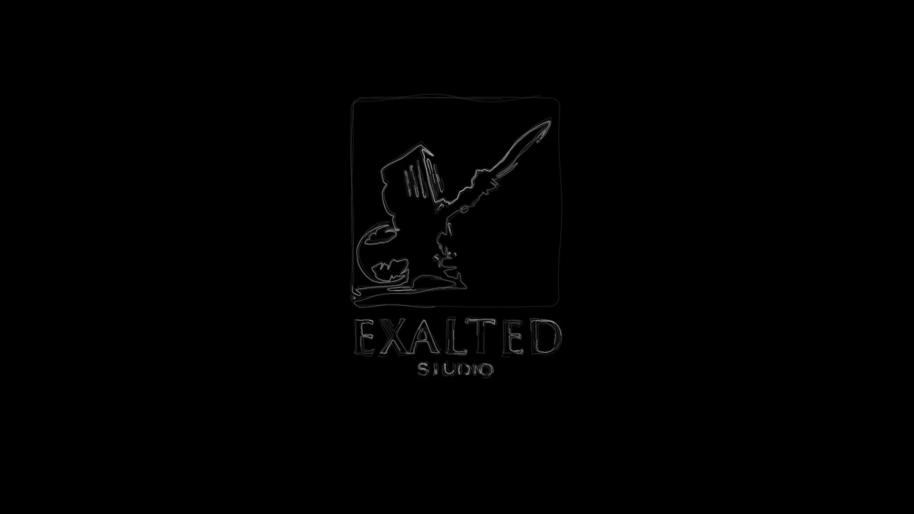

*The Exalted Studio logo during Big Helmet Heroes' opening movie, captured
from PS5PCEM's live 1920×1080 presentation output.*

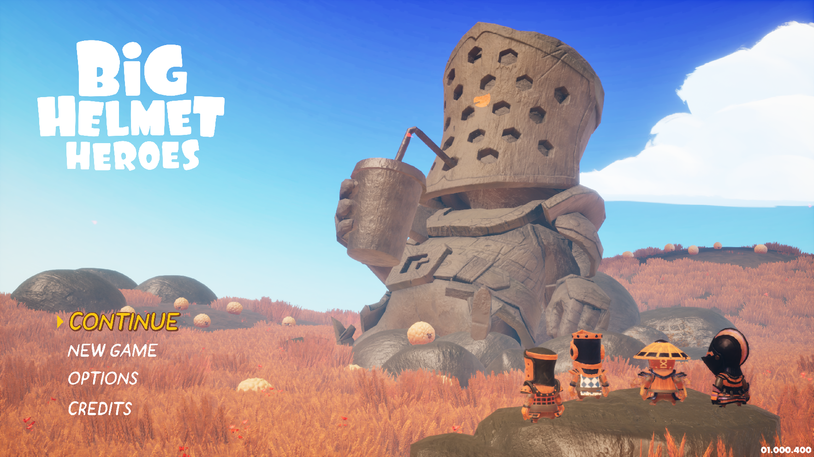

*Maintainer-approved visual reference, captured from the emulator's actual game
window on September 20, 2026. The menu, characters and 3D background render with
correct lighting and colors. Two clean menu-only launches reproduced this
result; gameplay has not been verified.*

*September 28, 2026: a 1765×993 capture of the actual game window after the
GPU-watched file-read and interrupted-save mount fixes. The character, HUD and
windmills render in the tutorial. This is a limited startup check; visual
artifacts remain and a complete playthrough has not been tested. The internal
captured framebuffer is still 3840×2160; this image does not demonstrate a
1080p internal-rendering change.*

*September 29, 2026: an unedited 1765×993 capture of the actual game window.
The character, HUD, windmills and Move/Sprint prompts render after the fix for
false command-header protection. Separate sampled runs measure 6.13 FPS in the
menu and 3.57 FPS in the tutorial. A repeatable FPS improvement is not established;
30 FPS has not been reached. Output is 1920×1080, with larger internal targets.
Visual artifacts remain, and full playability and long-session stability are
unverified.*

*September 29, 2026: an unedited capture of the actual game window after the
shared CPU texture-copy optimization. Separate standard-setting runs measure
6.25 FPS in the menu versus 5.85–5.95 FPS in two controls; the completed tutorial
check measures 3.57 FPS without a valid matched comparison. 30 FPS has not been
reached. Output is 1920×1080, with larger internal targets. Visual artifacts
remain; full playability and long-session stability are unverified.*

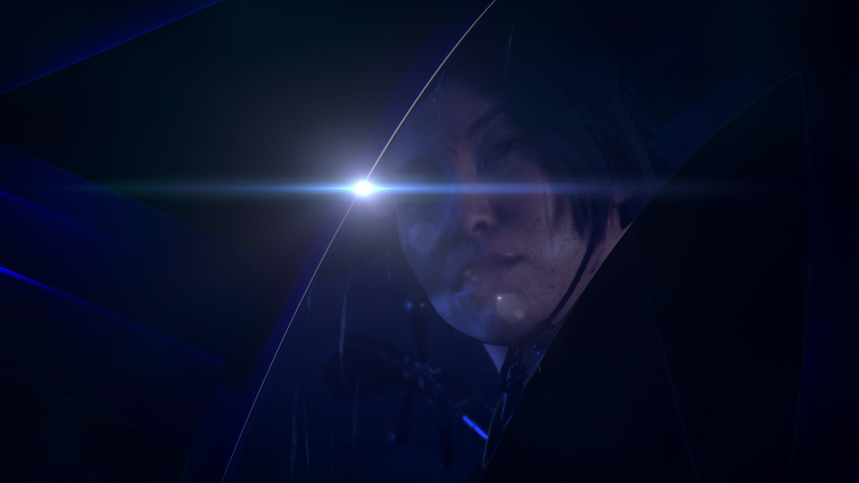

*A live Ghost of Yotei intro frame decoded from the title's own H.264 stream
through `libSceVideodec2` and presented at 1920×1080. The host decoder receives
the title's Annex B access units, the picture is converted from NV12 with BT.709
coefficients, and playback follows the frame rate reported by the decoded
stream. Build with `zig build build-game-run -Doptimize=ReleaseFast` to reproduce
the measured playback speed. Later development reached the bonus notices,
brightness calibration and parts of the 3D scene/interface; full title-menu
composition and gameplay remain unverified.*

*September 30 development build, unedited game-window capture. This debugger-assisted run completes
all 920 background warmups naturally and reaches the tree, but vertical streaks,
excessive brightness, later block corruption and long pipeline compilation stalls
remain. The native relocation test proves pipeline reuse; a game FPS improvement
is not established. [Current findings and second capture](development/yotei-scalar-tables-2026-09-30.md).*

*September 29, 2026: an unedited game-window capture from the 25-minute
buffer-publication diagnostic run. The wolf and tree were reached without a
logged guest fault; queued background warmups were cancelled during the run.
Vertical streaks, excessive brightness and stray elements remain. No FPS gain,
repeatable startup or playability is established. [Evidence and tests](development/yotei-buffer-publication-2026-09-29.md).*

*September 29, 2026: unedited 1765×993 captures of the actual game window in
a diagnostic repeat with default buffer reuse. The updated development runner
reached both screens, but another launch exited with a guest read fault.
The intermittent failure remains unresolved. Diagnostic instrumentation
affects timing; these images do not establish an FPS improvement, 30 FPS or
stable gameplay. [Investigation and validation](development/yotei-warmup-priority-2026-09-29.md).*

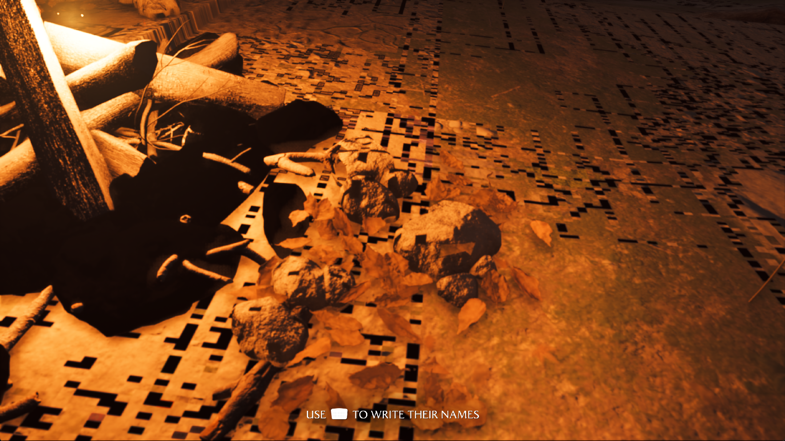

*Captured directly from the emulator's live client area at 1624×941 on
September 23, 2026, using a development build.*

*A live Terminator 2D gameplay frame produced by the current guest VS/PS,
sampled-texture, render-target, and Vulkan presentation paths. Texture alpha,
component swizzles, and sRGB sampling now preserve the title's intended color
balance.*

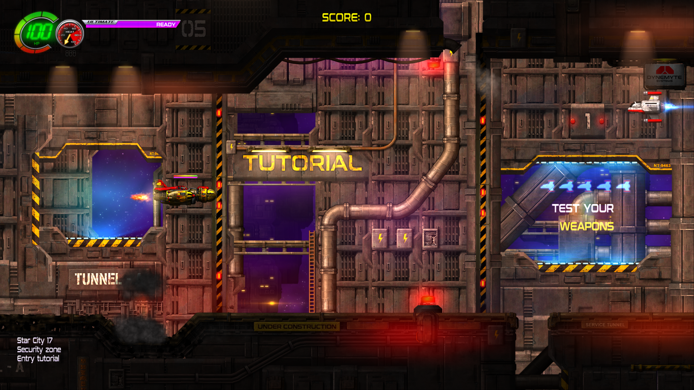

*A live 3840×2160 Jets 'n' Guns 2 tutorial frame reached through `START GAME`
and the title's loading screen. The ship, HUD, layered level art, lighting, and
text are produced by the guest multi-draw, sampled-texture,
persistent-render-target, compute, and VideoOut paths.*

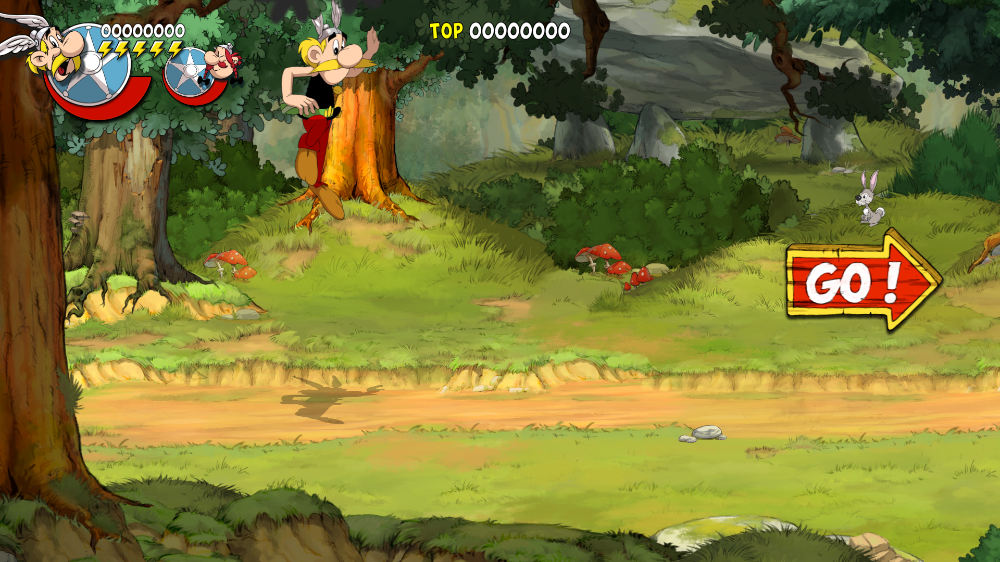

*A live 1920×1080 Asterix & Obelix: Slap Them All! gameplay frame captured at
flip 512. The scene, characters, HUD, and prompt come from the title's guest
draws. The final fullscreen compositor remains GPU-resident, while scanout
preserves the guest viewport's vertical orientation without a per-frame
host-memory round trip.*

*Captured directly from the emulator's live client area at 1765×993 on
September 25, 2026. The attract demo shows the lit level, textured enemies,
player's hand and weapon. The earlier dark-world and missing-NPC rendering
problems are resolved in this scene. Frame rate still varies with scene
complexity; work on the remaining performance dips continues.*

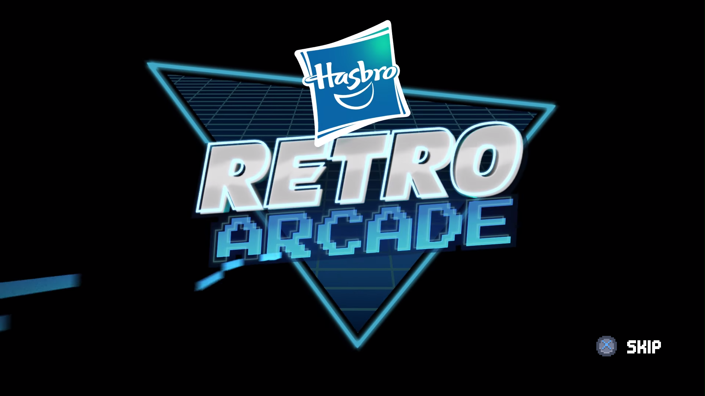

*A live 1920×1080 Rita's Rewind publisher/title intro frame produced by the
guest indexed vertex, sampled fragment, render-target composition, and VideoOut
paths. The corresponding animation and audio remain smooth in the observed
run; this is an intro milestone rather than a gameplay claim.*

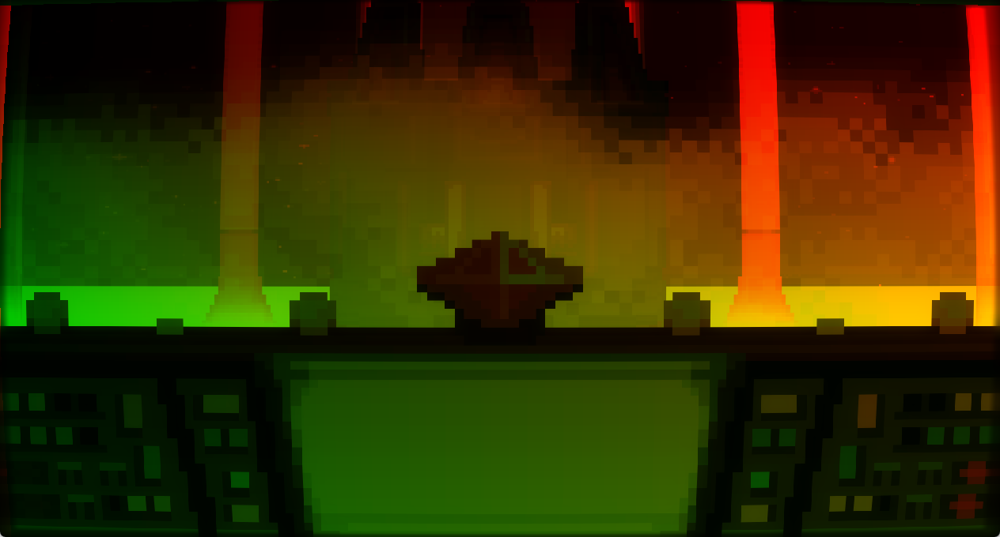

*Rita's Rewind after the title menu, rendered from the real 480×270 guest scene
target and carried through the 1920×1080 CRT/post-processing chain. The strict
CRT-composite compatibility path removes the former full-screen static while
preserving the title's pixel-art presentation.*

*Rita's Rewind gameplay: the Red Ranger in the Command Center training stage,
with the HUD, health bar, objective checklist, and `Double Jump` prompt,
captured from a live game-run window on September 24, 2026.*

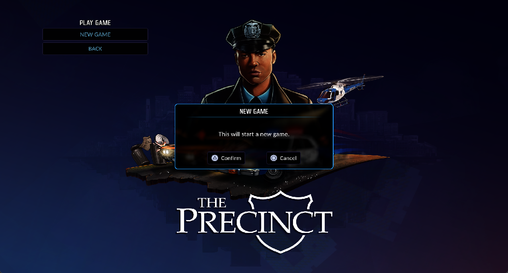

*The Precinct's live 1920×1080 title menu and `NEW GAME` confirmation, composed
by the guest graphics and compute passes after both SceAvPlayer intro movies.
Structured shader control flow restores the UI text, while fixed-function DCC
decompression no longer executes its constant-white helper shader over the
completed scene. This capture predates the now-verified transition into the
first in-engine gameplay scene.*

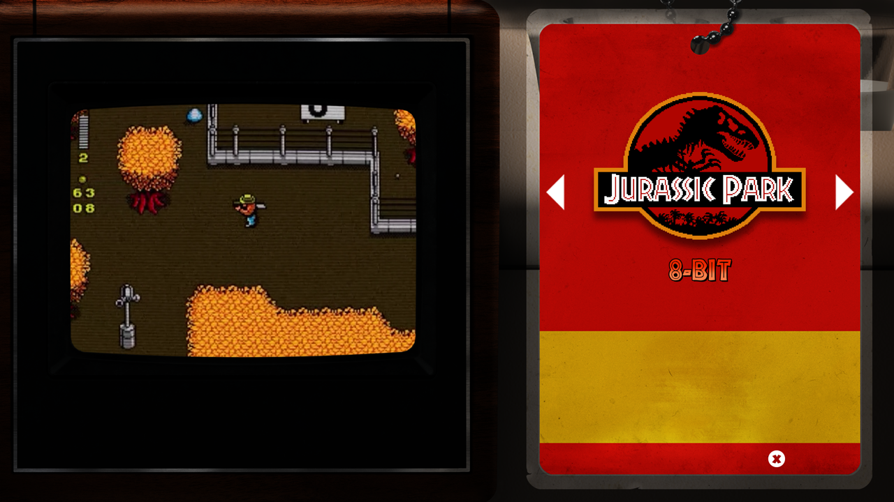

*Game selection with cover art, navigation arrows, and an animated preview.
This earlier development capture precedes the maintainer's full-playability
confirmation.*

*October 8, 2026 startup regression check: the new Font HLE rejected `U+007F`
while the collection built its ImGui atlas, triggering `CalcGlyphInfo`'s
assertion and terminating `CarbonMainThread`. Other threads kept waiting and
reported pending AGC commands. Missing characters now use the font's `.notdef`
glyph; the corrected runner reaches the first level shown above. All 569 HLE
tests pass, including complete Latin-1 atlas metrics and rendering coverage.*

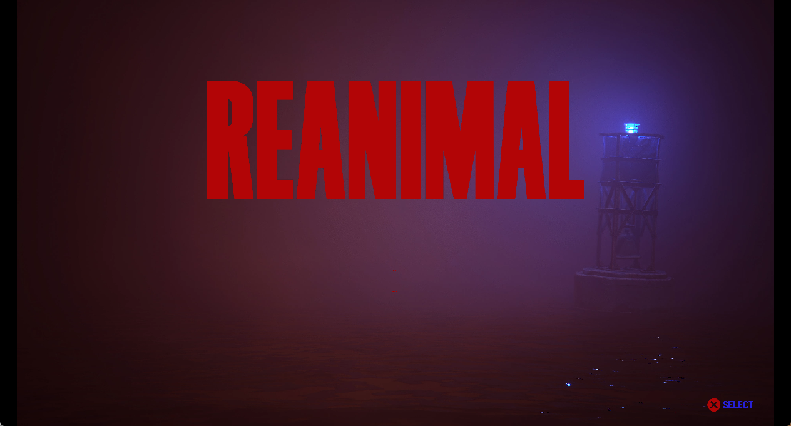

*A live REANIMAL title-menu frame produced by the guest Unity render graph. The
animated buoy background, title logo, water highlights, and `SELECT` prompt are
visible without the former full-screen stretch. The missing central option
labels remain an active rendering issue, so this capture is not a complete menu
or gameplay claim.*

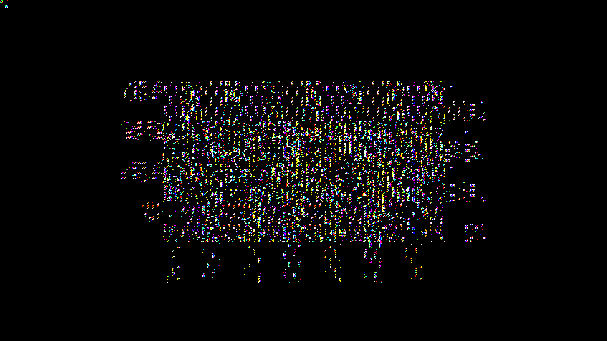

*The first recognizable Tetris Effect render produced by the title's startup
graph: 595 guest draws and 63 compute dispatches complete without a rejected
draw. This 1920×1080 `R11G11B10_FLOAT` intermediate is converted for display
because the registered 3840×2160 VideoOut target was still black in that run.
This historical capture predates the September 24 startup rendering fix; it
does not document gameplay.*

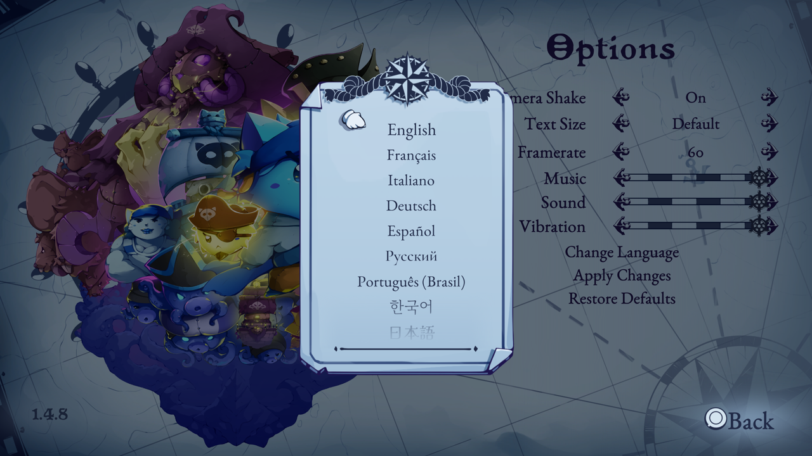

*The language list now retains its text and clips it inside the panel; the
stencil pop no longer paints a white rectangle over the labels.*

*Island gameplay with the HUD, restored mountains, blue sea and sky, and
correct character colors. Cat Quest III is fully playable according to the
project maintainer's September 8 playtest.*

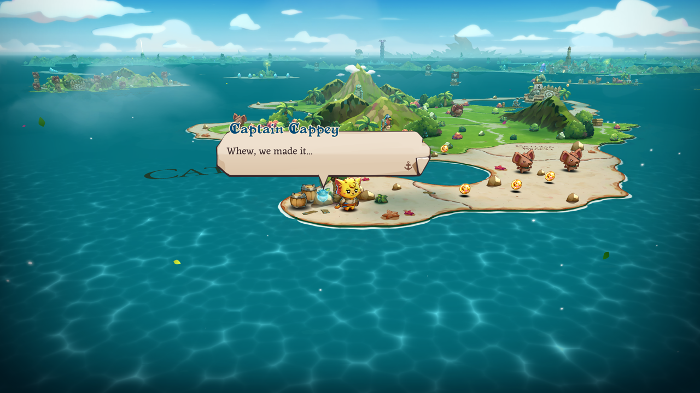

*Captain Cappey's dialogue remains readable over the rendered island scene.*

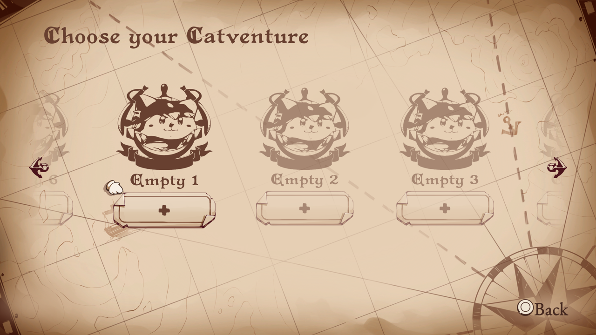

*Catventure selection now displays the slot artwork, labels, add buttons and
scroll arrows, with the clipping mask linked to the correct shader export.*

*September 29, 2026: an unedited capture of the actual game window. Separate
matched runs measure 6.21 FPS in the menu and 3.61 FPS in the tutorial.
Sample ranges overlap the controls; a repeatable FPS gain is not established.
30 FPS has not been reached. Output is 1920×1080, with larger internal targets.
Visual artifacts remain; full playability and long-session stability are unverified.*

*September 29, 2026: an unedited capture of the actual game window. Separate
matched runs measure 6.54 FPS in the menu and 3.61 FPS in the tutorial.
Sample ranges overlap the controls; a repeatable FPS gain is not established.
30 FPS has not been reached. Output is 1920×1080, with larger internal targets.
Visual artifacts remain; full playability and long-session stability are unverified.*

*September 29, 2026: an unedited 1765×993 capture from the actual game
window, after profiled flip 300. The default spare pool reuses compatible
Vulkan buffers after GPU completion. Separate matched samples measure 6.54 FPS
in the menu and 3.77 FPS in the tutorial; buffer creation and destruction time
in the tutorial falls from 28.8 to 15.8 ms. Frame ranges overlap, so a repeatable
FPS gain is not established. 30 FPS has not been reached. Output is 1920×1080,
with larger internal targets. Visual artifacts remain; full playability and
long-session stability are unverified.*

*September 29, 2026: an unedited 1765×993 capture of the actual game window,
about 67 seconds after launch following profiled flip 300. The HUD, windmills,
Move/Sprint prompts and a blue circular effect are visible. Separate matched
samples measure 6.37 FPS in the menu and 3.70 FPS in the tutorial. No game FPS
improvement is demonstrated. Longer isolated scalar-load fixtures are 9–45%
cheaper; short walks are effectively unchanged. 30 FPS has not been reached.
Output is 1920×1080, with larger internal targets. Visual artifacts remain;
full playability and long-session stability are unverified.*
